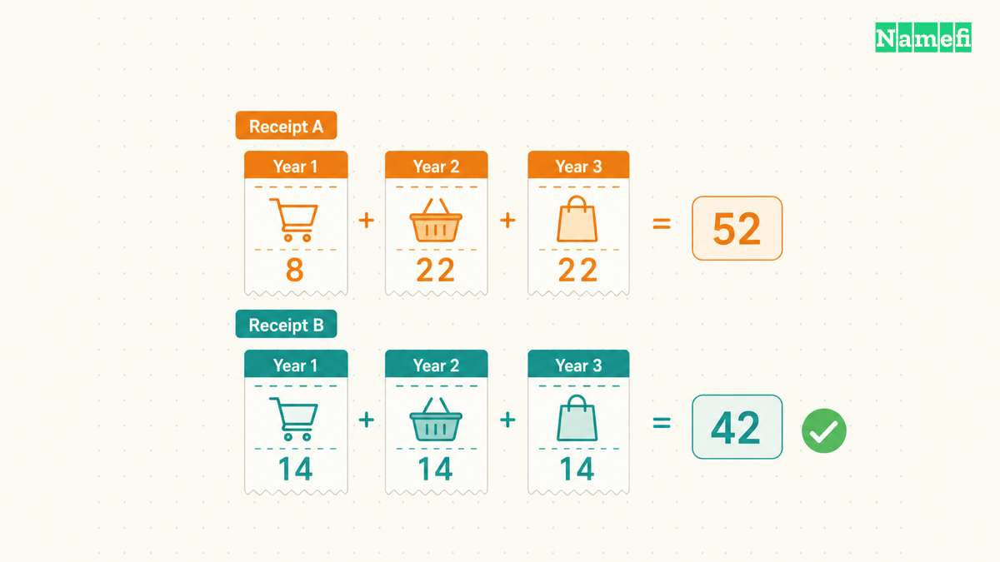
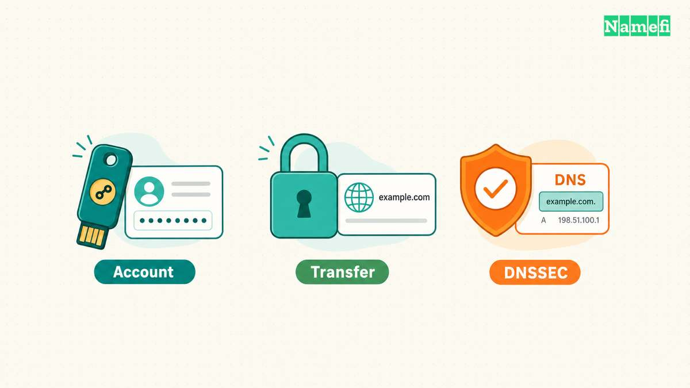
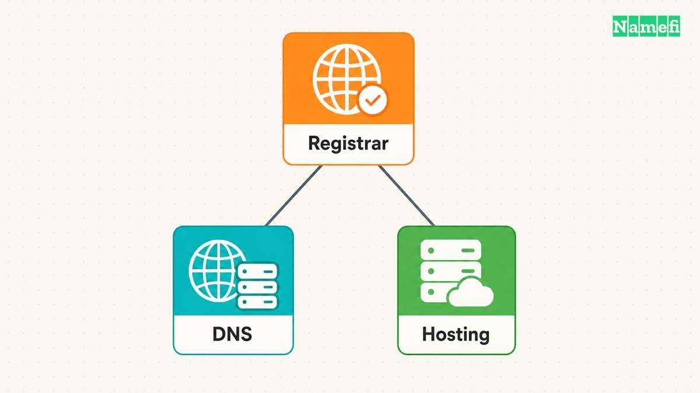

Der beste Domain-Anbieter erfüllt Ihre Anforderungen an die Verwaltung zu vertretbaren laufenden Kosten. Vergleichen Sie Verlängerungspreise, Kontowiederherstellung, DNS-Auswahl und Transferbedingungen, bevor Sie sich für einen Einstiegsrabatt entscheiden.

Ein [Registrar](/de/glossary/registrar/) übernimmt die Domainregistrierung. Eine [Registry](/de/glossary/registry/) führt die Datenbank einer Domainendung. Ein Verkäufer kann auch als Wiederverkäufer auftreten. ICANN erklärt, dass [Wiederverkäufer mit Registraren zusammenarbeiten](https://www.icann.org/resources/pages/domain-name-registration-process-2023-11-02-en). Lassen Sie sich den zuständigen Registrar und den Kontakt für Registrierungsprobleme nennen.

Prüfen Sie Anbieter für generische Endungen im [Verzeichnis akkreditierter Registrare von ICANN](https://www.icann.org/en/accredited-registrars). Die Akkreditierung bestätigt eine Rolle im Registrierungssystem. Die Akkreditierung zeigt nicht, welcher Anbieter zu Ihrem Budget und Ihren Verwaltungsanforderungen passt. Für Länderendungen gelten eigene Regeln der jeweiligen Registry. Prüfen Sie die konkrete Endung, statt sämtliche folgenden Regeln weltweit vorauszusetzen.

Erstellen Sie anhand Ihrer wichtigsten Anforderung eine Vorauswahl:

| Ihre Anforderung | Darauf kommt es an | Frage vor dem Kauf |
| --- | --- | --- |
| Eine private Domain | Planbare Verlängerung und praktikable Kontowiederherstellung | Was kostet das zweite Jahr? |
| Unternehmenswebsite und E-Mail | Kontozugriff, Verlängerungskontrolle und Unterstützung | Wer hilft bei einer Kontosperre außerhalb der Bürozeiten? |
| Getrennte DNS- oder Hosting-Anbieter | Freie Nameserver-Auswahl und dokumentierte Einrichtung | Kann ich meinen gewünschten autoritativen DNS-Anbieter nutzen? |
| Viele Domains oder Kundenkonten | Sammelaktionen, Datenexport und getrennte Zugänge | Können Beschäftigte Domains ohne das Inhaberpasswort verwalten? |

## Die Gesamtkosten bestimmen Ihr Domainbudget

Beginnen Sie mit der konkreten Endung und Registrierungskategorie. Vergleichen Sie eine normale Neuregistrierung mit anderen normalen Neuregistrierungen. Führen Sie separate Vergleiche für Premium-Domains und bereits registrierte Domains.

Addieren Sie für drei Jahre den Registrierungspreis, zwei jährliche Verlängerungen und notwendige Zusatzleistungen. Berücksichtigen Sie anfallende Steuern und Währungsumrechnungskosten. Behandeln Sie zukünftige Preise als Annahmen. Ein aktuelles Angebot garantiert keine zukünftigen Verlängerungspreise.

Die folgenden Zahlen veranschaulichen die Rechnung. Die Zahlen stammen aus keinem Anbieterangebot.

| Beispielangebot | Erstes Jahr | Angenommene jährliche Verlängerung | Dreijahressumme vor Zusatzleistungen |
| --- | --- | --- | --- |
| A | 8 $ | 22 $ | 52 $ |
| B | 14 $ | 14 $ | 42 $ |

Angebot A spart beim Kauf 6 $. Angebot B spart über die angenommenen drei Jahre 10 $. Bei vielen Domains gewinnen laufende Preisunterschiede an Bedeutung. Der [Leitfaden zu Domain-Haltekosten](/de/blog/how-much-is-a-domain-understanding-holding-cost/) erläutert die Budgetplanung über die Erstregistrierung hinaus.

Prüfen Sie die Preistabelle des Anbieters. Beispielsweise unterscheidet [Porkbun zwischen Registrierung, Verlängerung und Transfer](https://porkbun.com/products/domains). Kontrollieren Sie beim Kauf den Preis der konkreten Domain und eine mögliche Premium-Einstufung. Ein beworbener Einstiegspreis für eine Endung gilt nicht automatisch für jeden Namen.

Prüfen Sie die Kosten einer Verlängerung nach Ablauf und einer Wiederherstellung getrennt. ICANN verlangt für erfasste generische Domains die [Offenlegung entsprechender Gebühren](https://www.icann.org/resources/pages/errp-2024-02-21-en). Verlassen Sie sich bei der Planung nicht auf eine Rettungsfrist. Richten Sie die Verlängerungsüberwachung während der aktiven Registrierung ein.

Betrachten Sie jede Zusatzleistung als eigenes Produkt. Fragen Sie nach zusätzlichen Kosten für Datenschutzdienste, Postfächer, Weiterleitungen, DNS-Hosting und Webhosting. Nach einer kostenlosen Testphase kann sich die laufende Rechnung ändern. Behalten Sie nur benötigte Leistungen.

## Die Kontowiederherstellung ergänzt den Anmeldeschutz

Ein Sicherheitsvergleich braucht mehr als ein Schlosssymbol. Fragen Sie nach Anmeldeschutz, Kontowiederherstellung, Zugriffsrechten und Benachrichtigungen bei wichtigen Änderungen.

Die Dokumentation eines Anbieters kann konkrete Unterschiede zeigen. Beispielsweise beschreibt [Namecheap U2F mit Sicherheitsschlüsseln und TOTP mit Authentifizierungsanwendungen](https://www.namecheap.com/security/2fa-two-factor-authentication/). Prüfen Sie die verfügbaren Verfahren für das gewählte Konto. Prüfen Sie anschließend die Ersatzlösung bei einem Geräteausfall.

Vergleichen Sie Konten anhand folgender Fragen:

- Kann der Inhaber ein zusätzliches Authentifizierungsverfahren hinterlegen?
- Welche Nachweise verlangt der Kundendienst zur Kontowiederherstellung?
- Können Beschäftigte eigene Konten mit begrenzten Rechten nutzen?
- Welcher Kontakt erhält Meldungen zu Nameservern, Inhaberwechseln und Transfers?
- Kann das Unternehmen den Zugang beim Ausscheiden eines Beschäftigten behalten?

Unterscheiden Sie die Schutzmaßnahmen. Die Kontoauthentifizierung schützt die Anmeldung. Eine [Transfer-Sperre](/de/glossary/transfer-lock/) betrifft Registrarwechsel. [DNSSEC](/de/blog/dnssec-for-domain-owners/) [authentifiziert DNS-Daten](https://www.rfc-editor.org/rfc/rfc4033.html#section-3). Fragen Sie nach dem genauen Umfang jeder beworbenen Schutzmaßnahme. Der [Leitfaden zur Absicherung des Registrarkontos](/de/blog/harden-domain-registrar-account/) erläutert die betrieblichen Prüfungen.

Prüfen Sie Datenschutzdienste separat. Fragen Sie nach den verborgenen Kontaktfeldern für die konkrete Endung. Lesen Sie die Bedingungen des Datenschutzdienstes und das Verfahren zur Datenoffenlegung. Eine Datenschutzkennzeichnung belegt keine Kontosicherheit. Die Registrierung benötigt weiterhin korrekte Kontaktdaten.

Erfragen Sie für eine geschäftskritische Domain vor dem Kauf den Eskalationsweg beim Kundendienst. Prüfen Sie Erreichbarkeit, unterstützte Sprachen, Identitätsprüfungen und mögliche Kosten für Unterstützung. Ein veröffentlichter Kontaktweg belegt keine Antwortzeit. Eine normale Anfrage kann die Verständlichkeit testen. Eine einzelne Antwort belegt keine langfristige Zuverlässigkeit.

## Die DNS-Auswahl bestimmt Ihre Anbieterfreiheit

Registrierung, [DNS](/de/glossary/dns/), Webhosting und E-Mail erfüllen unterschiedliche Aufgaben. Ein Anbieter kann mehrere Leistungen gemeinsam verkaufen. Der [Vergleich von Domain und Hosting](/de/blog/domain-vs-hosting/) erklärt die Zuständigkeiten.

Fragen Sie nach der Nutzung Ihrer gewünschten autoritativen Nameserver. Beispielsweise [verlangt Cloudflare Registrar die Nutzung von Cloudflare als autoritativem DNS-Anbieter](https://developers.cloudflare.com/registrar/get-started/transfer-domain-to-cloudflare/). Die Vorgabe kann zu einem Projekt mit bestehender Cloudflare-DNS-Nutzung passen. Die Vorgabe passt nicht zu einem Projekt, das einen anderen autoritativen DNS-Anbieter behalten muss.

Prüfen Sie anschließend die konkreten Verwaltungsaufgaben. Kann der gewählte DNS-Dienst die benötigten Einträge für Hosting und E-Mail verwalten? Kann der Registrar bei externem DNS die erforderlichen DNSSEC-Delegationsdaten veröffentlichen? Können Sie die aktuellen DNS-Einträge vor einem Anbieterwechsel exportieren?

Für eine kleine Website kann eine gemeinsame Verwaltungsoberfläche den Aufwand senken. Für ein Team können getrennte Dienste Wahlmöglichkeiten bei einem Hostingwechsel erhalten. Beide Varianten benötigen dokumentierte Kontozugänge und eine klare Zuständigkeit für Verlängerungen.

Behandeln Sie Automatisierung als weitere Anforderung beim Kauf. Fragen Sie nach unterstützten API-Vorgängen, den Rechten eines API-Zugangs und nachvollziehbaren Aufzeichnungen bei Sammeländerungen. Eine DNS-API bedeutet nicht automatisch, dass der Anbieter Registrierungen automatisieren kann.

## Die Transferbedingungen bestimmen Ihren Anbieterwechsel

Lesen Sie während des Vergleichs die Anleitung zum ausgehenden Transfer. Suchen Sie die Entsperrfunktion, das Verfahren für den Autorisierungscode und mögliche Identitätsprüfungen. Unterscheiden Sie einen Registrarwechsel von einer Hostingkündigung. Die Kündigung eines unnötigen Hostingpakets darf keine weiterhin benötigte Domainregistrierung versehentlich beenden.

Für erfasste generische Domains legt ICANN [Vorgaben zum Zugang zu Autorisierungscodes und zur Entsperrung](https://www.icann.org/resources/pages/transfer-policy-2024-02-21-en) fest. Ohne entsprechende Selbstbedienungsfunktionen gilt für solche Anfragen eine Frist von fünf Kalendertagen. Die Richtlinie enthält außerdem Transferbeschränkungen nach kürzlich erfolgten Registrierungen, Transfers und Inhaberänderungen. Prüfen Sie die Voraussetzungen vor einem geplanten Wechsel. Der [Leitfaden zum Registrarwechsel](/de/blog/transfer-domain-to-another-registrar/) erklärt den Ablauf.

Stellen Sie vor dem Kauf diese abschließenden Fragen:

1. Unterstützt der Anbieter meine konkrete Endung und Registrierungskategorie?
2. Kann ich die laufenden Kosten ohne weitere Rabattaktion tragen?
3. Kann ich das Konto mit dokumentiertem Unternehmenszugang absichern und wiederherstellen?
4. Kann ich die benötigte Kombination aus DNS und Hosting nutzen?
5. Verstehe ich Verlängerung, Kündigung und Transfer vor dem Kauf?

Schließen Sie Anbieter aus, die eine notwendige Kontrollmöglichkeit nicht bieten. Vergleichen Sie die übrigen Anbieter anhand der Gesamtkosten und des Verwaltungsaufwands. Speichern Sie Angebot, Registrierungsvertrag und Supportanleitung zusammen mit den Domainunterlagen.

Wenn zwei Anbieter Ihre Anforderungen erfüllen, wählen Sie den Anbieter mit verständlichen Routineaufgaben für Ihre Domainverwaltung. Das Ziel ist eine zuverlässig verwaltbare Registrierung mit klarer Verlängerungszuständigkeit und praktikablem Wechselverfahren.

## Diese Quellen belegen den Vergleich

Die genannten Anbieter veranschaulichen dokumentierte Funktionen. Der Vergleich bewertet nicht sämtliche Registrare und erklärt keinen Anbieter zum allgemeinen Sieger.

- [ICANN: Ablauf einer Domainregistrierung](https://www.icann.org/resources/pages/domain-name-registration-process-2023-11-02-en). Aufgaben von Registrar, Registry und Wiederverkäufer. Abgerufen am 21.10.2026.
- [ICANN: Verzeichnis akkreditierter Registrare](https://www.icann.org/en/accredited-registrars). Umfang der Akkreditierung. Abgerufen am 21.10.2026.
- [Porkbun: Domainpreise](https://porkbun.com/products/domains). Getrennte Preiskategorien. Abgerufen am 21.10.2026.
- [ICANN: Richtlinie zur Wiederherstellung abgelaufener Registrierungen](https://www.icann.org/resources/pages/errp-2024-02-21-en). Gebührenoffenlegung, Abschnitt 4.1. Abgerufen am 21.10.2026.
- [Namecheap: Zwei-Faktor-Authentifizierung](https://www.namecheap.com/security/2fa-two-factor-authentication/). U2F- und TOTP-Verfahren. Abgerufen am 21.10.2026.
- [Cloudflare: Domain zu Cloudflare übertragen](https://developers.cloudflare.com/registrar/get-started/transfer-domain-to-cloudflare/). Vorgabe zum autoritativen DNS. Abgerufen am 21.10.2026.
- [ICANN: Transferrichtlinie](https://www.icann.org/resources/pages/transfer-policy-2024-02-21-en). Abschnitte I.A.3, I.A.5 und II.C. Abgerufen am 21.10.2026.
- [IETF: RFC 4033](https://www.rfc-editor.org/rfc/rfc4033.html#section-3). Authentifizierung von DNS-Daten, Abschnitt 3. Abgerufen am 21.10.2026.
