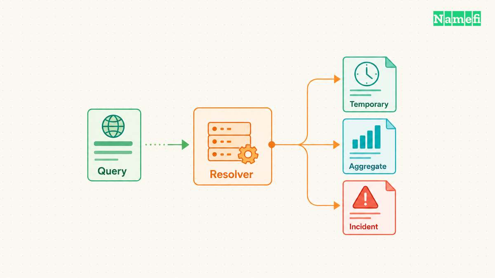
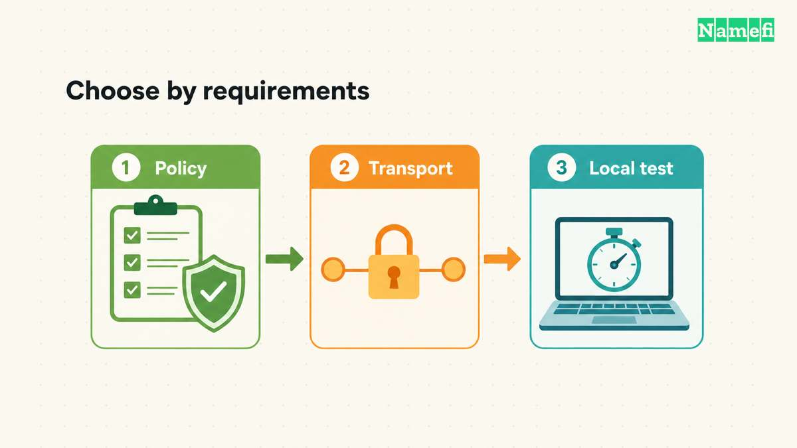
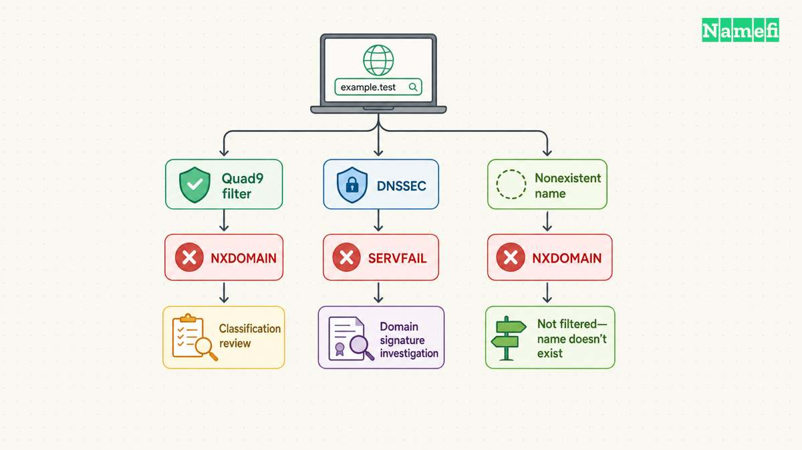

Beginnen Sie mit den gewünschten Regeln. Wählen Sie danach einen Resolver und [prüfen Sie die gesamte Verbindung](/de/blog/isp-dns-vs-public-resolver/). Eine einprägsame Adresse allein entscheidet die Auswahl nicht.

Der Standarddienst von Cloudflare eignet sich als Ausgangspunkt für Leser, die einen dokumentierten Dienst ohne Inhaltsfilter suchen. Der sichere Dienst von Quad9 richtet sich an Leser, die Bedrohungen blockieren möchten. Google Public DNS bietet eine weitere dokumentierte Möglichkeit mit DNSSEC-Validierung und verschlüsselten Übertragungsverfahren. Die Auswahl hängt von den Anforderungen ab. Eine allgemeingültige Rangliste ergibt sich daraus nicht.

Ein geeigneter Dienst muss im Alltag funktionieren: im Browser, bei Videokonferenzen, mit dem Firmen-VPN und in einem Netzwerk, das die gewählte verschlüsselte Verbindung blockiert. Der folgende Ablauf vergleicht drei öffentliche Dienste. Der Ablauf zeigt außerdem, wie Sie eine Änderung mit Rückkehrmöglichkeit prüfen. Der Artikel bewertet nicht alle verfügbaren Resolver.

## Die Resolver-Auswahl bestimmt den Dienst für die DNS-Anfragen Ihres Geräts

Das [DNS](/de/glossary/dns/) liefert Informationen zu Namen. Dazu gehören Adressen, die Anwendungen für Verbindungen benötigen. Ein [DNS-Resolver (Rekursiver Resolver)](/de/glossary/dns-resolver/) beschafft Antworten für Clients und kann zwischengespeicherte Informationen wiederverwenden. Fehlen lokal ausreichende Informationen, folgt der Resolver Verweisen. [RFC 1034 beschreibt den Ablauf](https://www.rfc-editor.org/rfc/rfc1034.html#section-5.3.3).

Ein anderer Resolver auf dem Gerät wählt einen anderen Dienst für Namensabfragen. Andere autoritative Nameserver einer Domain ändern dagegen den Veröffentlichungsort der DNS-Informationen. Eine öffentliche Resolver-Einstellung kann keinen fehlenden Eintrag an der autoritativen Quelle reparieren. Die Unterscheidung hilft, wenn eine Website unmittelbar nach einer Domainänderung ausfällt.

Schreiben Sie zuerst eine Anforderung in einfacher Sprache auf. Zum Beispiel: „Ich möchte verschlüsselte Abfragen ohne Inhaltsfilter.“ Oder: „Ich möchte einen Resolver, der bekannte schädliche Domains blockiert.“ Eine weitere Anforderung kann den Zugriff auf interne Firmennamen über ein verwaltetes VPN erhalten. Jede Anforderung führt zu anderen Einstellungen, selbst wenn mehrere Anbieter dasselbe Übertragungsverfahren unterstützen.

Trennen Sie vor dem Anbietervergleich vier Fragen. Wer erhält die Anfrage? Verschlüsselt der Client die Verbindung? Prüft der Resolver signierte DNS-Daten? Wendet der ausgewählte Dienst einen Filter an? Der Anbietername allein beantwortet keine der vier Fragen vollständig.

[DNSSEC (Domain Name System Security Extensions)](/de/glossary/dnssec/) authentifiziert signierte DNS-Daten und schützt die Integrität. DNSSEC verschlüsselt keine Anfragen und bewertet nicht die Vertrauenswürdigkeit einer Website. [RFC 4033 beschreibt die Grenzen](https://www.rfc-editor.org/rfc/rfc4033.html#section-4). Ein korrekt signierter Eintrag kann weiterhin auf eine schädliche Website zeigen, die der Domainbetreiber absichtlich veröffentlicht hat.

Verschlüsseltes DNS schützt eine andere Verbindung. DNS over TLS sichert die Verbindung zwischen Client und Resolver. [RFC 7858 legt das Verfahren fest](https://www.rfc-editor.org/rfc/rfc7858.html#section-1). Der Resolver muss die Anfrage weiterhin verarbeiten. Die Verschlüsselung ersetzt deshalb keine Prüfung der Datenschutzregeln des Betreibers.

Auch die Client-Konfiguration zählt. Ein Browser kann einen eigenen verschlüsselten Resolver wählen, während eine andere Anwendung den Resolver des Betriebssystems nutzt. Mozilla dokumentiert die [Schutzstufen und Ersatzverbindungen des Browsers](https://support.mozilla.org/en-US/kb/dns-over-https#w_protection-levels-explained). Ein erfolgreicher Browsertest beweist nicht, dass alle Anwendungen denselben Weg verwenden.

Beginnen Sie bei einem verwalteten Arbeitsgerät mit der Konfiguration der Administration. Behandeln Sie die erforderliche Auflösung interner Namen als Vergleichskriterium. Ein öffentlicher DNS-Dienst kann für ein privates Gerät sinnvoll sein. Daraus folgt keine Eignung für jede Arbeitsplatzkonfiguration.

## Die Regeln der Anbieter begrenzen die praktische Auswahl

Vergleichen Sie die genaue Dienstvariante. Der Standard-Resolver von Cloudflare verwendet keine Inhaltsfilter. Cloudflare bietet getrennte Families-Dienste mit Schadsoftwarefilter und mit zusätzlichem Filter für Erwachseneninhalte an. Die [offizielle Adressliste nennt die Varianten](https://developers.cloudflare.com/1.1.1.1/ip-addresses/).

Die folgende Auswahl enthält dokumentierte Möglichkeiten. Die letzte Spalte nennt die Prüfung vor dem Einsatz.

| Dienst | Geeigneter Ausgangspunkt | Zuerst prüfen |
| --- | --- | --- |
| Cloudflare Standard | Keine Inhaltsfilter | Protokollierung und Verschlüsselung |
| Cloudflare Families | Kategorienfilter | Richtige Filtervariante |
| Quad9 sicher | Blockierung von Bedrohungen | Umgang mit Fehlalarmen |
| Google Public DNS | Validierendes öffentliches DNS | Datenschutzregeln und lokale Tests |

Verwenden Sie das genaue Adresspaar des gewählten Dienstes. Die Tabelle enthält Cloudflare Standard, den sicheren Quad9-Dienst und Google Public DNS.

| Dienst | IPv4-Adressen | IPv6-Adressen | DoT-Hostname |
| --- | --- | --- | --- |
| Cloudflare Standard | `1.1.1.1`, `1.0.0.1` | `2606:4700:4700::1111`, `2606:4700:4700::1001` | `one.one.one.one` |
| Quad9 sicher | `9.9.9.9`, `149.112.112.112` | `2620:fe::fe`, `2620:fe::9` | `dns.quad9.net` |
| Google Public DNS | `8.8.8.8`, `8.8.4.4` | `2001:4860:4860::8888`, `2001:4860:4860::8844` | `dns.google` |

Die Anbieter veröffentlichen die [Cloudflare-Adressen](https://developers.cloudflare.com/1.1.1.1/ip-addresses/), die [Quad9-Einstellungen](https://docs.quad9.net/services/#9999-secure) und die [Google-Adressen](https://developers.google.com/speed/public-dns/docs/using#google_public_dns_ip_addresses). Cloudflare dokumentiert den [DoT-Hostnamen](https://developers.cloudflare.com/1.1.1.1/encryption/dns-over-tls/#how-it-works). Google dokumentiert die [verschlüsselten Endpunkte](https://developers.google.com/speed/public-dns/docs/secure-transports#endpoints). Quad9 führt die verschlüsselten Endpunkte in der Diensttabelle auf.

Bei Cloudflare Families lautet das IPv4-Paar für den Schadsoftwarefilter `1.1.1.2` und `1.0.0.2`. Das Paar für Schadsoftware und Erwachseneninhalte lautet `1.1.1.3` und `1.0.0.3`. Verwenden Sie für verschlüsseltes DNS die Anleitung der jeweiligen Dienstvariante. Der Endpunkt des Standarddienstes wählt keinen Families-Filter aus.

Ein gewöhnliches DNS-Adressfeld erwartet eine IP-Adresse. Ein DoT-Hostname-Feld erwartet den Hostnamen des Anbieters. Ein Feld für benutzerdefiniertes DoH erwartet einen unterstützten HTTPS-Endpunkt des Anbieters. Eine IP-Adresse allein aktiviert keine Verschlüsselung. Der [Vergleich von DoH und DoT](/de/blog/dns-over-https-vs-dns-over-tls/) erläutert den Unterschied.

## Datenschutzvergleiche müssen Datenfelder und Ausnahmen unterscheiden

Jeder Anbieter legt eigene Erfassungsregeln für die dargestellten Datenkategorien fest.

Auch eine verschlüsselte Verbindung übermittelt die Anfrage an den Resolver. Vergleichen Sie gespeicherte Daten, Speicherfristen, Weitergaben und Ausnahmen getrennt. Die Aussage „keine Protokolle“ beschreibt nicht jede Datenkategorie.

| Anbieterrichtlinie | Gewöhnlicher Umgang mit Adressen | Mögliche dauerhafte Daten | Zu prüfende Ausnahme |
| --- | --- | --- | --- |
| Öffentlicher Cloudflare-Resolver | Gekürzte Adressen verfallen innerhalb von 25 Stunden | Begrenzte Stichproben für Auswertungen und unbefristete zusammengefasste Statistiken | Zufällige Stichproben von Netzwerkpaketen |
| Google Public DNS | Vorübergehende Protokolle verbinden Client-Adressen mit Anfragen | Dauerhafte Stichproben ersetzen Adressen durch Stadt oder Region | Speicherung bei Sicherheits- und Missbrauchsfällen |
| Quad9 | Die normale Verarbeitung hält Antwortadressen im flüchtigen Arbeitsspeicher | Zusammengefasste Zähler und Statistiken zu abgefragten Namen | Diagnosedaten bei außergewöhnlichen Bedingungen |

Cloudflare nennt abgefragte Namen, Zeitstempel, Antwortdetails, Netzwerknummern und Länder als Resolver-Protokollfelder. Cloudflare sagt die Löschung gewöhnlicher Resolver-Protokolle innerhalb von 25 Stunden zu. Begrenzte Stichproben für zusammengefasste Auswertungen fallen nicht unter diese Regel. Zusammengefasste Daten darf Cloudflare unbefristet speichern. Cloudflare erlaubt außerdem zufällige Paketstichproben aus höchstens 0,05 % des Verkehrs zur eigenen Netzwerkinfrastruktur. Die Ausnahme dient der Fehlerdiagnose und der Abwehr von Überlastungsangriffen. APNIC erhält Zugriff auf anonymisierte Abfragemetadaten einschließlich abgefragter Namen, jedoch nicht auf Client-IP-Adressen. Prüfen Sie [Cloudflares vollständige Datenkategorien](https://developers.cloudflare.com/1.1.1.1/privacy/public-dns-resolver/), bevor Sie 25 Stunden als allgemeine Speichergrenze verstehen.

Googles vorübergehende Protokolle enthalten Client-Adressen und Abfragedetails. Google unterzieht die Protokolle innerhalb von 24–48 Stunden Löschverfahren. Sicherheits- und Missbrauchsfälle erlauben längere Speicherung. Dauerhafte Stichproben ersetzen Adressen durch Stadt- oder Regionsangaben. Die dauerhaften Felder umfassen abgefragte Namen, Zeitstempel, Übertragungsverfahren und die Nummer des autonomen Systems des Clients. Google schließt die Nutzung persönlicher DNS-Daten für gezielte Werbung aus. Die Zusage gegen eine Verknüpfung mit persönlichen Daten anderer Google-Dienste enthält ebenfalls eine Ausnahme für Sicherheits- und Missbrauchsfälle. Die [Richtlinie von Google Public DNS](https://developers.google.com/speed/public-dns/privacy) nennt die Grenzen getrennt.

Quad9s normale Richtlinie hält Antwortadressen während der Verarbeitung oder der zustandsbehafteten Verbindung im flüchtigen Arbeitsspeicher. Laut Quad9 speichert der Dienst keine Nutzer-IP-Adressen oder Ersatzmerkmale zur Identifizierung einzelner Personen dauerhaft. Quad9 darf zusammengefasste Zähler und Statistiken zu abgefragten Namen dauerhaft aufbewahren. Quad9 darf außerdem zusammengefasste Verkehrsübersichten lizenzieren, auch gegen Entgelt, ohne personenbezogene Informationen weiterzugeben. Die Zusagen betreffen unterschiedliche Datenklassen. Die [normale Quad9-Richtlinie](https://quad9.net/privacy/policy/) erläutert die Unterschiede.

Quad9s [Richtlinie für außergewöhnliche Bedingungen](https://quad9.net/privacy/anomalous-conditions/) umfasst neben Angriffen und missbräuchlicher Nutzung auch Softwarefehler und Protokollfehler. Die Diagnose kann zugehörige IP-Adressen erfassen. Anfragen mit Bezug zur ermittelten Ursache können einschließlich Quelladressen, Namen und Zeitstempeln in dauerhafte Archive gelangen. Die knappe Aussage „speichert niemals Adressen“ benötigt deshalb die Einschränkung auf normale Bedingungen.

Bestimmen Sie die Anforderung vor der Anbieterwahl. Eine Anforderung gegen routinemäßige dauerhafte Nutzeradressprotokolle unterscheidet sich von einer Anforderung gegen dauerhafte zusammengefasste Statistiken. Eine Anforderung gegen die Speicherung von Vorfallsdaten erfordert einen weiteren Vergleich. Keine der Richtlinien garantiert Anonymität. Der Resolver sieht die Anfrage weiterhin während der Verarbeitung.

Google dokumentiert ausdrücklich die [DNSSEC-Unterstützung](https://developers.google.com/speed/public-dns/docs/security#dnssec). Quad9 beschreibt DNSSEC-Fehler in der Anleitung zur Fehlerbehebung. Prüfen Sie die aktuelle Dokumentation der gewählten Variante. Nicht jede Adresse eines Betreibers muss dasselbe Verhalten aufweisen.

## Die Anforderungen bestimmen die Kandidaten für den Test

Die Regeln des Dienstes stehen an erster Stelle. Danach folgt das unterstützte Übertragungsverfahren. Die lokalen Ergebnisse entscheiden die endgültige Auswahl. Prüfen Sie die folgenden Punkte vor einer Routeränderung.

| Anforderung | Kandidat für den Test | Abnahmekriterium |
| --- | --- | --- |
| Öffentliches DNS ohne Inhaltsfilter | Cloudflare Standard oder Google Public DNS | Erforderliche öffentliche Namen funktionieren und die Datenschutzregeln passen |
| Blockierung von Bedrohungen | Quad9 sicher oder Cloudflare Families mit Schadsoftwarefilter | Der genaue Filter funktioniert und das Korrekturverfahren ist akzeptabel |
| Filter für Erwachseneninhalte | Cloudflare Families mit Filter für Erwachseneninhalte | Der gewünschte Kategorienfilter funktioniert auf dem Testgerät |
| Verschlüsselte Abfragen | Ein dokumentierter, vom Client unterstützter DoH- oder DoT-Endpunkt | Der konfigurierte Weg verwendet Verschlüsselung und akzeptable Ersatzverbindungen |
| Interne Arbeitsplatznamen | Die von der Administration freigegebene Konfiguration | Erforderliche interne Namen funktionieren über den freigegebenen Weg |

Ein Haushalt kann einen einfachen Ablauf verwenden:

1. Schreiben Sie die erforderlichen Filterregeln auf.
2. Wählen Sie zwei Kandidaten mit denselben passenden Eigenschaften.
3. Prüfen Sie das vom Client unterstützte verschlüsselte Übertragungsverfahren.
4. Testen Sie beide Kandidaten auf demselben Gerät und Anschluss.
5. Behalten Sie den Kandidaten, der die Anforderungen zuverlässig erfüllt.

Testen Sie die Leistung lokal zu mehreren Zeitpunkten. Googles [Leistungserklärung](https://developers.google.com/speed/public-dns/docs/performance#introduction_causes_and_mitigations_of_dns_latency) unterscheidet Netzwerkverzögerungen von fehlenden Cache-Einträgen. Ein für das Gerät neuer Name kann bereits im Cache eines öffentlichen Resolvers stehen. Eine erste Abfrage beweist deshalb keinen leeren Resolver-Cache.

Notieren Sie Hostnamen, Eintragstyp, gewählten Dienst, Übertragungsverfahren, Antwortcode, Abfragedauer, Zeitpunkt und Netzwerk. Trennen Sie Ergebnisse der ersten Abfrage von wiederholten Abfragen. Vergleichen Sie Ausfälle vor kleinen Zeitunterschieden. Der Artikel enthält keine Messungen, die einen weltweit schnellsten DNS-Server belegen.

Ein DNS-Geschwindigkeitstest misst die Namensabfrage. Erfassen Sie die Anwendungsergebnisse in einer eigenen Spalte. Testen Sie die Anwendungen, die Sie tatsächlich benötigen. Der [Leitfaden für lokale DNS-Benchmarks beim Spielen](/de/blog/benchmark-dns-for-gaming/) beschreibt das Messverfahren ausführlicher.

## Filter und Validierung erfordern unterschiedliche Maßnahmen zur Fehlerbehebung

Bedrohungsfilter und DNSSEC-Validierung können eine Abfrage stoppen. Die passende Reaktion unterscheidet sich jedoch. Ein Filterdienst kann einen Namen wegen einer Einstufung als schädlich ablehnen. Ein validierender Resolver kann signierte Daten ablehnen, wenn die Prüfung die Echtheit nicht nachweisen kann.

Quad9 dokumentiert einen konkreten Unterschied. Ein blockierter Name kann `NXDOMAIN` ergeben. Ein Fehler bei der DNSSEC-Authentifizierung ergibt `SERVFAIL`. Auch ein tatsächlich nicht vorhandener Name kann `NXDOMAIN` ergeben. Lesen Sie Quad9s [Anleitung zum Erkennen einer Blockierung](https://docs.quad9.net/FAQs/#identifying-a-quad9-block). Nutzen Sie auch das Prüfwerkzeug für blockierte Domains, bevor Sie eine allgemeine Browserfehlermeldung bewerten.

Verwenden Sie die Beobachtungen nicht als allgemeingültige Fehlerübersetzung. `SERVFAIL` kann andere Ursachen als Validierungsprobleme haben. Eine Resolver-Antwort beschreibt ein Abfrageergebnis. Die Antwort erklärt nicht vollständig den Zustand einer Website. Googles [Anleitung zur Fehlerbehebung](https://developers.google.com/speed/public-dns/docs/troubleshooting#problems_resolving_a_domain) bietet weitere Diagnosen für Validierungs- und Nameserverprobleme.

Betrachten Sie einen beispielhaften Haushalt mit Bedrohungsfilter. Eine benötigte Website lädt nicht mehr, während andere Websites funktionieren. Notieren Sie den vollständigen Hostnamen und prüfen Sie den Diagnosedienst des Anbieters. Prüfen Sie bei bestätigter Blockierung die Website, bevor Sie eine Korrektur der Einstufung beantragen. Ein automatischer Wechsel zu einem ungefilterten Dienst würde die ursprüngliche Anforderung des Haushalts aufgeben.

Betrachten Sie nun einen beispielhaften Domaininhaber mit Validierungsfehlern bei einer signierten Domain. Der Domaininhaber sollte die DNSSEC-Konfiguration zusammen mit dem DNS-Betreiber untersuchen. Der Domaininhaber sollte die Validierung für gewöhnliches Surfen beibehalten. Eine andere Filterregel kann eine fehlerhaft konfigurierte Domain erreichbar machen. Die andere Filterregel repariert das Signaturproblem nicht.

DNS-Filter besitzen außerdem eine begrenzte Genauigkeit. DNS-Abfragen betreffen Namen. Die Resolver-Auswahl prüft deshalb weder sämtliche Seiteninhalte noch das gesamte Anwendungsverhalten. Behandeln Sie DNS-Filter als einen Bestandteil der Gerätekonfiguration. Ein Bedrohungsfilter erkennt nicht zwangsläufig jedes schädliche Ziel.

Legen Sie fest, wer einen Fehlalarm bearbeiten kann. In einem Haushalt kann eine Person die Meldungen prüfen. Ein kleines Büro benötigt gegebenenfalls einen Supportkontakt und ein dokumentiertes Ausnahmeverfahren. Berücksichtigen Sie den Betriebsaufwand neben dem erklärten Zweck des Filters.

Prüfen Sie auch optionale Datenweitergaben. Quad9s [ECS-Erklärung](https://docs.quad9.net/FAQs/#what-is-edns-client-subnet-ecs) beschreibt eine Variante, die einen Teil der Client-Adresse an autoritative Server weitergibt. Die Informationen können Inhaltsanbietern bei der Auswahl geografisch passender Antworten helfen. Die Variante verändert zugleich die Datenweitergabe an vorgelagerte Stellen. Wählen Sie eine ECS-Variante bewusst. Kopieren Sie nicht einfach eine benachbarte Adresse aus einer Vergleichstabelle.

Unterschiedliche Antworten beweisen nicht automatisch [DNS-Hijacking](/de/glossary/dns-hijacking/). Filterregeln, ein noch gültiger Cache-Eintrag oder unterschiedliche autoritative Konfigurationen können das Ergebnis erklären. Vergleichen Sie die Belege vor der Ursachenzuordnung. Melden Sie einen vermuteten Eingriff mit Hostnamen, Antwort, Zeitpunkt und Netzwerkdetails.

## Ein rückgängig machbarer Test prüft Resolver und Ersatzverbindungen

Beginnen Sie auf einem privaten Gerät, das einen Konfigurationstest verträgt. Speichern Sie die aktuellen DNS-Einstellungen. Notieren Sie auch, ob das Netzwerk DNS automatisch vorgibt. Google empfiehlt ausdrücklich das [Sichern der bisherigen Einstellungen](https://developers.google.com/speed/public-dns/docs/using#important_before_you_start). Halten Sie die Wiederherstellungsanleitung ohne funktionierende DNS-Abfrage zugänglich.

Wählen Sie für den ersten Test eine Konfigurationsebene: Browser, Betriebssystem oder Router. Notieren Sie die Ebene, damit der Test einen klaren Geltungsbereich besitzt. Router-Einstellungen können andere Personen betreffen. Erweitern Sie den Test deshalb erst, wenn das einzelne Gerät funktioniert. Folgen Sie aktuellen Herstelleranleitungen statt Anleitungen für eine andere Betriebssystemversion.

Prüfen Sie IPv4 und IPv6 getrennt, wenn das Gerät getrennte DNS-Einstellungen anbietet. Die Anbieterdokumentation enthält Adressen für beide Protokollfamilien. Prüfen Sie außerdem die sicheren DNS-Einstellungen des Browsers und das VPN-Verhalten. Ein Gerät kann mehrere relevante Einstellungen besitzen. Ein Bildschirmfoto eines einzelnen Feldes beweist nicht den Weg jeder Anfrage.

Für einen einfachen Vergleich können Sie, sofern verfügbar, `nslookup example.com 9.9.9.9` und `nslookup example.com 8.8.8.8` verwenden. Die Befehle fragen bestimmte Server ab, ohne gespeicherte Einstellungen zu ändern. Die Ergebnisse sind direkte Abfragetests. Die Befehle beweisen weder die Nutzung des getesteten Dienstes durch den Browser noch eine verschlüsselte Übertragung.

Quad9 bietet einen eigenen Protokolltest. Die Abfrage `dig +short txt proto.on.quad9.net.` kann zeigen, wie Quad9 die Anfrage erhalten hat. Der [offizielle Protokolltest](https://docs.quad9.net/FAQs/#protocol-test-confirm-on-which-protocol-quad9-received-your-query) nennt Antworten für unverschlüsseltes DNS, DoH und DoT. Führen Sie den Test über den konfigurierten Systemweg aus. Bewerten Sie das Ergebnis nur für den geprüften Weg.

Prüfen Sie nach der Konfiguration gewöhnliche Aufgaben. Öffnen Sie erforderliche Websites, verbinden Sie das VPN erneut und testen Sie eine weitere Anwendung mit Namensauflösung. Wiederholen Sie die Prüfungen nach einem Netzwerkwechsel. Ein kontrollierter Test sollte auch die Rückkehr zu den gesicherten Einstellungen enthalten. So prüfen Sie die Wiederherstellung praktisch.

Lesen Sie die Fehlerregeln des Clients, bevor Sie sich auf Verschlüsselung verlassen. Der Standardschutz von Firefox kann bei Problemen auf die Standard-Resolver zurückgreifen. Der maximale Schutz zeigt dagegen eine Warnung, wenn die sichere Auflösung scheitert. [Mozilla dokumentiert die Unterschiede](https://support.mozilla.org/en-US/kb/dns-over-https#w_protection-levels-explained). Wählen Sie Verfügbarkeit oder strikt verschlüsselte Auflösung bewusst. Prüfen Sie das entsprechende Verhalten im tatsächlich verwendeten Client.

Halten Sie alternative Server mit den gewünschten Regeln vereinbar, sofern der Client keine genauere Regelung unterstützt. Ein ungefilterter Ersatzserver erhält keine durchgängige Filteranforderung. Eine unverschlüsselte Ersatzverbindung erhält keine durchgängige Verschlüsselungsanforderung. Dokumentieren Sie das akzeptable Fehlerverhalten vor dem Hinzufügen eines zweiten Anbieters.

Berücksichtigen Sie zuletzt zwischengespeicherte Antworten. Die [TTL (Time to Live)](/de/glossary/ttl/) begrenzt die gewöhnliche Wiederverwendung im Cache. Google dokumentiert außerdem die Diagnose veralteter Antworten nach DNS-Änderungen. Vergleichen Sie den genauen Hostnamen und Eintragstyp, bevor Sie einen Fehler des neuen Dienstes annehmen. Stellen Sie bei gestörtem erforderlichem Zugriff die bisherigen Einstellungen wieder her. Untersuchen Sie danach die gespeicherten Beobachtungen.

Das Ergebnis sollte ein kurzer Konfigurationsnachweis sein: gewählter Dienst, genaue Variante, Übertragungsverfahren, Konfigurationsebene, Ersatzverhalten und Wiederherstellungsverfahren. Der Nachweis liefert eine tragfähigere Grundlage für die weitere Nutzung als eine Geschwindigkeitsrangliste oder eine bekannte Adresse.

## Die Quellen belegen die Angaben des Artikels

Die Datenschutzrichtlinien wurden am 22. Oktober 2026 UTC erneut abgerufen. Die übrigen Quellen wurden am 21. Oktober 2026 UTC abgerufen. Produktregeln und Plattformverhalten können sich ändern.

- Cloudflare: [IP-Adressen](https://developers.cloudflare.com/1.1.1.1/ip-addresses/), „1.1.1.1“ und „1.1.1.1 for Families“.
- Cloudflare: [Datenschutz des öffentlichen DNS-Resolvers](https://developers.cloudflare.com/1.1.1.1/privacy/public-dns-resolver/), Datenschutzzusagen und Datenweitergabe an APNIC.
- Google: [Datenschutz](https://developers.google.com/speed/public-dns/privacy), vorübergehende und dauerhafte DNS-Protokolle.
- Google: [Einrichtung](https://developers.google.com/speed/public-dns/docs/using), Vorbereitung und IP-Adressen.
- Google: [Sicherheitsvorteile](https://developers.google.com/speed/public-dns/docs/security#dnssec), DNSSEC und verschlüsselte Übertragungsverfahren.
- Quad9: [Dienste](https://docs.quad9.net/services/), sicherer Dienst und weitere Varianten.
- Quad9: [Außergewöhnliche Bedingungen](https://quad9.net/privacy/anomalous-conditions/), Diagnoseerfassung und dauerhafte Vorfallsarchive.
- Quad9: [Daten- und Datenschutzrichtlinie](https://quad9.net/privacy/policy/), Geltungsbereich und Umgang mit IP-Adressen.
- Quad9: [Häufige Fragen](https://docs.quad9.net/FAQs/), Protokolltest, Erkennung von Blockierungen und ECS.
- Mozilla: [DoH-Schutzstufen in Firefox](https://support.mozilla.org/en-US/kb/dns-over-https#w_protection-levels-explained).
- IETF: [RFC 4033](https://www.rfc-editor.org/rfc/rfc4033.html#section-4), Abschnitte 3–5 und 12.
- IETF: [RFC 7858](https://www.rfc-editor.org/rfc/rfc7858.html#section-1), Einführung und TLS-Verbindungen.
- IETF: [RFC 1034](https://www.rfc-editor.org/rfc/rfc1034.html#section-5.3.3), Resolver-Ablauf und Cache-Verhalten.
- Google: [Leistungsvorteile](https://developers.google.com/speed/public-dns/docs/performance), Netzwerkverzögerungen und fehlende Cache-Einträge.
- Cloudflare: [DNS over TLS](https://developers.cloudflare.com/1.1.1.1/encryption/dns-over-tls/), Hostname des Standarddienstes.
- Google: [Sichere Übertragungsverfahren](https://developers.google.com/speed/public-dns/docs/secure-transports#endpoints), DoH- und DoT-Endpunkte.
- Google: [Fehlerbehebung](https://developers.google.com/speed/public-dns/docs/troubleshooting), Domainfehler und falsche Antworten.
