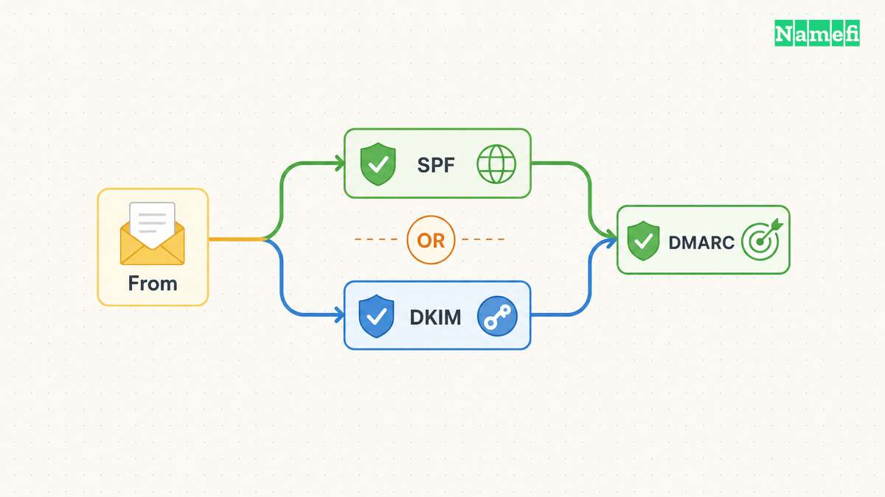
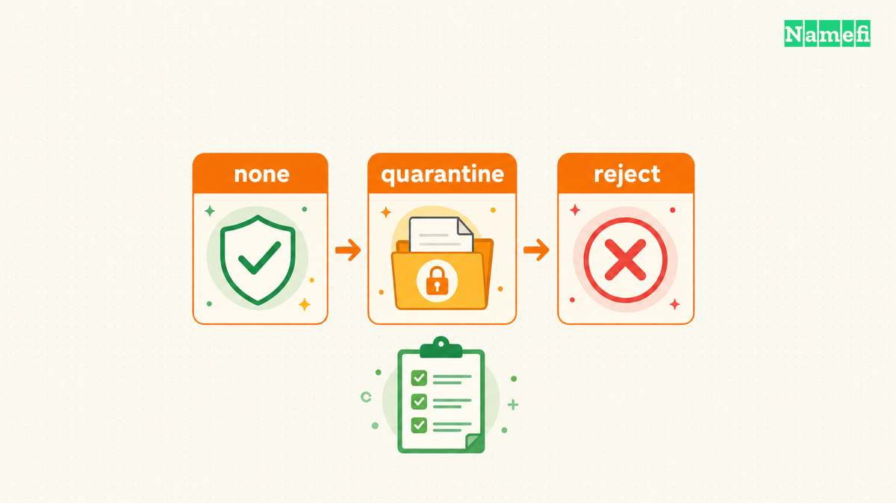

**Ein DMARC-Eintrag beschreibt, wie empfangende Mailserver nach dem Wunsch des Domaininhabers mit Nachrichten umgehen sollen, die DMARC nicht bestehen.** DMARC vergleicht die sichtbare Absenderdomäne mit authentifizierten Absenderdomänen. Ein veröffentlichter Eintrag allein sorgt nicht dafür, dass jeder Versanddienst die Prüfung besteht. [Das Protokoll definiert die Prüfung, die Behandlung und die Berichterstattung](#der-standard-definiert-den-domänenabgleich-und-die-richtlinie).

Verwenden Sie diese Anleitung nach der [Einrichtung von E-Mail mit einer eigenen Domain](/de/blog/set-up-email-with-your-own-domain/). Erfassen Sie alle Versanddienste, einschließlich Supportsoftware, Newsletter, Rechnungsdienste und Websiteformulare. Behalten Sie eine bestehende Durchsetzungsrichtlinie während der Untersuchung bei. Die folgenden Beispiele beschreiben eine neue Einrichtung für die reservierte Domain `example.com`.

## DMARC erfordert Authentifizierung und einen Domänenabgleich

SPF und DKIM liefern unterschiedliche authentifizierte Kennungen. SPF prüft normalerweise die Domäne des SMTP-Umschlagabsenders. DKIM prüft eine Signatur mit einer Signaturdomäne. DMARC vergleicht diese Kennungen mit der Domäne im sichtbaren From-Feld der Nachricht. **Ein erfolgreiches Verfahren mit passendem Domänenabgleich genügt für DMARC.** Ein erfolgreiches Ergebnis für eine fremde Domäne genügt nicht. [RFC 9989 definiert den Domänenabgleich](#der-standard-definiert-den-domänenabgleich-und-die-richtlinie).

Bei einer hypothetischen Nachricht von `sales@example.com` liefert eine gültige DKIM-Signatur mit `d=example.com` eine exakte Übereinstimmung. Eine Signatur mit `d=mail-vendor.example.net` liefert keine Übereinstimmung. SPF kann einen eigenen erfolgreichen Prüfweg mit passendem Domänenabgleich liefern. Prüfen Sie die tatsächlich empfangene Nachricht. Ein Bestätigungssymbol beim Anbieter beweist keinen Domänenabgleich.

Der strenge Abgleich verlangt übereinstimmende Domänen. Der gelockerte Abgleich vergleicht organisatorische Domänen. Unterscheiden Sie den Domänenabgleich von der Kanonisierung einer DKIM-Signatur. [Das Protokoll beschreibt beide Abgleichverfahren](#der-standard-definiert-den-domänenabgleich-und-die-richtlinie).

## Eine neue DMARC-Einrichtung sollte mit Berichten beginnen

Google empfiehlt, SPF und DKIM vor DMARC einzurichten, mit `p=none` zu beginnen und vor der Durchsetzung Berichte auszuwerten. [Google beschreibt den Einführungsablauf](#google-beschreibt-eine-schrittweise-einführung). Der Ablauf ist ein Betriebsplan und keine Erlaubnis, eine bestehende Richtlinie abzuschwächen.

In der autoritativen [DNS](/de/glossary/dns/)-Zone kann eine neue Einrichtung folgende beispielhafte Felder verwenden:

| Feld | Beispielwert | Bedeutung |
| --- | --- | --- |
| Typ | `TXT` | Der Eintrag enthält eine Textrichtlinie |
| Name | `_dmarc` | Ein relativer Name unter `example.com` |
| Wert | `v=DMARC1; p=none; rua=mailto:dmarc@example.com` | Überwachen und zusammengefasste Berichte anfordern |

Prüfen Sie, ob der DNS-Editor einen relativen Namen oder den vollständigen Namen `_dmarc.example.com` erwartet. Ersetzen Sie das Beispielpostfach durch ein überwachtes Postfach unter Ihrer Kontrolle. Google veröffentlicht eine [Anleitung zur Einrichtung des Eintrags](#google-erklärt-die-veröffentlichung-des-eintrags).

Prüfen Sie die Domäne des sichtbaren Absenders im [Namefi-Prüfwerkzeug für die E-Mail-Authentifizierungskonfiguration](https://namefi.io/domain-tools/email-auth). Prüfen Sie den gefundenen DMARC-Eintrag sowie Hinweise zur Richtlinie oder Kompatibilität, bevor Sie eine bestehende Richtlinie ändern. Das Prüfwerkzeug belegt weder den Domänenabgleich einer Nachricht noch die Zustellung von Berichten oder einen wirksamen Schutz allein durch das Vorhandensein eines Eintrags.

`p=none` fordert Überwachung ohne DMARC-Durchsetzung an. `p=quarantine` fordert eine Behandlung fehlgeschlagener Nachrichten als verdächtig an. `p=reject` fordert die Ablehnung an. Empfänger treffen weiterhin eigene Entscheidungen über die Behandlung. [RFC 9989 legt die Richtlinienwerte fest](#der-standard-definiert-den-domänenabgleich-und-die-richtlinie).

**Verlassen Sie sich nicht darauf, dass `pct` die Durchsetzung begrenzt.** RFC 9989 erschien im Mai 2026, ersetzt RFC 7489 und entfernt `pct`. Googles Einführungsanleitung zeigt weiterhin ein Prozentbeispiel. Der aktuelle Standard führt `t` für Tests ein. Die Unterstützung müssen Sie jedoch beim Anbieter prüfen. Verwenden Sie ein Prozentbeispiel nicht als verlässliche Sicherheitsbegrenzung. [Anhang A.6 erläutert die Änderung](#der-standard-definiert-den-domänenabgleich-und-die-richtlinie).

## Empfangene Nachrichten und Berichte zeigen unterschiedliche Fehler

1. Fragen Sie die TXT-Einträge für `_dmarc.example.com` mit einem DNS-Abfragewerkzeug ab.
2. Prüfen Sie, ob der veröffentlichte Wert der vorgesehenen Richtlinie entspricht.
3. Senden Sie über jeden legitimen Versanddienst Testnachrichten.
4. Prüfen Sie in den empfangenen Nachrichtenköpfen die Ergebnisse für SPF, DKIM und DMARC.
5. Vergleichen Sie die authentifizierten Domänen mit der sichtbaren Absenderdomäne.
6. Prüfen Sie Berichte, bevor Sie eine strengere Richtlinie auswählen.

Google empfiehlt die Prüfung von Nachrichtenköpfen und Berichten, wenn legitime Nachrichten scheitern. Ein strenger Domänenabgleich kann zusätzliche Fehler verursachen. Auch mit `p=none` kann eine Nachricht im Spamordner landen, weil Empfänger weitere Prüfungen durchführen. [Google dokumentiert diese Diagnosewege](#google-unterscheidet-authentifizierung-und-zustellung).

Zusammengefasste Berichte helfen, Versandquellen und Authentifizierungsergebnisse zu erkennen. Verwendet das Berichtspostfach eine andere Domain, muss diese Domain den Berichtsempfang im DNS erlauben. [Google erklärt die Freigabe externer Berichte](#google-erklärt-die-externe-berichterstattung). Beschränken Sie den Zugriff auf Berichte auf die zuständigen Mailverantwortlichen. Prüfen Sie Zugriffsrechte und Aufbewahrung eines Berichtsdienstes, bevor Sie Berichte dorthin leiten.

Ein erfolgreicher Test gilt für den geprüften Versanddienst und die geprüfte Nachricht. Überwachen Sie Änderungen an Versanddiensten weiterhin. Weitere Zusammenhänge zur Zustellung erklärt die [Geschichte der Absenderreputation](/de/blog/email-sender-reputation-arms-race/).

## Diese Quellen belegen die Einrichtungsschritte

### Der Standard definiert den Domänenabgleich und die Richtlinie

IETF — [RFC 9989](https://www.rfc-editor.org/rfc/rfc9989.html#section-4.4), Abschnitte 4.4, 4.7, 4.10 und Anhang A.6. Abgerufen am 2026-10-22.

### Google beschreibt eine schrittweise Einführung

Google Workspace — [Empfohlene DMARC-Einführung](https://knowledge.workspace.google.com/admin/security/recommended-dmarc-rollout#:~:text=DMARC%20should%20be%20rolled%20out%20gradually). Abgerufen am 2026-10-22.

### Google erklärt die Veröffentlichung des Eintrags

Google Workspace — [DMARC einrichten](https://knowledge.workspace.google.com/admin/security/set-up-dmarc), Eintragserstellung und Richtlinienoptionen. Abgerufen am 2026-10-22.

### Google unterscheidet Authentifizierung und Zustellung

Google Workspace — [DMARC-Probleme beheben](https://knowledge.workspace.google.com/admin/security/troubleshoot-dmarc-issues#:~:text=Check%20message%20headers). Abgerufen am 2026-10-22.

### Google erklärt die externe Berichterstattung

Google Workspace — [Informationen zu DMARC-Berichten](https://knowledge.workspace.google.com/admin/security/about-dmarc-reports#:~:text=Send%20reports%20to%20an%20email%20address%20in%20a%20different%20domain). Abgerufen am 2026-10-22.
