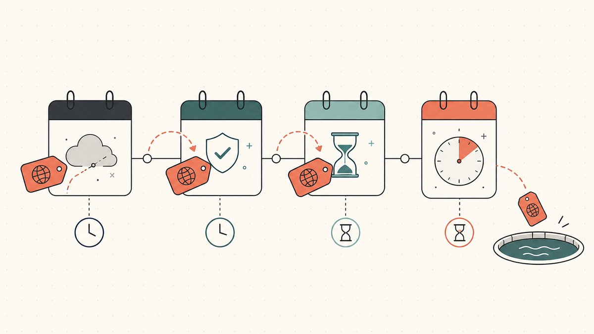
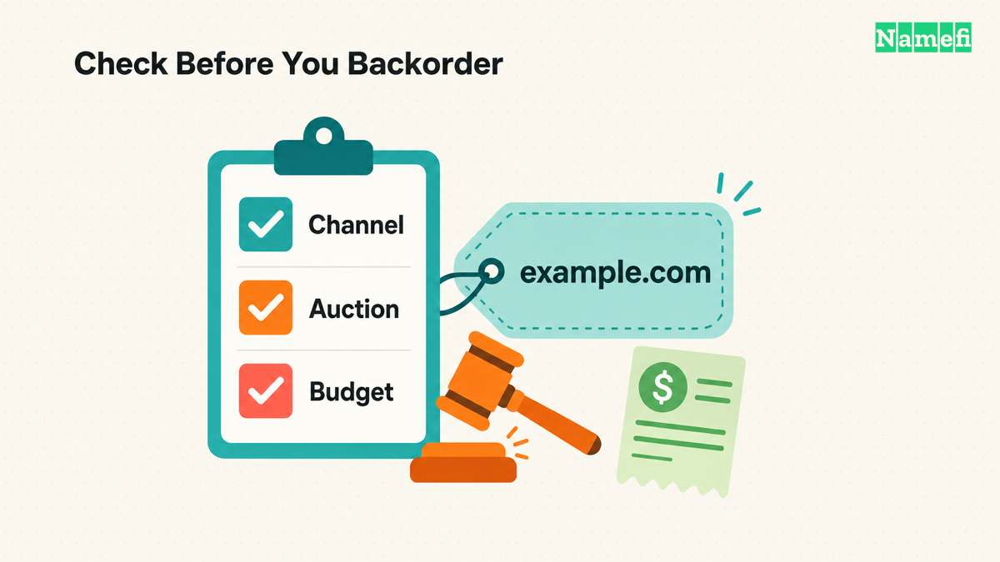

Ein Name, den du willst, ist bereits vergeben. Der aktuelle Inhaber verkauft nicht, antwortet nicht und benutzt ihn, soweit du erkennen kannst, nicht einmal. Also tust du das Einzige, was übrig bleibt: Du wartest darauf, dass er die Verlängerung vergisst. In dem Augenblick, in dem die Registrierung ausläuft und der Name in den offenen Pool zurückfällt, willst du derjenige sein, der bereitsteht, um ihn zu greifen.

Genau darum geht es bei Backorders und [Drop-Catching](/de/glossary/backorder/). Beide sind Wege, auf eine Domain zu wetten, die du heute nicht kaufen kannst – in der Hoffnung, sie in dem Moment registrieren zu können, in dem sie frei wird. Sie sind nicht dasselbe, der Unterschied ist wichtig, und meistens lautet die ehrliche Antwort auf „Soll ich dafür bezahlen?" Nein. Dieser Erklärtext behandelt, was beides ist, wie das Rennen in dem Moment abläuft, in dem ein Name freigegeben wird, welche Dienste es betreiben und die enge Gruppe von Fällen, in denen sich eine Backorder lohnt. Er ist Teil der [Serie zu Domain-Flipping-Fähigkeiten](/de/blog/domain-flipping/) und steht neben unserem Pfeiler-Artikel dazu, [wie man Domains zum Flippen findet](/de/blog/how-to-find-domains-to-flip/).

## Zuerst: Warum ein Name überhaupt „droppt"

Die Registry gibt nicht jede abgelaufene Domain sofort frei. Registrar, Registry und Endung bestimmen den Ablauf. Manche Domains gelangen vor einer öffentlichen Löschung in eine Ablaufauktion.

Für erfasste gTLDs verlangt [ICANN](https://www.icann.org/en/contracted-parties/consensus-policies/expired-registration-recovery-policy/expired-registration-recovery-policy-21-02-2024-en) nach der Löschung eine Wiederherstellungsfrist von 30 Tagen. Ausgenommen sind gesponserte gTLD-Registrys. Der bisherige Inhaber kann die Wiederherstellung beim löschenden Registrar beantragen. Der Registrar muss seine Gebühren offenlegen. Für Länderendungen können andere Regeln gelten.

Nach erfolgloser Wiederherstellung folgt die abschließende Löschphase. Laut [ICANN](https://www.icann.org/resources/pages/epp-status-codes-2014-06-16-en) entfernt die Registry die Domain nach fünf Kalendertagen im entsprechenden `pendingDelete`-Status. Die Domain kann dann wieder registriert werden. Das Ablaufdatum allein nennt keinen sicheren Freigabetermin.

## Drop-Catching: die Millisekunde gewinnen

Drop-Catching ist der Brute-Force-Ansatz: Du (oder, realistisch betrachtet, ein Dienst, der für dich handelt) versuchst, den Namen in dem buchstäblichen Augenblick zu registrieren, in dem er gelöscht wird. Wikipedias Definition ist schlicht – Drop-Catching, auch bekannt als Domain-Sniping, ist [the practice of registering a domain name once registration has lapsed, immediately after expiry](https://en.wikipedia.org/wiki/Domain_drop_catching#:~:text=is%20the%20practice%20of%20registering%20a%20domain%20name%20once%20registration%20has%20lapsed%2C%20immediately%20after%20expiry).

Von Hand kannst du das nicht gewinnen. Gute Namen werden nach einem vorhersehbaren Zeitplan gelöscht, und eine Schar professioneller Dienste hämmert in derselben Sekunde wie du auf die Registry ein. Wie es die Fachliteratur zur Domain-Spekulation beschreibt: [the business of registering the domain names as they are deleted by the registries is known as drop catching. It is a highly competitive business](https://en.wikipedia.org/wiki/Domain_name_speculation#:~:text=The%20business%20of%20registering%20the%20domain%20names%20as%20they%20are%20deleted%20by%20the%20registries%20is%20known%20as%20drop%20catching.%20It%20is%20a%20highly%20competitive%20business), und der Wettkampf ist brutal schnell: [the time between a drop and a capture is often measured in seconds or fractions thereof](https://en.wikipedia.org/wiki/Domain_name_speculation#:~:text=The%20time%20between%20a%20drop%20and%20a%20capture%20is%20often%20measured%20in%20seconds%20or%20fractions%20thereof).

Eine Auktion kann den Endpreis bestimmen. Die Anleitungen von [NameJet](https://www.namejet.com/userguide.action) und [SnapNames](https://www.snapnames.com/userguide.action) lassen auch öffentliche Auktionen mit Teilnehmern ohne vorherige Backorder zu. Prüfe die konkrete Auktion. Ein Auftrag garantiert keinen geschlossenen Bieterkreis.

## Eine Backorder beauftragt einen Erwerbsversuch

Eine Backorder beauftragt einen Dienst mit einem Erwerbsversuch. Bei einer öffentlichen Löschung konkurriert der Dienst mit anderen Registrierungssystemen. Die Backorder gewährt keinen Vorrang vor allen anderen Anbietern. Vorauszahlung, Zahlungsautorisierung und verbindliche Gebote hängen von der Plattform ab.

[Dynadot](https://www.dynadot.com/help/question/place-a-backorder) garantiert keinen erfolgreichen Fang. Mehrere Anfragen können zu einer Auktion führen. [NameJet](https://www.namejet.com/userguide.action) unterscheidet auslaufende Partnerbestände von öffentlich gelöschten Domains. Ein unabhängiger Dienst kann keine Domain registrieren, die nie öffentlich verfügbar wird.

## Die Dienste, die für dich rennen

Die meisten Flipper haben über eine Handvoll Plattformen mit Drop-Catching zu tun. Sie überschneiden sich und spezialisieren sich nach Endung, und welche die richtige ist, hängt davon ab, wo ein Name registriert ist und in welcher [TLD](/de/glossary/tld/) er liegt.

- **DropCatch** ist die bekannteste reine Drop-Catch-Plattform für [`.com`](/de/tld/com/) und andere Legacy-gTLDs. Du platzierst eine Backorder auf einen Pending-Delete-Namen, der Dienst wirft seine Registrar-Flotte auf die Löschung, und wenn mehr als ein Nutzer denselben Namen vorbestellt hat, wird per Auktion abgerechnet. Es ist die Standardlösung, um öffentliche Löschungen in großem Maßstab zu fangen.
- **SnapNames** und **NameJet** sind die klassischen Ablauf-Auktions-Vermittler – die oben genannten [Snapnames and Namejet](https://en.wikipedia.org/wiki/Domain_name_speculation#:~:text=instead%20introducing%20an%20intermediary%20%28e.g.%2C%20Snapnames%20and%20Namejet%29). Ihre Stärke sind Namen, die nie öffentlich droppen, weil ein Partner-Registrar seinen ablaufenden Bestand zuerst an sie weiterleitet. Wenn ein Name, den du willst, bei einem ihrer Partner-Registrare liegt, taucht er hier auf.
- **Dynadot** ist ein vollwertiger Registrar, der zugleich Backorder- und Ablauf-Auktions-Dienste betreibt, sodass du einen Fang an demselben Ort reservieren kannst, an dem du normal registrieren würdest. Fürs Protokoll: Wikipedia bezeichnet ihn als [an ICANN-accredited domain registrar and web host company founded by software engineer Todd Han in 2002](https://en.wikipedia.org/wiki/Dynadot#:~:text=is%20an%20ICANN%2Daccredited%20domain%20registrar%20and%20web%20host%20company%20founded%20by%20software%20engineer%20Todd%20Han%20in%202002).
- **Park.io** hat sich seinen Ruf damit erarbeitet, neuere und länderspezifische Endungen zu fangen – die Art von Namen, bei denen die Abdeckung eines Generalisten-Catchers dünner ist. Wenn du einem Namen auf einer weniger verbreiteten TLD hinterherjagst, ist ein Spezialist oft die einzige realistische Chance.

Prüfe vor der Bestellung den Erwerbsweg und die Zahlungspflichten. Bei einer öffentlichen Löschung können Anfragen bei unabhängigen Diensten zusätzliche Registrierungssysteme abdecken. Bei exklusiven Angeboten zählt die Plattform, die das Angebot kontrolliert. Mehrere Bestellungen sind nicht automatisch Geldverschwendung.

## Wann sich eine Backorder wirklich lohnt

Backorders sind günstig zu platzieren und leicht zu überplatzieren, und genau das ist die Falle. Hier ist der ehrliche Filter.

**Zahle für eine Backorder, wenn der Name wirklich knapp ist und du eine konkrete Verwendung hast.** Eine saubere Ein-Wort-`.com`, ein kurzer, markenfähiger Name oder ein Exact-Match-Name für ein Projekt, das du tatsächlich baust, ist eine Backorder-Gebühr und sogar ein bescheidenes Auktionsbudget wert, denn wenn er öffentlich droppt, wird er umkämpft sein und du verlierst ihn ohne einen Catcher. Das gilt auch für einen gealterten Namen mit echter, überprüfbarer Historie – bestehende Backlinks oder Traffic, die die Übergabe überstehen – was ein anderer Beschaffungskanal ist als das [Handregistrieren brandneuer Namen zum Flippen](/de/blog/hand-registering-domains-to-flip/).

**Lass es bleiben, wenn der Name nicht wirklich knapp ist.** Wenn eine fast identische Zeichenfolge gerade jetzt zum Preis einer normalen Registrierung handregistriert werden kann, ist es meist ein schlechtes Geschäft, eine Backorder-Gebühr zu zahlen und eine Auktion für die ablaufende Variante zu riskieren. Der Drop zählt nur, wenn der *spezifische* Name das Asset ist und kein Ersatz genügt.

**Geh davon aus, dass du verlieren könntest, und kalkuliere entsprechend.** Eine Backorder ist ein Versuch, kein Kauf. Bei einem begehrten Namen kannst du in der Post-Catch-Auktion überboten oder von einem Dienst mit mehr Feuerkraft übertroffen werden. Budgetiere die Gebühr als Kosten eines Lottoscheins mit anständigen Chancen, nicht als Anzahlung auf einen Namen, der dir bereits gehört.

**Achte auf die Markenrechtsgrenze.** Einen abgelaufenen Namen zu fangen wäscht seine Historie nicht rein. Wenn die Zeichenfolge die Marke von jemandem ist, macht die Tatsache, dass sie ausgelaufen ist, sie nicht sicher zum Greifen und Weiterverkaufen. Das [UDRP](/de/glossary/udrp/)-Rahmenwerk gilt weiterhin, und ein abgelaufener, [markenrechtlich geschützter](/de/glossary/trademark/) Name ist genau die Art von Sache, die einen Streitfall auslöst, wie wir in [Was ist UDRP](/de/blog/what-is-udrp/) behandeln. Fange generische und markenfähige Namen, keine ausgelaufenen Marken.

Noch ein Sorgfaltshinweis speziell zu gefangenen Namen: Eine [abgelaufene Domain](/de/blog/buy-expired-domains/) kann Altlasten mit sich tragen, die eine frische Registrierung nie hätte, etwa eine Spam-Historie oder eine Google-Abstrafung. Bevor du hart bietest, prüfe ihre Vergangenheit im [WHOIS](/de/glossary/whois/) und im Archiv-Eintrag. Die Historie eines Namens geht mit ihm über.

## Nach dem Fang: ihn tatsächlich besitzen

Den Fang zu gewinnen ist der Anfang, nicht das Ende. Der Name landet in einem Konto bei dem Registrar, der ihn gefangen hat, und ihn in ein sauberes, verkaufbares Asset zu verwandeln bedeutet, echte [Kontrolle darüber](/de/glossary/domain-ownership/) zu erlangen – den [Auth-Code](/de/glossary/auth-code/), die Möglichkeit eines [Cross-Registrar-Transfers](/de/glossary/cross-registrar-transfer/) zu deinem Heim-Registrar und die Gewissheit, dass [WHOIS](/de/glossary/whois/) und DNS dir gehören. Diese Übergabe ist der Punkt, an dem hochwertige Namen nervös werden, denn das Patt verfolgt jeden [Domain-Handel](/de/glossary/domain-trading/): Niemand will sich zuerst bewegen.

Genau diese Reibung soll [Namefi](https://namefi.io) verringern. Tokenisiertes Eigentum macht die Kontrolle über eine echte [ICANN](/de/glossary/icann/)-Domain einfacher überprüf- und übertragbar, mit DNS-Kontinuität, sodass ein gefangener Name während der Übergabe sauber auflösbar bleibt. Wenn du ihn dann weiterverkaufst, sind die Standard-Abläufe – Listung, Preisgestaltung und eine neutrale [Treuhand](/de/glossary/escrow/)-Übergabe – behandelt in [Wie man eine eigene Domain verkauft](/de/blog/how-to-sell-a-domain-name-you-own/) und [Domain-Treuhand erklärt](/de/blog/domain-escrow-explained/).

## Die Kurzfassung

Eine Backorder ist ein Erwerbsauftrag, keine Garantie und kein allgemeines Vorrecht. Prüfe den Erwerbsweg, die Auktionsregeln und dein Gesamtbudget. Betrachte die Domain erst nach erfolgreicher Zuteilung und Kontozugriff als gesichert.

## Freundlicher Hinweis (bitte lesen!)

> Wir sind keine Anwälte, Buchhalter, Finanzberater oder Ärzte, und **nichts in diesem Artikel ist rechtliche, finanzielle, steuerliche, buchhalterische, medizinische oder sonst irgendeine Art von professioneller Beratung.** Wir schreiben diese Beiträge, um uns selbst weiterzubilden, und als Service für unsere Kunden. Informationen hier können veraltet, geografisch spezifisch oder schlicht falsch sein. Auch wir machen Fehler.
>
> Für jede wichtige Entscheidung **konsultiere bitte einen echten Fachmann (im Ernst!)**. Oder, wenn das nicht dein Ding ist, frag einen Freund, frag Twitter, frag Reddit, frag eine KI oder frag einen Hellseher. Kurz gesagt: **DOYR – Do Your Own Research (recherchiere selbst)**. Lass uns lernen und Spaß haben.

## Diese Quellen erklären die Bestellregeln

Die Quellen wurden am 21. Oktober 2026 aufgerufen.

- [ICANN](https://www.icann.org/en/contracted-parties/consensus-policies/expired-registration-recovery-policy/expired-registration-recovery-policy-21-02-2024-en)
- [ICANN EPP](https://www.icann.org/resources/pages/epp-status-codes-2014-06-16-en)
- [Dynadot](https://www.dynadot.com/help/question/place-a-backorder)
- [NameJet](https://www.namejet.com/userguide.action)
- [SnapNames](https://www.snapnames.com/userguide.action)
