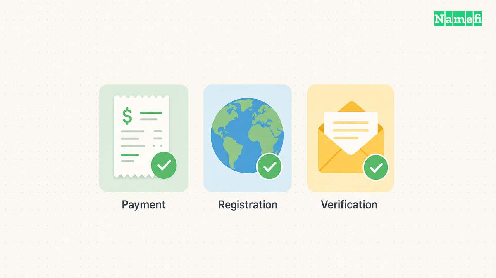
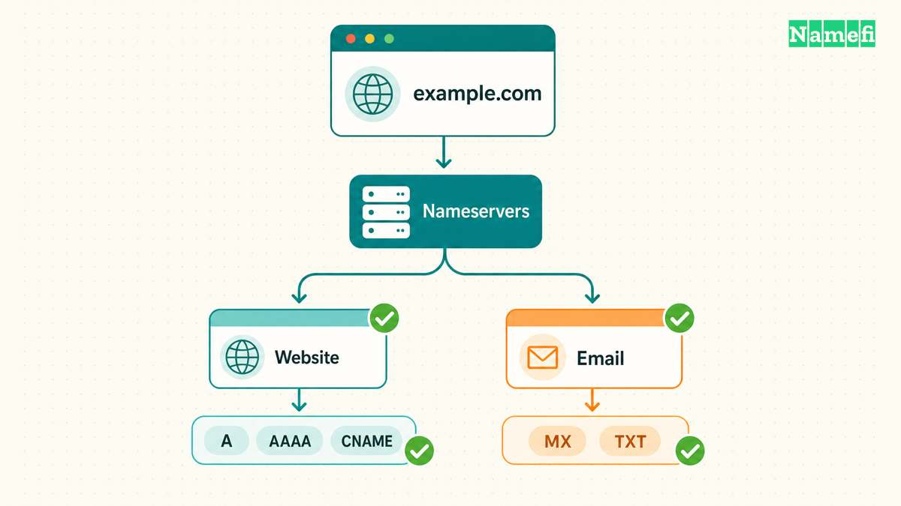

Eine Domainregistrierung gibt einer Person oder Organisation die Registrierungsrechte für einen begrenzten Zeitraum. Die Registrierung erstellt weder eine Website noch ein Postfach. ICANN erklärt [die unterschiedlichen Aufgaben](https://www.icann.org/resources/pages/faqs-84-2012-02-25-en#:~:text=Your%20domain%20name%20registration%20is%20not%20the%20same%20thing).

Diese Anleitung führt Sie von einem verfügbaren Namen über die Bestellung und Registrierungsprüfung bis zur Verbindung mit einer Website. Prüfen Sie drei Ergebnisse getrennt: **Zahlung angenommen, Registrierung abgeschlossen und Dienste funktionsfähig**. Bestätigen Sie jedes Ergebnis, bevor Sie die Adresse bekannt geben.

Wenn ein KI-Agent die Domain kauft, verwenden Sie die [Namefi-Anleitung zur Registrierung mit einem Agenten](/de/blog/ai-agent-register/). Die Anleitung erklärt die Einrichtung und API-Nutzung. Die folgenden Prüfungen helfen weiterhin dabei, den genehmigten Kauf festzulegen.

## Prüfen Sie den Namen, die Voraussetzungen und den Gesamtpreis vor der Zahlung

### Suchen Sie nach der vollständigen gewünschten Adresse

1. Notieren Sie den vollständigen Namen einschließlich der Endung.
2. Suchen Sie beim gewählten [Registrar](/de/glossary/registrar/) nach dem genauen Namen.
3. Prüfen Sie jedes Zeichen und die Endung im Suchergebnis.
4. Bestätigen Sie, dass das Angebot eine Neuregistrierung umfasst.

Ein Verkaufsangebot, eine Auktion oder ein Transfer erfordert einen anderen Kaufablauf. Ersetzen Sie den Namen nicht ungeprüft durch eine ähnliche Adresse. Stimmen Sie die neue Schreibweise mit allen Beteiligten ab.

Prüfen Sie bei einem Namen mit nichtlateinischen Zeichen die angezeigte Darstellung vor der Zahlung. Lassen Sie unklare Zeichen oder Schreibweisen vom Registrar klären.

### Lesen Sie die Regeln für die gewählte Endung

Länderdomains haben unterschiedliche Anforderungen an Antragsteller, Unterlagen und Registrierungszeiträume. Prüfen Sie die aktuellen Regeln der Registry und die Registrierungsoptionen des Registrars.

| Beispiel | Die Quelle belegt folgende Anforderung | Ihr nächster Schritt |
| --- | --- | --- |
| `.au` direkt | auDA verlangt eine [nachgewiesene Verbindung zu Australien](https://www.auda.org.au/au-domain-names/the-different-au-domain-names/au-direct-domain-names/#:~:text=validated%20connection%20to%20Australia). | Prüfen Sie, welche Nachweise zu Ihrer Situation passen. |
| `com.au` | auDA nennt [geschäftliche Voraussetzungen und eine Verbindung zwischen Name und Unternehmen](https://www.auda.org.au/au-domain-names/the-different-au-domain-names/com-au-domain-names/#:~:text=Who%20can%20get%20a%20com.au). | Prüfen Sie die Berechtigung und den vorgeschlagenen Namen getrennt. |
| `.cn` | Das Registrierungsverfahren von CNNIC verlangt [korrekte Antragsdaten und Identitätsnachweise](https://www.cnnic.com.cn/PublicS/fwzx/cnymfaq/201210/t20121008_36615.htm#:~:text=Submit%20authentic). | Fragen Sie den Registrar nach den aktuellen Unterlagen und dem Prüfverfahren. |

Die Beispiele zeigen unterschiedliche Prüfungen. Die Tabelle belegt keine Berechtigung für `.ai`, `.cc`, `.gg`, `.ru`, `.rs`, `.cl` oder `.ro`. Lesen Sie die passende [TLD-Übersicht](/de/topics/choosing-a-tld/) und die Registry-Regeln für die gewählte Endung.

Prüfen Sie die Mindestlaufzeit und mögliche Verlängerungsschritte, bevor Sie Jahrespreise vergleichen. Ein beworbener Jahrespreis entspricht nicht unbedingt dem fälligen Bestellbetrag.

### Halten Sie den vereinbarten Rechnungsbetrag fest

Vergleichen Sie die folgenden Angaben im endgültigen Warenkorb und in den Vertragsbedingungen:

| Angabe | Diese Frage müssen Sie vor der Zahlung klären |
| --- | --- |
| Registrierungszeitraum | Wie viele Jahre deckt die Zahlung ab? |
| Gesamtpreis der Registrierung | Welchen Betrag berechnet der Registrar jetzt, und in welcher Währung? |
| Verlängerung | Welchen Verlängerungspreis und Zeitraum zeigt der Registrar derzeit an? |
| Premium-Einstufung | Gelten für den Namen besondere Registrierungs- oder Verlängerungspreise? |
| Zusatzdienste | Welche Hosting-, E-Mail-, Datenschutz- oder sonstigen Dienste haben Sie ausgewählt? |
| Steuern und Gebühren | Welche zusätzlichen Beträge enthält die Endsumme? |

Die [Rechte von Registranten](https://www.icann.org/resources/pages/benefits-2013-09-16-en#:~:text=pricing%20information) umfassen zugängliche Preisangaben für Registrierung und Datenschutzdienste. Lassen Sie unklare Kosten vor der Zahlung vom Registrar erklären. Die [Anleitung zu Domainkosten](/de/blog/how-much-is-a-domain-understanding-holding-cost/) erläutert die Kostenarten genauer.

Sie können für Registrierung und Hosting verschiedene Anbieter nutzen. ICANN bestätigt, dass [Registranten kein Hosting beim Registrar kaufen müssen](https://www.icann.org/resources/pages/faqs-84-2012-02-25-en#:~:text=you%20are%20not%20required%20to%20use%20these%20services).

## Übermitteln Sie korrekte Daten und bestätigen Sie die abgeschlossene Registrierung

### Legen Sie den vorgesehenen Registranten vor der Bestellung fest

Der [Registrant](/de/glossary/registrant/) ist die Person oder Organisation mit den Registrierungsrechten. Prüfen Sie den Registranteneintrag besonders dann, wenn eine Agentur oder ein Entwickler die Bestellung übernimmt. ICANN [warnt vor der Eintragung fremder Kontaktdaten](https://www.icann.org/resources/pages/faqs-84-2012-02-25-en#:~:text=they%20may%20have%20registered%20the%20domain).

1. Tragen Sie den korrekten Namen und die Organisationsdaten des vorgesehenen Registranten ein.
2. Geben Sie korrekte Kontaktdaten an, die Sie aktuell halten können.
3. Verwenden Sie eine funktionierende E-Mail-Adresse mit sofortigem Zugriff.
4. Prüfen Sie den Registrierungsvertrag und die Bedingungen des Datenschutzdienstes.
5. Speichern Sie den endgültigen Warenkorb und zahlen Sie einmal.

Verwenden Sie für eine neue Domain ein bereits funktionierendes Postfach zur Kontaktbestätigung. Vermeiden Sie ein Postfach, das zunächst die DNS-Einrichtung der neuen Domain benötigt.

Datenschutzdienste rechtfertigen keine falschen Antragsdaten. ICANN verlangt, dass Registranten [korrekte Angaben machen und Kontodaten aktuell halten](https://www.icann.org/resources/pages/benefits-2013-09-16-en#:~:text=You%20must%20provide%20accurate%20information). Prüfen Sie, welche Angaben der Registrar veröffentlicht und welche Angaben ein Datenschutzdienst schützt.

### Bestätigen Sie die Registrierung und schließen Sie die Prüfungen ab

1. Speichern Sie den Beleg, die Bestellnummer und die Supportadresse des Registrars.
2. Öffnen Sie die Bestell- und Domainseiten im Registrarkonto.
3. Prüfen Sie den genauen Namen, die erfolgreiche Registrierung und das Ablaufdatum.
4. Befolgen Sie die Anweisungen zur Bestätigung Ihrer Kontaktdaten.
5. Speichern Sie die Bestätigung erforderlicher Identitäts- oder Berechtigungsprüfungen.

Klären Sie einen unklaren Bestellstatus. Prüfen Sie die vorhandene Bestellung, bevor Sie erneut zahlen. Fragen Sie den Support nach abgeschlossener Registrierung, fehlenden Unterlagen oder einer Erstattung bei gescheiterter Bestellung.

ICANN erklärt, dass Registrare [Kontaktdaten prüfen und unbestätigte Domains sperren oder löschen können](https://www.icann.org/resources/pages/contact-verification-2013-05-03-en#:~:text=Registrars%20must%20suspend%20or%20delete). Beachten Sie die konkrete Mitteilung und Frist. Übertragen Sie keine pauschale Bestätigungsfrist auf sämtliche Länderdomains.

Öffnen Sie das Registrarkonto direkt, wenn eine Nachricht verdächtig erscheint. Bestätigen Sie eine unerwartete Dokumentenanforderung über den Supportkanal des Kontos, bevor Sie Identitätsnachweise senden.

## Verbinden Sie die Domain mit Website und E-Mail

Die [DNS](/de/glossary/dns/)-Konfiguration verbindet den registrierten Namen mit Diensten. Website- und E-Mail-Anbieter liefern die erforderlichen Eintragsnamen und Werte. Übernehmen Sie die Werte aus den aktuellen Einrichtungsanweisungen des Anbieters.

### Wählen Sie den Verwaltungsort für DNS-Einträge

1. Prüfen Sie die zugewiesenen [Nameserver (NS Record)](/de/glossary/nameserver/) im Registrarkonto.
2. Wählen Sie den DNS-Dienst des Registrars oder einen anderen DNS-Anbieter.
3. Öffnen Sie beim gewählten Anbieter die Seite für DNS-Einträge.

Befolgen Sie bei einem externen DNS-Anbieter dessen Anweisungen zur Nameserver-Einrichtung. Der Nameserverwechsel und das Hinzufügen von Einträgen sind getrennte Vorgänge. Cloudflares [Anleitung zur vollständigen Einrichtung](https://developers.cloudflare.com/dns/zone-setups/full-setup/setup/) beschreibt beide Vorgänge und verlangt die Prüfung der Einträge vor der Aktivierung.

Wenn DNSSEC bereits aktiv ist, befolgen Sie vor dem Nameserverwechsel die Migrationsanleitung des DNS-Anbieters. Cloudflare warnt, dass [ein Nameserverwechsel mit aktivem DNSSEC die Domain unerreichbar machen kann](https://developers.cloudflare.com/dns/zone-setups/full-setup/setup/#:~:text=Changing%20nameservers%20while%20DNSSEC%20is%20active).

### Fügen Sie die vom Dienstanbieter vorgegebenen Einträge hinzu

| Dienst | Benötigte Angaben | Prüfung nach dem Speichern |
| --- | --- | --- |
| Website | Erforderliche A-, AAAA- oder CNAME-Einträge für die Hauptdomain und `www` | Beide vorgesehenen Adressen öffnen die richtige Website. |
| E-Mail | MX-Einträge und erforderliche Authentifizierungs- oder Bestätigungseinträge | Ein Testpostfach sendet und empfängt Nachrichten. |
| Dienstbestätigung | Genauer TXT- oder CNAME-Eintrag des Dienstes | Der Dienst bestätigt die Domain. |

Cloudflare dokumentiert [Eintragstyp, Pflichtfelder, TTL und das Speichern](https://developers.cloudflare.com/dns/manage-dns-records/how-to/create-dns-records/#:~:text=Create%20DNS%20records). Die TTL beeinflusst, wie lange zwischengespeicherte Eintragsdaten gültig bleiben. Versprechen Sie keine sofortige weltweite Aktualisierung.

Holen Sie die genauen E-Mail-Einstellungen beim E-Mail-Anbieter ein. Cloudflares [Anleitung zu E-Mail-Einträgen](https://developers.cloudflare.com/dns/manage-dns-records/how-to/email-records/) unterscheidet die Zustellung vom Schutz gegen gefälschte Absender. Eine Domainregistrierung allein richtet kein funktionierendes Postfach ein.

Prüfen Sie bei Website-Problemen zuerst den Registrierungsstatus, danach Bestätigungsmitteilungen, Nameserverzuweisung und DNS-Werte. Vergleichen Sie bei reinen E-Mail-Problemen die gespeicherten Mail-Einträge mit den Anweisungen des E-Mail-Anbieters.

## Bewahren Sie die Registrierungsdaten für die nächste Verlängerung auf

Speichern Sie Domain, Registrar, Kontoinhaber, Ablaufdatum, aktuellen Verlängerungspreis, DNS-Anbieter und Supportkontakt an einem Ort. Notieren Sie die automatische Verlängerung und die Zahlungsmethode. ICANN erinnert Registranten daran, [Zahlungsdaten für die automatische Verlängerung aktuell zu halten](https://www.icann.org/resources/pages/benefits-2013-09-16-en#:~:text=keep%20your%20payment%20information%20current).

Prüfen Sie die folgende Liste, bevor Sie die neue Adresse weitergeben:

- Der Registrar bestätigt die Registrierung der richtigen Domain.
- Der vorgesehene Registrant hält die Registrierungsrechte.
- Erforderliche Kontakt- und Berechtigungsprüfungen sind abgeschlossen.
- Website und E-Mail funktionieren unabhängig voneinander.
- Die Registrierungsdaten enthalten Ablaufdatum und Verlängerungseinstellungen.

Sichern Sie anschließend den dauerhaften Zugang mit der [Checkliste zum Schutz des Registrarkontos](/de/blog/harden-domain-registrar-account/).

## Diese Quellen belegen die Registrierungsschritte

Die folgenden Quellen wurden am 22. Oktober 2026 UTC abgerufen. In Los Angeles war der 21. Oktober 2026.

- ICANN: [Allgemeine Fragen](https://www.icann.org/resources/pages/faqs-84-2012-02-25-en), Registrierungsfragen 1–4 und 14.
- ICANN: [Rechte und Pflichten von Registranten](https://www.icann.org/resources/pages/benefits-2013-09-16-en), Preise und Pflichten.
- ICANN: [Bestätigung von Kontaktdaten](https://www.icann.org/resources/pages/contact-verification-2013-05-03-en), Gründe für die Prüfung.
- auDA: [.au direkt](https://www.auda.org.au/au-domain-names/the-different-au-domain-names/au-direct-domain-names/) und [com.au](https://www.auda.org.au/au-domain-names/the-different-au-domain-names/com-au-domain-names/), Abschnitte zu den Voraussetzungen.
- CNNIC: [Häufige Fragen zu CN-Domains](https://www.cnnic.com.cn/PublicS/fwzx/cnymfaq/201210/t20121008_36615.htm), Registrierungsverfahren, Schritte 4–8. Die Seite trägt ein Datum aus 2012. Bestätigen Sie die aktuellen Einreichungsanforderungen beim Registrar.
- Cloudflare: [DNS-Einträge verwalten](https://developers.cloudflare.com/dns/manage-dns-records/how-to/create-dns-records/), [vollständige Einrichtung](https://developers.cloudflare.com/dns/zone-setups/full-setup/setup/) und [E-Mail-Einträge](https://developers.cloudflare.com/dns/manage-dns-records/how-to/email-records/).
