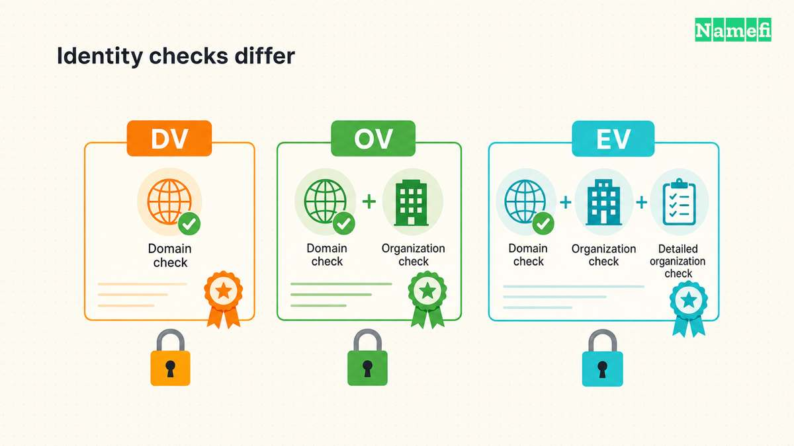
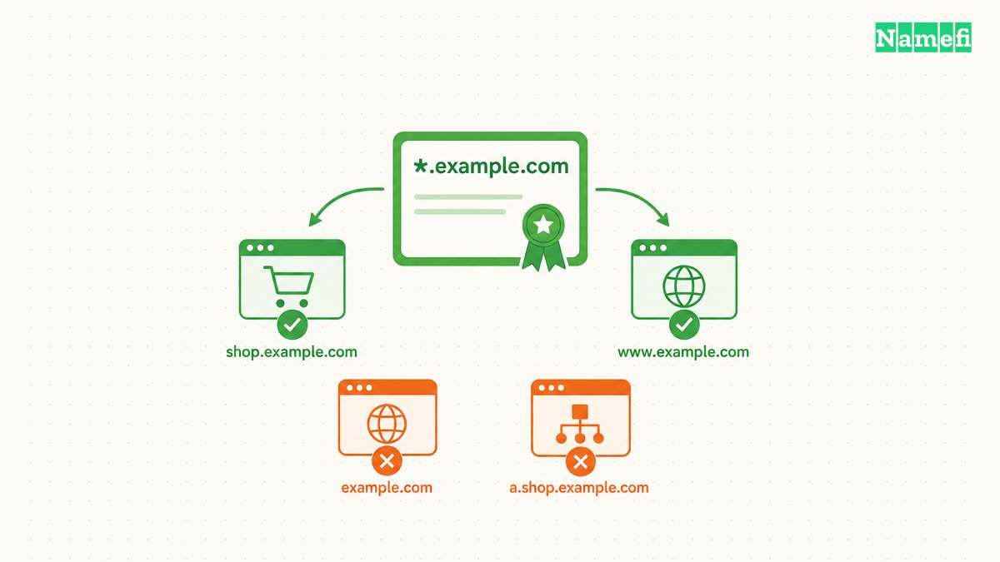

**Bei der Wahl eines SSL-Zertifikats zählen zwei Fragen: Welche Identität muss der Aussteller prüfen, und welche Hostnamen muss das Zertifikat abdecken?** [DV](/de/blog/domain-validation-ssl-certificate/), OV und EV bezeichnen die Identitätsprüfung. Einzelname, Wildcard und Multi-Domain beschreiben die Namensabdeckung. Ein Wildcard-Zertifikat kann zugleich ein DV-Zertifikat sein.

„SSL-Zertifikat“ bleibt eine gängige Suchbezeichnung für Zertifikate, die modernes TLS verwenden. Der Beitrag über [HTTPS](/de/blog/what-is-https/) erklärt den Verbindungsaufbau. Dieser Leitfaden hilft Website-Betreibern, einen Zertifikatsantrag vorzubereiten und Angebote zu vergleichen.

## Die Identitätsvalidierung legt die Prüfungen des Ausstellers fest

Eine Zertifizierungsstelle prüft vor der Ausstellung eines DV-Zertifikats die Kontrolle über die Domain. OV ergänzt Angaben zur Organisation. EV verlangt umfangreichere Identitätsprüfungen. [DigiCert erläutert die Unterschiede](https://www.digicert.com/difference-between-dv-ov-and-ev-ssl-certificates#:~:text=What%20distinguishes%20OV%20%26%20EV).

| Validierung | Prüfung des Ausstellers | Frage für die Auswahl |
| --- | --- | --- |
| Domainvalidierung (DV) | Kontrolle über die angeforderte Domain | Verlangt die Anforderung eine authentifizierte Verbindung zu einem Hostnamen? |
| Organisationsvalidierung (OV) | Domainkontrolle und Organisationsangaben | Verlangt ein Kunde oder eine interne Richtlinie die Organisationsidentität im Zertifikat? |
| Erweiterte Validierung (EV) | Domainkontrolle und umfangreichere Prüfung der Organisationsidentität | Nennt eine dokumentierte Anforderung ausdrücklich EV? |

Die Auswahlfragen dienen der Planung. Klären Sie die tatsächliche Anforderung vor dem Kauf mit dem zuständigen Team.

Eine Identitätsprüfung garantiert keinen verantwortungsvollen Umgang mit Kundendaten. Die Validierungsbezeichnung allein legt auch keine ausgehandelte TLS-Verschlüsselungssuite fest. [RFC 8446, Abschnitt 4.1.2](https://www.rfc-editor.org/rfc/rfc8446.html#section-4.1.2) beschreibt die Aushandlung der Verschlüsselungssuite getrennt von der Zertifikatsauswahl. Kaufen Sie OV oder EV daher nicht in der Annahme, die Bezeichnung bedeute eine stärkere Verbindungsverschlüsselung.

Let's Encrypt bietet [DV-Zertifikate, aber keine OV- oder EV-Zertifikate](https://letsencrypt.org/docs/faq/#what-services-does-lets-encrypt-offer). Eine Anforderung zur Organisationsvalidierung verändert daher die Auswahl möglicher Aussteller.

## Die Namensabdeckung bestimmt die passenden Hostnamen

Erstellen Sie vor der Auswahl eine Liste aller Namen, die Besucher verwenden. Ein fiktives Unternehmen könnte `example.com`, `www.example.com` und `shop.example.net` benötigen. Die Namen veranschaulichen Konfigurationsmöglichkeiten. Die Namen bezeichnen keinen eingerichteten Dienst.

| Abdeckung | Beispielnamen im Zertifikat | Abdeckung des Beispiels |
| --- | --- | --- |
| Ein genauer Name | `www.example.com` | Genau dieser Hostname |
| Wildcard | `*.example.com` | Eine Ebene unter `example.com`, etwa `shop.example.com` |
| Mehrere Namen | `example.com`, `www.example.com`, `shop.example.net` | Jeder aufgeführte Name |

`*.example.com` passt weder zu `example.com` noch zu `a.shop.example.com`. [RFC 9525, Abschnitt 6.3](https://www.rfc-editor.org/rfc/rfc9525.html#section-6.3) begrenzt den Platzhalter auf eine Namensebene. Fügen Sie die Stammdomain separat hinzu, wenn die Stammdomain HTTPS bereitstellen soll.

Zertifizierungsstellen können mehrere Namen in die Erweiterung Subject Alternative Name aufnehmen. Let's Encrypt [unterstützt mehrere Domainnamen in einem Zertifikat](https://letsencrypt.org/docs/faq/#can-i-get-a-certificate-for-multiple-domain-names-san-certificates-or-ucc-certificates). „Multi-Domain“ und „SAN-Zertifikat“ bezeichnen üblicherweise diese Anordnung. Prüfen Sie vor der Bestellung die unterstützten Kombinationen und Namensgrenzen des Ausstellers.

Ein [Wildcard-DNS-Eintrag](/de/blog/wildcard-dns-records/) und ein Wildcard-Zertifikat lösen unterschiedliche Aufgaben. DNS liefert eine Adresse oder eine andere DNS-Antwort. Das Zertifikat muss weiterhin zum Hostnamen passen, den der Client prüft. Ein Wildcard-DNS-Eintrag erweitert keine Zertifikatsabdeckung.

Ein gemeinsames Zertifikat kann die Bestandsverwaltung vereinfachen. Ein gemeinsamer privater Schlüssel verbindet jedoch die Bereitstellungen, die den Schlüssel speichern. Verteilen Sie einen Wildcard-Schlüssel als betriebliche Empfehlung nicht allein zur Verringerung der Zertifikatszahl an voneinander unabhängige Teams.

## Eine kurze Bestandsliste macht den Zertifikatsantrag prüfbar

1. Erfassen Sie alle öffentlichen Hostnamen, die HTTPS benötigen.
2. Ermitteln Sie den Hosting-Anbieter oder Server, der das jeweilige Zertifikat verwaltet.
3. Erfassen Sie ausdrückliche DV-, OV- oder EV-Anforderungen und deren Verantwortliche.
4. Prüfen Sie die Wildcard-Grenzen anhand der Hostnamenliste.
5. Bestätigen Sie die Unterstützung der Namen durch Aussteller und Bereitstellung.
6. Bestimmen Sie vor der Ausstellung die Zuständigkeit für die Erneuerung.

Für Wildcard-Zertifikate von Let's Encrypt muss der ACME-Client die [DNS-01-Validierung](https://letsencrypt.org/docs/challenge-types/#dns-01-challenge) verwenden. DNS-01 hinterlegt einen Prüfwert im DNS. Die Automatisierung benötigt fortlaufenden DNS-Zugriff. Verwenden Sie entsprechend den Hinweisen des Ausstellers eng begrenzte DNS-Zugangsdaten.

Prüfen Sie bei verwaltetem Hosting die unterstützte Namensabdeckung vor einem Kauf. Ein separat gekauftes Zertifikat hilft nicht, wenn die Plattform das Zertifikat nicht installieren kann. Prüfen Sie bei bestehenden Bereitstellungen mit dem [Leitfaden zur Zertifikatserneuerung](/de/blog/renew-ssl-certificate/) das Zertifikat, das Besucher tatsächlich erhalten.

## Die Quellen dokumentieren Validierung und Namensvergleich

- DigiCert, [Unterschiede zwischen DV, OV und EV](https://www.digicert.com/difference-between-dv-ov-and-ev-ssl-certificates), Validierungsvergleich. Abgerufen am 2026-10-22.
- IETF, [RFC 9525, Abschnitt 6.3](https://www.rfc-editor.org/rfc/rfc9525.html#section-6.3), Wildcard-Vergleich. Abgerufen am 2026-10-22.
- IETF, [RFC 8446, Abschnitt 4.1.2](https://www.rfc-editor.org/rfc/rfc8446.html#section-4.1.2), Verschlüsselungssuiten. Abgerufen am 2026-10-22.
- Let's Encrypt, [FAQ](https://letsencrypt.org/docs/faq/) und [DNS-01-Prüfung](https://letsencrypt.org/docs/challenge-types/#dns-01-challenge), Zertifikatstypen und Validierung. Abgerufen am 2026-10-22.
