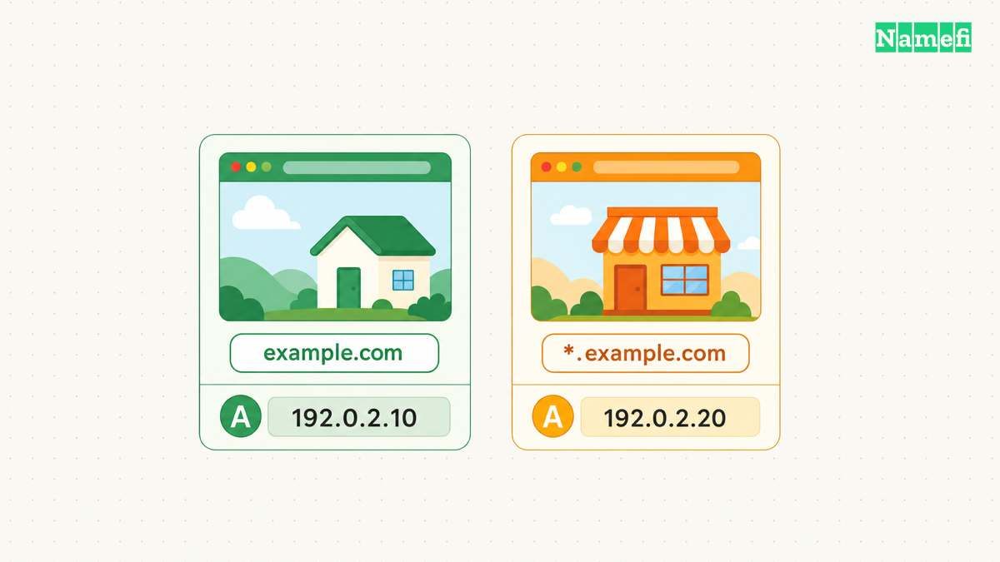
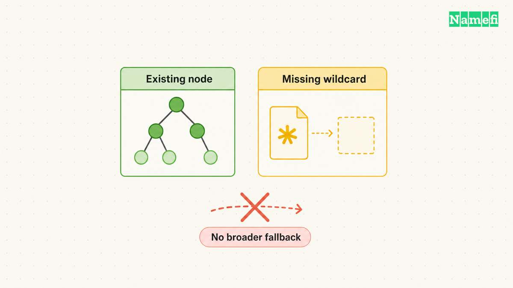
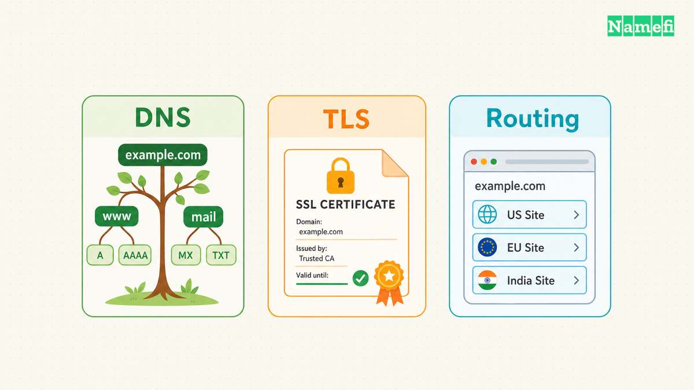
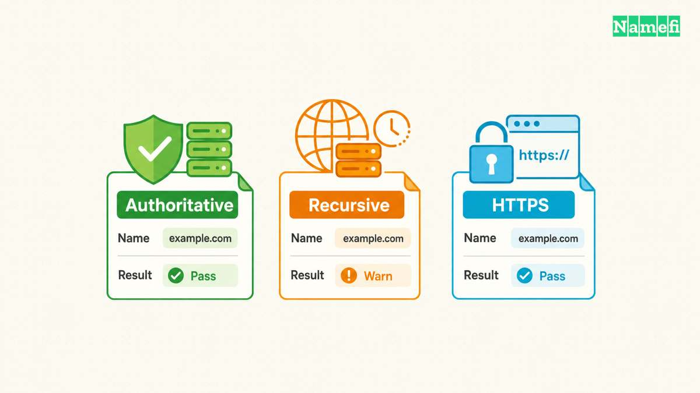
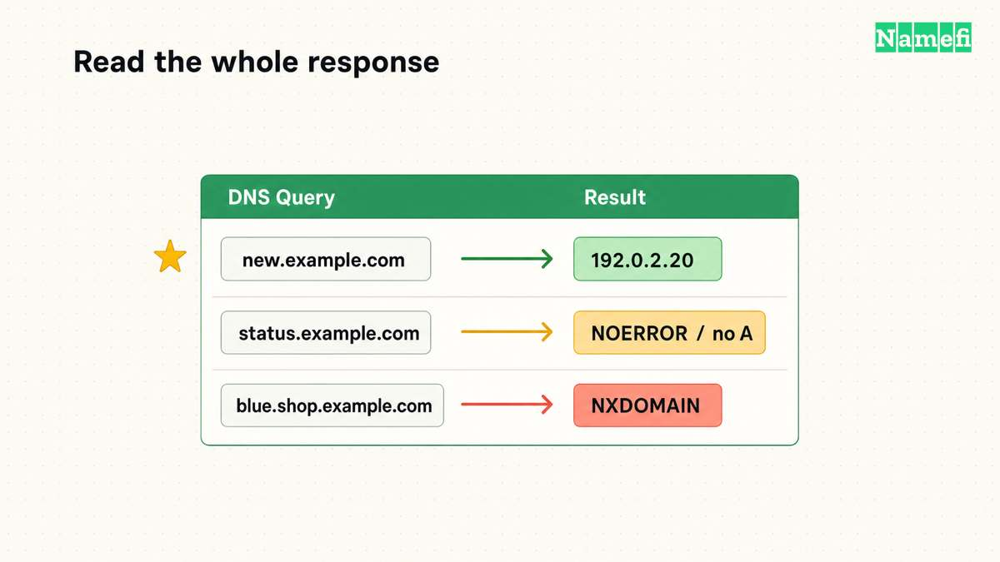

Ein Wildcard-DNS-Eintrag liefert Antworten für fehlende Namen. Ein Eintrag unter `*.example.com` kann für `shop.example.com` und manchmal auch für `blue.shop.example.com` antworten. Vorhandene Namen im DNS-Baum bestimmen die Grenze. Das Sternchen bedeutet nicht, dass jeder Hostname funktioniert. [RFC 4592 definiert den Abgleich.](https://www.rfc-editor.org/rfc/rfc4592.html#section-3.3.1)

Der Unterschied erklärt, warum eine Wildcard nach dem Hinzufügen eines scheinbar unabhängigen Eintrags nicht mehr greift. Ein TXT-Eintrag zur Bestätigung oder ein tieferer Hostname kann den Baum verändern. Eine erfolgreiche DNS-Abfrage sagt außerdem nichts darüber aus, ob eine Website den Hostnamen akzeptiert.

Verwenden Sie Wildcard-[DNS](/de/glossary/dns/), wenn viele vorgesehene Namen denselben Dienst erreichen sollen. Dokumentieren Sie Ausnahmen und prüfen Sie den Dienst getrennt. Die folgenden hypothetischen Beispiele verwenden reservierte Domainnamen und Dokumentationsadressen. Die Beispiele erklären das Verhalten und ersetzen keine bestehende produktive Zone.

## Eine Wildcard liefert Einträge für fehlende Namen

Eine Wildcard ist ein gewöhnlicher DNS-Eintrag mit einem besonderen Eigentümernamen. Das äußerste linke Label muss ausschließlich aus `*` bestehen. `*.example.com` erfüllt diese Bedingung. `shop*.example.com` stellt kein Muster für Teilnamen bereit. Bei `shop.*.example.com` wirkt das mittlere Label nicht als Wildcard. [RFC 4592 erklärt die Syntax.](https://www.rfc-editor.org/rfc/rfc4592.html#section-2.1)

Stellen Sie sich einen Dienst vor, der Kundenseiten unter einer [Subdomain](/de/glossary/subdomain/) anlegt. Der Dienst soll Namen wie `amber.example.com` und `violet.example.com` akzeptieren. Eine Wildcard kann die Anzahl der erforderlichen DNS-Einträge reduzieren. Der Dienst benötigt weiterhin ein Kundenverzeichnis, das angefragte Namen echten Kunden zuordnet.

Eine hypothetische Zone enthält eine Adresse für den Zonennamen selbst und eine Wildcard-Adresse:

| Eigentümername | Typ | Wert |
| --- | --- | --- |
| `example.com.` | A | `192.0.2.10` |
| `*.example.com.` | A | `192.0.2.20` |

Der Zonenapex bezeichnet den Namen der Zone selbst, hier `example.com`. Die Wildcard ersetzt den Apex-Eintrag nicht. Die beiden unterschiedlichen Adressen ermöglichen, Apex-Antworten und Wildcard-Antworten zu unterscheiden.

Wenn der autoritative Server eine Antwort synthetisiert, setzt der Server den angefragten Namen in die Antwort ein. Eine A-Abfrage für `amber.example.com` erhält deshalb einen A-Eintrag mit `amber.example.com` als Eigentümernamen. Die Antwort verweist den Client nicht auf eine Adresse mit dem wörtlichen Namen `*`. [RFC 4592 beschreibt Antwortaufbau und Typabgleich.](https://www.rfc-editor.org/rfc/rfc4592.html#section-3.3.3)

Der Eintragstyp bestimmt weiterhin den Inhalt der Antwort. Ein A-Eintrag liefert eine IPv4-Adresse. Ein Wildcard-A-Eintrag erzeugt weder eine IPv6-Adresse noch Regeln für die Mailzustellung. Prüfen Sie die [DNS-Eintragstypen (A, AAAA, CNAME, MX, TXT)](/de/glossary/dns-record-types/), bevor Sie die Daten der Wildcard festlegen.

Eine Wildcard mit CNAME liefert einen Alias, wenn der Abgleich eine Synthese erlaubt. Bei einer A-Abfrage kann der Server den CNAME synthetisieren und die Auflösung am Ziel fortsetzen. Das Ziel benötigt weiterhin nutzbare Adressdaten. [RFC 4592 definiert die Verarbeitung von Wildcard-CNAME-Einträgen.](https://www.rfc-editor.org/rfc/rfc4592.html#section-3.3.3) Die Oberfläche eines Anbieters akzeptiert möglicherweise `*` relativ zur Zone oder verlangt einen vollständigen Eigentümernamen. Prüfen Sie den gespeicherten Namen vor dem Test. Cloudflare dokumentiert beispielsweise `*` im Namensfeld und `*.www` für eine Wildcard unter `www.example.com`. [Cloudflare erklärt die Einrichtung.](https://developers.cloudflare.com/dns/manage-dns-records/reference/wildcard-dns-records/#create-a-wildcard-record)

Begrenzen Sie den vorgesehenen Dienstbereich möglichst auf einen Teil der Domain. Für Kundenseiten kommt etwa `*.customers.example.com` statt `*.example.com` infrage. Diese betriebliche Empfehlung erleichtert, den Zweck und die Ausnahmen zu dokumentieren. DNS, Zertifikate und Anwendungsrouting müssen weiterhin zur gewählten Struktur passen.

## Vorhandene Namen bestimmen die zuständige Wildcard

Für einen fehlenden Namen sucht der Standardalgorithmus den nächsten vorhandenen Vorfahren, den „closest encloser“. Der Server prüft anschließend die Wildcard direkt unter diesem Vorfahren. Fehlt diese Wildcard, versucht der Server keine übergeordneten Wildcards als Ersatz. [RFC 4592 definiert den nächsten vorhandenen Vorfahren und die Synthesequelle.](https://www.rfc-editor.org/rfc/rfc4592.html#section-3.3.1)

Beginnen Sie mit der obigen hypothetischen Zone ohne Namen unter `shop.example.com`. Der nächste vorhandene Vorfahr von `blue.shop.example.com` ist `example.com`. Der Wildcard-Kandidat lautet `*.example.com`. Die Wildcard kann deshalb trotz der zwei Labels vor `example.com` eine Adresse liefern.

Fügen Sie nun einen ausdrücklichen A-Eintrag für `shop.example.com` hinzu. Eine Abfrage für `shop.example.com` verwendet den vorhandenen Namen. Für `blue.shop.example.com` wird dagegen `shop.example.com` zum nächsten vorhandenen Vorfahren. Der Kandidat lautet nun `*.shop.example.com`. Ohne diesen Kandidaten oder eine ausdrückliche Antwort bietet die Wildcard auf Zonenebene keinen Ersatz.

Ein vorhandener Name kann die Synthese auch ohne Eintrag des angefragten Typs verhindern. Angenommen, `status.example.com` besitzt nur einen TXT-Eintrag. Eine A-Abfrage für diesen Namen übernimmt den A-Eintrag von `*.example.com` nicht. Der Name existiert bereits. Nach den Standardregeln zeigt die Antwort an, dass der Name keine A-Daten besitzt. [RFC 4592 zeigt vorhandene Namen mit fehlenden Eintragstypen.](https://www.rfc-editor.org/rfc/rfc4592.html#section-2.2.1)

Ein leerer Zwischenknoten bildet eine weniger sichtbare Grenze. Angenommen, die Zone enthält `probe.team.example.com`, aber keine Einträge direkt unter `team.example.com`. Der untergeordnete Name lässt `team.example.com` im standardmäßigen DNS-Baum als vorhandenen Knoten gelten. Der Knoten kann den Wildcard-Abgleich verändern, obwohl die Eintragsliste des Anbieters keine eigene Zeile für den übergeordneten Namen zeigt. [RFC 4592 erklärt leere Zwischenknoten.](https://www.rfc-editor.org/rfc/rfc4592.html#section-2.2.2)

Erstellen Sie vor Änderungen eine Übersicht. Die folgenden Ergebnisse setzen den Standardalgorithmus, den obigen Wildcard-A-Eintrag und keine weiteren Wildcards voraus:

| A-Abfrage | Zusätzliche Zonendaten | Erwartetes Ergebnis |
| --- | --- | --- |
| `new.example.com` | Keine | Wildcard-Adresse |
| `blue.new.example.com` | Keine unter `new` | Wildcard-Adresse |
| `status.example.com` | TXT unter `status` | Keine A-Daten |
| `blue.shop.example.com` | A unter `shop` | Keine Wildcard-Antwort |
| `team.example.com` | A unter `probe.team` | Keine A-Daten |

Prüfen Sie die vorhergesagten Ergebnisse beim jeweiligen Anbieter. Cloudflare dokumentiert unterschiedliches Verhalten für leere übergeordnete Namen bei Standard- und erweiterten Nameservern. Im dokumentierten Fall folgen die erweiterten Nameserver RFC 4592. Die Standard-Nameserver wenden dagegen weiterhin die übergeordnete Wildcard an. Diese Ausnahme macht Anbietertests notwendig. [Cloudflare beschreibt den impliziten übergeordneten Namen.](https://developers.cloudflare.com/dns/manage-dns-records/reference/wildcard-dns-records/#specific-dns-records-take-precedence-over-wildcard-records)

Eine Delegierung schafft eine weitere Grenze. Wenn eine untergeordnete Zone eigene autoritative Server verwendet, untersuchen Sie die Antworten der untergeordneten Zone. Erwarten Sie keinen Ersatz fehlender Einträge durch die Wildcard der übergeordneten Zone. Dokumentieren Sie die zuständigen [Nameserver (NS Record)](/de/glossary/nameserver/) für jeden delegierten Zweig. Eine solche Übersicht verhindert irreführende Wildcard-Änderungen in der falschen Zone.

## Der DNS-Abgleich konfiguriert weder Zertifikate noch Website-Routing

Ein Browser benötigt mehr als eine DNS-Antwort, um eine HTTPS-Seite zu öffnen. Das Ziel muss ein akzeptables Zertifikat für den angefragten Hostnamen vorlegen. Der Webdienst muss außerdem die vorgesehene Anwendung auswählen. Prüfen Sie diese Anforderungen getrennt.

Für TLS gelten andere Wildcard-Regeln. RFC 9525 erlaubt ein einzelnes Sternchen als vollständiges äußerstes linkes Label eines präsentierten Namens. Dieses Sternchen deckt genau ein Label ab. Der Zertifikatsbezeichner `*.example.com` kann `amber.example.com` abdecken, aber weder `blue.amber.example.com` noch `example.com`. Ein Zertifikat kann weitere Bezeichner für zusätzliche Namen enthalten. [RFC 9525 unterscheidet den TLS-Abgleich vom DNS-Abgleich.](https://www.rfc-editor.org/rfc/rfc9525.html#section-6.3)

Angenommen, DNS leitet beide Kundennamen an dieselbe Adresse. Das Zertifikat deckt nur `*.example.com` ab. Der Betreiber muss beim tieferen Hostnamen einen Fehler beim Zertifikatsnamen erwarten. Eine erneute DNS-Änderung auf dasselbe Ziel erweitert die Namensabdeckung des Zertifikats nicht.

Prüfen Sie anschließend das Webrouting. NGINX wählt mit `server_name` einen Serverblock aus. NGINX dokumentiert exakte Namen, Wildcards und reguläre Ausdrücke mit eigenen Vorrangregeln. Laut NGINX kann eine führende Wildcard außerdem mehrere Namensteile abdecken. Diese Regeln gehören zur NGINX-Konfiguration und gelten unabhängig von der DNS-Synthese. [NGINX erklärt den Abgleich von Servernamen.](https://nginx.org/en/docs/http/server_names.html#wildcard_names)

Ein sinnvoller Test beantwortet drei unterschiedliche Fragen:

| Ebene | Frage | Nachweis |
| --- | --- | --- |
| DNS | Zu welchem Ziel löst der Name auf? | DNS-Antwort |
| TLS | Deckt das Zertifikat den Namen ab? | Prüfung des Zertifikatsnamens |
| Anwendung | Welche Kundenseite erscheint? | Anfrage und Dienstprotokolle |

Bei einer hypothetischen Kundenplattform kann ein unbekannter Name wie `unassigned.example.com` über die Wildcard erfolgreich auflösen. Die Anwendung benötigt eine ausdrückliche Regel für unbekannte Kunden. Die Anwendung könnte eine Nichtverfügbarkeitsseite anzeigen oder die Anfrage ablehnen. Legen Sie die Regel bewusst fest und prüfen Sie das Ergebnis, ohne Inhalte anderer Kunden offenzulegen.

Verwenden Sie die DNS-Auflösung nicht zur Kundenautorisierung. Eine Auflösung zeigt nur, dass der angefragte Name DNS-Daten erhalten hat. Die Anwendung muss weiterhin feststellen, ob der Kunde existiert und auf dessen Ressourcen zugreifen darf. Diese Aussage ist eine Gestaltungsempfehlung für die hypothetische Plattform, keine Behauptung über einen bestimmten Hostingdienst.

## Eine Testmatrix zeigt Wildcard-Fehler vor der Bereitstellung

Sichern Sie vor dem Hinzufügen einer Wildcard die Zonenkonfiguration und bestimmen Sie den Dienstverantwortlichen. Dokumentieren Sie Eigentümername, Typ, Wert und Ausnahmen. Berücksichtigen Sie Apex-Einträge, mailbezogene Namen und delegierte Zweige. Behalten Sie funktionierende Einträge bei, sofern die geplante Änderung diese Einträge nicht ausdrücklich ersetzt.

Legen Sie vor den Abfragen eine kleine Testmatrix mit Soll-Ergebnissen an. Nehmen Sie einen neuen einstufigen Namen, einen neuen tieferen Namen, einen ausdrücklichen Hostnamen, einen vorhandenen TXT-Namen und einen leeren Zwischenknoten auf. Ergänzen Sie den Zonenapex und delegierte Zweige. Unterscheiden Sie Adresse, fehlende Daten, Namensfehler und Weiterverweis, statt nur „funktioniert“ zu notieren.

Fragen Sie zuerst die autoritativen Server ab. Vergleichen Sie anschließend die Antworten mit dem rekursiven Resolver des betroffenen Clients. Verwenden Sie bei jedem Vergleich denselben Abfragenamen und Eintragstyp. Dokumentieren Sie Server, Antwortstatus, Antwortabschnitt und Autoritätsabschnitt. Eine erfolgreiche Antwort über einen einzelnen Pfad belegt kein einheitliches Verhalten der gesamten Bereitstellung.

Verwenden Sie `dig` ohne `+short`, wenn Sie eine leere Antwort untersuchen. Die vollständige Antwort enthält Status und Autoritätsinformationen. Ersetzen Sie die Beispielnamen durch Namen einer selbst verwalteten Zone. Ersetzen Sie `ns1.example.net` durch einen autoritativen Server dieser Zone.

| Zweck | Beispielbefehl |
| --- | --- |
| Autoritativen Server abfragen | `dig @ns1.example.net new.example.com. A +norecurse` |
| Vorhandenen TXT-Namen prüfen | `dig @ns1.example.net status.example.com. A +norecurse` |
| Zweig unter einem vorhandenen Namen prüfen | `dig @ns1.example.net blue.shop.example.com. A +norecurse` |
| Standardresolver des Clients vergleichen | `dig new.example.com. A` |

Die Option `+norecurse` entfernt die Anforderung einer rekursiven Auflösung. Der Rückgabecode null von `dig` bedeutet, dass eine DNS-Antwort eingetroffen ist. Eine NXDOMAIN-Antwort zählt ebenfalls als eingetroffene Antwort. Prüfen Sie den DNS-Status. Der Rückgabecode des Befehls allein belegt keine Adresse. [Das BIND-Handbuch dokumentiert Optionen und Rückgabecodes.](https://bind9.readthedocs.io/en/latest/manpages.html#dig-dns-lookup-utility)

Die Abbildung setzt den obigen Wildcard-A-Eintrag, TXT unter `status.example.com`, A unter `shop.example.com` und keine weiteren relevanten Einträge voraus. Diese Voraussetzungen erzeugen unterschiedliche Fehler: Ein vorhandener Name ohne A-Daten unterscheidet sich von einem fehlenden Namen unter einem vorhandenen Zweig.

Lesen Sie leere Antworten sorgfältig. Eine NODATA-Antwort enthält `NOERROR`, aber keine relevanten Antwortdaten. NXDOMAIN bezeichnet einen Namensfehler. Auch ein Weiterverweis kann ohne Antwortdaten erscheinen. Prüfen Sie deshalb vor einer Schlussfolgerung die Autoritätsinformationen. [RFC 2308 erklärt NODATA und Weiterverweise.](https://www.rfc-editor.org/rfc/rfc2308.html#section-2.2)

Wenn ein neuer TXT-Eintrag mit einer fehlenden Adresse zusammenfällt, vergleichen Sie den DNS-Baum vor und nach der Änderung. Löschen Sie einen Bestätigungseintrag nicht allein, um die breitere Wildcard-Abdeckung wiederherzustellen. Eine ausdrückliche Adresse am betroffenen Namen oder eine gezielte Wildcard unter dem Zweig kann die gewünschte Konfiguration klarer ausdrücken. Prüfen Sie die Dienstanforderung vor der Auswahl einer Korrektur.

Wenn autoritative Antworten stimmen, der rekursive Resolver aber einen älteren Fehler zurückgibt, untersuchen Sie den Cache. DNS-Caches speichern neben Adressen auch negative Antworten. Die [TTL (Time to Live)](/de/glossary/ttl/) einer negativen Antwort hängt von den SOA-Daten der Zone ab. RFC 2308 legt den kleineren Wert aus SOA-Eintrags-TTL und SOA MINIMUM fest. Die positive TTL einer Wildcard allein sagt deshalb nichts Verlässliches über die Wiederherstellungszeit aus. [RFC 2308 definiert das Zwischenspeichern negativer Antworten.](https://www.rfc-editor.org/rfc/rfc2308.html#section-3)

Prüfen Sie abschließend echte HTTPS-Anfragen für die vorgesehenen Hostnamenstrukturen. Kontrollieren Sie Zertifikat, Seitenauswahl, Antworten für unbekannte Kunden und bestehende Ausnahmen. Wiederholen Sie die Testmatrix nach dem Hinzufügen tieferer Namen oder einem Anbieterwechsel. Beide Änderungen können die zuvor geprüfte Wildcard-Grenze verändern.

## Diese Quellen definieren Abgleich und Diagnoseverhalten

- [RFC 4592: The Role of Wildcards in the Domain Name System](https://www.rfc-editor.org/rfc/rfc4592.html). Abgerufen am 21.10.2026. Abschnitte 2.1, 2.2.1–2.2.3 und 3.3 erklären Syntax, vorhandene Knoten und Synthese.
- [Cloudflare: Wildcard DNS records](https://developers.cloudflare.com/dns/manage-dns-records/reference/wildcard-dns-records/). Abgerufen am 21.10.2026. Die Abschnitte zur Einrichtung und zum Vorrang spezifischer Einträge dokumentieren Konfiguration und die Ausnahme für implizite übergeordnete Namen.
- [RFC 9525: Service Identity in TLS](https://www.rfc-editor.org/rfc/rfc9525.html#section-6.3). Abgerufen am 21.10.2026. Abschnitt 6.3 begrenzt den TLS-Wildcard-Abgleich auf ein Label.
- [NGINX: Server names](https://nginx.org/en/docs/http/server_names.html). Abgerufen am 21.10.2026. Die Abschnitte zu Wildcards und zur Serverauswahl beschreiben unabhängiges Webserver-Routing.
- [RFC 2308: Negative Caching of DNS Queries](https://www.rfc-editor.org/rfc/rfc2308.html#section-2.2). Abgerufen am 21.10.2026. Abschnitte 2.2, 3 und 5 erklären NODATA und das Zwischenspeichern negativer Antworten.
- [ISC BIND 9: dig-Handbuch](https://bind9.readthedocs.io/en/latest/manpages.html#dig-dns-lookup-utility). Abgerufen am 21.10.2026. Optionen und Rückgabecodes unterscheiden den DNS-Antwortstatus vom erfolgreichen Befehlsablauf.
