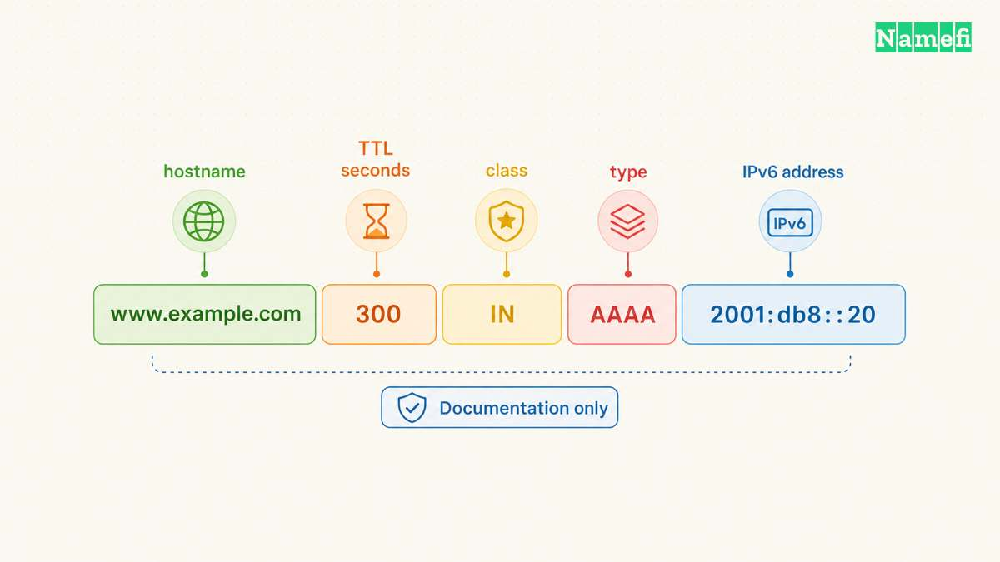
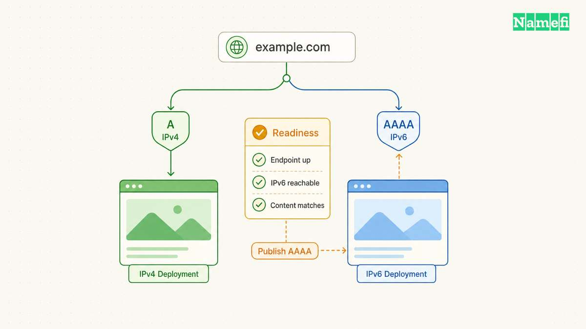
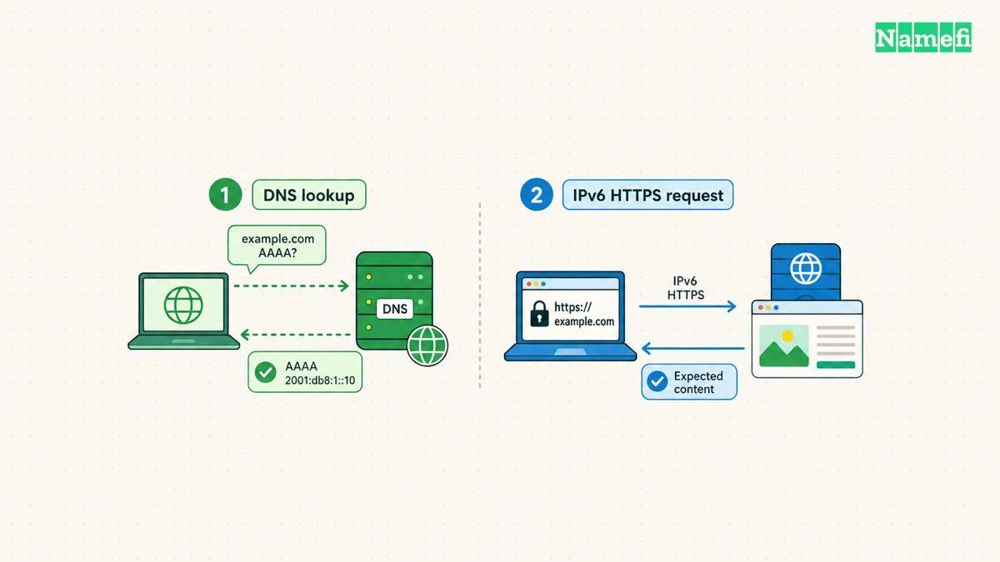
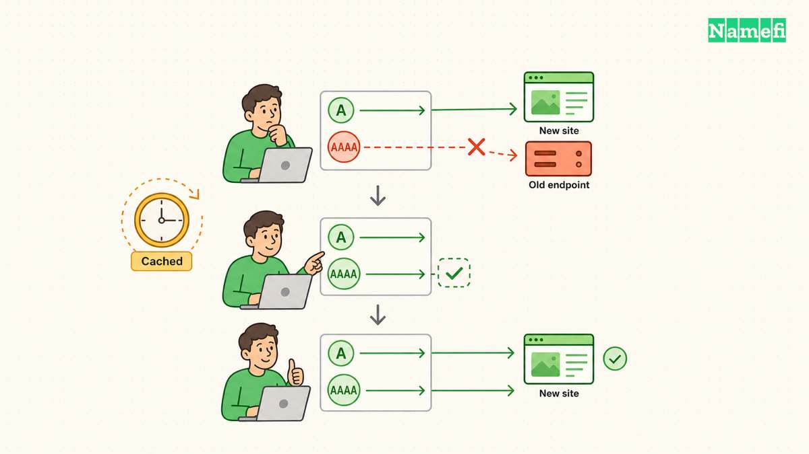

**An AAAA record connects a domain name to an IPv6 address.** An A record does the equivalent job for IPv4. A hostname can publish both. [RFC 3596 defines the AAAA record](https://www.rfc-editor.org/rfc/rfc3596.html#section-2.1).

The operational question is whether the IPv6 destination serves the correct website. Publishing an address does not configure the destination. A working IPv4 site can still have a broken IPv6 path.

This guide explains how to read an AAAA record, decide whether to add one, and test both paths. All names and addresses in examples are hypothetical. Replace example values with verified values from the provider responsible for the public endpoint.

## An AAAA record publishes an address for one hostname

[DNS](/en/glossary/dns/) holds several kinds of information. Different [DNS record types](/en/glossary/dns-record-types/) answer different questions. AAAA answers the IPv6 address question for a specific name.

Read this hypothetical zone-file entry as separate fields: `www.example.com. 300 IN AAAA 2001:db8::20`. The hostname identifies the record owner. The number gives the cache lifetime in seconds. `IN` identifies the Internet class. `AAAA` identifies the type, and the final value supplies the address. [RFC 1035 describes the shared record fields and master-file format](https://www.rfc-editor.org/rfc/rfc1035.html#section-3.2.1).

The address `2001:db8::20` is a documentation example. The reserved prefix `2001:db8::/32` must not become a real public website destination. [RFC 3849 defines that documentation range](https://www.rfc-editor.org/rfc/rfc3849.html#section-2).

An AAAA value contains an IPv6 address, not a URL. Do not enter `https://`, a page path, or a port number. If the hosting instructions supply a hostname instead, stop and check the requested record type. A hostname is not an IPv6 address.

IPv6 addresses contain colons and hexadecimal characters. Compressed notation can hide consecutive zero groups. For example, `2001:0db8:0000:0000:0000:0000:0000:0020` and `2001:db8::20` represent the same address. [RFC 5952 recommends consistent compression and lowercase text](https://www.rfc-editor.org/rfc/rfc5952.html#section-4).

Compare addresses carefully when a DNS dashboard changes the display format. A shorter value can still match the provider's longer value. Conversely, moving the double colon can change the address. Copy the complete provider value and verify the saved result.

One AAAA record stores one IPv6 address. A hostname can have multiple AAAA records when the service uses several IPv6 addresses. [RFC 3596 describes both the single-address format and multiple-record use](https://www.rfc-editor.org/rfc/rfc3596.html#section-2). Treat every published destination as a destination that requires testing.

An AAAA record can share a hostname with an A record. An ordinary CNAME cannot share its owner name with an AAAA record. [RFC 2181 defines the CNAME exclusivity rule](https://www.rfc-editor.org/rfc/rfc2181.html#section-10.1). If the provider requests a CNAME, follow the provider’s alias instructions. Do not add an AAAA record beside that CNAME. See the [CNAME and A comparison](/en/blog/cname-vs-a-record/) for alias configuration details.

The hostname matters as much as the value. A record for `www.example.com` does not automatically configure `example.com`. Make an inventory of the names visitors use before editing records. Include the bare domain and any application subdomains that the deployment actually serves.

A successful AAAA lookup also says nothing about the transport used for the lookup. A [DNS resolver](/en/glossary/dns-resolver/) can retrieve AAAA data over IPv4. [RFC 3596 explicitly separates DNS transport from the returned address family](https://www.rfc-editor.org/rfc/rfc3596.html#section-1). Therefore, seeing an IPv6 address in a lookup does not demonstrate working IPv6 connectivity from the testing computer.

## A working IPv6 endpoint determines whether you should add AAAA

Start with the hosting configuration, then inspect DNS. Ask which public endpoint should receive requests for the hostname. Obtain the provider's current connection instructions for that endpoint. An address from an old invoice or another customer's tutorial is insufficient evidence.

A dual-stack service supports both IPv4 and IPv6. However, an enabled network stack does not establish that every application supports that stack. [RFC 4213 makes that distinction](https://www.rfc-editor.org/rfc/rfc4213.html#section-2). For a website, verify the actual web service on the advertised destination.

Use the following table as a deployment decision aid. The table describes operational choices, not universal hosting-provider policy.

| Endpoint | DNS decision | Required check |
| --- | --- | --- |
| Verified IPv4 only | Keep the instructed A record | Confirm no stale AAAA remains |
| Verified IPv4 and IPv6 | Publish instructed A and AAAA | Test both families |
| Managed hostname target | Follow the provider's instructions | Avoid inventing an address |
| Unverified IPv6 destination | Delay AAAA publication | Establish service readiness |

Do not manufacture an IPv6 address from an IPv4 address. Do not copy the testing computer's address into the website's DNS. The destination must belong to the intended public service and match the provider's deployment instructions.

Consider a hypothetical team moving `www.example.com` to a new host. The team updates the A record but leaves an older AAAA record. IPv4 requests reach the new deployment. IPv6 requests can still reach the old destination. Checking only the A record would miss the incomplete migration.

The team's change checklist should track both address families for each hostname. Record the existing values, intended values, and provider instructions before making changes. Identify the person who can restore a known working configuration. A screenshot can help, but preserve copyable record values as well.

Write the acceptance criteria before publication. For example, require matching release identifiers and successful navigation to a representative page on both paths. Identify the expected hostname and public endpoint beside each criterion. A later reviewer can then repeat the same checks instead of accepting a vague report that the site loaded.

Test more than a default landing page. Verify the homepage, a representative application page, and a request that exercises a necessary dependency. Use a test account when authentication matters. Compare the deployment version and expected response content across address families.

If a service uses a CDN or reverse proxy, establish which public destination the DNS instructions describe. Do not assume the origin server's address belongs in public DNS. Provider architecture determines the intended endpoint. Ask the provider to resolve an ambiguous instruction before publishing an address.

Keep the work proportional to the service. A personal static site and a production application need different acceptance checks. Both still need a verified destination. An IPv6 address merely listed in a server dashboard does not complete the deployment review.

For a broader explanation of the service boundaries, see [domain names versus hosting](/en/blog/domain-vs-hosting/). Domain registration, DNS publication, and application deployment require separate checks even when one provider supplies all three.

## DNS queries and connection tests answer different questions

Begin with read-only queries. On a computer with `dig`, run `dig www.example.com. AAAA` and `dig www.example.com. A`. Replace the example hostname with the hostname under investigation. The trailing dot makes the intended absolute name explicit.

The [BIND dig manual documents type-specific queries and server selection](https://bind9.readthedocs.io/en/latest/manpages.html#dig-dns-lookup-utility). Keep the complete response during diagnosis. `+short` provides compact output, but compact output removes useful context. A blank compact answer does not identify the cause.

Inspect the response status and answer section together. [RFC 2308 distinguishes name errors from missing-type answers](https://www.rfc-editor.org/rfc/rfc2308.html#section-2). Neither result means that the web server rejected a connection.

| Full AAAA response | Meaning | Next check |
| --- | --- | --- |
| Answer includes AAAA | The answer supplies an IPv6 address | Compare every address with the provider’s instructions |
| `NOERROR`, no AAAA, SOA in authority | The response can indicate NODATA for the requested type | Check the queried name and any alias target |
| `NXDOMAIN` | The queried name, or the final alias target, does not exist | Inspect spelling and the complete CNAME chain |
| `SERVFAIL` | The server could not process the query | Diagnose the DNS failure before changing website addresses |

`NODATA` describes a response condition, not a separate status code. A referral can also contain `NOERROR` and no answer. Check the authority section before concluding that the hostname lacks AAAA data. [RFC 2308, section 2.2, explains the distinction](https://www.rfc-editor.org/rfc/rfc2308.html#section-2.2). [RFC 1035 defines SERVFAIL as a server failure](https://www.rfc-editor.org/rfc/rfc1035.html#section-4.1.1).

A CNAME in an AAAA answer identifies an alias. Check the final target before adding or deleting records at the original name. [RFC 2308 explains negative responses through CNAME chains](https://www.rfc-editor.org/rfc/rfc2308.html#section-2.1).

Next, compare the published answer with the intended configuration. If necessary, query the service's authoritative [nameserver](/en/glossary/nameserver/) using `dig @ns1.example.net. www.example.com. AAAA`. The server name here is a placeholder. Obtain the actual authoritative server from the domain's verified DNS configuration.

Interpret each response within the question asked. A recursive resolver's answer helps explain what that resolver currently supplies. An authoritative answer helps establish what the queried authoritative server currently publishes. Save the query time and server identity alongside the result.

Then test the website from a computer with working IPv6 connectivity. With curl, compare `curl -4 --verbose --max-time 20 https://www.example.com/` and `curl -6 --verbose --max-time 20 https://www.example.com/`. These requests select different address families. [The curl manual documents both family options](https://curl.se/docs/manpage.html#-6).

Keep the hostname in the URL during testing. An address-only request can exercise a different application configuration. For advanced checks, curl's `--resolve` option can substitute a chosen address while retaining the URL hostname. [The manual documents the override syntax](https://curl.se/docs/manpage.html#--resolve). Use the actual intended address and avoid sharing verbose output that contains private application data.

Review the connected address and the returned content. Curl documents resolver-dependent mapped-address behavior, including on macOS. A forced-family command therefore needs interpretation within the testing environment. An IPv6-capable external test location provides additional evidence when the local network lacks native connectivity.

Record failures at the stage where failures occur: name lookup, connection establishment, certificate validation, or application response. Preserve certificate validation during HTTPS testing. An error disappears for the wrong reason if a test disables the check that detected the problem.

Do not interpret one successful homepage request as complete coverage. Repeat a representative request for each advertised destination when practical. If results differ between networks, retain both observations. A useful incident report identifies the hostname, address family, testing network, response, and time.

## A targeted rollback addresses broken IPv6 publication

A browser can make a broken deployment appear healthy. Happy Eyeballs coordinates address lookups and connection attempts to reduce connection delays. [RFC 8305 describes the process](https://www.rfc-editor.org/rfc/rfc8305.html#section-2). The successful path can hide a failed alternative.

Fallback also has boundaries. A successful connection to the wrong application can produce an error page rather than trigger another address-family attempt. [RFC 8305 discusses application-layer limitations and hidden operational issues](https://www.rfc-editor.org/rfc/rfc8305.html#section-9.2). Test IPv6 directly instead of relying on an ordinary browser visit.

For a hypothetical incident, suppose IPv4 serves the expected site while IPv6 times out after a migration. Confirm the AAAA value first. Compare the value with the new host's instructions. Then check the IPv6 listener, network access rules, routing, and public endpoint configuration with the hosting operator.

If IPv6 reaches an unexpected page, investigate deployment selection instead of treating the result as a routing timeout. If IPv6 reports a certificate error, investigate the HTTPS configuration for the requested hostname. These observations identify different repair tasks.

Choose a recovery action that matches the evidence. Correct a verified mistyped value, repair the IPv6 service, or restore the previously verified configuration. If the deployment should temporarily serve only IPv4, review removal of the affected AAAA record with the service owner. Preserve unrelated records and working hostnames.

An AAAA deletion does not immediately remove every cached answer. The [TTL](/en/glossary/ttl/) sets a record's cache lifetime in seconds. [RFC 1035 defines the TTL field](https://www.rfc-editor.org/rfc/rfc1035.html#section-3.2.1). A resolver that already holds an older answer can continue supplying that answer during its applicable cache lifetime.

Adding a previously absent AAAA record can also encounter cached negative answers. [RFC 2308 explains negative caching and its SOA-based lifetime](https://www.rfc-editor.org/rfc/rfc2308.html#section-5). Avoid promising a universal propagation interval. Compare the authoritative state and observed resolver responses instead.

Keep the DNS change and the server repair distinguishable in the incident record. If an operator changes both simultaneously, later tests cannot establish which change fixed the fault. Prefer one verified correction followed by a fresh check when the incident permits that sequence.

Keep a short recovery log. Record the changed hostname, previous value, replacement value or removal, and change time. Add the authoritative response and separate IPv4 and IPv6 test results. Another operator should understand the recovery without guessing which dashboard entry changed.

Finish by checking the application again from an IPv6-capable network and the existing IPv4 path. Review monitoring so the next incident does not depend on a visitor complaint. The deployment is ready when the published destinations serve the intended application under the intended hostname.

## Sources and further reading

- [RFC 3596: DNS Extensions to Support IPv6](https://www.rfc-editor.org/rfc/rfc3596.html#section-2), sections 1–2.4. Fetched 2026-10-21.
- [RFC 2181: Clarifications to the DNS Specification](https://www.rfc-editor.org/rfc/rfc2181.html#section-10.1), section 10.1. Fetched 2026-10-21.
- [RFC 1035: Domain Names, Implementation and Specification](https://www.rfc-editor.org/rfc/rfc1035.html#section-3.2.1), sections 3.2.1, 3.4.1, 4.1.1, and 5.1. Fetched 2026-10-21.
- [RFC 3849: IPv6 Address Prefix Reserved for Documentation](https://www.rfc-editor.org/rfc/rfc3849.html#section-2), sections 2–3. Fetched 2026-10-21.
- [RFC 5952: IPv6 Address Text Representation](https://www.rfc-editor.org/rfc/rfc5952.html#section-4), sections 4.1–4.3. Fetched 2026-10-21.
- [RFC 4213: Basic Transition Mechanisms](https://www.rfc-editor.org/rfc/rfc4213.html#section-2), sections 2–2.2. Fetched 2026-10-21.
- [BIND dig manual](https://bind9.readthedocs.io/en/latest/manpages.html#dig-dns-lookup-utility), simple usage, query options, and return codes. Fetched 2026-10-21.
- [Curl manual](https://curl.se/docs/manpage.html#-6), `--ipv4`, `--ipv6`, `--verbose`, `--max-time`, and `--resolve`. Fetched 2026-10-21.
- [RFC 2308: Negative Caching](https://www.rfc-editor.org/rfc/rfc2308.html#section-2), sections 2–5. Fetched 2026-10-21.
- [RFC 8305: Happy Eyeballs Version 2](https://www.rfc-editor.org/rfc/rfc8305.html#section-2), sections 2–5 and 9.2–9.3. Fetched 2026-10-21.
