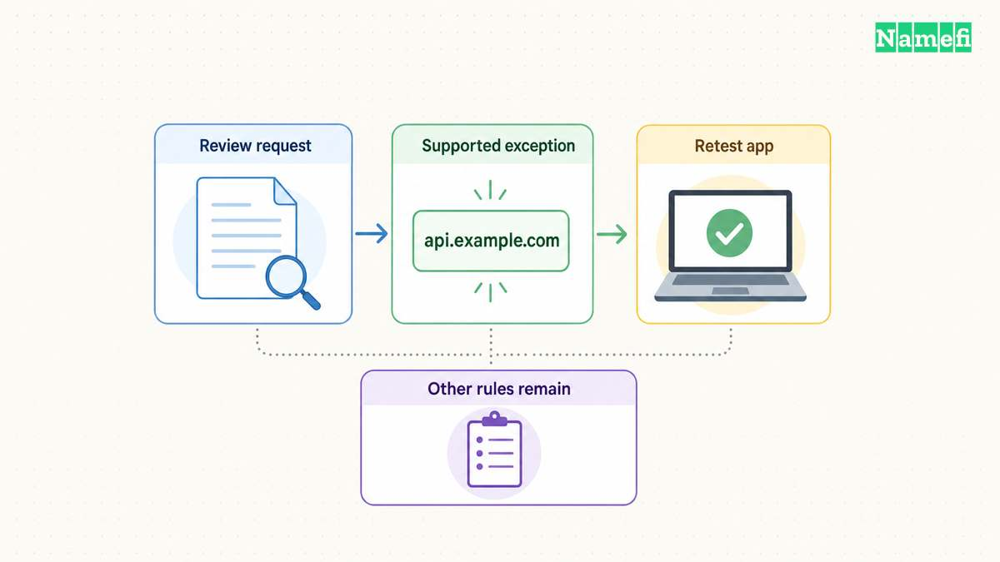

**Use [AdGuard's public filtering DNS](/en/blog/adguard-dns-setup/) for a simple starting point, NextDNS for configurable hosted filtering, or Pi-hole for a local filter you operate.** These are recommendations by operating preference, not measured blocking rankings. Official documentation describes [AdGuard's endpoints](#adguard-publishes-filtering-endpoints-and-setup), [NextDNS controls](#nextdns-offers-custom-filtering-and-logging-controls), and [Pi-hole's local service](#pi-hole-provides-local-network-filtering).

Expect domain-level filtering rather than complete ad removal. Ads that share a domain with wanted content cannot be separated by a DNS-level blocker without also blocking that content. [AdGuard documents that limitation.](#adguard-explains-filtering-limits-and-verification)

This guide focuses on advertising filters. For general resolver selection, use the [public DNS resolver guide](/en/blog/choose-public-dns-resolver/).

## Choose the operating model before choosing an endpoint

A useful shortlist starts with how much control and maintenance you want:

| Choice | Best fit as an editorial recommendation | Verify before adopting |
| --- | --- | --- |
| AdGuard public filtering DNS | A quick trial without maintaining a local server | Correct filtering endpoint and device compatibility |
| NextDNS | Hosted filtering with custom rules and logging choices | Configuration, plan conditions, and log settings |
| Pi-hole | A local filtering service under your administration | Supported hardware, maintenance, backups, and client routing |

AdGuard publishes different endpoint groups for filtering, non-filtering, and family protection. Select the group that matches the policy you want. A non-filtering endpoint does not become an ad blocker because the endpoint carries the same provider name. [Read AdGuard's endpoint descriptions.](#adguard-publishes-filtering-endpoints-and-setup)

NextDNS offers custom allow and deny controls, along with configurable logging and encrypted DNS support. [Its feature page describes those controls.](#nextdns-offers-custom-filtering-and-logging-controls) Read the current plan conditions before deploying a profile across your devices.

Pi-hole describes network-wide filtering on your own Linux hardware and publishes open-source software. [Its documentation defines the local model.](#pi-hole-provides-local-network-filtering) Choose that model when someone will maintain the service and respond to outages.

Avoid selecting solely by blocklist size or a provider's broad marketing claim. As a practical evaluation, test the websites and applications you actually use and record both unwanted ads and legitimate functions that break.

## Configure one device before changing the whole network

Make the first trial reversible. Save the original DNS settings and identify whether the device belongs to an organization that controls the network configuration. Use approved settings on a managed device.

For Android's Private DNS provider-hostname field, AdGuard lists `dns.adguard-dns.com` for its default filtering service. Use the provider's current platform instructions and the field's required format. [Read the Android setup steps.](#adguard-publishes-filtering-endpoints-and-setup)

For a setting that accepts ordinary IPv4 DNS addresses, AdGuard publishes the filtering pair `94.140.14.14` and `94.140.15.15`. [Verify the current pair on the official page.](#adguard-publishes-its-dns-address-pair) Do not paste an IP address into a field that requires a provider hostname, or a hostname into a numeric-address field.

For NextDNS, use the configuration-specific setup instructions shown by the service. For Pi-hole, follow the supported client or router configuration rather than guessing a local server address.

After applying the change, repeat a normal browsing task and an important application task. Keep the original configuration available until the trial passes.

If you later change router settings, plan and test that change separately. Confirm what the router distributes to clients and verify individual devices. Avoid assuming a router screenshot establishes every application's actual DNS path.

## Understand why some ads and empty spaces remain

DNS filtering makes a decision about domain names. The filter cannot selectively remove an ad merely because the ad appears inside a page you otherwise want.

AdGuard's documentation says DNS filtering does not perform cosmetic cleanup, including removal of empty spaces left by blocked ads. The same documentation explains that some ads require blocking entire domains used for other purposes. [Read the filtering limitations.](#adguard-explains-coarse-domain-filtering)

AdGuard's current FAQ lists YouTube and Twitch ads, along with sponsored posts on several social platforms, as examples beyond ordinary DNS-level separation. [Read the known limitations.](#adguard-explains-filtering-limits-and-verification)

Therefore, a video ad still playing does not by itself prove the DNS setting failed. First establish whether the device uses the intended resolver. Then determine whether the unwanted material has a separately blockable domain.

For an illustrative site, imagine wanted content and an ad share the same hostname. Blocking that hostname also blocks the wanted service. The example demonstrates the documented domain boundary, rather than describing a live website test.

If finer page control matters, evaluate an appropriate browser or content-filtering tool separately. Do not expect a different DNS address alone to remove every page element or video advertisement.

## Verify the active filter before editing the blocklist

Check the actual DNS path with the provider's supported diagnostic workflow. For AdGuard Home, the FAQ instructs users to inspect the answering server and confirm a test request appears in the query log. [Follow the verification procedure.](#adguard-explains-filtering-limits-and-verification)

A saved DNS setting, a successful ordinary lookup, and a blocked test request answer different questions. Keep those observations separate.

If a query never reaches the expected filter, inspect the client configuration before adding rules. Review any configured VPN, browser DNS setting, or management profile as part of the local investigation. Change one approved setting at a time and repeat the test.

If the query reaches the filter but remains allowed, inspect the selected filters, exceptions, and rewrites. AdGuard Home explicitly lists those configuration checks. [Its FAQ explains the next steps.](#adguard-explains-filtering-limits-and-verification)

Do not publish complete household query logs to request help. Share the minimum domain, timestamp, observed decision, and relevant setting needed for the investigation.

## Repair false positives with a narrow exception

When a needed application stops working, reproduce the exact action and compare the filter's logged decision. Temporarily restore the previous configuration if necessary to establish whether the filter caused the failure.

If the service supports custom exceptions, allow the necessary domain and retest the original action. NextDNS documents custom allow and deny controls. [Check those controls before selecting the service.](#nextdns-offers-custom-filtering-and-logging-controls)

Keep a note of the exception and reason. Avoid adding broad exceptions without checking which function requires access. Review exceptions when the application or blocklists change.

The next action is a controlled trial on one device. Choose the policy, verify the resolver, test important applications, and record the remaining limits. Extend the configuration only after the trial provides evidence that the filter meets your needs.

## Sources and further reading

### AdGuard publishes filtering endpoints and setup

[adguard-public official source](https://adguard-dns.io/en/public-dns.html#:~:text=Default%20server) — fetched 2026-10-30 UTC.

### AdGuard publishes its DNS address pair

[adguard-addresses official source](https://adguard-dns.io/en/public-dns.html#:~:text=94.140.14.14) — fetched 2026-10-30 UTC.

### NextDNS offers custom filtering and logging controls

[nextdns official source](https://nextdns.io/#:~:text=Custom%20Denylist%2FAllowlist) — fetched 2026-10-30 UTC.

### Pi hole provides local network filtering

[pihole official source](https://docs.pi-hole.net/#:~:text=Network-wide%20ad%20blocking%20via%20your%20own%20Linux%20hardware) — fetched 2026-10-30 UTC.

### AdGuard explains coarse domain filtering

[dns-filter official source](https://adguard-dns.io/kb/general/dns-filtering/#dns-filtering-vs-network-filtering) — fetched 2026-10-30 UTC.

### AdGuard explains filtering limits and verification

[adguard-faq official source](https://adguard-dns.io/kb/adguard-home/faq/#limitations) — fetched 2026-10-30 UTC.

Checked diagnostic passage: [AdGuard Home resolver and query-log checks](https://adguard-dns.io/kb/adguard-home/faq/#doesntblock).
