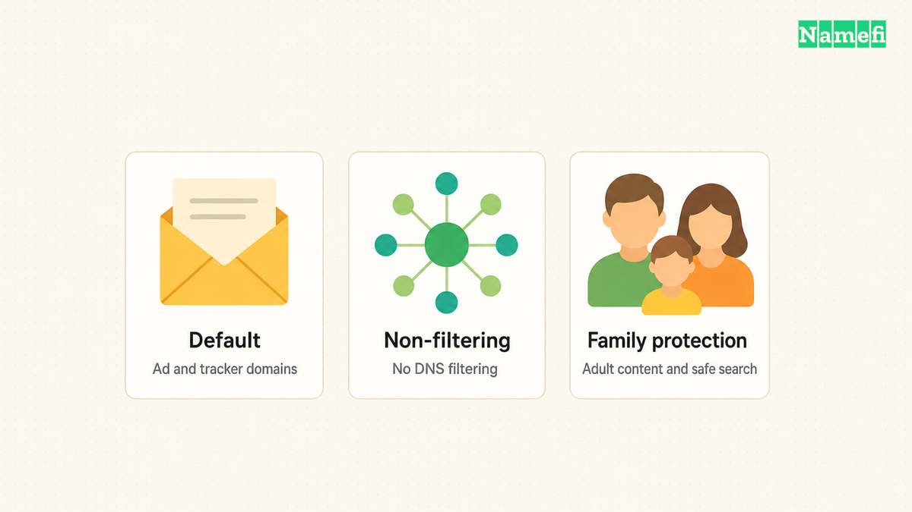
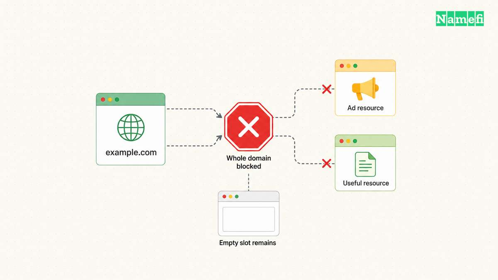

AdGuard DNS can block requests to advertising and tracking domains when a device uses AdGuard's filtering resolver. Start with the official [public DNS setup page](https://adguard-dns.io/en/public-dns.html#:~:text=Option%202). Choose the filtering mode, apply the correct settings for one device, and test before changing the whole network. [AdGuard publishes the supported addresses and instructions](#adguard-publishes-server-addresses-and-device-instructions).

[DNS filtering](/en/blog/ad-blocking-dns/) acts on domain requests. It does not remove every advertisement or replace all browser content filtering. [AdGuard explains the limits of DNS-level blocking](#adguard-explains-dns-filtering-limits).

## The server mode determines the filtering policy

AdGuard publishes Default, Non-filtering, and Family protection options. [The public setup page distinguishes their policies](#adguard-publishes-server-addresses-and-device-instructions).

Use Default when you want the standard advertising and tracking domain filtering. Use Family protection only when its additional adult-content and safe-search behavior fits the household or managed network. Non-filtering does not provide the advertising-domain blocking that this setup seeks.

Do not mix modes casually. A device that can use a filtering address or a non-filtering address may produce inconsistent expectations. Apply the intended policy to the complete configured resolver set.

The mode decision also affects other people. Confirm authority to change a shared router before replacing the network's resolver settings. For a workplace or school device, follow the network administrator's policy.

The [public resolver selection guide](/en/blog/choose-public-dns-resolver/) offers a broader comparison of policy, transport, and troubleshooting requirements.

## Android Private DNS accepts a hostname rather than an IP address

AdGuard's Android instructions use the system's Private DNS setting. Open the device's network settings, locate Private DNS, and select the provider-hostname option. Menu names can vary across Android versions and device vendors.

For Default filtering, enter `dns.adguard-dns.com`. Save the setting and confirm that normal browsing still works. [AdGuard lists that exact hostname for the Default server](#adguard-publishes-server-addresses-and-device-instructions).

For a different policy, use the matching hostname from the same official instructions. Do not paste an HTTPS URL into a field that expects only a provider hostname.

AdGuard documents encrypted DNS transports separately. [DNS-over-TLS encrypts DNS communication](#adguard-describes-encrypted-dns-protocols). Entering plain DNS server IP addresses in a different network screen does not establish that the device uses the same encrypted transport.

Record the previous setting before making the change. If the network cannot reach the configured service, restore the previous setting and investigate connectivity. Avoid disabling certificate validation or changing unrelated security controls.

## A router or desktop setup needs the complete resolver addresses

AdGuard lists these Default plain DNS addresses:

| Address family | Default resolver addresses |
| --- | --- |
| IPv4 | `94.140.14.14` and `94.140.15.15` |
| IPv6 | `2a10:50c0::ad1:ff` and `2a10:50c0::ad2:ff` |

[The official setup page supplies those values](#adguard-publishes-server-addresses-and-device-instructions). Copy the addresses carefully and use the instructions for the actual device or router.

A router may expose several DNS-related fields. Distinguish the router's upstream resolver from the DNS addresses the router advertises to clients. Follow the router vendor's instructions instead of guessing from a field label.

Review IPv6 as well as IPv4 when the network uses both. An unchanged resolver path can explain why some requests appear to bypass the intended policy.

For an encrypted router configuration, use the matching endpoint and transport from AdGuard's instructions. Do not assume every router supports every transport. A hostname, an HTTPS endpoint, and a plain IP address belong in different configuration fields.

## A reversible test should establish which resolver the device uses

Begin with one device and record its prior configuration. Save the chosen AdGuard mode and transport. Test ordinary browsing, a known work application, and the services important to the device owner.

Check the active network settings after applying the change. A browser, VPN, or managed application can have its own DNS configuration. A system setting therefore needs verification in the application that matters.

A command-line lookup can help establish the configured resolver's response. Keep the command output and test time when investigating an issue. Avoid claiming that an advertisement's disappearance alone proves which resolver handled the request.

After the device test, expand the change only to the devices or network you administer. Keep a clear rollback instruction with the saved previous settings. A household-wide change deserves a broader application test than a single browsing check.

## DNS filtering can leave ads visible or block useful content

AdGuard explains that DNS filtering does not perform cosmetic filtering. Blank spaces can remain after blocked advertising requests. Some complicated advertisements cannot disappear without blocking domains that also serve useful content. [Those limitations follow from the domain-level approach](#adguard-explains-dns-filtering-limits).

If a site breaks, record the affected hostname, device, network, and chosen mode. Compare a controlled test using the prior approved configuration. Restore normal access while investigating rather than changing several settings at once.

Public filtering offers less customization than a configuration with your own filtering rules. [AdGuard describes the difference between a blocking resolver and local blocklists](#adguard-explains-dns-filtering-limits). Choose a different supported setup when the project requires detailed exceptions.

Do not treat DNS filtering as proof that every destination is safe. Keep the device's normal software updates, account protections, and browsing precautions.

## A successful setup needs a documented policy and rollback

Record the filtering mode, addresses or endpoint, transport, changed device, and prior settings. Confirm that expected applications work after the change.

The next action is to open the official instructions for one device and apply the Default filtering option. Verify the active resolver path before expanding the configuration across other devices.

## Sources and further reading

### AdGuard publishes server addresses and device instructions

[AdGuard publishes server addresses and device instructions](https://adguard-dns.io/en/public-dns.html#:~:text=Private%20DNS%20provider%20hostname) — checked 2026-10-30.

### AdGuard explains DNS filtering limits

[AdGuard explains DNS filtering limits](https://adguard-dns.io/kb/general/dns-filtering/#dns-filtering-vs-network-filtering) — checked 2026-10-30.

### AdGuard describes encrypted DNS protocols

[AdGuard describes encrypted DNS protocols](https://adguard-dns.io/kb/public-dns/choosing-a-protocol/#dns-over-tls-dot) — checked 2026-10-30.
