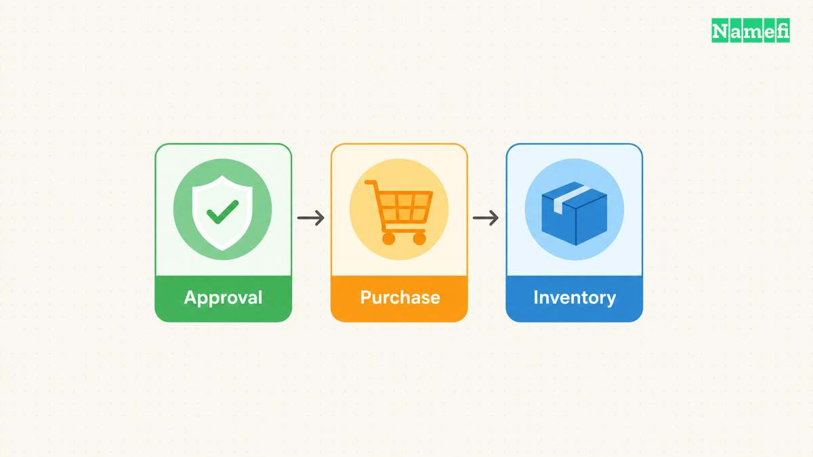
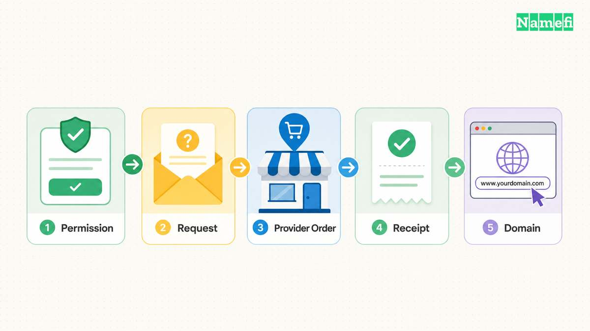
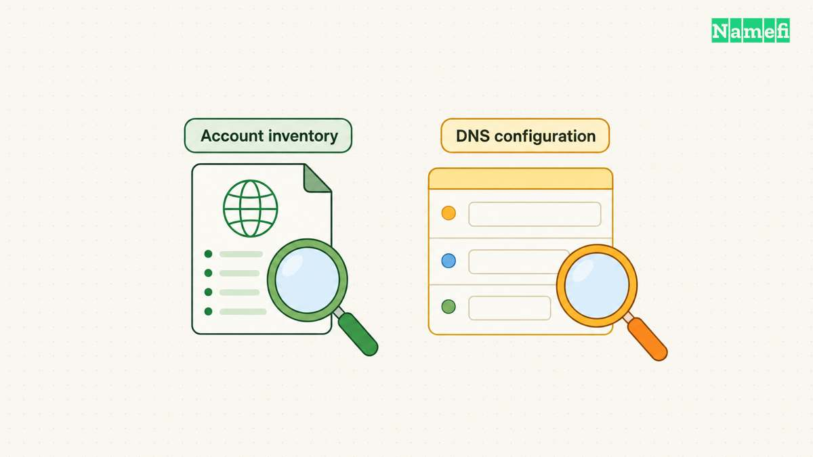

An AI agent purchase audit should connect four records: the owner's instruction, the [approved purchase](/en/blog/delegate-domain-agent-permissions/), the provider's order, and the resulting registration. A fluent completion message cannot establish those connections.

Start with a precise question: did the agent acquire the exact domain, for the approved account, under the approved price and registration conditions? Then check whether the agent changed anything else. Nameservers, renewal settings, and account contacts deserve their own answers.

The following workflow provides an operating procedure for a small business. The procedure does not claim that every registrar exposes the same logs. Teams should record missing evidence explicitly and request provider confirmation when necessary.

## An audit begins with the authority that permitted the purchase

Keep the original instruction and the final approval together. The instruction should identify the intended domain, registration period, spending limit, account, and permitted follow-up changes. A request to find candidates differs from permission to place an order.

[OWASP identifies excessive functionality, permissions, and autonomy as separate causes of excessive agency](https://genai.owasp.org/llmrisk/llm062025-excessive-agency/). For domain purchases, review those causes as separate questions. Could the agent buy a domain? Could the credential modify every domain? Could the agent proceed without another approval?

Consider a hypothetical studio that approves one example.com registration. The studio authorizes a one-year term and a stated total price. The studio does not authorize a different extension, a premium aftermarket purchase, or changes to existing mail records.

The auditor should compare that instruction with the actual tool arguments. A matching description in the assistant's final message does not substitute for the arguments. Preserve the normalized domain string alongside the human-readable name, particularly when internationalized characters appear.

Record the intended customer account before inspecting the receipt. A purchase can succeed technically while placing the domain in an unexpected account. Verify the account through the provider's own authenticated interface. Avoid recording an access token as proof of account identity.

For standing authorization, identify the policy version that applied at execution time. A team might authorize purchases below an internal budget without asking each time. That budget is the team's policy, not an industry standard. The record should show whether the specific purchase satisfied the policy.

A useful approval record includes the approver, timestamp, domain, duration, currency, maximum total, and permitted configuration. Include taxes or other checkout charges when the approval uses a total. Mark a price field as unknown when the provider has not supplied a quote.

Check the order of events as well. Approval after execution documents later acceptance, but approval after execution does not prove that earlier execution had authorization. Preserve both timestamps rather than rewriting the sequence.

Finally, distinguish the owner from the operator. A contractor might run the agent for a company. The company still needs an explicit account and registration relationship. The audit should identify the company representative who can resolve a discrepancy without relying on the contractor's private conversation history.

## Transaction evidence separates attempts from completed registrations

Build an event sequence from the approval through the provider response. Use the provider's order identifier and request identifier when available. Also keep an internal correlation identifier that links the agent run to the purchase record.

[OWASP recommends recording event time, actor, action, target, and outcome](https://cheatsheetseries.owasp.org/cheatsheets/Logging_Cheat_Sheet.html#event-attributes). A domain workflow needs those basic fields before the workflow needs a large transcript archive. Structured fields make comparison possible across multiple tools.

| Evidence | Question the evidence answers | Limitation |
| --- | --- | --- |
| Approved instruction | What could the agent do? | Does not prove execution |
| Tool request | What did the client submit? | Does not prove provider acceptance |
| Provider order | What did the provider record? | Can include a pending state |
| Registration inventory | Which account lists the domain? | Does not explain every prior action |
| Billing receipt | What amount did the provider charge? | Does not prove correct DNS configuration |

Keep attempts separate from results. An availability search is not a reservation. A checkout request is not necessarily a completed registration. A timeout is an uncertain outcome until the provider record resolves the uncertainty.

For a hypothetical timeout, inspect order history before retrying the purchase. If the API offers an idempotency mechanism, review whether the original request used that mechanism correctly. Do not assume that a different registrar supports the same retry behavior.

Write the resulting state explicitly: completed, pending, failed, or unknown. Use the provider's vocabulary in a separate field if the provider uses different labels. Avoid translating every response into a generic success flag.

Compare the charged amount with the approved amount in the same currency. Record registration length and any add-on charges separately. A renewal quotation can differ from the initial registration charge, so preserve both when the provider supplies both.

Inspect duplicate attempts as their own issue. Two requests can represent one legitimate retry or two different purchases. Request identifiers, timestamps, and provider orders help determine the sequence. Agent explanations alone cannot settle whether the provider accepted both requests.

Keep the evidence readable for another person. Store a concise event table beside the original provider records. Preserve the original files with appropriate access controls, and describe any redaction. A screenshot without a timestamp or account context can create more questions than answers.

## Registration and configuration checks establish the resulting state

Open the account inventory and locate the exact domain. Verify the registration period, expiration information, renewal settings, and available registration contacts. Record which fields the provider exposes and which fields require support confirmation.

The [registrant](/en/glossary/registrant/) relationship deserves separate attention. Account access and payment authority do not automatically answer which entity holds the registration. Review the registration agreement when the intended holder differs from the account operator.

Public registration data can supplement the account record, but public data can redact personal fields. A redacted record cannot prove that the intended company owns the account. Use public data for the fields actually returned, and keep account verification separate.

Next, inspect configuration changes. Compare the approved nameservers with the current delegation. Compare the intended DNS records with the current zone. A new registration and a DNS deployment are different operations, even when the agent performs both in one conversation.

For the hypothetical studio, the expected outcome might include a blank DNS zone. A mail record, website redirect, or unfamiliar nameserver would then require explanation. Another project might explicitly approve those same settings. Judge the difference against the documented instruction.

Use a small before-and-after table for existing domains. Include the record name, type, value, and TTL for every approved change. For nameserver changes, preserve the previous delegation and the intended replacement. The [DNS control-plane guide](/en/blog/dns-is-the-control-plane/) explains why registration access and DNS access deserve separate treatment.

Check whether the agent accessed additional tools during the run. The [MCP security guidance warns that token passthrough can obscure accountability](https://modelcontextprotocol.io/docs/2025-11-25/tutorials/security/security_best_practices#token-passthrough). Apply that observation only to MCP implementations that use the relevant architecture. A tool connection does not establish a universal identity chain.

Ask the integration owner how the provider associates requests with users. If the integration uses a shared service identity, document the additional event record that connects the shared identity to the approved task. Do not claim individual attribution when the logs expose only a shared account.

Finish with an independent check of the business outcome. Confirm that an authorized person can find the domain and receive important account messages. A successful website response cannot prove renewal control, and a paid receipt cannot prove that the website points to the intended service.

## A compact audit report records exceptions and follow-up owners

Write a conclusion that states what the evidence supports. A useful conclusion names the domain, provider account, registration result, amount, approved changes, and unresolved exceptions. Avoid a broad statement that the agent acted safely in every respect.

For the studio example, a supported conclusion might say that the approved one-year registration appears in the intended account. The conclusion can separately state that the price matches the receipt and that no additional changes appear in the available provider log. The word available matters when the provider does not expose a complete activity history.

Classify exceptions by the next action. An unexpected charge needs billing reconciliation. An unexpected domain needs immediate provider contact. An unrecognized credential needs access review. An unavailable log needs a documented evidence gap, rather than an invented clean result.

Keep secrets out of the report. [OWASP advises excluding access tokens, passwords, and payment-card data from ordinary logs](https://cheatsheetseries.owasp.org/cheatsheets/Logging_Cheat_Sheet.html#data-to-exclude). Use account identifiers and receipt references instead. Restrict personal contact information to people who need that information.

A practical closing checklist follows:

1. Match the exact domain against the approved instruction.
2. Match the provider account against the intended customer.
3. Reconcile the registration period and total charge.
4. Resolve every pending or uncertain purchase attempt.
5. Compare configuration changes with the approved scope.
6. Assign an owner and deadline to each exception.
7. Preserve records under the team's retention policy.
8. Remove temporary credentials when the task ends.

Choose retention according to the business, contractual, and applicable legal requirements. This guide supplies no universal retention period. Keep a lightweight index so a later reviewer can locate the original evidence without searching a long chat transcript.

Test the process before delegating a large portfolio purchase. Use a non-purchasing rehearsal to confirm that approval fields, request identifiers, and exception handling appear in the records. An authorized small purchase can then test the complete path if the business needs that validation.

The final audit should let a colleague reconstruct the transaction without trusting the agent's memory. Clear authorization, attributable requests, provider records, and verified account state provide that reconstruction. Missing evidence should remain visible until the responsible person resolves the gap.

## These sources support the article

- [OWASP: LLM06:2025 Excessive Agency](https://genai.owasp.org/llmrisk/llm062025-excessive-agency/). Causes and mitigation principles. Fetched 2026-10-21.
- [OWASP: Logging Cheat Sheet](https://cheatsheetseries.owasp.org/cheatsheets/Logging_Cheat_Sheet.html). Event attributes and data to exclude. Fetched 2026-10-21.
- [Model Context Protocol: Security Best Practices](https://modelcontextprotocol.io/docs/2025-11-25/tutorials/security/security_best_practices). Token passthrough and audit-trail risks. Fetched 2026-10-21.
