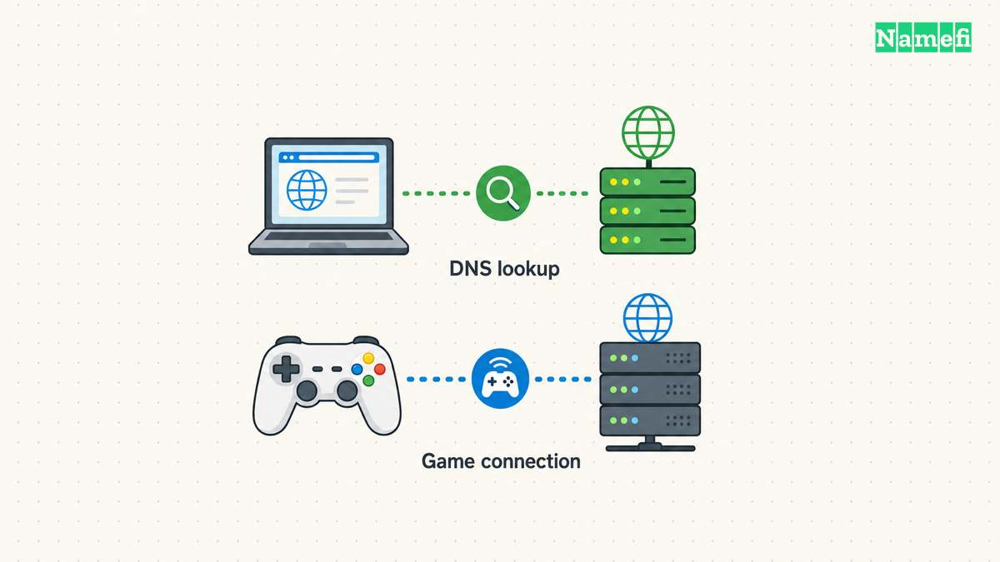
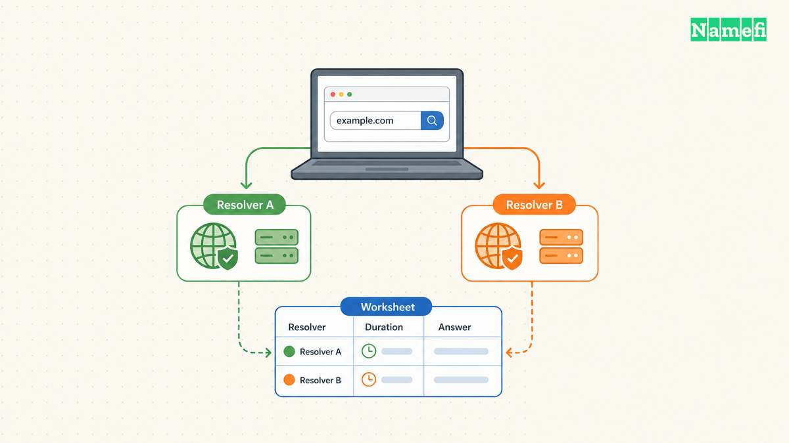

Run a DNS speed test from the device and connection that matter to you. Compare several queries, record failures, and repeat the test under similar conditions. The fastest single response is insufficient evidence for changing a working resolver.

DNS timing includes network and resolver work. Google identifies cache misses, overloaded resolvers, and network conditions as causes of DNS latency. [Google explains those causes](#google-explains-dns-latency). A useful comparison needs to control the test conditions rather than assume one provider wins everywhere.

## The test must identify the operation being measured

A DNS query resolves a name or retrieves another DNS record. A website visit also includes connections, encryption, server processing, and content transfer. Treat those as separate measurements.

Similarly, a game’s established network connection needs its own diagnostics. A shorter DNS lookup does not establish lower match latency. If the problem occurs during gameplay, use the game’s network telemetry alongside DNS investigation.

Write the symptom before choosing a tool. “The launcher pauses before sign-in” identifies a different event from “the match responds slowly.” The first observation may justify a lookup test. The second observation needs evidence about the game connection.

As practical guidance, define the success condition: reliable resolution for the actual services, with consistently acceptable lookup time. Do not make the fastest isolated response the only target.

## A useful comparison keeps the network conditions stable

Test from the same device, network, and connection type. Record whether a VPN, browser secure-DNS setting, or organization policy affects the path. Avoid changing those conditions midway through a resolver comparison.

Use approved resolver endpoints. Do not bypass a workplace DNS policy to run a speed test. An organization may need internal resolution or security controls that a public resolver cannot replace.

Create a worksheet before collecting results:

| Observation | Record with units or context |
| --- | --- |
| Query duration | Milliseconds reported by the tool |
| Query | Exact name and record type |
| Resolver | Endpoint used by the test |
| Transport | The tested DNS transport |
| Outcome | Answer, error, or timeout |
| Time | Timestamp and timezone |
| Network | Connection type and relevant VPN state |

The worksheet contains no invented benchmark values. Fill the worksheet from the actual run. Preserve unusual results rather than deleting slow queries from the record.

## The dig tool can show query statistics

The BIND documentation describes `dig` as a DNS lookup tool and documents query statistics through `+stats`. [The official manual explains statistics](#bind-documents-dig-statistics).

For a basic example, `dig example.com A +stats` requests an address record through the tool’s configured resolver path. Read the answer status and the query-time field. The example is a command illustration, not a result from this article.

For an explicit resolver comparison, use the manual’s `@server` argument with the approved resolver’s actual address. Replace the argument deliberately. Do not copy a placeholder as though the placeholder were a functioning server.

Keep the query type fixed when comparing runs. A query for an address record and a query for a TXT record can involve different data. Read the returned addresses as well as the timing, especially when a service uses several possible destinations.

A command-line query also may follow a different path from a browser using encrypted DNS. As testing advice, identify the application’s actual configuration before calling a command-line result a measurement of browser behavior.

## Repeated queries expose cache effects

A resolver can answer from cache or query other nameservers. Google explains that a cache miss adds recursive network work and can increase latency. [The performance documentation explains the effect](#google-explains-dns-latency).

Repeat a query, but label the repetitions accurately. A later answer may benefit from a warm cache. Clearing a device cache does not establish that a public resolver has no cached copy.

Avoid describing a test as “cold cache” unless the test actually controls the relevant cache state. On a public resolver, that condition may remain unknown. Record the uncertainty rather than creating a false experimental label.

Use a small, relevant set of hostnames and repeat the comparison across more than one session. Alternate the resolver order where practical. That advice reduces dependence on one moment’s congestion, but does not turn a home test into a global ranking.

Do not generate large volumes of random queries merely to force misses. A useful household comparison should stay small and focused on legitimate resolution needs.

## Reliability can matter more than a small timing difference

Count timeouts and unsuccessful queries. Check whether the required services resolve correctly. A resolver that returns a quick policy block does not provide the same outcome as a resolver that returns the expected usable answer.

Compare the spread of observed durations rather than the minimum alone. When reporting a median or another summary, state the sample size and unit. Retain the raw observations so another person can inspect the calculation.

Do not publish a provider ranking from hypothetical values. This article supplies a procedure without measured winners. The [public resolver guide](/en/blog/choose-public-dns-resolver/) addresses the wider selection criteria.

## A resolver change needs an application test and a rollback

Save the original settings before changing the resolver. Change one device first where permitted. Test the actual browser, application, or launcher after the change.

Check internal services if the device belongs to an organization. Restore the prior configuration if required names stop resolving. Repeat the original symptom test before keeping the change.

The [ISP versus public resolver guide](/en/blog/isp-dns-vs-public-resolver/) helps with the wider decision. Keep the resolver change only when the measured benefit, reliability, and operating requirements support that choice.

## Sources and further reading

### Google explains DNS latency

[Google explains DNS latency](https://developers.google.com/speed/public-dns/docs/performance#:~:text=If%20a%20response%20cannot%20be%20served%20from%20a%20resolver%27s%20cache%2C%20but%20requires%20recursively%20querying%20other%20name%20servers%2C%20the%20added%20). Supporting passage: “If a response cannot be served from a resolver's cache, but requires recursively querying other name servers, the added network latency is considerable” Checked 2026-10-30.

### BIND documents dig statistics

[BIND documents dig statistics](https://bind9.readthedocs.io/en/latest/manpages.html#:~:text=The%20default%20behavior%20is%20to%20print%20the%20query%20statistics%20as%20a%20comment%20after%20each%20lookup.). Supporting passage: “The default behavior is to print the query statistics as a comment after each lookup.” Checked 2026-10-30.
