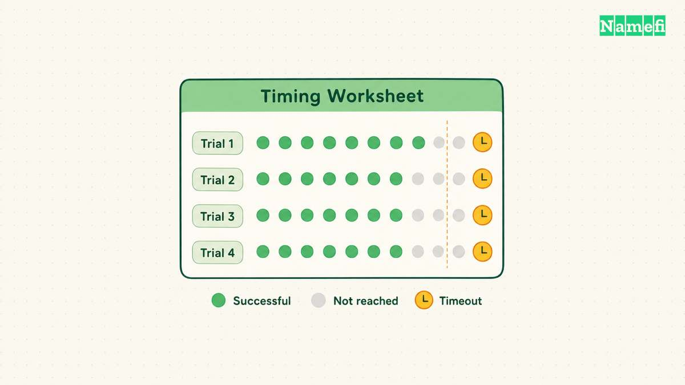
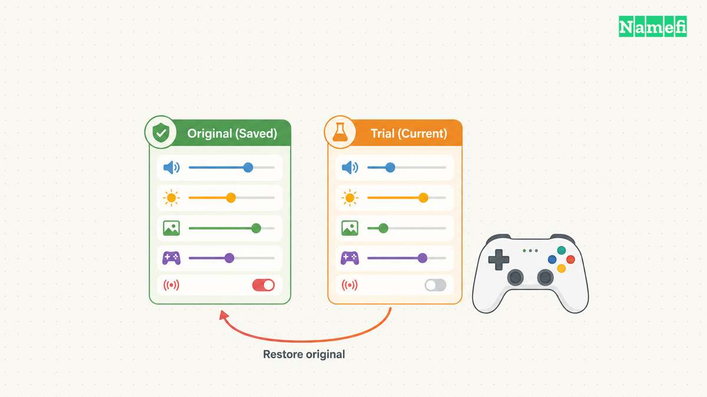

A faster DNS lookup can shorten one step before a game connects. A faster lookup does not establish a faster route to the game server. Measure those outcomes separately before replacing a working resolver.

A useful gaming DNS benchmark answers a local question. Which resolver gives reliable answers for the services that a particular device uses, on a particular network? A worldwide ranking cannot answer that question for every household.

This guide supplies a repeatable comparison method. The guide reports no measured winners, invented latency results, or promised reductions in game ping. The procedure complements the broader [public DNS resolver guide](/en/blog/choose-public-dns-resolver/).

## Lookup time and game latency measure different operations

[DNS](/en/glossary/dns/) translates a service hostname into records that applications can use. A resolver can answer from cache or contact other DNS servers. Network distance, congestion, and cache misses can change lookup time. [Google's performance documentation](https://developers.google.com/speed/public-dns/docs/performance) explains those separate sources of DNS latency.

A game session involves additional work after name resolution. A launcher can authenticate an account, download content, select a region, and establish a connection. The route to the selected endpoint then matters independently of the resolver response time. Treat the difference as a measurement boundary rather than a promise about a particular game.

Define the problem before collecting numbers. A launcher that pauses before signing in presents a different problem from rubber-banding during an established match. A download that starts promptly but runs slowly presents another problem. Write down the visible symptom and the point when the symptom occurs.

A short test worksheet can separate the observations:

| Observation | Measurement | Interpretation boundary |
| --- | --- | --- |
| Hostname resolution | DNS query duration | Measures one lookup |
| Sign-in | Time to account screen | Includes application work |
| Download | Sustained transfer rate | Includes content delivery |
| Match responsiveness | Game network telemetry | Includes game connection |

Keep those measurements in separate columns. Do not subtract two lookup results from an in-game latency reading and call the difference a guaranteed improvement. The observations describe different operations and can involve different endpoints.

Resolver choice can also affect endpoint selection. Some authoritative services tailor responses using information about the querying network. [RFC 7871](https://www.rfc-editor.org/rfc/rfc7871.html#section-5) describes EDNS Client Subnet and its privacy tradeoffs. A changed DNS answer therefore deserves inspection alongside the query duration.

For example, a resolver comparison might produce different address sets for a download hostname. Record both sets before testing transfer speed. The result might reflect endpoint selection, cache state, or another condition. Label the explanation as a hypothesis until a controlled comparison supports the explanation.

Use the game's own diagnostics for the game connection when available. A ping to the resolver measures reachability to the resolver address. A ping to an unrelated website measures a different destination. Neither measurement directly describes the route to the current match server.

## A controlled comparison keeps device conditions consistent

Start with the current resolver as the baseline. Record the device, connection type, network, date, and resolver addresses. Note any VPN, filtering service, or router setting that could change the request path. Preserve the original settings for recovery.

Choose a small candidate set. Compare the existing provider with one or two alternatives rather than testing dozens of services once. Consult each operator's current setup instructions. [Cloudflare's setup documentation](https://developers.cloudflare.com/1.1.1.1/setup/) distinguishes its standard resolver from filtering variants and lists device-specific configuration paths.

Keep filtering policy consistent with the comparison goal. A family filtering service can return a blocked answer where another resolver returns an address. Count the result as a policy difference. Do not label a quick blocked response a successful performance win.

Create a hostname list from services relevant to the actual gaming workflow. Include the launcher, authentication service, game service, and content delivery hostnames when the application exposes those names. Exclude unrelated popularity lists unless general browsing performance also forms part of the goal.

Avoid collecting private account tokens, request headers, or unrelated household activity. A useful benchmark needs the hostname and query type, not a complete record of a player's browsing. Share aggregate timing results without publishing sensitive application logs.

Keep the query type constant. A lookup for an IPv4 address and a lookup for an IPv6 address request different data. Compare A with A and AAAA with AAAA. Test both types when the application uses both address families.

A DNS utility can send a query to an explicit server. The [BIND manual](https://bind9.readthedocs.io/en/latest/manpages.html#dig-dns-lookup-utility) documents `dig` and its query options. For example, `dig @1.1.1.1 example.com A +stats` illustrates a direct IPv4-record query. Replace the example hostname with a relevant public service hostname.

A direct utility query tests the selected resolver path for that utility. The query does not prove that a browser, console, or launcher uses the same path. Applications can have separate settings. After selecting a candidate, verify the actual application configuration through the relevant device documentation.

Hold other conditions steady during a round. Pause optional downloads, retain the same network connection, and avoid changing a VPN simultaneously. Change one factor at a time so a later observation has a useful explanation.

## Repeated queries reveal slow answers and failures

A single fast response can reflect a warm cache. A single slow response can reflect a transient event. Repeat each query across candidates and keep every result, including timeouts and errors. A comparison loses value when the worksheet keeps only successful responses.

Use a modest schedule that respects public services. For example, collect several rounds with pauses rather than a high-rate flood. Alternate candidate order between rounds. A resolver tested first every time can face a different local condition from a resolver tested last.

Record the response status, returned addresses, query duration, and test time. Add a note when a query times out or returns a different answer. Keep raw observations so another person can check the summary without trusting a screenshot alone.

Separate initial queries from immediate repeats. Call the groups “initial” and “repeated” unless the cache state is actually known. A public resolver can already hold a name because another user queried the same name. Clearing a local device cache does not clear that public resolver's cache.

The DNS caching design allows servers to reuse data within validity limits. [RFC 1034, section 3.6](https://www.rfc-editor.org/rfc/rfc1034.html#section-3.6) explains caching. Do not manufacture random subdomains and assume the resulting negative answers reproduce a real game-service lookup.

Summarize the typical response and the slower responses separately. A median describes a central observation. A high percentile describes part of the slower tail when the sample supports that calculation. With a small sample, report the slowest observations plainly rather than implying statistical precision.

| Result field | Reason to retain the field |
| --- | --- |
| Median duration | Shows a typical successful lookup |
| Slow responses | Exposes inconsistent service |
| Timeout count | Preserves failed attempts |
| Answer changes | Flags endpoint or policy differences |
| Test conditions | Makes later comparisons meaningful |

Repeat the comparison during more than one relevant period. Evening conditions can differ from a quiet morning. Use the same hostname list and method so the second round tests time variation rather than a different workload.

Treat small differences cautiously when observations overlap. A candidate that wins one round and loses another does not establish a dependable advantage. Prefer reliable resolution and an appropriate policy over an isolated fastest number.

## Application checks confirm the resolver change works

Select a candidate only after reviewing reliability, response policy, and privacy needs. The fastest median cannot compensate for blocked authentication or a resolver that fails intermittently. The worksheet should support a service decision, not merely a ranking.

Change the resolver through the supported device or router procedure. Record whether the change affects one device or the whole household. A router change can affect other users, printers, and local services. A device-level trial usually makes comparison and rollback easier.

Check every configured resolver address. Do not casually combine unrelated providers as a “fast” primary and a “slow” backup. Different addresses can apply different filtering or privacy policies. The [primary and secondary DNS guide](/en/blog/primary-secondary-dns/) explains why address order alone does not establish identical client behavior.

Then repeat the original user-visible task. Sign in, browse the game library, start a download, and join the intended region. Record the same application timings used for the baseline. Avoid changing game graphics, region selection, or network hardware during the resolver trial.

Keep in-game telemetry separate from startup observations. If startup improves while match latency stays the same, report both results. If match latency changes, inspect the selected server and route before crediting the DNS resolver. A resolver benchmark alone cannot isolate every later network change.

Verify services outside gaming before keeping a household-wide change. Check work access, filtering expectations, and local names that the network intentionally provides. Return to the saved configuration if the replacement breaks a required service.

Preserve a short decision record: candidate, test dates, hostname list, summary results, known limitations, and rollback settings. Review the record after a network move or a persistent service problem. A good choice for one connection does not establish a permanent winner for every connection.

The final answer should remain local and specific. State that a resolver performed acceptably under the recorded conditions. Reserve stronger claims for measurements that actually support the stronger claims. A useful benchmark reduces uncertainty without inventing a universal fastest DNS service.

## These sources support the article

- Google — [Performance benefits](https://developers.google.com/speed/public-dns/docs/performance), causes of resolver latency and cache misses. Fetched 2026-10-21.
- Cloudflare — [Resolver setup](https://developers.cloudflare.com/1.1.1.1/setup/), device configuration and filtering variants. Fetched 2026-10-21.
- IETF — [RFC 1034](https://www.rfc-editor.org/rfc/rfc1034.html#section-3.6), section 3.6: TTL and caching. Fetched 2026-10-21.
- IETF — [RFC 7871](https://www.rfc-editor.org/rfc/rfc7871.html#section-5), sections 2 and 5: client subnet information and privacy. Fetched 2026-10-21.
- ISC — [BIND manual pages](https://bind9.readthedocs.io/en/latest/manpages.html#dig-dns-lookup-utility), `dig` lookup utility. Fetched 2026-10-21.
