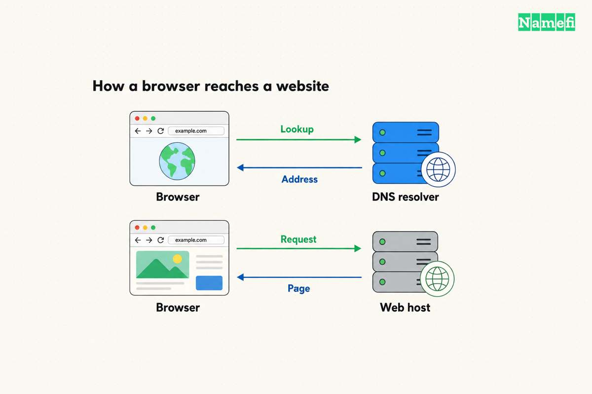

Buy a domain for the address, then choose a website service that supports the site you want to publish. Some website services include hosting. Check the package before purchasing separate hosting, email, or certificates. [ICANN explains that a domain alone does not create a functioning website](#icann-separates-domain-registration-from-website-services).

A useful purchase starts with the website’s requirements. A portfolio, a store, and a custom application need different services. Choose the service first enough to understand the requirements, while checking the desired domain before committing to a brand.

## Your website requirements should determine the hosting choice

Write a short list of what the site must do at launch. Separate public pages from editing tools, customer accounts, payments, and private data.

| Intended site | First hosting question |
| --- | --- |
| Portfolio or information site | Can a static publishing service deliver the pages? |
| Blog with browser editing | Does the service include the required content management system? |
| Store | Does the platform support the products, checkout, and required integrations? |
| Custom application | Does the host support the runtime, data storage, and authentication? |

This table is decision advice, rather than a ranking of providers. Test the actual workflow before committing to a long subscription.

For example, GitHub Pages publishes static HTML, CSS, and JavaScript from a repository. [GitHub describes the service’s publishing model](#github-explains-static-site-hosting). GitHub also restricts using Pages to run online businesses, ecommerce, or commercial SaaS. [Read the usage policy](#github-publishes-pages-use-restrictions) before selecting Pages for a business project.

A provider name or a free plan is not enough to establish suitability. Check the product’s current limits, supported software, export path, and use rules.

## A purchase inventory prevents duplicate services

List the services you already have. Use account records and invoices rather than assuming that the company selling the domain also hosts the website.

| Service | Evidence that you have the service |
| --- | --- |
| Domain registration | Domain listed in an authorized registrar account |
| Website hosting | A site or project with publishing controls |
| Authoritative DNS | The active zone and nameserver delegation |
| Email | Mailbox users and documented sending and receiving settings |
| HTTPS | Certificate status for the public website hostname |

Our [domain and hosting guide](/en/blog/domain-vs-hosting/) explains the separate services. Keep that distinction when comparing bundles.

A bundle can be convenient when the included services meet your requirements. A bundle can also include features the project does not need. Compare the included term, renewal price, and cancellation behavior for each service.

Treat a first-year domain offer as a term-specific offer. Confirm the later renewal obligation. Do the same for email trials, security add-ons, and backup products. This guide does not quote checkout prices because the selected name and package determine the actual charge.

## You should register the domain under an account the organization controls

Search the full intended name, including the extension. Review the spelling in the final cart. A search suggestion can differ from the address you originally typed.

Before payment, check the registration term, renewal currency, renewal amount, holder details, and relevant registry eligibility. Domain registration follows a registration agreement. [ICANN’s domain guidance explains the relationship between registrants and registration services](#icann-separates-domain-registration-from-website-services).

Use an account that the intended holder can recover. For a company, document the account owner, billing contact, and access process. Keep recovery available independently of a new mailbox that does not work yet.

Save the receipt and renewal details. Complete any registrar verification request through the official account workflow. A paid order and a fully active domain are separate states worth checking.

## You can build the site before changing public DNS

Publish a working version on the host’s provided address or preview mechanism. Inspect the pages and content before connecting the main domain.

Decide who may view the preview. A difficult address does not protect private customer data. Use the provider’s supported access controls when the project contains nonpublic material.

Test the requirements you wrote earlier. Submit a contact form to a controlled destination. Check a real navigation path, a mobile layout, and a missing-page response. For a store, use the platform’s documented test workflow before enabling real transactions.

Confirm how to export content and preserve a backup. A usable exit path can matter more than an introductory discount when the site becomes important to the organization.

## Connecting the domain requires both hosting and DNS configuration

Add the exact custom hostname in the destination service first. Then follow the service’s current DNS instructions. A DNS record alone does not tell every hosting platform to accept an unfamiliar hostname.

Cloudflare Pages illustrates why provider-specific instructions matter. An apex domain requires a Cloudflare zone in the same account. A custom subdomain can use a CNAME without moving the entire zone. [Cloudflare documents the separate routes](#cloudflare-documents-custom-domain-connection).

Do not generalize those settings to every host. Obtain the actual destination from the service you selected. A provider may request A, AAAA, CNAME, verification TXT records, or a nameserver change.

If the provider requests a nameserver change, inventory the existing zone first. Recreate required email and verification records at the destination. Replacing authoritative DNS without preserving records can affect services unrelated to the website.

For a hypothetical `www.example.com` setup, copy the provider’s actual target. Do not use a placeholder target from another tutorial. Review the saved hostname to catch an accidentally repeated domain suffix.

After saving the host's required record, query that exact hostname and type in [Namefi's DNS lookup](https://namefi.io/domain-tools/dns). Compare the public resolver's response with the host's instruction. Complete the platform's connection check and the browser test separately.

## HTTPS and application tests complete the launch

Enable the host’s certificate workflow and wait for the certificate status. Let’s Encrypt explains that many providers manage certificates automatically. [Check the provider-managed route](#lets-encrypt-describes-host-managed-certificates) before purchasing a separate certificate.

Open both the intended primary hostname and any supported alternate hostname. Confirm the correct site, HTTPS certificate, and redirect destination. A name resolving in DNS does not prove that the correct website responds.

Test contact forms, important pages, and any email-dependent workflow again through the public domain. A form can render successfully while failing to deliver its message.

Record the registrar, DNS provider, host, email provider, renewal dates, and responsible account owners. Keep the domain registration active even when the website content changes.

The launch is complete when the intended public address serves the working site and the organization can maintain the required services. The next useful purchase should follow an identified requirement, rather than a default checkout suggestion.

## Sources and further reading

### ICANN separates domain registration from website services

[ICANN separates domain registration from website services](https://www.icann.org/resources/pages/about-domain-names-2018-08-30-en#:~:text=Your%20domain%20name%20is%20not%20the%20same%20thing%20as%20a%20website%20or%20a%20Uniform%20Resource%20Locator%20%28URL%29.), checked 2026-10-30.

### GitHub explains static site hosting

[GitHub explains static site hosting](https://docs.github.com/en/pages/getting-started-with-github-pages/what-is-github-pages#:~:text=GitHub%20Pages%20is%20available%20in%20public%20repositories%20with%20GitHub%20Free%20and%20GitHub%20Free%20for%20organizations), checked 2026-10-30.

### GitHub publishes Pages use restrictions

[GitHub publishes Pages use restrictions](https://docs.github.com/en/pages/getting-started-with-github-pages/github-pages-limits#:~:text=GitHub%20Pages%20is%20not%20intended%20for%20or%20allowed%20to%20be%20used%20as%20a%20free%20web-hosting%20service%20to%20run), checked 2026-10-30.

### Cloudflare documents custom domain connection

[Cloudflare documents custom domain connection](https://developers.cloudflare.com/pages/configuration/custom-domains/#:~:text=To%20use%20a%20custom%20apex%20domain%20%28for%20example%2C%20example.com%29%20with%20your%20Pages%20project%2C%20configure%20your%20nameservers%20to%20point), checked 2026-10-30.

### Lets Encrypt describes host managed certificates

[Lets Encrypt describes host managed certificates](https://letsencrypt.org/getting-started/#:~:text=For%20many%20people%2C%20their%20hosting%20provider%20will%20get%20and%20manage%20certificates%20from%20Let%E2%80%99s%20Encrypt%20for%20them.), checked 2026-10-30.
