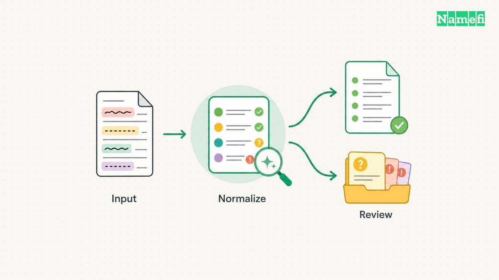
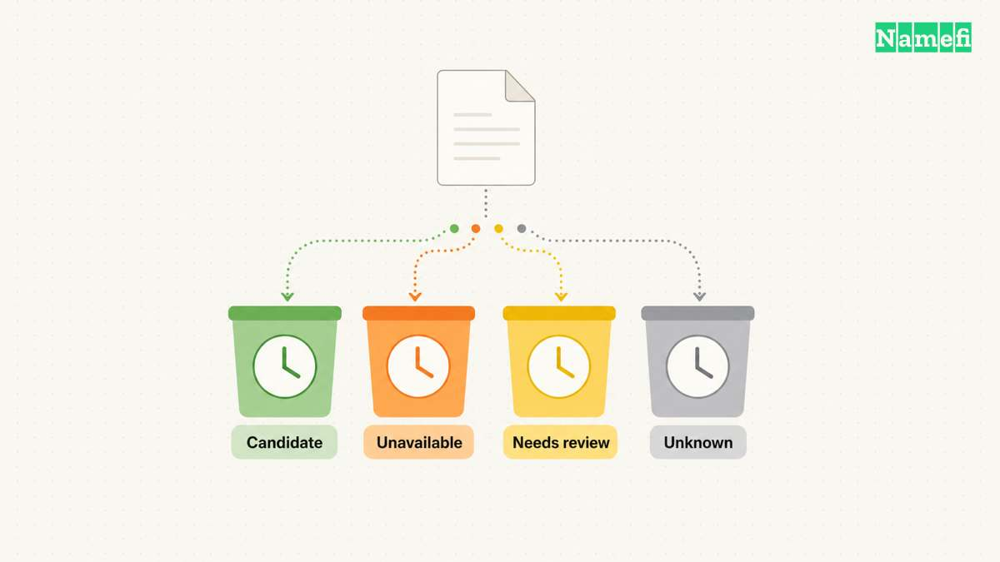
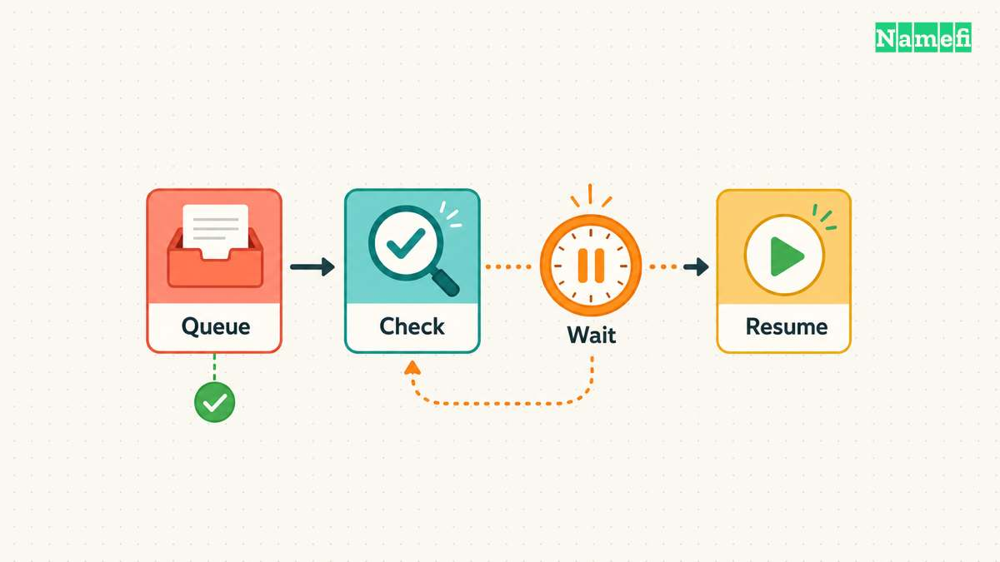
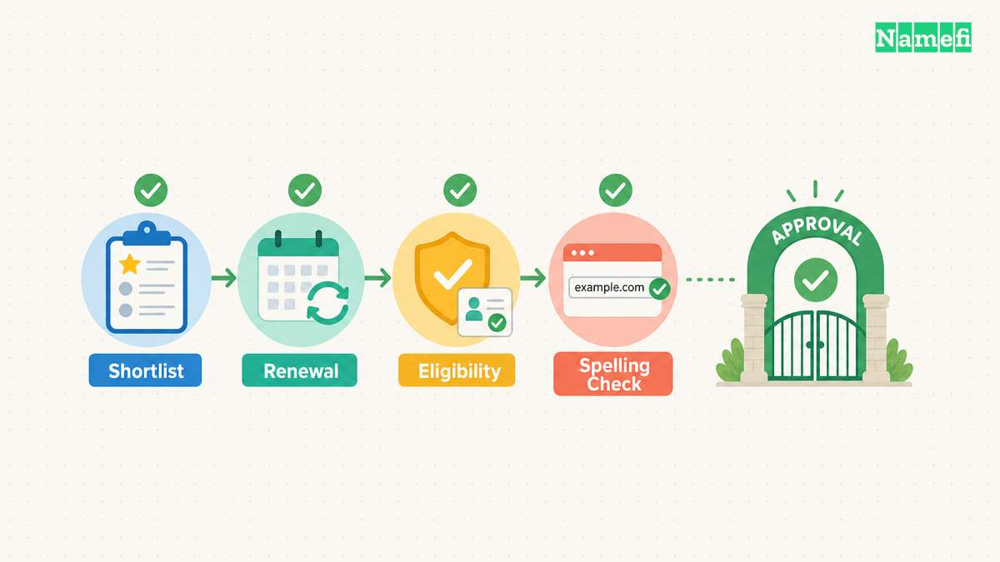

A bulk domain checker helps you narrow a list of candidate names. The checker does not reserve the names, complete a purchase, or establish that a proposed brand is safe to use.

Prepare exact domain spellings, preserve the provider's result categories, and record the checking time. Recheck the final shortlist through the registrar you intend to use before you authorize a purchase.

The most useful output is a small, reviewed shortlist with current prices and clear uncertainties. A large spreadsheet full of unexamined “available” labels can create more work than a careful first pass saves.

## Clean inputs keep a bulk search focused on the intended names

Decide whether the tool expects keywords or complete domain names. A keyword search can expand one word across several extensions. A complete-domain check should evaluate the exact names you supply.

Namecheap's [bulk search page](https://www.namecheap.com/domains/bulk-domain-search/) describes keyword import and extension selection. That interface is one provider's workflow. Do not assume every bulk tool uses the same input format, import method, or batch limit.

Keep an original copy of the candidate list before cleaning the data. Give each candidate a stable row identifier. The identifier helps you compare repeated checks without losing the relationship between the original idea and the normalized name.

Remove protocols, page paths, query strings, and accidental spaces from a complete-domain list. Preserve the intended extension. Do not turn `project.example` into a different name because a spreadsheet or import tool guesses the format.

Separate invalid entries from valid candidates rather than silently deleting invalid entries. A typographical error may hide a useful idea that needs correction. A rejected row should retain the original value and the reason for rejection.

Use a preparation worksheet:

| Column | Purpose |
| --- | --- |
| Candidate ID | Preserve the relationship across exports |
| Original input | Retain the exact submitted idea |
| Normalized domain | Store the spelling you intend to check |
| Extension | Compare like-for-like candidates |
| Source group | Identify a campaign, product, or naming theme |
| Input issue | Explain why a row needs human review |

Deduplicate exact normalized names before checking. Keep the source groups attached when several people proposed the same candidate. Deduplication should reduce repeated work without erasing the team's reasoning.

Treat internationalized names carefully. A display spelling and an encoded spelling can represent the same intended domain, but character support depends on the extension. AWS [documents extension-specific IDN support](https://docs.aws.amazon.com/Route53/latest/APIReference/API_domains_CheckDomainAvailability.html#API_domains_CheckDomainAvailability_RequestParameters). Preserve the relevant representation and verify the registrar's rules.

Use reserved examples when testing an import format in a document. Do not present a hypothetical name as a live availability result. An example input row explains the workflow without suggesting that a particular name can be purchased.

Set the purpose before expanding the list. A product launch may need one primary name and a few defensive variants. A portfolio experiment needs a defined budget and renewal plan. A bulk search should serve that purpose, rather than manufacture a reason to buy every returned name.

## Availability results need more than a yes-or-no column

A domain check reports a state at a particular time. The [EPP domain-check standard](https://datatracker.ietf.org/doc/html/rfc5731#section-3.1.1) describes availability at the moment the check completes. A check does not become a future reservation.

Providers can also return states that need another action. AWS [documents pending, unknown, reserved, invalid, and unavailable results](https://docs.aws.amazon.com/Route53/latest/APIReference/API_domains_CheckDomainAvailability.html#API_domains_CheckDomainAvailability_ResponseElements). Preserve the original status before mapping the status into your own shortlist categories.

A pending response is not an unavailable response. A timeout is not proof that someone registered the name. A provider that does not support an extension cannot establish that the extension contains no available names.

Use at least four working categories in your review:

- Candidate: the provider reports availability for the intended registration path.
- Unavailable: the provider explicitly reports that the requested path is unavailable.
- Needs review: premium, reserved, restricted, preorder, or another special state applies.
- Unknown: the check failed or produced no definitive answer.

Keep a separate raw-status column. Your simplified categories help people scan the list, while the raw status preserves the provider's actual claim. A later reviewer can then audit the decision without guessing what “no” originally meant.

Do not use DNS resolution as an availability checker. A registered name can lack a working website or ordinary address record. Similarly, a [failed registration-data request](/en/blog/whois-and-rdap-public-data/) does not establish that the name is available to register.

Distinguish a standard registration result from an aftermarket offer. A name listed for resale may require a seller agreement and a different transfer process. A “buy” button does not by itself identify whether the transaction is a new registration or a purchase from an existing holder.

Record the provider, checking time, and request context. A spreadsheet row that says only “available” loses the information needed to explain a later disagreement. A dated result can remain accurate as a historical observation even after the name becomes unavailable.

If two providers disagree, investigate the exact spelling, extension support, special registration state, and checking time. Do not average conflicting statuses into a probability. Recheck the selected registrar and preserve any unresolved difference.

A useful shortlist treats uncertainty as work to resolve. The shortlist should not hide uncertainty merely to produce a cleaner count of available names.

## An API workflow must preserve limits and per-domain errors

A web interface suits a modest one-time search. An API can help a repeatable workflow, but API use adds authentication, request limits, error handling, and result storage.

Use the provider's documented availability endpoint rather than scraping a checkout interface. Check the current account eligibility and terms before building automation. Keep credentials outside exported candidate files and logs.

Read batch limits at the endpoint level. Namecheap's [domain-check API documentation](https://www.namecheap.com/support/api/methods/domains/check/) documents a limit of 50 domains per check command. The provider's web bulk-search interface can advertise a different capacity. The web capacity does not override the API limit.

A safe client splits the cleaned list into allowed batches and keeps row-level outcomes. A successful HTTP request does not mean every domain produced a usable result. Preserve per-domain errors and any top-level error separately.

Use a minimal processing sequence:

1. Load the approved candidate list.
2. Validate and deduplicate the intended names.
3. Split requests according to the current documented limit.
4. Submit checks through the supported endpoint.
5. Store raw status, error, provider, and checking time.
6. Retry only the cases that require another check.
7. Produce a reviewable shortlist.

### A batch limit does not define the allowed request rate

Namecheap limits one check command to 50 domains. AWS checks one domain per request. Neither number establishes the permitted requests per second. Read the provider's current account limits before choosing a sending rate.

For example, 1,000 unique domains need at least 20 Namecheap check commands at 50 domains per command. Retries add requests. The calculation sizes the queue but does not promise a completion time.

Use one shared request limiter when several workers use the same account. Start with sequential requests unless the provider documents a suitable concurrency allowance. Additional workers must share the allowance rather than each assume the full account limit.

### A retry policy must distinguish throttling from bad input

An [HTTP 429 response](https://www.rfc-editor.org/rfc/rfc6585#section-4) signals rate limiting. The response can include a `Retry-After` header. [HTTP semantics](https://www.rfc-editor.org/rfc/rfc9110.html#name-retry-after) allows a delay in seconds or an HTTP date. Parse both forms and wait until the indicated retry time.

If the provider supplies no usable delay, use bounded exponential backoff with random variation between workers. Treat the backoff as a client policy, not a provider guarantee. Set a maximum attempt count and a run deadline before starting.

| Result | Next action |
| --- | --- |
| Explicit availability result | Save the result and checking time |
| Documented pending state | Schedule another check under the provider's rules |
| HTTP 429 or documented throttle error | Pause affected requests and schedule a bounded retry |
| Timeout or temporary server failure | Preserve unknown status and retry within the budget |
| Invalid input or unsupported extension | Correct the input or choose a supported provider |
| Authentication or account-permission failure | Stop the run and repair access |

Providers can report errors inside a successful HTTP response. Inspect the application response as well as the HTTP status. Do not assume every provider uses HTTP 429 for throttling.

Save each completed batch before submitting the next batch. Record the candidate ID, attempt number, raw status, error, checking time, and earliest retry time. Remove authentication material before saving responses.

Resume only unfinished or deliberately scheduled rows after an interruption. A restart should not repeatedly check every completed row. Keep the final checkout recheck separate because an earlier successful result can become stale.

If a retry budget expires, leave the affected rows unknown and report the incomplete count. Do not relabel unknown rows as unavailable to make the export appear complete.

Avoid writing secrets into query logs or exported URLs. Some APIs use authentication parameters that can leak through a copied request. Store the useful response fields while removing authentication material from any shared record.

Use the provider's response model for premium pricing. Namecheap documents separate fields for premium registration, renewal, restore, and transfer prices. Preserve the relevant price type rather than treating a single figure as a lifetime cost.

A hypothetical API result can carry an available status and a premium flag. The flag sends the row to a pricing review, rather than directly to an automatic purchase. Keep acquisition authorization separate from availability checking.

A small dry run should prove the output format before the full search. Inspect a successful response, an invalid input, and an uncertain result. A useful client preserves uncertainty instead of converting every exception into “unavailable.”

## A purchase decision needs pricing and a fresh final check

Availability is only one selection criterion. Read the registration price, renewal price, registration term, applicable fees, and any eligibility conditions before approving a name. Check whether a premium renewal schedule applies.

Avoid comparing a promotional first-year price with another provider's renewal price. Our [free-domain offer guide](/en/blog/free-domain-offers/) explains why acquisition offers need a full cost review. Keep the same term and currency when comparing shortlisted names.

Reserved names also need a separate interpretation. ICANN's [reserved-names guidance](https://www.icann.org/en/contracted-parties/registry-operators/services/reserved-names) describes categories governed by registry arrangements. An absence from an ordinary registration result does not promise an alternative way to buy the name.

Keep brand review separate from technical availability. The [USPTO trademark search resources](https://www.uspto.gov/trademarks/search) provide a starting point for United States trademark research. A domain availability result is not a trademark clearance or permission to use a name.

For a commercial launch, review relevant markets and similar names with appropriate expertise. Our [domain-flipping legal guide](/en/blog/domain-flipping-and-the-law/) explains additional issues that availability tools do not decide. Do not treat a clean exact-match search as a universal legal conclusion.

Use a final approval table with a small number of candidates:

| Review item | Evidence required before purchase |
| --- | --- |
| Exact spelling | Approved domain and extension |
| Registration path | New registration or a defined aftermarket process |
| Current availability | Fresh result from the chosen registrar |
| Cost | Registration, renewal, term, currency, and fees |
| Eligibility | Relevant registry or registrar requirements |
| Brand review | The completed naming review for the intended use |
| Budget owner | Explicit approval for the selected acquisition |

Recheck the selected domain close to checkout. Read the final cart and confirm the spelling again. A previous export is a research record, rather than an instruction to accept a changed price or substitute name.

After purchase, confirm the registration in the intended account. Save the receipt, term, renewal setting, and recovery plan. A payment attempt alone does not establish a completed registration.

For a portfolio, record the recurring obligation for every acquired name. Our [domain-value guide](/en/blog/what-makes-a-domain-valuable/) can help structure the qualitative review. A bulk search does not create resale demand.

Bulk checking works best as a filter. Clean the inputs, preserve provider states, inspect errors, compare full costs, and recheck the final names. Buy from a reviewed shortlist, rather than from the raw search count.

## These sources support the article

Sources checked on October 21, 2026. No live availability results or current retail-price quotes appear in the examples.

- [Namecheap: Bulk domain search](https://www.namecheap.com/domains/bulk-domain-search/). The page describes keyword import and the web search workflow.
- [Namecheap: Domain-check API](https://www.namecheap.com/support/api/methods/domains/check/). The documentation defines request limits, premium fields, and per-domain results.
- [Amazon Route 53: CheckDomainAvailability](https://docs.aws.amazon.com/Route53/latest/APIReference/API_domains_CheckDomainAvailability.html). The reference distinguishes supported inputs and uncertain or restricted results.
- [RFC 5731, section 3.1.1](https://datatracker.ietf.org/doc/html/rfc5731#section-3.1.1). The check response describes availability at completion time.
- [ICANN: Reserved names](https://www.icann.org/en/contracted-parties/registry-operators/services/reserved-names). The guidance links applicable reserved-name categories.
- [RFC 6585, section 4](https://www.rfc-editor.org/rfc/rfc6585#section-4). The standard defines HTTP 429 and optional retry guidance.
- [RFC 9110, section 10.2.3](https://www.rfc-editor.org/rfc/rfc9110.html#name-retry-after). The standard defines the two Retry-After value formats.
- [USPTO: Trademark search resources](https://www.uspto.gov/trademarks/search). The page provides the official United States search starting point.
