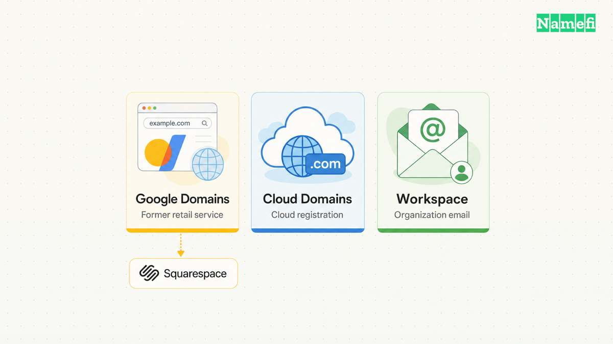
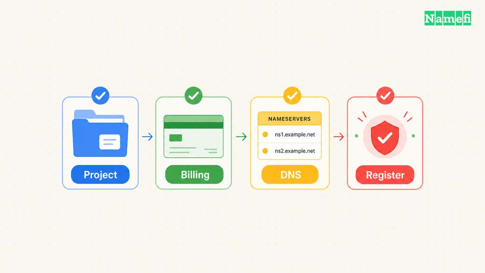
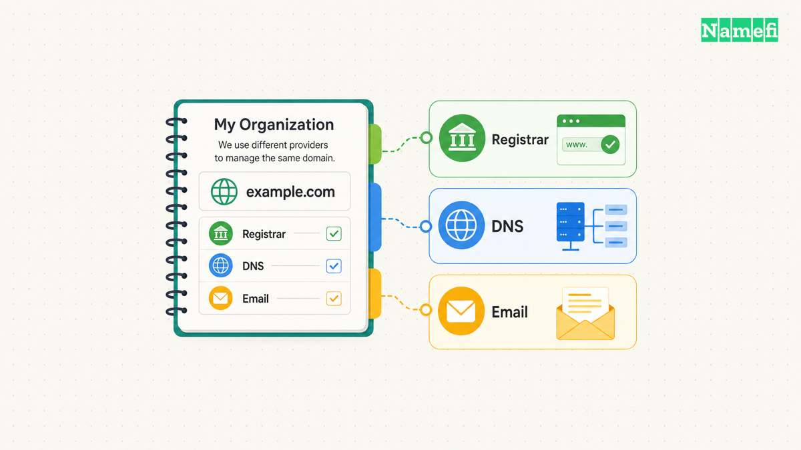

The answer to “Can I buy a domain through Google?” depends on the product.
Google Domains, Cloud Domains, and Google Workspace do not describe the same purchase or management service.
Check the product name before following a registration tutorial.

Google's [migration notice](#google-confirms-the-google-domains-migration) states that all Google Domains registrations migrated to Squarespace.
However, Google's separate [Cloud Domains FAQ](#google-explains-the-cloud-domains-arrangement) still supports new registrations through Cloud Domains.
Both statements can be true.

## Identify the Google product before choosing a registration route

Use the following distinction when a guide tells you to “register with Google.”

| Product or previous account | Current starting point | What to establish |
| --- | --- | --- |
| Former Google Domains retail registration | Squarespace migration and account guidance | Which account now manages the existing registration |
| Cloud Domains | Google Cloud's Cloud Domains workflow | Which project, billing account, and authorized users control the registration |
| Google Workspace | Workspace sign-up or the organization's existing domain configuration | Whether the organization already owns a usable domain |

The old Google Domains website now carries a migration notice.
Treat screenshots of its former checkout as historical instructions.
The [official notice](#google-confirms-the-google-domains-migration) directs retail customers to Squarespace and Cloud Domains customers to Cloud support.

Google Workspace's [primary-domain guidance](#google-describes-workspace-domain-choices) allows an existing domain or a domain purchased during sign-up.
A Workspace email address alone does not identify the registrar that maintains the registration.
Record the registration provider separately from the email provider.

## Use the current Cloud Domains workflow for a Google Cloud purchase

Google Cloud continues to offer Cloud Domains.
Its [FAQ](#google-explains-the-cloud-domains-arrangement) identifies Google Cloud as a reseller after the migration, with Squarespace as the registrar of record.
Google Cloud continues to provide billing and first-line support for Cloud Domains customers.

Begin with Google's [current registration instructions](#google-documents-the-current-registration-workflow), rather than a former Google Domains review.
The documented prerequisites include a Google Cloud project, enabled billing, and the Cloud Domains API.
The person completing registration also needs the required permissions.
Use an account authorized to purchase and manage the organization's domain.

The documented console workflow then asks you to:

1. Search for an available domain.
2. Review the offered registration and its current price.
3. Accept the required Squarespace terms for the project.
4. Select the DNS provider and settings.
5. Review contact and privacy choices.
6. Complete the registration and contact verification.

Read the live checkout before authorizing payment.
A remembered Google Domains price does not establish a current Cloud Domains offer.
Google's registration instructions display pricing for the available name and describe the separate DNS choices.

Cloud DNS and custom nameservers are different configuration options.
Google's [registration instructions](#google-documents-the-current-registration-workflow) note additional Cloud DNS charges when you select that service.
A [domain registration](/en/blog/register-domain-name/) and DNS hosting should remain separate entries in your service inventory.

## Existing owners should find the management account before buying again

If the organization already owns the desired domain, first identify the existing registration.
The old service name is not evidence that the domain needs a replacement registration.
Use the existing account records, registration notices, and provider support route.

Google directs former retail Google Domains customers to Squarespace.
For Cloud Domains, Google identifies Cloud support as the initial support route.
The distinction can prevent a support request from reaching the wrong provider.
Keep the domain name and purchase records available when requesting help.

DNS hosting also requires a separate check.
Google's [Cloud Domains FAQ](#google-explains-the-cloud-domains-arrangement) distinguishes retired Google Domains DNS from Cloud DNS and third-party DNS providers.
A legacy Google Domains DNS setup can require migration even when the registration remains manageable through Cloud Domains.
Check the actual nameservers and configuration before changing the delegation.

Inventory website, mail, and verification records before a DNS move.
The [domain-versus-hosting guide](/en/blog/domain-vs-hosting/) explains why those services can depend on separate providers.
Do not replace working mail records merely because a registration account changed.

Keep four facts together after the task: the registrar, the management account, the DNS provider, and the renewal billing arrangement.
The service logo cannot substitute for those records.

## These official sources distinguish the services

### Google confirms the Google Domains migration

Google, [About the Squarespace purchase of Google Domains registrations](https://domains.google/).
The notice confirms the completed retail migration and separates Squarespace support from Cloud support.
The source was checked on October 28, 2026, in America/Los_Angeles.

### Google explains the Cloud Domains arrangement

Google Cloud, [Squarespace purchase of Google Domains FAQ](https://docs.cloud.google.com/domains/docs/faq#continue-purchase-domains).
The FAQ covers new registrations, the registrar of record, billing, support, and legacy DNS changes.
The source was checked on October 28, 2026, in America/Los_Angeles.

### Google documents the current registration workflow

Google Cloud, [Register a domain](https://docs.cloud.google.com/domains/docs/register-domain#before_you_begin).
The instructions cover prerequisites, permissions, checkout, DNS, contact information, and verification.
The source was checked on October 28, 2026, in America/Los_Angeles.

### Google describes Workspace domain choices

Google Workspace, [Choose your primary domain](https://knowledge.workspace.google.com/admin/domains/choose-your-primary-domain).
The guide distinguishes using an existing domain from purchasing a domain during sign-up.
The source was checked on October 28, 2026, in America/Los_Angeles.
