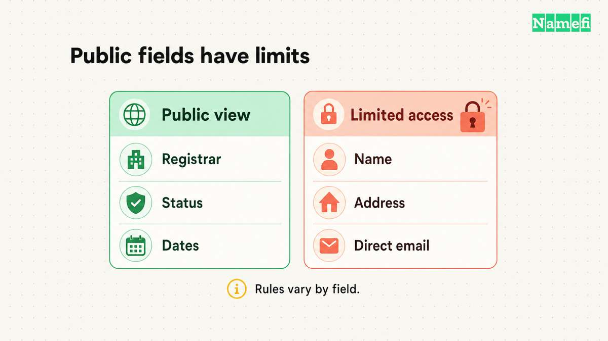
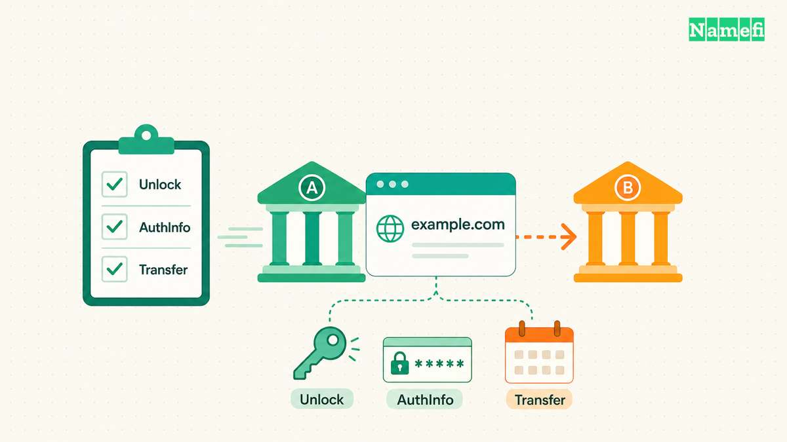

**Look for registered domains through a domain marketplace, a verified sales page, or a broker.** Before paying, agree on the exact domain, purchase terms, transfer method, and payment-release conditions. Sedo provides buy-it-now, auction, and negotiation formats. Escrow.com describes holding payment until it verifies the transfer. [Read the marketplace formats](#sedo-explains-its-domain-purchase-formats) and [escrow workflow](#escrowcom-describes-payment-and-transfer-checks).

A listing is a starting point. A completed purchase requires control of the intended registration through the agreed provider process. This guide focuses on buying a name already registered, rather than choosing unregistered names for investment.

For background terminology, read the [aftermarket explanation](/en/glossary/aftermarket/). No listing, sale price, or availability result in this article represents a live search for a specific domain.

## Start with a search route that exposes the sales terms

[Sedo's domain buying page](https://sedo.com/us/buy-domains/) provides an official route into its marketplace search and purchase formats. A domain's own sales page can offer another route. Verify the service destination before entering account or payment information.

For an unlisted name, begin with a [public registration lookup](/en/blog/domain-owner-lookup/) and any published contact mechanism. Ask whether the holder wants to sell. Do not interpret a parked page, inactive website, or unavailable registrant name as consent to a sale.

Keep a search record with the full domain spelling, extension, listing URL, date, and sales format. Copy the name directly rather than retyping from memory. Check visually similar characters and the extension before discussing a price.

Use the same record for every candidate. Record whether the sale concerns only the domain or also includes a website, content, accounts, or other assets. Obtain explicit terms for additional assets instead of inferring the bundle from a screenshot.

## Understand the commitment before making an offer

Sedo distinguishes three purchase formats. In a buy-it-now sale, the seller specifies the displayed price. Negotiation requires agreement on price. An auction uses its own bidding process. [Sedo documents those formats.](#sedo-explains-its-domain-purchase-formats)

Before placing an offer or bid, read the platform's current transaction terms. Ask when the action creates a commitment and which fees apply. Keep the answer with the listing record.

| Sales format | Check before acting |
| --- | --- |
| Buy-it-now | Exact domain, displayed amount, currency, fees, and transfer procedure |
| Negotiation | Offer validity, included assets, acceptance process, and payment deadline |
| Auction | Bidding rules, reserve terms if applicable, closing procedure, and buyer obligations |
| Brokered purchase | Broker scope, compensation, authority, and communication process |

Set a total acquisition budget before contacting the seller. Separate the purchase amount from marketplace or escrow fees, registration renewal, and migration work. Use actual quotes for all costs. Keep unknown charges marked unknown until the responsible provider confirms them.

Treat an appraisal as one input to your decision, not proof that a particular buyer will pay the same amount later. The [domain valuation guide](/en/blog/how-to-value-a-domain-name/) covers that separate assessment.

## Verify authority and the proposed transfer route

As a buying recommendation, ask the marketplace or escrow provider to verify that the seller controls the domain through its supported procedure. A seller's screenshot and a public record do not independently complete that process.

Ask where the domain is registered now and where the domain will reside after delivery. Determine whether the transaction changes accounts at one registrar or transfers the registration between registrars. Those are different operations to plan.

ICANN's transfer policy includes restrictions that can affect an inter-registrar move. A change of registrant can trigger a transfer lock, with a possible prior opt-out when the registrar offers that option. [Read the current transfer policy.](#icann-specifies-transfer-restrictions)

Ask the registrar to confirm the applicable process before promising an immediate move. Do not assume that changing the registrant first leaves every subsequent transfer available.

If the domain supports an active website or email service, agree who preserves those services and when DNS changes occur. Keep the ownership transfer and service migration as separately verified tasks.

## Use a payment process with explicit release conditions

Escrow.com states that the buyer pays Escrow.com and that the service can withhold payment until it is satisfied the seller transferred the domain. [Its domain escrow page describes the process.](#escrowcom-describes-payment-and-transfer-checks)

For a marketplace purchase, use the marketplace's documented payment and transfer procedure. For a private transaction, evaluate an appropriate escrow service and confirm that the service supports the exact transaction.

Read the terms before funding. Confirm the domain, currency, fee allocation, transfer destination, inspection requirements, and circumstances for payment release. Obtain clarification directly from the service when the conditions are unclear.

Open the service through its known official address. Check a payment instruction inside the authenticated transaction record. Pause if an unexpected message changes the destination or asks to move the transaction outside the agreed process.

Do not approve receipt because a website now shows your logo. Verify the registration in the account you control. Escrow.com lists direct confirmation with the registrar among its buyer benefits. [Read that confirmation boundary.](#escrowcom-describes-payment-and-transfer-checks)

## Confirm delivery before closing the transaction

Use a written acceptance checklist. Confirm the full domain in your own registrar account, the intended registrant details, the registration term, and access to the management controls. Follow the platform's acceptance procedure after verifying the agreed delivery conditions.

Then protect the account through the registrar's supported security settings. Restrict access to authorized people and document recovery ownership. Keep transaction documents private unless disclosure serves a specific purpose.

Save the completion notice, receipt, and support record. Check renewal settings and create an independent reminder. The [domain renewal guide](/en/blog/renew-domain-name/) covers keeping the acquired registration active.

Finally, connect the domain to the intended services using each provider's instructions. Test the website and mail separately. A successful purchase and a successful website launch require separate evidence.

The next useful action is to shortlist names with clear terms and a documented delivery route. Buy only after the exact registration, total cost, transfer sequence, and payment-release conditions are understood.

## Sources and further reading

### Sedo explains its domain purchase formats

[sedo official source](https://sedo.com/us/buy-domains/#:~:text=Domain%20offers%20come%20in%20three%20types) — fetched 2026-10-30 UTC.

### Escrow.com describes payment and transfer checks

[escrow official source](https://www.escrow.com/domains#:~:text=Since%20the%20Buyer%20pays) — fetched 2026-10-30 UTC.

### ICANN specifies transfer restrictions

[transfer official source](https://www.icann.org/en/contracted-parties/accredited-registrars/resources/domain-name-transfers/policy#:~:text=60%2Dday%20inter%2Dregistrar%20transfer%20lock) — fetched 2026-10-30 UTC.
