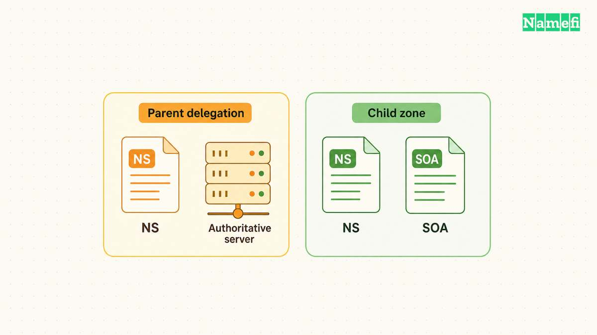
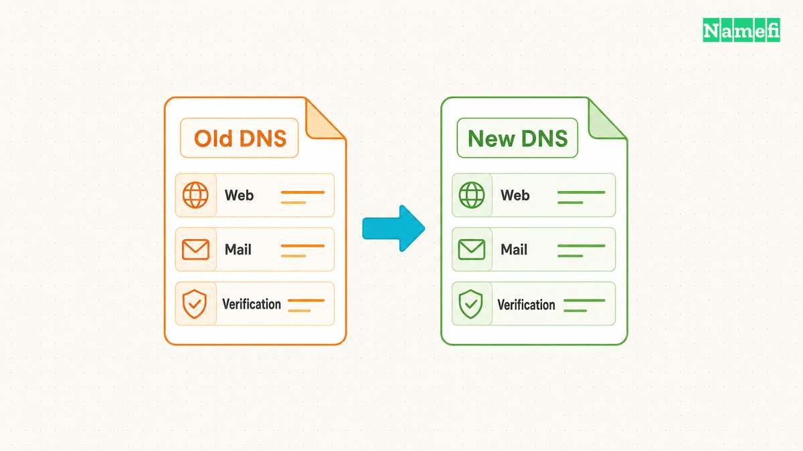
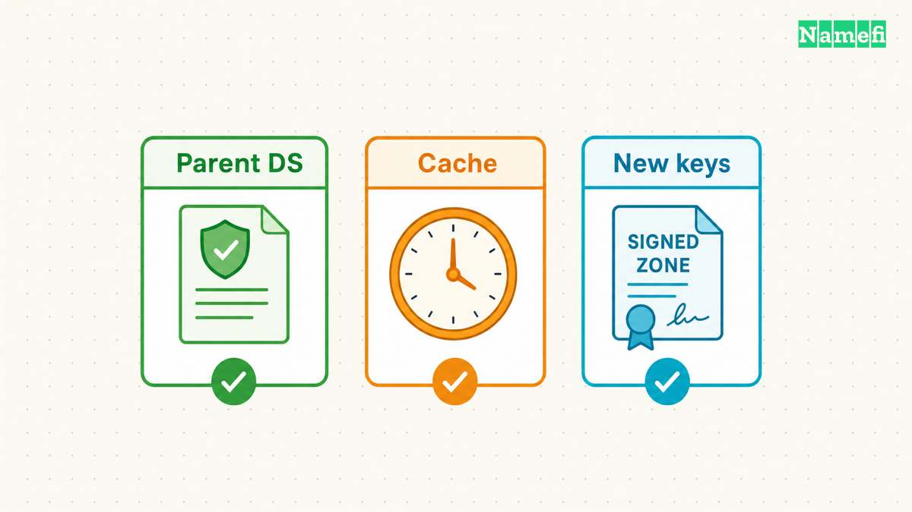
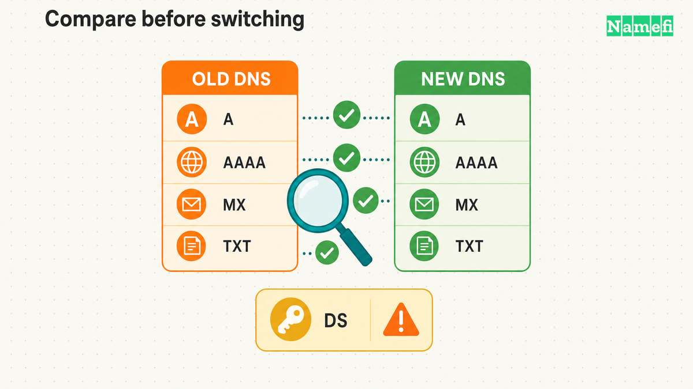
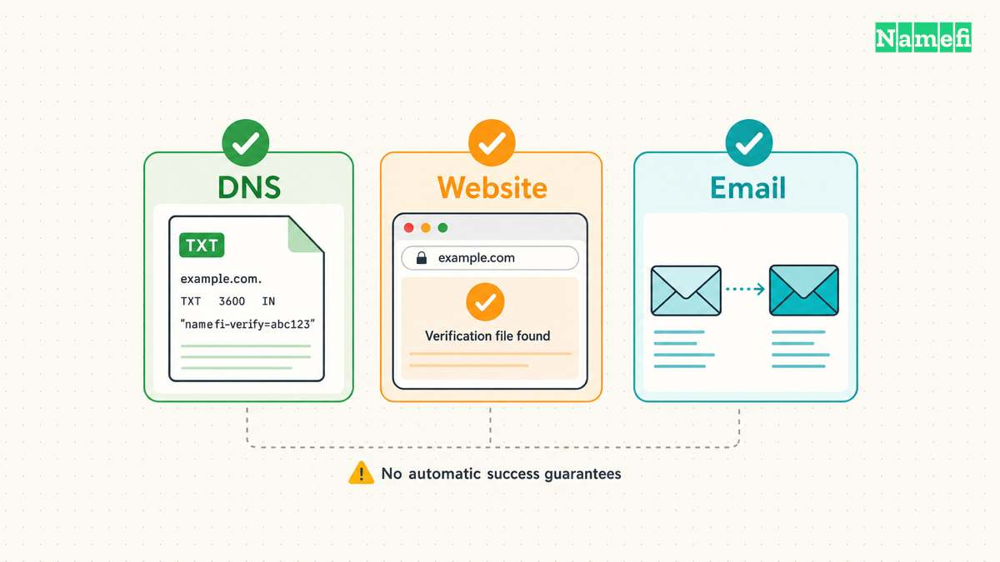

**Changing domain nameservers changes which authoritative DNS service answers for the domain. Prepare the replacement zone before changing the delegation.** Your website and email need their records at the replacement service, even when their hosting stays unchanged.

The important work happens before the nameserver form. Copy the full configuration, test the replacement service, and plan DNSSEC separately. Then change the delegation and keep the previous DNS service available during the transition.

This guide covers a move between authoritative DNS providers. A [registrar transfer](/en/blog/transfer-domain-to-another-registrar/) changes who manages the registration and requires a separate procedure. A website move can require only an address change.

## The registrar changes the delegation that resolvers follow

A [nameserver](/en/glossary/nameserver/) stores and serves DNS information for a zone. A recursive resolver follows delegations to find the authoritative service. [RFC 1034 describes the parent and child zone relationship](https://www.rfc-editor.org/rfc/rfc1034#section-4.2.1).

For a hypothetical `example.com` migration, the `.com` parent directs resolvers toward the domain's authoritative nameservers. The replacement provider must already serve the `example.com` zone when resolvers arrive.

The domain's [registrar](/en/glossary/registrar/) normally provides the controls that request this parent delegation change. A reseller might provide the controls instead. Cloudflare's [setup instructions distinguish these administrative locations](https://developers.cloudflare.com/dns/zone-setups/full-setup/setup/#32-log-in-to-your-registrar).

A nameserver setting at the registrar differs from an NS record inside the domain's zone. Editing the child zone alone does not request a parent delegation change. Both sides should identify the intended authoritative service. [RFC 1034 requires consistency across the delegation boundary](https://www.rfc-editor.org/rfc/rfc1034#section-4.2.2).

An NS record can also delegate a subdomain. For example, `shop.example.com` might use different authoritative servers while the rest of `example.com` stays unchanged. Record the intended scope before editing any NS entry.

Use the following decision table before opening the registrar's nameserver form:

| Intended change | Usual control | Preparation |
| --- | --- | --- |
| New website destination | Website DNS records | Follow the web host's instructions |
| New authoritative DNS provider | Parent delegation | Prepare the complete replacement zone |
| New registrar | Registration transfer | Check DNS service continuity separately |
| Separate subdomain DNS | Parent zone's subdomain NS | Prepare the delegated child zone |

Treat this table as a way to select the procedure, rather than a provider-specific instruction. Providers can bundle registration, DNS, and web hosting. The [domain versus hosting guide](/en/blog/domain-vs-hosting/) explains those separate responsibilities.

Copy the exact nameservers assigned to the correct replacement zone. Do not copy a nameserver pair from a tutorial or another account. Record the old delegation before saving the replacement.

If you operate nameservers under the migrating domain, check glue records as well. Glue supplies addresses needed to reach in-domain nameservers. [RFC 1034 explains why the parent sometimes needs these address records](https://www.rfc-editor.org/rfc/rfc1034#section-4.2.1).

A typical managed-provider migration uses the provider's assigned nameserver names. A move involving custom nameservers needs a separate glue review with the registrar. Avoid combining an unfamiliar custom-nameserver change with a routine DNS provider move.

## A complete replacement zone preserves website and email settings

Start with an export from the current authoritative DNS service. Also save screenshots or a configuration report for features outside the exported zone. Keep a dated copy that someone else can understand during recovery.

Do not use a new provider's automatic scan as your only inventory. Cloudflare explicitly warns that its [quick scan can miss existing records](https://developers.cloudflare.com/dns/zone-setups/full-setup/setup/#common-records). Compare the imported configuration with the current service and your service providers' requirements.

Organize the comparison by service. The website needs the apex name, `www`, and any application names. Email needs its delivery and authentication configuration. Other systems might depend on verification names or delegated subdomains.

Google's [nameserver-change guidance](https://knowledge.workspace.google.com/admin/domains/connect-your-website-to-a-domain-registered-through-google#if-ns-changed-add-google-workspace-services-to-your-web-host) specifically requires copying mail, verification, and custom-service records. A successful homepage request does not test those records.

Build a service checklist before making the replacement zone active:

- Compare apex and `www` website records with the current configuration.
- Compare application, support, and API names with their service owners.
- Preserve MX destinations and priorities from the current mail configuration.
- Preserve SPF, DKIM, DMARC, and mail-provider verification records.
- Preserve delegated subdomains and their required supporting records.
- Check certificate-related and other verification records with the relevant service owners.

Use the current account configuration for exact values. A generic example cannot supply your DKIM selector, mailbox destination, or verification token. The [custom-domain email guide](/en/blog/set-up-email-with-your-own-domain/) covers the separate mail setup.

Also review behavior that ordinary record exports cannot express. Amazon documents that imported zone files do not automatically recreate its [alias choices or complex routing policies](https://docs.aws.amazon.com/Route53/latest/DeveloperGuide/migrate-dns-domain-in-use.html#Step3CreateRecords). A visually similar record list can therefore represent a different operating configuration.

For each provider feature, write a concrete migration decision. Recreate the feature with a supported equivalent, remove the dependency deliberately, or postpone the migration. Do not assume the replacement provider interprets a proprietary record identically.

Keep the replacement provider's required apex NS and SOA configuration. For example, Route 53 creates those records automatically and [warns against deleting or duplicating them](https://docs.aws.amazon.com/Route53/latest/DeveloperGuide/migrate-dns-domain-in-use.html#Step2CreateHostedZone). Follow the replacement provider's import instructions rather than blindly importing every administrative record.

Consider a hypothetical shop that keeps the same web host and mail provider. The migration should reproduce the existing service destinations at the new DNS provider. Changing the website platform or mail provider during the same window adds separate recovery decisions.

Assign someone to control DNS edits during the transition. If an urgent verification record arrives, add the approved record to both active copies. Record the change so the zone comparison remains meaningful.

Before proceeding, ask each service owner to confirm the inventory. An old campaign subdomain may look unimportant to the website team but still support a customer workflow. A named owner provides a better decision than guessing from a record label.

## The DNSSEC plan must account for parent DS records and caches

[DNSSEC](/en/glossary/dnssec/) adds a validation chain that needs its own migration sequence. Changing only nameserver names can leave validators using trust information for the previous provider. [RFC 6781 explains this operator-change problem](https://www.rfc-editor.org/rfc/rfc6781#section-4.3.5).

First determine whether the parent currently publishes a DS record for the domain. Check the registrar's DNSSEC controls and the published parent data. Do not infer the parent state from a signing toggle at the DNS provider.

Select one supported migration method before changing the delegation. A coordinated signed migration can preserve validation through exchanged key material and carefully timed changes. [RFC 6781 describes cooperating operators](https://www.rfc-editor.org/rfc/rfc6781#section-4.3.5.1), but both providers must support the required procedure.

An ordinary migration between unrelated managed providers may instead use a temporary unsigned transition. Cloudflare's standard onboarding asks customers to [turn off DNSSEC at the registrar before replacing nameservers](https://developers.cloudflare.com/dns/zone-setups/full-setup/setup/#33-turn-off-dnssec). That procedure deliberately creates a period without DNSSEC validation protection.

For a temporary unsigned transition, agree on the following checkpoints with the providers:

1. Remove the old parent DS record through the supported registrar procedure.
2. Confirm the parent publishes the removal.
3. Wait for previously cached DS information to expire before changing signing or delegation incompatibly.
4. Change the delegation after the replacement zone passes its checks.
5. Keep the previous service available while cached delegations expire.
6. Enable replacement signing and publish the matching DS through the supported procedure.
7. Verify the restored validation chain before closing the migration.

Keep the old zone correctly signed while resolvers can still rely on the old DS. Stopping signatures immediately after requesting DS removal can break validation for cached trust data. Do not treat a registrar's saved confirmation as evidence that every resolver has refreshed.

A DS record is not an arbitrary value to copy between providers. The parent trust information must correspond to the replacement zone's key configuration. [RFC 6781 identifies a DS pointing to a nonexistent DNSKEY as a failure condition](https://www.rfc-editor.org/rfc/rfc6781#section-4.3.3).

[TTL](/en/glossary/ttl/) also affects nameserver migration. Lowering a TTL changes future answers, rather than rewriting records already inside resolver caches. Inspect the previous TTLs before selecting the change window.

Parent delegation TTLs and child-zone NS TTLs can differ. Lowering an A record's TTL does not lower either nameserver TTL. Amazon's [migration guidance explicitly notes parent NS caching](https://docs.aws.amazon.com/Route53/latest/DeveloperGuide/migrate-dns-domain-in-use.html#Step4LowerTTLSettings).

Ask which TTLs the registrar or DNS provider actually lets you change. Plan around the values you observe, including DS caching where relevant. Do not promise a universal propagation window based on one website record.

A newly restored missing record can also remain absent from cached answers. [RFC 2308 defines negative caching using SOA information](https://www.rfc-editor.org/rfc/rfc2308.html#section-3). Correct the authoritative zone first, then distinguish cached absence from a continuing configuration error.

## Direct queries compare the replacement zone before delegation changes

Use `dig` when the replacement provider permits direct authoritative queries. Replace `ns1.provider.example` with an assigned server. Replace `example.com` with the domain under migration. These examples only read DNS data.

| Check | Example command |
| --- | --- |
| Zone authority | `dig @ns1.provider.example example.com SOA +norecurse` |
| Website address | `dig @ns1.provider.example www.example.com A +norecurse` |
| IPv6 address | `dig @ns1.provider.example www.example.com AAAA +norecurse` |
| Mail destinations | `dig @ns1.provider.example example.com MX +norecurse` |
| Apex text records | `dig @ns1.provider.example example.com TXT +norecurse` |

The `@server` argument selects the server. The `+norecurse` option clears the recursion request. [ISC documents the query syntax and recursion option](https://bind9.readthedocs.io/en/stable/manpages.html#dig-dns-lookup-utility).

Repeat each relevant query against every assigned server and the previous provider. Compare record values with the approved inventory. Preserve the full response, including status and flags. A timeout or refusal needs investigation before the change.

Query DKIM selectors, `_dmarc`, and verification names separately. An apex TXT query does not enumerate text records at other names. Use the inventory to choose the exact owner name and record type.

Check provider features before requiring identical wire answers. A proxy or alias can intentionally change returned addresses. Confirm that the replacement behavior matches the approved service plan.

Keep the parent delegation check separate. A direct query proves what the selected server answers. A direct query does not prove that public resolvers will find the selected server through the parent.

## Separate checks verify DNS, website and mail after the change

Test the replacement authoritative nameservers before changing delegation, when the provider supports direct queries. Compare answers from every assigned server for the names on the inventory. A response from one server does not establish agreement across the set.

Record the queried server, full hostname, record type, response status, and answer. An explicit query for `www.example.com` differs from checking only `example.com`. Likewise, an A answer cannot establish whether the expected AAAA or MX records exist.

Use a short acceptance sheet with expected values from the approved inventory. Mark missing answers as failures that need investigation. Do not substitute a screenshot of the provider dashboard for a response from the authoritative service.

Once the checks pass, save the assigned nameserver set through the registrar's delegation controls. Verify the parent delegation after the registrar processes the request. Keep the old DNS account and zone operational during the agreed overlap.

Check recursive [DNS](/en/glossary/dns/) answers from more than one network during the transition. Record which server returned each answer. Different answers can reflect cached delegations, but the explanation needs evidence from the parent and authoritative services.

Then test the services that depend on DNS. Open both apex and `www` addresses over HTTPS. Check a meaningful application operation, rather than only a cached landing page. Ask the mail owner to send and receive test messages through an external mailbox.

For outgoing mail, inspect the receiving system's authentication results with the mail administrator. A delivered test message alone does not verify every sender configuration. Test important sending systems separately, including any transactional email service.

Use symptoms to choose the next investigation:

- If only new authoritative servers lack records, repair the replacement zone.
- If parent delegation still lists old servers, check the registrar request.
- If validators fail, inspect DS, DNSKEY, and signatures before changing service destinations.
- If DNS answers match but HTTPS fails, inspect the web host and certificate configuration.
- If web access succeeds but mail fails, inspect mail records and the mail service separately.

Avoid repeatedly switching nameservers while investigating. Each switch can leave another set of cached information in use. Prefer a documented repair or a deliberate rollback decision with the provider.

A rollback needs the saved delegation and a working previous zone. DNSSEC also needs a compatible trust state. Returning the nameserver names alone cannot repair a mismatched parent DS record.

Finally, define the retirement condition in writing. Require matching authoritative data, the expected parent delegation, successful service checks, and the planned DNSSEC state. Review the relevant cache lifetimes before canceling the old DNS service.

The useful completion test is operational: visitors reach the intended website, mail uses the intended service, and validation follows the intended trust chain. A saved nameserver form starts that verification.

## Sources and further reading

- RFC Editor — [RFC 1034](https://www.rfc-editor.org/rfc/rfc1034#section-4.2.1), sections 4.2.1–4.2.2, zone boundaries, delegation, and glue. Fetched 2026-10-21.
- RFC Editor — [RFC 6781](https://www.rfc-editor.org/rfc/rfc6781#section-4.3.5), sections 4.3.3–4.3.5.2, DNSSEC operator changes and trust continuity. Fetched 2026-10-21.
- RFC Editor — [RFC 2308](https://www.rfc-editor.org/rfc/rfc2308.html#section-3), sections 3 and 5, negative responses and caching. Fetched 2026-10-21.
- Cloudflare — [Set up a primary zone](https://developers.cloudflare.com/dns/zone-setups/full-setup/setup/), sections 2 and 3, scan limitations, assigned nameservers, and standard DNSSEC migration. Fetched 2026-10-21.
- Amazon Web Services — [Migrate a domain in use to Route 53](https://docs.aws.amazon.com/Route53/latest/DeveloperGuide/migrate-dns-domain-in-use.html), steps 2–7, zone preparation, imports, TTLs, DS removal, and delegation. Fetched 2026-10-21.
- Google Workspace — [Connect your website](https://knowledge.workspace.google.com/admin/domains/connect-your-website-to-a-domain-registered-through-google#if-ns-changed-add-google-workspace-services-to-your-web-host), “If NS changed,” mail and verification continuity. Fetched 2026-10-21.
- ISC — [BIND 9 dig manual](https://bind9.readthedocs.io/en/stable/manpages.html#dig-dns-lookup-utility), query syntax, server selection, and recursion options. Fetched 2026-10-21.
