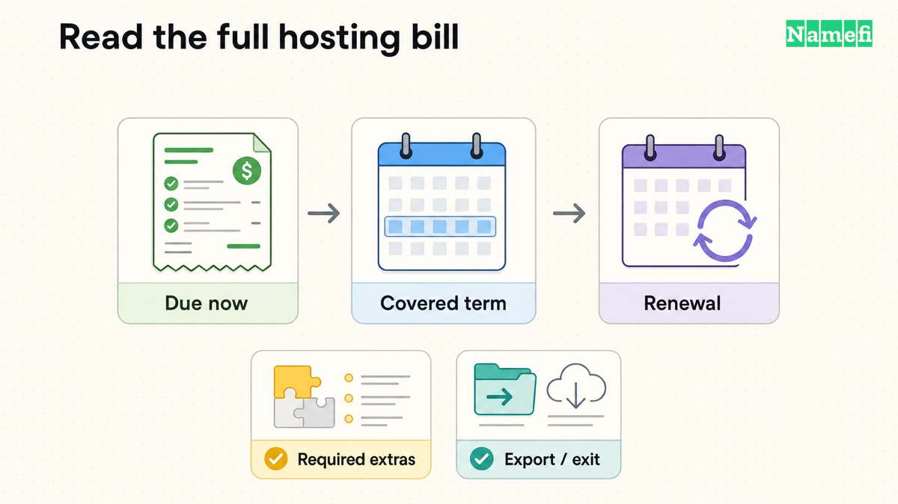
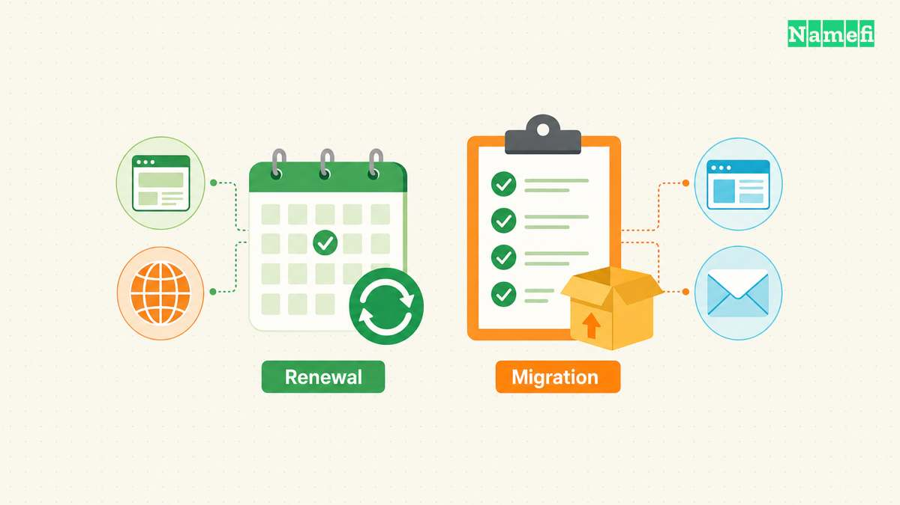

Choose cheap hosting by the total cost of a suitable plan, including renewal and required extras. The lowest introductory monthly label does not establish the lowest practical cost. Start with the website’s software needs, then compare the actual checkout and renewal obligation.

For a conventional hosted website, examine [Namecheap’s shared-hosting plans](https://www.namecheap.com/hosting/shared/). For managed WordPress publishing, examine [WordPress.com’s plan comparison](https://wordpress.com/pricing/). Those are starting routes, not a claim that one provider is cheapest for every website.

## Your software requirements should narrow the shortlist first

A plan that cannot run the website is an unsuitable purchase at any price. List the required software, editing workflow, databases, storage, and access controls before comparing discounts.

| Website requirement | Suitable comparison starting point |
| --- | --- |
| Static information pages | A static publishing service, including a suitable free tier |
| Conventional content management system | Shared hosting with the required runtime and database |
| Managed WordPress editing | A hosted WordPress platform with the required features |
| Custom application | A platform that supports the actual runtime and data services |

Hostinger explains shared hosting as multiple accounts using a physical server’s resources. The provider manages the underlying server, while customers manage their sites through the supplied controls. [The provider’s shared-hosting explanation describes that division](#hostinger-explains-the-shared-hosting-model).

Shared hosting can be a reasonable shortlist for a modest conventional site. Check resource limits and software compatibility for the selected plan. Do not assume a shared plan offers the same control as a server you administer.

For a static site, first review our [free hosting comparison](/en/blog/free-web-hosting-guide/). Paying for a database or server runtime that the site does not use can create unnecessary cost.

## The billing term changes what a monthly label means

A displayed monthly equivalent may require payment for a longer term. Read the amount due today and the exact term length before comparing another plan.

Use the same currency and term for each candidate. A monthly subscription and a prepaid multi-year subscription create different cash and cancellation commitments, even when both show a per-month figure.

Keep these calculations separate:

- **Initial total:** the actual first-term charge plus required extras and taxes.
- **Renewal total:** the next-term charge plus recurring extras and taxes.
- **Monthly equivalent:** the relevant term total divided by the term’s months.
- **Migration cost:** the tools, paid assistance, or staff work required to leave.

The calculations are a comparison method, not an estimate of any provider’s price. Enter the actual amounts from the quote you are reviewing. Do not fill missing renewal information with a guessed percentage.

Namecheap’s shared-hosting page states that the relevant discount offer does not apply to renewals. [The offer conditions make the distinction explicit](#namecheap-publishes-shared-hosting-offer-conditions). Keep a dated record of the actual offer and renewal terms you accept.

## Bundled features can change the full cost

The hosting invoice may not include every service the website needs. Compare registration, email, HTTPS, backups, and application features separately.

| Feature | Question that prevents an incomplete comparison |
| --- | --- |
| Domain | Is registration included for a limited period, and what happens at renewal? |
| Email | Does the plan include the required mailboxes and sending capabilities? |
| HTTPS | Who issues and renews the certificate? |
| Backups | What gets backed up, and who can restore the backup? |
| Application features | Does the selected plan support the actual workflow? |
| Support | Which channels and tasks does support cover? |

WordPress.com says its plans include hosting. The free plan uses a provider subdomain, while custom domains require an appropriate paid plan. [The plan comparison explains the boundaries](#wordpress-com-describes-hosting-and-plan-features).

A domain included for an introductory period still has an ongoing registration obligation. Our [domain and hosting guide](/en/blog/domain-vs-hosting/) explains why the products remain separate even when one company bundles billing.

Remove an optional checkout product only after confirming that the website does not need the product. Removing every extra without checking requirements can leave the site without a necessary service.

## Backup wording deserves a closer reading

Read the exact backup conditions for the chosen tier. A general statement that a provider “has backups” does not tell you whether your account can restore yesterday’s database.

Namecheap’s plan comparison distinguishes the entry plan’s internal backup wording from AutoBackup access on other tiers. The page says entry-plan internal backups are not guaranteed. [The comparison states the tier-specific conditions](#namecheap-distinguishes-backup-coverage).

For any host, ask which files and databases the backup covers, how long copies remain available, and how restoration works. Check whether restoration creates a separate charge or requires support assistance.

Keep a recoverable copy of essential content outside the hosting account when appropriate. Test restoration with representative content before treating the backup feature as a reason to choose a plan.

For a hosted publisher, export may also differ from a full site backup. WordPress.com says content export excludes the theme design, customizations, and plugins. [Its export documentation explains that limit](#wordpress-com-explains-export-scope).

## A cheap plan still needs a workable upgrade and exit path

Review what happens when the site exceeds the selected plan’s resources. Check whether an upgrade preserves the workflow and whether the provider explains the migration path.

Do not choose a plan from an unsupported claim about speed or uptime. This guide does not publish a benchmark or measured reliability ranking. Test the actual site and check the provider’s written service conditions.

Before committing, publish a representative page and test editing, HTTPS, a form, and any required application feature. Decide who can access administration and private previews. A low price does not replace access controls.

Record how to export content, obtain a database copy, and move the domain or DNS separately. A hosting change should not require abandoning a domain merely because both services share an invoice.

## Your final comparison should include the next renewal

Shortlist plans that meet the requirements, then compare initial and renewal totals over matching terms. Mark any unknown fee or unsupported capability as a question to resolve before purchase.

Choose the least expensive suitable commitment that the project can maintain. Save the selected quote, ordinary renewal terms, required extras, and migration plan. The purchase is economical when the website works and the ongoing obligation remains acceptable after the introductory term ends.

## Sources and further reading

### Hostinger explains the shared hosting model

[Hostinger explains the shared hosting model](https://www.hostinger.com/tutorials/what-is-shared-hosting#:~:text=Shared%20hosting%20is%20a%20web%20hosting%20service%20where%20multiple%20websites%20share%20a%20single%20physical%20server%20and%20its%20resources%2C), checked 2026-10-30.

### Namecheap publishes shared hosting offer conditions

[Namecheap publishes shared hosting offer conditions](https://www.namecheap.com/hosting/shared/#:~:text=This%20discount%20offer%20does%20not%20apply%20to%20renewals.), checked 2026-10-30.

### WordPress com describes hosting and plan features

[WordPress com describes hosting and plan features](https://wordpress.com/pricing/#:~:text=Free%20sites%20display%20WordPress.com%20ads%20to%20visitors.), checked 2026-10-30.

### Namecheap distinguishes backup coverage

[Namecheap distinguishes backup coverage](https://www.namecheap.com/hosting/shared/#:~:text=For%20Stellar%20customers%2C%20internal%20backups), checked 2026-10-30.

### WordPress com explains export scope

[WordPress com explains export scope](https://wordpress.com/support/export/#:~:text=Your%20export%20file%20will%20include%20your%20posts%2C%20pages%2C%20and%20comments%20but%20will%20not%20include%20your%20theme%20design%2C%20customizations%2C), checked 2026-10-30.
