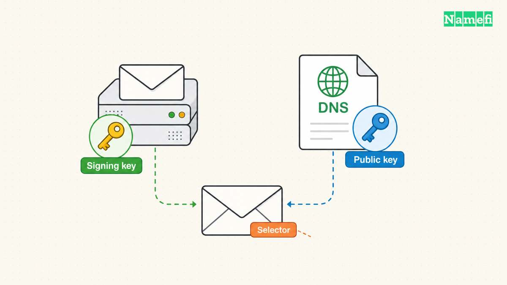

Check DKIM in two places: the public record for the signing selector and the authentication result on a received message. A DNS key can exist while the sender fails to sign messages. Google’s setup guide therefore includes both DNS publication and a received-message test. [Google explains the verification process](#google-explains-live-dkim-verification).

Start with a real message from the sending service you want to check. Use the provider’s current DKIM instructions alongside the message headers. Do not guess the selector from the visible sender address.

## The message identifies the signing domain and selector

Open the full source of a received message. In Gmail, Google documents the Show original control. Locate the `DKIM-Signature` header and inspect the `d=` and `s=` values. The DKIM standard defines `s=` as the selector within the signing domain’s namespace. [RFC 6376 explains selector use](#the-dkim-standard-defines-selector-queries).

For a hypothetical message with `d=example.com` and `s=mail2026`, the DNS lookup name is `mail2026._domainkey.example.com`. The example demonstrates the naming structure and does not supply a real key.

A domain can use different services for ordinary mailbox mail, newsletters, and application notifications. As practical guidance, obtain a sample from each service. A passing mailbox message does not establish that a separate marketing platform signs correctly.

Google explains that the DKIM public key belongs in DNS while the private key stays in the sending system. [Google describes the key roles](#google-explains-dkim-key-publication). Do not upload private keys to a diagnostic website.

## The DNS lookup must use the exact selector

Use a DNS tool that accepts the complete record name, or a DKIM checker that asks separately for domain and selector. Copy the selector from the message or the provider configuration.

Google’s setup instructions show the selector followed by `._domainkey` in the DNS host field. The instructions also warn that DNS providers can impose TXT-length limits. [Google explains key publication](#google-explains-dkim-key-publication).

If the provider instructs a CNAME configuration, inspect the configured alias and the destination record. Do not replace the provider’s requested record type with TXT solely because another provider’s example uses TXT. That is practical setup guidance, not a claim that every sender uses the same design.

Read the queried name carefully. Some DNS interfaces append the zone automatically. An accidentally duplicated domain suffix can create a record at the wrong name while leaving the intended selector unanswered.

Compare the public result with the sending provider’s current configuration. A record for an old selector can remain published without serving the current message’s signature.

## The receiver supplies the live signature result

Google recommends sending a test message to a recipient using Gmail or Google Workspace and inspecting the recipient’s full headers. The guide says the result should indicate a DKIM pass or equivalent success. [Google describes that live check](#google-explains-live-dkim-verification).

Inspect the receiver’s `Authentication-Results` field. Use a trusted receiving service’s report rather than assuming that any copied header text represents an independent test. Preserve the received sample while investigating.

Record the signing domain and selector alongside the result. A message may contain more than one signature. A passing signature from a service’s unrelated domain does not answer whether the expected domain produced the signature under review.

The standard separates the signing identity from the purported author. [RFC 6376 explains that distinction](#the-dkim-standard-separates-signer-and-author). Do not equate a DKIM pass with proof that the visible author is trustworthy or that every other authentication check passed.

This article checks DKIM publication and signing. A separate DMARC assessment needs the message’s other identities and the applicable current policy.

## A failed test needs a specific diagnosis

Use the evidence to choose the next check:

| Observation | Next question |
| --- | --- |
| No expected signature | Did the sending service enable DKIM? |
| Selector has no usable public key | Does the DNS name match the current selector? |
| Published key differs from provider settings | Did a rotation or copied value leave an outdated record? |
| Direct message passes but forwarded message fails | Did a relay modify signed content? |
| One sender passes and another fails | Does each service have its own correct configuration? |

Google warns that outbound gateways can modify messages, such as by adding a footer, and can interfere with DKIM. [The provider describes that failure boundary](#google-explains-dkim-key-publication).

As operating advice, change one understood cause at a time. Keep the previous DNS values and sending settings. Generate a fresh test message after the change because an old message cannot demonstrate the new signing configuration.

## A key rotation needs a safe verification sequence

Treat rotation as a coordinated sending and DNS change. Follow the sender’s documented process for publishing the new selector, enabling the new key, and retaining or removing the previous selector.

Do not delete an unfamiliar selector merely because another selector passes. The record might support a different authorized service. Confirm ownership through the sending inventory before removal.

After the change, test each relevant sending route again. Save the message timestamp, signing domain, selector, public result, and receiving verdict. Label the timestamp with the timezone.

The [DNS record guide](/en/blog/dns-record-types-guide/) explains how mail records fit together. The [MXToolbox guide](/en/blog/mxtoolbox-dns-guide/) helps separate mail routing from authentication tests.

A complete DKIM finding states both outcomes: the expected selector resolves to the intended public key, and a newly received message passes verification for the intended signing domain. Either outcome alone leaves part of the task unfinished.

## Sources and further reading

### Google explains live DKIM verification

[Google explains live DKIM verification](https://support.google.com/a/answer/180504?hl=en#:~:text=the%20DKIM%20results%20should%20say%20something%20like%20DKIM%3Dpass%20or%20DKIM%3DOK%20.). Supporting passage: “the DKIM results should say something like DKIM=pass or DKIM=OK .” Checked 2026-10-30.

### The DKIM standard defines selector queries

[The DKIM standard defines selector queries](https://www.rfc-editor.org/rfc/rfc6376.html#:~:text=The%20selector%20subdividing%20the%20namespace%20for%20the%20%22d%3D%22%20%28domain%29%20tag). Supporting passage: “The selector subdividing the namespace for the "d=" (domain) tag” Checked 2026-10-30.

### Google explains DKIM key publication

[Google explains DKIM key publication](https://support.google.com/a/answer/180504?hl=en#:~:text=A%20public%20key%20that%20is%20stored%20in%20your%20domain%27s%20DNS%20TXT%20record%20for%20DKIM.). Supporting passage: “A public key that is stored in your domain's DNS TXT record for DKIM.” Checked 2026-10-30.

### The DKIM standard separates signer and author

[The DKIM standard separates signer and author](https://www.rfc-editor.org/rfc/rfc6376.html#:~:text=DKIM%20separates%20the%20question%20of%20the%20identity%20of%20the%20Signer%20of%20the%20message%20from%20the%20purported%20author%20of%20the%20message.). Supporting passage: “DKIM separates the question of the identity of the Signer of the message from the purported author of the message.” Checked 2026-10-30.
