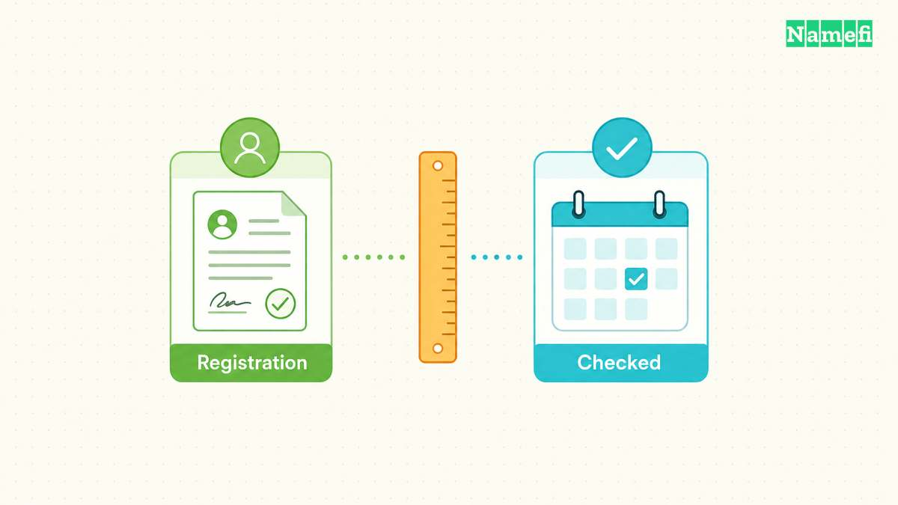
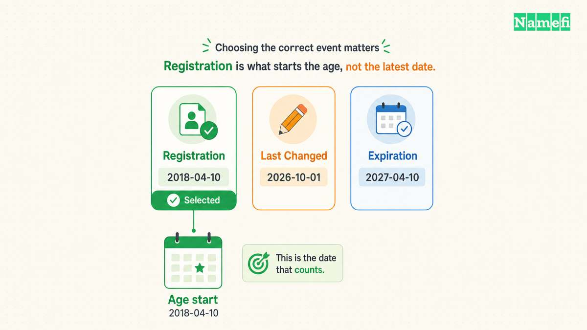
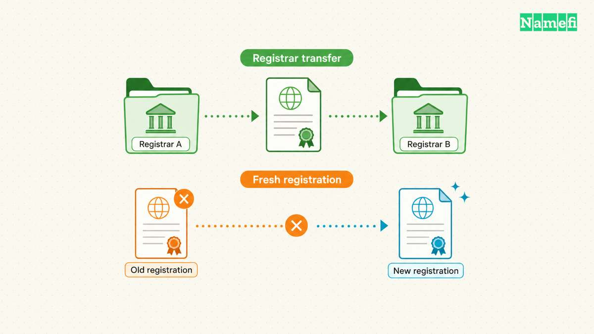

To check domain age, find the registration event in current registration data and compare the timestamp with your checking date. Then check website history separately.

A domain can have an old registration, a new website, and a recent owner. One age number cannot describe all three.

The distinction matters when a seller advertises an “aged domain,” a website claims decades of experience, or a buyer investigates an unfamiliar address. A date can support a narrow historical statement. A date cannot establish trust, continuous operation, or future search performance.

This guide explains how to collect the dates, resolve apparent contradictions, and write a conclusion that matches the evidence.

## A quick domain age check starts with the registration event

1. Enter the registered domain in [ICANN Lookup](https://lookup.icann.org/en).
2. Find the domain's registration event and copy the complete timestamp.
3. Calculate the interval from that timestamp to the checking date.
4. Search the exact website address in the [Wayback Machine](https://web.archive.org/).
5. Report registration age, observed website history, and supported owner tenure separately.

ICANN provides a [free browser-based RDAP client](https://www.icann.org/en/contracted-parties/registry-operators/registration-data-access-protocol/information-for-rdap-users-31-08-2018-en). No purchase is necessary for that lookup.

A domain age checker should identify the event behind the displayed age. Compare the result with the source record before relying on a summary.

For example, “created” or “registered on” can describe registration in a tool's interface. Confirm the underlying event instead of assuming every interface uses identical labels.

## Registration data gives the domain a specific starting date



Start with Registration Data Access Protocol, or RDAP. ICANN describes RDAP as a way to access [current registration data](https://www.icann.org/en/contracted-parties/registry-operators/resources/registration-data-access-protocol). RDAP replaces the older [WHOIS](/en/glossary/whois/) protocol, although readers still encounter the familiar WHOIS label on lookup services.

Open the [ICANN Lookup tool](https://lookup.icann.org/en) and enter the registered domain. ICANN documents the service as a [free browser-based RDAP client](https://www.icann.org/en/contracted-parties/registry-operators/registration-data-access-protocol/information-for-rdap-users-31-08-2018-en). For a country-code domain without a usable result, consult the responsible registry's lookup documentation.

Use the registered domain rather than a full page URL. For a hypothetical page at `https://shop.example.com/catalog`, investigate `example.com` for registration age. Keep `shop.example.com` for the separate website-history search.

Read the result as a set of labeled events. The [RDAP standard pairs an event reason with an event timestamp](https://datatracker.ietf.org/doc/html/rfc9083#section-4.5). Do not select the first date, the oldest visible date, or the date nearest a prominent heading.

If the service exposes JSON, find the domain object's `events` array. Match `eventAction: registration` with its `eventDate`. Nested registrar, contact, or nameserver objects can have their own events, so confirm the surrounding object before copying a timestamp.

The [IANA event definitions](https://www.iana.org/assignments/rdap-json-values) distinguish several dates that age checkers can confuse:

| Event | Meaning | Age use |
| --- | --- | --- |
| `registration` | Initial registration of the object | Starting point for the reported registration |
| `last changed` | Information changed | Not the creation date |
| `transfer` | Registrar-to-registrar transfer | Not an ownership timeline |
| `expiration` | Scheduled or recorded removal time | Not the registration date |
| `last update of RDAP database` | Database synchronization | Not the domain's birthday |



The following hypothetical extract places three events in one domain object. The event order does not determine the age calculation:

```json
{
  "objectClassName": "domain",
  "ldhName": "example.com",
  "events": [
    {"eventAction": "last changed", "eventDate": "2026-10-01T09:00:00Z"},
    {"eventAction": "registration", "eventDate": "2018-04-10T12:00:00Z"},
    {"eventAction": "expiration", "eventDate": "2027-04-10T12:00:00Z"}
  ]
}
```

Select `2018-04-10T12:00:00Z` for the registration-age calculation. The [RDAP event structure](https://datatracker.ietf.org/doc/html/rfc9083#section-4.5) associates each date with its own action.

Record the exact event label and timestamp before calculating an age. Add the lookup date, source URL, and domain spelling. A screenshot helps preserve context, but retain the underlying text when the service provides it.

For a hypothetical record dated `2018-04-10T12:00:00Z`, an October 21, 2026 check shows eight completed years since that registration event. The calculation does not establish eight years of website operation.

Use completed calendar years when presenting a whole-year figure. Subtract the years, then subtract one if the anniversary has not arrived. Keep the full timestamp when a boundary of hours matters.

Save the unrounded result in your notes if a contract or research question requires an exact interval. State the chosen time zone.

Avoid false precision. “Registered in April 2018” usually serves a purchase note better than a day count that changes tomorrow. Always include the checking date.

If the result omits the registration event, write “registration date unavailable from this result.” Do not substitute an update date to produce a number.

## Website captures reveal use rather than a guaranteed launch date


After recording registration data, investigate what visitors could see. Search the domain in the Wayback Machine, then inspect individual captures rather than counting calendar markers.

Check the bare domain and the `www` hostname. If the business used a known subdomain or important page, check that URL too. Keep each capture associated with its exact address.

A useful historical note records the capture timestamp, the displayed content, and the capture URL. Describe the observation directly: “The available March 2014 capture shows a bicycle shop.” Do not silently turn the observation into “The business launched in March 2014.”

The Internet Archive explains that [crawlers can miss sites or encounter access restrictions](https://help.archive.org/help/using-the-wayback-machine/). Therefore, an earliest available capture does not establish the first day a website existed. An empty archive result does not establish that the domain never hosted a website.

Inspect a few dates across the visible history. Look for topic changes, parking pages, sale notices, and redirects. Record what changed between observations without inventing the date of the change.

For example, imagine an available January capture showing a restaurant and a June capture showing a sale page. The evidence places the observed change between those captures. The evidence does not identify the exact day or explain who made the change.

Read the archived address after following links. The Internet Archive warns that [incomplete captures can lead to another capture date or the live web](https://help.archive.org/help/using-the-wayback-machine/). A working navigation link does not mean every displayed page belongs to the original snapshot.

Treat a redirect as a separate observation. Record the original URL, destination, and available date. A redirect capture can explain why a domain appears in an archive without showing an independent website.

Other records can help, provided the records answer the same question. A dated launch announcement can support a claimed launch. A hosting invoice can support a billed service period. Neither document replaces the registration record.

Keep the conclusion proportional to the material reviewed. “Available captures show this topic in 2014 and 2017” is stronger research than an unsupported claim of continuous activity.

When the public archive lacks evidence, ask the seller for dated records that address the missing period. Treat seller records as supplied evidence, and identify the source in your notes.

Do not merge dates just because a single number looks cleaner. A registration date and an earliest observed website date can both be correct.

## Transfers and fresh registrations create different historical questions



The next question concerns continuity. Has one registration remained in place, or does the same name have separate registration periods?

A [registrar](/en/glossary/registrar/) manages a registration for a customer. The [registrant](/en/glossary/registrant/) holds the registration. The [registry](/en/glossary/registry/) maintains the relevant registration system. Changes at these different levels do not mean the same thing.

The [EPP domain standard separates creation, modification, and transfer dates](https://datatracker.ietf.org/doc/html/rfc5731#section-3.1.2). The standard also treats registrar transfer as a change of sponsorship, rather than a command to create a domain object. An ordinary registrar transfer therefore does not itself restart object creation.

A sale raises another question: when did the current registrant acquire the registration? The original registration event does not answer that question. Neither does a registrar transfer date without supporting transaction records.

Ask for evidence specific to the claimed acquisition. A dated purchase agreement, registrar confirmation, or account record can help explain a seller's chronology. Review documents without requesting account passwords or transfer authorization codes.

Public data may leave the acquisition date unknown. Record the uncertainty instead of treating a missing name or date as evidence of uninterrupted ownership.

Deletion and later registration require separate care. The same domain spelling can appear in an old website capture and a newer registration object. The [IANA event vocabulary includes reinstantiation after removal](https://www.iana.org/assignments/rdap-json-values), but a current lookup does not necessarily provide an exhaustive event history.

Consider another hypothetical example. A 2012 archive capture shows content at `example.net`, while the current lookup reports a 2024 registration. Those observations require investigation. The observations do not automatically prove that either source made a mistake.

A completed deletion followed by a fresh registration could explain the difference. A record interpretation issue could also require clarification. Ask the registry or registrar what the displayed field represents before asserting a continuous fourteen-year registration.

Distinguish a completed drop from expiration or recoverable deletion. ICANN's [Expired Registration Recovery Policy](https://www.icann.org/en/contracted-parties/consensus-policies/expired-registration-recovery-policy/expired-registration-recovery-policy-21-02-2024-en) provides for post-expiration renewal and restoration in applicable circumstances. An expiration notice alone does not establish a fresh registration.

If recovery timing affects an active registration, contact the registrar directly. Historical age research should not delay a renewal or restoration request. The [drop-cycle guide](/en/blog/expired-domains-and-the-drop-cycle/) addresses that separate process.

When two lookup services disagree, compare the exact domain, object, event labels, retrieval dates, and source servers. One service might show a stored result while another shows a current response. Do not average conflicting dates.

Preserve both results and seek an explanation from the responsible operator. The [IANA TLD database](https://www.iana.org/domains/root/db) can identify a top-level domain's manager. The database does not supply the ownership history of a second-level domain.

## Buyers should connect age claims to the decision at hand


Domain age becomes useful when the date changes a specific question. A buyer investigating a seller's chronology needs historical evidence. A founder choosing an address needs a suitable name and a workable acquisition.

An old registration alone cannot establish that a website is safe or that a seller can transfer the registration. A new registration alone cannot establish fraud. Use age as a reason to investigate a claim, not as a verdict.

For a proposed purchase, write three separate findings: the reported registration date, the earliest website evidence reviewed, and the current registrant's supported acquisition date. Mark unknown findings explicitly.

Then compare those findings with the seller's wording. “Registration dates to 2005” differs from “Our company has operated this website since 2005.” The second statement needs evidence about the company and website.

If a price premium depends on [SEO](/en/glossary/seo/), request evidence of actual search performance for the current website. Ask which pages, content, and other assets the sale includes. A registration timestamp supplies none of that information.

Do not assume a domain purchase carries a predictable ranking benefit. Google defines [expired domain abuse](https://developers.google.com/search/docs/essentials/spam-policies#expired-domain-abuse) around manipulative repurposing that provides little or no user value. The policy does not label every old-domain purchase as abuse, but age cannot justify such a plan.

A practical decision table keeps the next action tied to the evidence:

| Finding | Next check | Decision effect |
| --- | --- | --- |
| Old registration, little website evidence | Ask what the age premium buys | Evaluate the name separately |
| Old captures, newer registration | Investigate registration continuity | Avoid a continuous-age claim |
| Recent registrant acquisition | Request acquisition records | Separate seller tenure from domain age |
| Claimed search value | Inspect dated performance evidence | Exclude unsupported uplift |
| Missing or conflicting dates | Ask the responsible operator | Keep the age unresolved |

Before accepting a screenshot, ask for the original lookup address and observation date. Check whether the screenshot includes the domain spelling and event label. A cropped date without those details cannot identify the measured event.

For a seller questionnaire, ask one question per claim. Request the registration source for a registration claim, historical pages for a website claim, and acquisition records for a tenure claim. Keep missing answers separate rather than assigning one overall confidence score.

Use a short written conclusion before making the purchase decision. For example: “The lookup reports registration in 2018. Reviewed captures show a shop in 2020. Seller acquisition remains unverified.”

That conclusion gives another reviewer enough context to challenge the evidence. “Eight-year-old domain, trusted” hides the questions that matter.

If new evidence changes a finding, update the finding and its source date. Keep earlier observations when the observations explain the discrepancy. A research record should show why the conclusion changed.

A completed age check can end with uncertainty. The useful outcome is a defensible account of what each date means, followed by an appropriate next step.

## Common age-checking questions need different evidence

**Can a domain age checker establish the age of a page?** No. Registration data describes the domain object. Check the specific page's captures and dated publication evidence separately.

**Does an update date show a sale?** No. IANA defines [`last changed` as an information change](https://www.iana.org/assignments/rdap-json-values). The date alone does not identify the change or buyer.

**Can an archive capture predate the current registration?** Yes. Investigate deletion and registration continuity before combining the dates into one age.

**Can a missing registration date prove that a domain is new?** No. Record the missing field and consult the responsible registry or registrar.

## Sources and further reading

- ICANN, [RDAP Overview](https://www.icann.org/en/contracted-parties/registry-operators/resources/registration-data-access-protocol), “RDAP Overview.” Fetched 2026-10-21.
- ICANN, [Information for RDAP Users](https://www.icann.org/en/contracted-parties/registry-operators/registration-data-access-protocol/information-for-rdap-users-31-08-2018-en), “ICANN RDAP Lookup Tool.” Fetched 2026-10-21.
- IETF, [RFC 9083](https://datatracker.ietf.org/doc/html/rfc9083#section-4.5), sections 2.1, 4.5, and 5.3. Fetched 2026-10-21.
- IANA, [RDAP JSON Values](https://www.iana.org/assignments/rdap-json-values), event-action definitions. Fetched 2026-10-21.
- Internet Archive, [Using the Wayback Machine](https://help.archive.org/help/using-the-wayback-machine/), missing-site and incomplete-capture questions. Fetched 2026-10-21.
- IETF, [RFC 5731](https://datatracker.ietf.org/doc/html/rfc5731#section-3.1.2), sections 3.1.2 and 3.2.1–3.2.5. Fetched 2026-10-21.
- ICANN, [Expired Registration Recovery Policy](https://www.icann.org/en/contracted-parties/consensus-policies/expired-registration-recovery-policy/expired-registration-recovery-policy-21-02-2024-en), sections 2.2 and 3. Fetched 2026-10-21.
- IANA, [Top-Level Domains](https://www.iana.org/domains/root/db), database introduction. Fetched 2026-10-21.
- Google Search Central, [Spam policies](https://developers.google.com/search/docs/essentials/spam-policies#expired-domain-abuse), “Expired domain abuse.” Fetched 2026-10-21.
