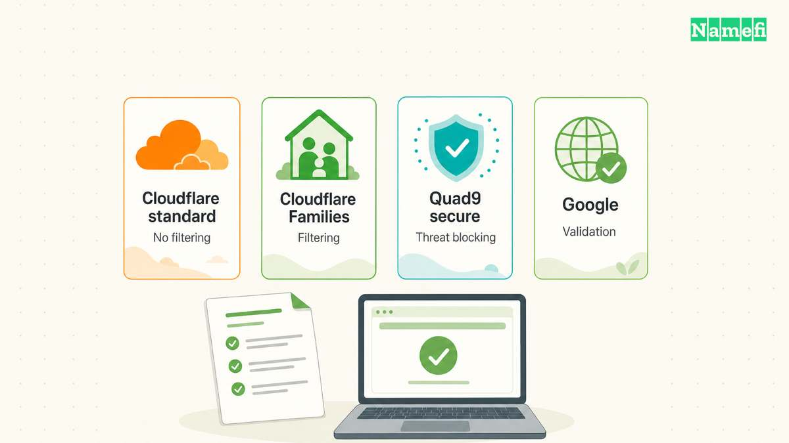
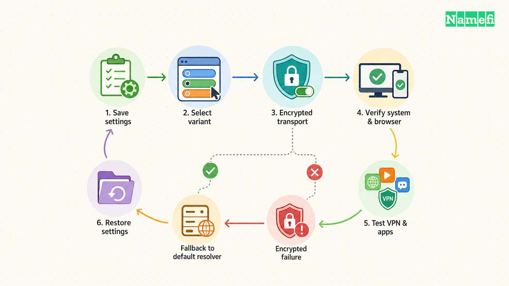
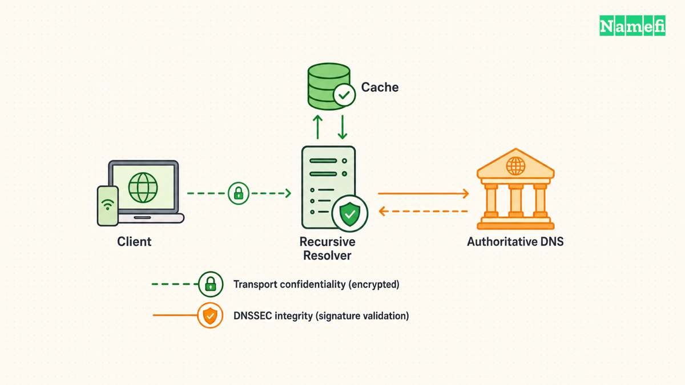

For Cloudflare's standard public DNS resolver, use **1.1.1.1** and **1.0.0.1** as the IPv4 addresses. Cloudflare also publishes IPv6 addresses and separate filtering services. Choose the matching set from the [official address list](#cloudflare-lists-its-resolver-addresses).

You can change the resolver on a device without moving a domain to Cloudflare. This guide covers device DNS settings. Domain owners who want authoritative DNS should follow the [Cloudflare nameserver guide](/en/blog/change-domain-nameservers/).

Start with one device and save the existing configuration. Finish by checking the actual connection, rather than assuming that a saved settings screen proves the resolver changed.

## Choose the resolver policy before entering addresses

Cloudflare distinguishes the standard resolver from **1.1.1.1 for Families**. The standard resolver has no content filtering. The Families options add malware filtering or malware and adult-content filtering. [Cloudflare lists separate addresses for each policy](#cloudflare-lists-its-resolver-addresses).

| Intended policy | IPv4 addresses | IPv6 addresses |
| --- | --- | --- |
| Standard resolver | `1.1.1.1`, `1.0.0.1` | `2606:4700:4700::1111`, `2606:4700:4700::1001` |
| Block malware | `1.1.1.2`, `1.0.0.2` | `2606:4700:4700::1112`, `2606:4700:4700::1002` |
| Block malware and adult content | `1.1.1.3`, `1.0.0.3` | `2606:4700:4700::1113`, `2606:4700:4700::1003` |

Use the complete pair for the chosen service. As practical advice, avoid mixing a filtering address with a nonfiltering address when consistent filtering matters. Write the intended policy beside the saved settings.

Entering an address alone does not document the transport configuration. Review encrypted DNS separately when privacy requirements include encryption between the device and resolver.

## Save the existing configuration before making changes

Record whether the device currently receives DNS automatically or uses manual entries. Save any existing addresses and the network adapter name. This record gives you a clear rollback target.

Use a network you are authorized to administer. Ask the responsible administrator before replacing settings on a managed work device. Private applications may depend on the organization's documented DNS configuration.

As an editorial troubleshooting method, change one device first. Test ordinary browsing and any important work applications before applying the change elsewhere. Keep the old configuration available until the trial succeeds.

A resolver change should solve a named DNS requirement. Do not assume that choosing a public resolver guarantees faster downloads or lower in-game latency. Test the task that motivated the change under your actual network conditions.

## Windows 11 exposes DNS server assignment for the active adapter

Cloudflare's Windows guide starts with the selected network adapter and the **DNS server assignment** control. [The guide provides the current Windows 11 sequence](#cloudflare-documents-windows-dns-settings).

1. Open **Settings**, then **Network & internet**.
2. Select the active Ethernet or Wi-Fi adapter.
3. Find **DNS server assignment** and select **Edit**.
4. Change **Automatic (DHCP)** to **Manual**.
5. Enable IPv4 and enter the selected resolver pair.
6. Configure the matching IPv6 entries when your network uses IPv6.
7. Save the change and test the connection.

For the standard policy, the IPv4 pair is `1.1.1.1` and `1.0.0.1`. Use the corresponding entries from the table for a Families policy. Follow the operating system's supported encrypted-DNS controls if you require encryption.

Cloudflare documents older Windows versions separately. Use the [official Windows setup page](https://developers.cloudflare.com/1.1.1.1/setup/windows/#windows-10) when your interface does not match Windows 11.

## macOS applies DNS settings to a specific network service

On macOS, Cloudflare configures DNS for a selected service such as Wi-Fi or Ethernet. [Cloudflare documents that service-specific scope](#cloudflare-documents-macos-dns-settings).

1. Open **System Settings**.
2. Select **Network** and the active network service.
3. Select **Details**, then **DNS**.
4. Save the existing DNS entries in your notes.
5. Add the addresses for the selected Cloudflare service.
6. Confirm the change and test the connection.

Repeat the review for another network service only when the other service also needs the change. Do not assume that editing Wi-Fi also configures Ethernet.

If an unfamiliar DNS entry returns after saving, inspect the device's managed configuration with the responsible administrator. Repeatedly deleting the entry does not identify which configuration controls the resolver.

## Android Private DNS uses a hostname

Cloudflare documents a manual Private DNS option for Android 9 and later. For the standard resolver, the provider hostname is **`one.one.one.one`**. [The Android guide lists the corresponding filtering hostnames](#cloudflare-documents-android-private-dns).

Open the Android settings and find **Private DNS**. Select the provider-hostname option, enter `one.one.one.one`, and save. Device manufacturers can place the setting under different network menus.

For malware filtering, Cloudflare lists `security.cloudflare-dns.com`. For malware and adult-content filtering, Cloudflare lists `family.cloudflare-dns.com`. Choose the hostname that matches your intended policy.

Do not enter a website page path in the hostname field. The hostname identifies the resolver endpoint. Use the official Android guide if your device's interface requests a different input format.

Cloudflare also offers an Android app with DNS and WARP options. Review the selected mode before enabling the app. A manual resolver setting and a broader connection mode require different operating decisions.

## Verify the actual connection and keep a rollback route

Open [Cloudflare's connection check](https://1.1.1.1/help) from the configured device. Cloudflare says the page tests the connection and identifies the serving data center. [The verification instructions explain the check's purpose](#cloudflare-explains-connection-verification).

Record the observed result and the network used for the test. If you require encrypted DNS, inspect the encryption result as well as the resolver result. Do not infer encryption solely from the IP address you entered.

If browsing fails after the change, restore the recorded DNS configuration and retest. Compare the failing application, network, and active connection settings before trying another resolver.

Cloudflare warns that some public Wi-Fi login pages can conflict with manual configurations. Follow the official device instructions for that case. Do not disable certificate checks or unrelated security controls to force a connection.

Keep the change only after the required applications work and the connection check matches your intended setup. The [public resolver comparison guide](/en/blog/choose-public-dns-resolver/) provides a broader framework if you still need to choose a provider.

For a command-line comparison, use [Namefi's DNS command generator](https://namefi.io/domain-tools/dns-commands) to prepare separate system-resolver and Cloudflare queries for the same name and type. Run the commands on the configured device. This comparison does not establish which resolver Chrome or an encrypted-DNS profile uses.

## Sources and further reading

### Cloudflare lists its resolver addresses

[Cloudflare lists its resolver addresses](https://developers.cloudflare.com/1.1.1.1/ip-addresses/#1111). Checked 2026-10-30.

### Cloudflare documents Windows DNS settings

[Cloudflare documents Windows DNS settings](https://developers.cloudflare.com/1.1.1.1/setup/windows/#windows-11). Checked 2026-10-30.

### Cloudflare documents macOS DNS settings

[Cloudflare documents macOS DNS settings](https://developers.cloudflare.com/1.1.1.1/setup/macos/#:~:text=These%20steps%20configure). Checked 2026-10-30.

### Cloudflare documents Android Private DNS

[Cloudflare documents Android Private DNS](https://developers.cloudflare.com/1.1.1.1/setup/android/#android-9-and-later). Checked 2026-10-30.

### Cloudflare explains connection verification

[Cloudflare explains connection verification](https://developers.cloudflare.com/1.1.1.1/check/#:~:text=After%20setting%20up). Checked 2026-10-30.
