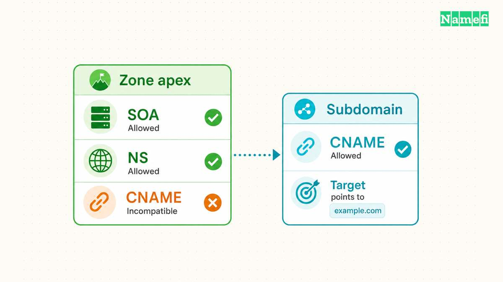
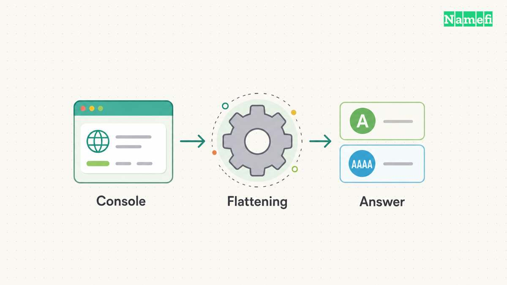

An A record associates a name with an IPv4 address. A CNAME record makes a name an alias of another domain name. Choose between the records according to the destination your hosting provider supports and the name you need to configure.

The difficult cases involve more than the value field. A standard CNAME cannot share its name with ordinary records such as MX or TXT. A zone apex needs SOA and NS records, so an ordinary CNAME cannot occupy that position. Provider features such as CNAME flattening address the apex problem through different behavior.

This guide compares the configuration choices and the checks that reveal mistakes. For the wider record catalog, use the [DNS record types guide](/en/blog/dns-record-types-guide/). Every configuration example below is hypothetical. The example addresses belong to [documentation address space](https://www.rfc-editor.org/rfc/rfc5737.html#section-3), rather than a hosting service.

## A records supply addresses while CNAME records supply target names

An A record stores an IPv4 [IP address](/en/glossary/ip-address/), such as `192.0.2.20`. A name can have multiple A records when multiple IPv4 addresses apply. [RFC 1035 defines the A record format.](https://www.rfc-editor.org/rfc/rfc1035.html#section-3.4.1)

For example, the hypothetical record `app.example.com. A 192.0.2.20` supplies the address directly at `app.example.com`. The administrator must maintain the address according to the hosting service's instructions. The A record contains neither a website path nor a destination domain name.

A CNAME contains a domain name instead. Suppose `www.example.com` has a CNAME target of `site.example.net`. An address lookup follows `site.example.net` to obtain address data. A query specifically requesting the CNAME can return the alias record itself. [RFC 1034 describes the lookup behavior.](https://www.rfc-editor.org/rfc/rfc1034.html#section-3.6.2)

The practical maintenance difference matters when a service controls the destination. With a supported CNAME configuration, the service can change addresses behind the target name. The customer continues to publish the same target name. Copying one address from the target into an A record removes that relationship.

Treat the hosting provider's documented interface as the starting point. A temporary address observed during a lookup does not establish a supported configuration. Ask whether the provider publishes addresses for customers to enter or requires customers to retain a target hostname.

| Question | A record | CNAME record |
| --- | --- | --- |
| What does the value contain? | IPv4 address | Domain name |
| Who maintains address changes? | Administrator or automation | Target's operator |
| Can ordinary records share the name? | Generally yes | No |
| Does the record change a URL? | No | No |

IPv6 uses a separate address type. An AAAA record stores an IPv6 address, so an A record does not configure IPv6 connectivity. [RFC 3596 defines AAAA records.](https://www.rfc-editor.org/rfc/rfc3596.html#section-2.1) Review both address families when the hosting provider supports both.

For a hypothetical migration, imagine that `app.example.com` currently publishes an A record. A replacement service requests a CNAME to `tenant.example.net`. Save the existing record and confirm the replacement service accepts `app.example.com` before changing DNS. Then replace only the conflicting records at that exact name, following the provider's migration instructions.

Do not paste `https://tenant.example.net/start` into a CNAME value. The value needs a domain name, without a scheme or path. Likewise, an A value needs an IPv4 address. A DNS editor accepting text does not make the text valid for every record type.

## The exact DNS name determines the valid record type

Use this sequence before replacing an address record with an alias:

1. Confirm the exact name and the zone that contains the name.
2. Save the current record values and TTLs.
3. Check the provider's required target for that exact hostname.
4. List A, AAAA, MX, TXT, NS, and SOA records at the name.
5. Identify the service owner before removing a conflicting record.
6. Confirm that the hosting service accepts the custom hostname.
7. Select a supported apex feature if the name is the zone apex.

For example, `example.com` may have MX and TXT records for email. A `www.example.com` CNAME does not replace those apex records. Converting `example.com` itself to an ordinary CNAME conflicts with the apex authority records, even when the website only needs a hostname target. [RFC 2181 explains the same-name restriction.](https://www.rfc-editor.org/rfc/rfc2181.html#section-10.1)

A provider's `@` field commonly represents the zone apex. Check the editor's help before entering a full hostname. Some editors append the zone name to relative names. The final saved name matters more than the text entered into the form. [RFC 1035 distinguishes relative and absolute names in zone files.](https://www.rfc-editor.org/rfc/rfc1035.html#section-5.1)

## Apex requirements prevent ordinary CNAME records from sharing the zone name

The zone apex is the top name of a particular DNS zone. In a zone for `example.com`, the apex is `example.com`. A delegated zone for `shop.example.com` has `shop.example.com` as its own apex. The word “subdomain” therefore does not establish whether an ordinary CNAME can occupy a name.

A zone apex needs NS records and an SOA record. [RFC 1034 describes the apex records.](https://www.rfc-editor.org/rfc/rfc1034.html#section-4.2.1) An ordinary CNAME cannot coexist with those records. Removing SOA or NS records to make a CNAME fit does not produce a valid replacement zone.

The same coexistence rule matters away from the apex. A CNAME at `app.example.com` conflicts with an A, AAAA, MX, or ordinary TXT record at `app.example.com`. A record at `example.com` has a different owner name and creates no such same-name conflict. [RFC 2181 clarifies CNAME exclusivity and the single-target rule.](https://www.rfc-editor.org/rfc/rfc2181.html#section-10.1)

There are narrow DNS security exceptions. [DNSSEC](/en/glossary/dnssec/) can place supporting records alongside a CNAME, including RRSIG and NSEC records. [RFC 4034 describes that coexistence.](https://www.rfc-editor.org/rfc/rfc4034.html#section-3) The exceptions do not permit ordinary address, mail, or apex authority records beside a CNAME.

A second restriction concerns the destination inside other records. An MX destination and an NS destination must not be CNAME aliases. The destination names must provide address records. [RFC 2181 states the MX and NS target requirement.](https://www.rfc-editor.org/rfc/rfc2181.html#section-10.3)

For example, a hypothetical MX record for `example.com` might name `mail.example.net`. Check that `mail.example.net` provides the required address records directly. Do not make `mail.example.net` a CNAME merely to reuse another hostname. Follow the mail provider's published MX destinations.

Before converting an existing [subdomain](/en/glossary/subdomain/) to a CNAME, inventory every record at the exact name. Identify which service uses each record. A TXT verification record may belong to another active integration. Resolve the conflict through supported service settings instead of deleting an unfamiliar record.

The table below separates several common decisions. The table describes a configuration review, rather than values to copy into a live zone.

| Situation | Starting choice | Required check |
| --- | --- | --- |
| Provider publishes IPv4 addresses | A | Use supported current values |
| Provider requests a hostname | CNAME below apex | Check same-name records |
| Apex needs a hostname destination | Provider apex feature | Confirm target support |
| MX or NS names a server | Direct address target | Exclude CNAME aliases |
| Browser must change its URL | HTTP redirect | Configure website behavior |

## Provider alias features return answers through a separate mechanism

Some DNS consoles accept a hostname for an apex configuration. The console may call the feature flattening, ALIAS, or ANAME. Inspect the provider's documentation before treating a console label as an ordinary CNAME.

Cloudflare documents CNAME flattening as resolving the target and returning the final IP address instead of the CNAME. The distinction explains how a hostname-based apex configuration can give clients address answers. [Cloudflare describes the flattening mechanism.](https://developers.cloudflare.com/dns/cname-flattening/#how-it-works)

Amazon Route 53 documents its alias record as a DNS extension. For an Elastic Load Balancing destination, the alias can use the apex name or a subdomain. [The ELB configuration guide describes the supported alias setup.](https://docs.aws.amazon.com/Route53/latest/DeveloperGuide/routing-to-elb-load-balancer.html) That example does not establish that every provider alias supports every external hostname.

Keep three questions separate during review. What value does the console store? What target types does the provider support? What record does the authoritative server return for the requested type? A hostname in the console and an A answer on the network can both describe the same supported configuration.

Flattening can also affect records that another service expects to inspect. Cloudflare warns that flattening all CNAME records can break third-party verification that requires a visible CNAME. Cloudflare also documents empty address responses when a flattened target lacks A or AAAA records. [The documentation lists both limitations.](https://developers.cloudflare.com/dns/cname-flattening/#aspects-to-keep-in-mind)

For a failed verification, first identify the requested record type. If the service expects a CNAME, inspect the CNAME answer rather than only the final address. Review flattening settings for that name. Do not disable unrelated DNS features across the whole zone without checking their purpose.

Hosting platforms can specify different configurations for apex and `www` names. GitHub Pages, for example, documents A or supported ALIAS/ANAME configurations for an apex and a CNAME configuration for subdomains. GitHub also requires custom-domain settings in the repository. [Its custom-domain guide separates those steps.](https://docs.github.com/en/pages/configuring-a-custom-domain-for-your-github-pages-site/managing-a-custom-domain-for-your-github-pages-site#configuring-an-apex-domain)

Use the provider's instructions for the particular project and hostname. Record the feature dependency in the zone's maintenance notes. Before moving DNS providers, confirm that the replacement provider supports an equivalent destination and answer behavior. An exported record list alone may not reproduce a provider-specific alias feature.

Neither record type provides a universal performance advantage. A CNAME adds a name dependency, but caching and the available answers affect actual lookups. Evaluate the supported configuration and observed behavior instead of choosing from an assumed latency difference.

## DNS checks and HTTPS checks reveal different failures

Start troubleshooting by writing down the exact hostname, requested record type, expected target, and active DNS provider. Compare those details with the saved configuration. Check the authoritative answer before treating a cached result as evidence that the saved change failed.

Run separate queries for separate record types. With `dig` installed, use `dig www.example.com CNAME` to inspect the alias. Use `dig www.example.com A` and `dig www.example.com AAAA` to inspect address resolution. Replace the example name with the actual hostname.

To query a specific authoritative server, use `dig @ns1.example.net www.example.com CNAME +norecurse`. Replace both example names with verified values. Repeat the relevant query against each authoritative server. Preserve the full output, including the response status, flags, answer section, and authority section. [The BIND manual documents server selection, query types, and recursion controls.](https://bind9.readthedocs.io/en/latest/manpages.html#dig-dns-lookup-utility)

A `NOERROR` status without a CNAME answer does not by itself prove a broken website. The name may use A records or flattening. An `NXDOMAIN` status means the queried name does not exist in that response. A `SERVFAIL` status needs further diagnosis. Compare the result with the intended record type before changing DNS. [RFC 1035 defines the DNS response codes.](https://www.rfc-editor.org/rfc/rfc1035.html#section-4.1.1)

For an A configuration, compare the returned address set with the hosting provider's instructions. For a CNAME configuration, inspect the target and then the target's address answers. For flattening, compare the response with the provider's documented behavior. A missing CNAME answer can be expected under flattening.

Trace an unexpected target one step at a time. A hypothetical chain from `www.example.com` to `site.example.net` can continue to another name. A chain that returns to `www.example.com` creates a loop. [RFC 1034 requires DNS software to signal CNAME loops as errors.](https://www.rfc-editor.org/rfc/rfc1034.html#section-3.6.2)

Check cache information when authoritative and recursive answers differ. The [TTL](/en/glossary/ttl/) limits how long a resolver may retain a record under ordinary caching rules. The TTL does not provide a universal completion deadline. [RFC 2181 defines TTL as a maximum.](https://www.rfc-editor.org/rfc/rfc2181.html#section-8) A previously missing name can also have a cached negative answer. [RFC 2308 explains negative-answer caching.](https://www.rfc-editor.org/rfc/rfc2308.html#section-5)

Once DNS answers match the intended configuration, check the website separately. A CNAME does not send a browser to another URL. An HTTP redirect uses a response such as 301 and a Location field. [RFC 9110 defines that redirect behavior.](https://www.rfc-editor.org/rfc/rfc9110.html#section-15.4.2)

For example, `www.example.com` can resolve through a CNAME while the browser continues requesting `https://www.example.com/`. The hosting service must recognize that hostname. HTTPS also requires certificate verification for the requested origin. [RFC 9110 describes the certificate identity requirement.](https://www.rfc-editor.org/rfc/rfc9110.html#section-4.3.4) Successful DNS resolution alone does not establish successful HTTPS delivery.

If the desired result changes `https://example.com/guide` to `https://www.example.com/guide`, configure the redirect at the hosting or redirect service. Test the original hostname's HTTPS connection and the resulting Location value. Decide explicitly whether the service should preserve paths and query parameters.

Keep the previous configuration available until the replacement passes the relevant checks. When retiring a hosted service, review associated aliases as part of removal. GitHub specifically warns about lingering DNS when a Pages site becomes disabled. [Its security guidance explains the domain-takeover exposure.](https://docs.github.com/en/pages/configuring-a-custom-domain-for-your-github-pages-site/managing-a-custom-domain-for-your-github-pages-site#securing-your-custom-domain)

Choose the record from the provider's supported destination, the name's existing records, and the authoritative answer you need. Then verify the application behavior separately. Those checks distinguish a wrong address, an invalid alias, a provider feature, and a website configuration failure.

## Primary sources explain the configuration rules

- RFC Editor, [RFC 1035](https://www.rfc-editor.org/rfc/rfc1035.html#section-3.4.1), section 3.4.1, A record format. Fetched 2026-10-21.
- RFC Editor, [RFC 3596](https://www.rfc-editor.org/rfc/rfc3596.html#section-2.1), sections 2.1–2.3, AAAA records. Fetched 2026-10-21.
- RFC Editor, [RFC 1034](https://www.rfc-editor.org/rfc/rfc1034.html#section-3.6.2), sections 3.6.2 and 4.2.1, aliases and zone authority. Fetched 2026-10-21.
- RFC Editor, [RFC 2181](https://www.rfc-editor.org/rfc/rfc2181.html#section-10.1), sections 8, 10.1 and 10.3, TTL and alias restrictions. Fetched 2026-10-21.
- RFC Editor, [RFC 4034](https://www.rfc-editor.org/rfc/rfc4034.html#section-3), sections 3 and 4, DNSSEC record coexistence. Fetched 2026-10-21.
- Cloudflare, [CNAME flattening](https://developers.cloudflare.com/dns/cname-flattening/), “How it works” and “Aspects to keep in mind.” Fetched 2026-10-21.
- AWS, [Routing traffic to an ELB load balancer](https://docs.aws.amazon.com/Route53/latest/DeveloperGuide/routing-to-elb-load-balancer.html), introduction and alias configuration. Fetched 2026-10-21.
- GitHub, [Managing a custom domain for your GitHub Pages site](https://docs.github.com/en/pages/configuring-a-custom-domain-for-your-github-pages-site/managing-a-custom-domain-for-your-github-pages-site), apex, subdomain and security sections. Fetched 2026-10-21.
- RFC Editor, [RFC 2308](https://www.rfc-editor.org/rfc/rfc2308.html#section-5), section 5, negative caching. Fetched 2026-10-21.
- RFC Editor, [RFC 9110](https://www.rfc-editor.org/rfc/rfc9110.html#section-15.4.2), sections 15.4.2 and 4.3.4, redirects and HTTPS identity. Fetched 2026-10-21.
- RFC Editor, [RFC 5737](https://www.rfc-editor.org/rfc/rfc5737.html#section-3), section 3, documentation IPv4 ranges. Fetched 2026-10-21.

- ISC, [BIND dig manual](https://bind9.readthedocs.io/en/latest/manpages.html#dig-dns-lookup-utility), server selection, query types, and recursion controls. Fetched 2026-10-21.
