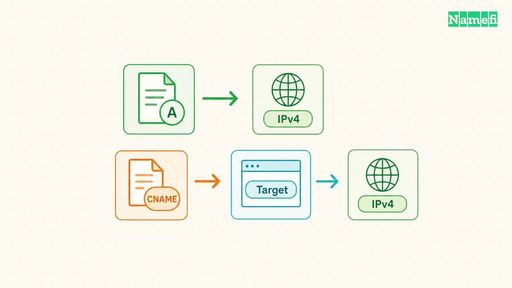
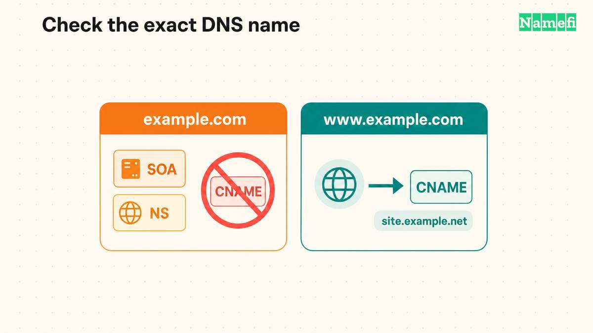
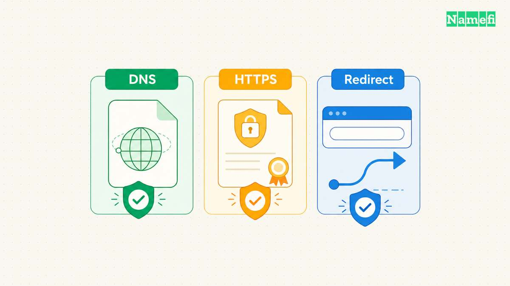

A CNAME record makes one DNS name an alias of another name. Use a CNAME when your hosting service supplies a hostname as the destination. Use an A record when the service supplies an IPv4 address. [The DNS standard defines the alias relationship](#rfc-1034-defines-canonical-aliases).

For a website, the provider's supported configuration decides the final choice. A CNAME does not create a website, install a certificate, or redirect a browser. Start with the exact hostname you want visitors to use and the destination shown in your hosting account.

Examples use [reserved domain names](#rfc-2606-reserves-example-domains) and [documentation IPv4 addresses](#rfc-5737-reserves-documentation-addresses).

## A CNAME stores a hostname while an A record stores an address

Consider these hypothetical records. The names and addresses illustrate syntax, rather than an operational service.

| Name | Record type | Value | Meaning |
| --- | --- | --- | --- |
| `app.example.com` | A | `192.0.2.20` | Obtain an IPv4 address directly |
| `www.example.com` | CNAME | `site.example.net` | Continue resolution at another name |

An A record contains an IPv4 address. A name can have multiple A records. [RFC 1035 specifies the address format](#rfc-1035-defines-address-records).

The CNAME owner is the alias. The value identifies the canonical target. For an address query, DNS resolution follows the target to obtain the requested data. A query asking specifically for CNAME data can return the alias record itself. [RFC 1034 describes both behaviors](#rfc-1034-defines-canonical-aliases).

The distinction matters when a hosting provider changes infrastructure. A supported target hostname lets the provider maintain the addresses behind the target. As practical advice, avoid copying a temporary address from that target into an A record. Follow the provider's instructions instead.

Neither record accepts an entire web address. A CNAME value should not contain `https://`, a port, or `/pricing`. Use the provider's hostname field exactly as documented. If the goal involves a different page path, consult the [domain forwarding guide](/en/blog/domain-forwarding-redirects/).

## The zone apex needs a different decision from a subdomain

The zone apex is the zone's top name, such as `example.com`. The apex needs SOA and NS records for zone administration. [RFC 1034 describes those required zone records](#rfc-1034-describes-zone-authority).

An ordinary CNAME cannot coexist with other ordinary data at the same name. The apex requirement therefore conflicts with a standard CNAME. A separate name such as `www.example.com` can use a CNAME when no conflicting records occupy that name. [The CNAME rule explains the restriction](#rfc-1034-defines-canonical-aliases).

Some DNS providers offer an apex alias feature. Cloudflare calls its mechanism CNAME flattening. Cloudflare resolves the target and returns the resulting address instead of the CNAME record. [Cloudflare documents that response behavior](#cloudflare-explains-cname-flattening).

Treat ALIAS, ANAME, and flattening labels as provider features that need provider documentation. Do not assume a field labeled CNAME creates identical public answers everywhere. For an apex website, ask the host which supported option applies to the DNS service you use.

If the host supports an apex A record and a `www` CNAME, configure each name separately. Adding the `www` record does not automatically configure the apex. Choose the preferred website address in the hosting application after both names work.

## A short configuration review prevents common input mistakes

Before editing, record the current name, type, value, and TTL. Keep a copy of the provider's requested replacement. The following checklist is editorial advice for a controlled change.

1. Open the DNS service that currently answers for the domain.
2. Find the exact hostname that needs the alias.
3. Check existing records at that hostname.
4. Enter the target hostname supplied by the hosting service.
5. Save the change and record the change time.
6. Verify the published answer before changing another setting.

Check how the editor handles names. One editor might expect `www`. Another might expect `www.example.com`. A duplicated suffix creates a different name from the name visitors use. Check the editor's preview or saved result before continuing.

Do not delete MX and TXT records merely because a website is moving. First identify the exact record name that conflicts. An apex mail record does not conflict with a CNAME at `www`, because the owner names differ.

Avoid making the alias point back to itself. Also inspect the target when several aliases form a chain. A destination that no longer provides address data cannot supply a usable website address. Cloudflare specifically describes an empty flattened answer for a target without address records. [Its flattening notes explain that failure](#cloudflare-explains-cname-flattening).

## DNS answers and website behavior need separate checks

Use the [Google Admin Toolbox Dig tool](https://toolbox.googleapps.com/apps/dig/) to inspect DNS. Enter the exact hostname and select the required record type. [Google provides the browser lookup interface](#google-provides-a-browser-dns-tool). This article does not run a live query for your domain.

Check CNAME data first. Then inspect the target's address records. Compare the published values with the hosting account. A matching CNAME confirms the alias configuration, rather than a functioning application.

Next, visit the exact HTTPS address. Check whether the host serves the intended project and presents a valid certificate for the visitor's hostname. An alias to another service does not make the target's website configuration correct for your custom name.

If DNS looks correct but the browser shows a certificate error, inspect the host's custom-domain and certificate status. If the browser loads the wrong site, inspect project assignment and redirects. Replacing a correct CNAME with a guessed IP address can create another problem.

Finally, compare old and new answers when a recent change appears inconsistent. Resolvers can retain cached records until their remaining TTL expires. [The TTL specification describes that cache limit](#rfc-1034-defines-cache-timing). Use the [DNS propagation guide](/en/blog/ttl-and-dns-propagation/) to distinguish a cached answer from an unpublished change.

The useful next action is small: locate the hosting provider's requested record and compare the type, owner name, and target with public DNS. Change only the mismatch that the comparison reveals.

Inspect the alias with a CNAME query in [Namefi's DNS lookup](https://namefi.io/domain-tools/dns), then query the returned target's A or AAAA records as needed. Keep each owner name with its result. These public-resolver observations do not prove that the destination application or certificate works.

## Sources and further reading

### RFC 1034 defines canonical aliases

[RFC 1034 defines canonical aliases](https://www.rfc-editor.org/rfc/rfc1034.html#section-3.6.2). Checked 2026-10-30.

### RFC 1035 defines address records

[RFC 1035 defines address records](https://www.rfc-editor.org/rfc/rfc1035.html#section-3.4.1). Checked 2026-10-30.

### RFC 1034 describes zone authority

[RFC 1034 describes zone authority](https://www.rfc-editor.org/rfc/rfc1034.html#section-4.2.1). Checked 2026-10-30.

### Cloudflare explains CNAME flattening

[Cloudflare explains CNAME flattening](https://developers.cloudflare.com/dns/cname-flattening/#how-it-works). Checked 2026-10-30.

### Google provides a browser DNS tool

[Google provides a browser DNS tool](https://toolbox.googleapps.com/apps/dig/). Checked 2026-10-30.

### RFC 1034 defines cache timing

[RFC 1034 defines cache timing](https://www.rfc-editor.org/rfc/rfc1034.html#section-3.6). Checked 2026-10-30.

### RFC 2606 reserves example domains

[RFC 2606 reserves example domains](https://www.rfc-editor.org/rfc/rfc2606.html#section-3). Checked 2026-10-30.

### RFC 5737 reserves documentation addresses

[RFC 5737 reserves documentation addresses](https://www.rfc-editor.org/rfc/rfc5737.html#section-3). Checked 2026-10-30.
