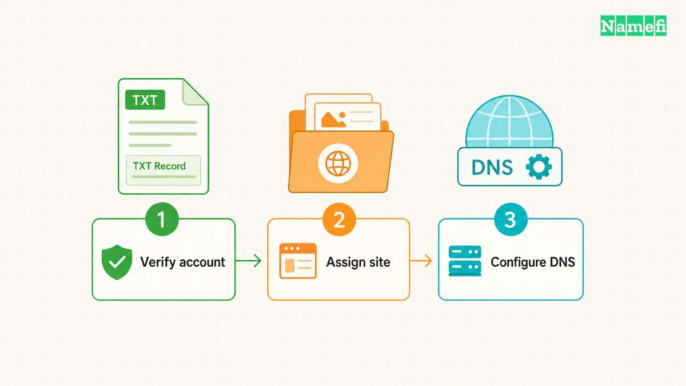
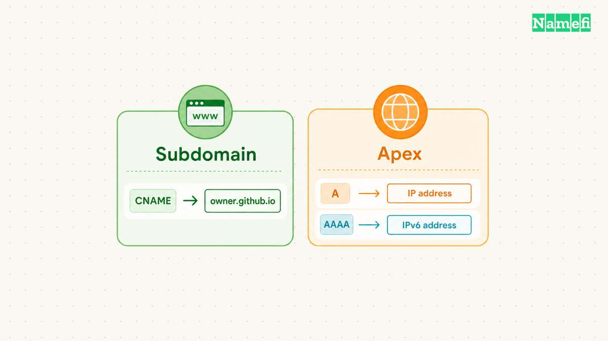
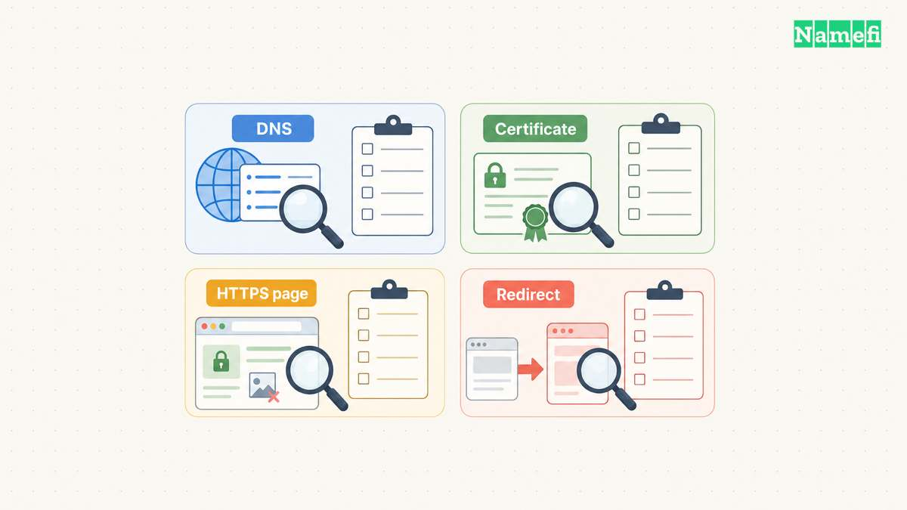

**Connect a custom domain to GitHub Pages by verifying domain control, assigning the hostname, configuring DNS, and checking HTTPS.** Complete those checks separately. A working address lookup does not establish that the correct repository serves the site.

This guide covers an existing domain and a GitHub Pages website. Every `example.com` hostname represents a hypothetical configuration. Replace example names with names under your control. The instructions do not describe a completed setup or an actual customer deployment.

GitHub Pages publishes static website files from a repository, with an optional build process. User and organization sites differ from project sites. [GitHub explains the service and site types.](https://docs.github.com/en/pages/getting-started-with-github-pages/what-is-github-pages#about-github-pages) Keep the distinction between [domain registration and website hosting](/en/blog/domain-vs-hosting/) clear during setup.

## Your chosen hostname determines the DNS configuration

First, write down the address visitors should use. Choose `example.com`, `www.example.com`, or a separate [subdomain](/en/glossary/subdomain/) such as `docs.example.com`. Record one primary hostname before opening the DNS editor.

GitHub supports apex domains and subdomains. GitHub recommends configuring `www` even when the apex domain provides the primary address. Correctly configured apex and `www` variants redirect toward the hostname selected for the site. [GitHub documents the supported domain arrangements.](https://docs.github.com/en/pages/configuring-a-custom-domain-for-your-github-pages-site/about-custom-domains-and-github-pages#supported-custom-domains)

| Address | Configuration | Planning question |
| --- | --- | --- |
| `example.com` | Apex records | Will the whole website move? |
| `www.example.com` | Subdomain alias | Should the apex redirect here? |
| `docs.example.com` | Subdomain alias | Should the main website stay elsewhere? |

For example, a hypothetical team already runs a store at `example.com`. The team wants GitHub Pages for product documentation. Choosing `docs.example.com` gives the team a specific hostname to configure and test. The team should document the existing store configuration before making changes.

Do not treat a custom domain as a request to move every service. List the website, email, verification records, and other applications before editing [DNS](/en/glossary/dns/). Mark the exact names and record types involved in the website change. Preserve unrelated records unless a separate migration requires changes.

Identify the active DNS provider separately from the [registrar](/en/glossary/registrar/). Use the provider that manages the live zone. An unused DNS editor in another account offers no useful confirmation. Keep a copy of the original records and a short explanation of each intended change.

Also confirm the publishing source before changing the domain. GitHub supports branch publishing and custom GitHub Actions workflows. Branch publishing uses a selected branch and either the root folder or `/docs`. Custom workflows give the project control over the build. [GitHub describes these publishing choices.](https://docs.github.com/en/pages/getting-started-with-github-pages/configuring-a-publishing-source-for-your-github-pages-site#about-publishing-sources)

For a branch source, record the branch and folder. For a workflow source, record the workflow and the deployment artifact. Open the current website and choose a recognizable page for later comparison. A heading, release note, or navigation label gives the final browser check a concrete target.

Check the generated entry file as well. GitHub looks for `index.html`, `index.md`, or `README.md`. The entry file belongs at the publishing source's top level, or the deployed artifact's top level. [GitHub explains entry files and site creation.](https://docs.github.com/en/pages/getting-started-with-github-pages/creating-a-github-pages-site#creating-your-site) Fix a missing entry file before investigating custom-domain DNS.

## Account verification protects the domain before DNS points toward Pages

Domain verification and repository assignment perform different jobs. Verification associates domain control with the relevant personal account or organization. Repository assignment selects the site that should answer for the hostname. Keep separate entries for both checks in the setup notes.

Open [personal account Pages settings](https://github.com/settings/pages) to verify a personal domain. For an organization, open that organization's settings and choose Pages. Use the account that owns the intended repository. Repository settings do not contain the account-level verification process. [GitHub documents both verification procedures.](https://docs.github.com/en/pages/configuring-a-custom-domain-for-your-github-pages-site/verifying-your-custom-domain-for-github-pages#verifying-a-domain-for-your-user-site)

Add the domain and copy the TXT name and value that GitHub supplies. Do not invent the verification value or reuse a value from a tutorial. Review the DNS editor's saved full name before continuing. Keep the verification TXT record after verification so the domain remains verified.

For a hypothetical personal account named `USERNAME`, inspect the challenge with `dig _github-pages-challenge-USERNAME.example.com TXT +short`. Substitute the actual challenge name from GitHub. The command reads DNS and changes no records. Compare the returned text with the challenge shown in the account.

If the TXT answer differs, resolve the mismatch before pressing Verify repeatedly. Check the spelling, saved hostname, selected zone, and copied value. Keep the command output private if the surrounding terminal contains unrelated account information. The purpose of the check is an exact comparison with GitHub's challenge.

Verification covers the domain and immediate subdomains for repositories owned by the verified account. The protection does not justify a wildcard configuration. GitHub warns that wildcard DNS can expose deeper names to takeover even after verification. [GitHub explains the protection boundary and wildcard warning.](https://docs.github.com/en/pages/configuring-a-custom-domain-for-your-github-pages-site/verifying-your-custom-domain-for-github-pages#about-domain-verification-for-github-pages)

After verification, open the intended repository's Settings → Pages. Save the selected hostname under Custom domain before pointing DNS toward Pages. GitHub explicitly recommends that order. [Follow GitHub's custom-domain configuration instructions.](https://docs.github.com/en/pages/configuring-a-custom-domain-for-your-github-pages-site/managing-a-custom-domain-for-your-github-pages-site#about-custom-domain-configuration)

Treat a domain marked as already taken as a separate account-control problem. Check the account and organization before changing DNS again. GitHub documents verification as a recovery route for an unverified domain used by another account. An existing verification by another account requires further resolution. Do not assume DNS edits alone will settle the conflict.

## The DNS records must match the selected hostname

For a subdomain, create a CNAME toward the repository owner's `github.io` hostname. Exclude the repository name and URL path. For an apex, follow GitHub's A-record instructions or the provider's supported ALIAS or ANAME arrangement. GitHub also lists IPv6 AAAA records. [Use GitHub's current record values.](https://docs.github.com/en/pages/configuring-a-custom-domain-for-your-github-pages-site/managing-a-custom-domain-for-your-github-pages-site#configuring-an-apex-domain)

The linked instructions list four IPv4 addresses and four IPv6 addresses at publication. Copy the complete relevant set from the current documentation. Do not substitute a single address observed during a lookup of an unrelated site. When adding IPv6, GitHub recommends retaining IPv4 support too.

For `www.example.com`, inspect the saved CNAME target before closing the editor. The target must identify the owner hostname rather than `example.com` or a project URL. [GitHub specifies the subdomain destination.](https://docs.github.com/en/pages/configuring-a-custom-domain-for-your-github-pages-site/managing-a-custom-domain-for-your-github-pages-site#configuring-a-subdomain) A repository path belongs in a website URL, not the DNS target field.

DNS providers present different controls. Cloudflare, for example, asks for a record type and type-specific fields. Cloudflare also exposes proxy status and TTL controls for relevant records. [Cloudflare documents its DNS editor.](https://developers.cloudflare.com/dns/manage-dns-records/how-to/create-dns-records/#create-dns-records) Use the actual provider's instructions when field names differ.

Before saving, read each proposed record aloud as a complete instruction: this hostname uses this record type with this destination. Compare the instruction with the migration notes. Stop if the name identifies an existing service that should stay online. A smaller change is easier to inspect and reverse.

After saving, query `dig www.example.com CNAME +short` for the subdomain. Query `dig example.com A +short` and `dig example.com AAAA +short` when checking an apex. Run each command separately. Save the observation time and returned answers in the setup notes.

Compare answers with the intended configuration rather than assuming any answer means success. A missing expected answer needs investigation. An unexpected address also needs investigation. Review both address families so an old IPv6 entry does not escape the inspection. GitHub identifies extra or incorrect address records as possible certificate blockers.

Keep [DNS propagation](/en/glossary/dns-propagation/) separate from repeated edits. If a saved value looks correct but a lookup still differs, record the difference before making another change. Avoid changing several record sets while also changing the publishing source. Separate changes give the next check a specific question to answer.

Branch publishing adds another maintenance check. Preserve the uppercase `CNAME` file in the publishing source. A custom Actions workflow ignores that file. [GitHub documents the distinction and common CNAME errors.](https://docs.github.com/en/pages/configuring-a-custom-domain-for-your-github-pages-site/troubleshooting-custom-domains-and-github-pages#cname-errors) The repository file and DNS CNAME record are separate configuration objects despite their shared name.

## HTTPS checks confirm the completed website and expose remaining failures

Open the custom hostname over HTTPS after GitHub accepts the DNS configuration. Confirm the expected page and hostname. Then enable Enforce HTTPS in the repository's Pages settings when available. GitHub uses that setting to redirect HTTP requests to HTTPS. [GitHub explains HTTPS enforcement.](https://docs.github.com/en/pages/getting-started-with-github-pages/securing-your-github-pages-site-with-https#enforcing-https-for-your-github-pages-site)

GitHub checks DNS and requests a TLS certificate through Let's Encrypt during provisioning. Certificate issuance takes a separate step after DNS configuration. Correct DNS answers therefore do not prove the certificate is ready. [GitHub describes certificate provisioning.](https://docs.github.com/en/pages/getting-started-with-github-pages/securing-your-github-pages-site-with-https#troubleshooting-certificate-provisioning-certificate-not-yet-created-error) Treat a pending certificate as an unfinished check.

Use a short acceptance checklist: the chosen hostname opens, the intended page appears, HTTPS works, and expected alternate-host redirects reach the chosen hostname. Test a second page as well. For an apex and `www` pair, test both names individually. Keep the observed final addresses with the setup notes.

When provisioning stalls, review the saved hostname and all relevant address records first. Check for conflicting A, AAAA, ALIAS, ANAME, or subdomain CNAME entries. Remove only a confirmed conflicting website record after recording the original value. Preserve unrelated [DNS record types](/en/glossary/dns-record-types/) such as mail routing and verification entries.

If the zone uses CAA restrictions, check whether the configuration permits `letsencrypt.org`. GitHub identifies that authorization as a requirement for its HTTPS setup. GitHub also documents removing and re-adding the custom domain to restart provisioning when necessary. [Use GitHub's HTTPS troubleshooting guidance.](https://docs.github.com/en/pages/configuring-a-custom-domain-for-your-github-pages-site/troubleshooting-custom-domains-and-github-pages#https-errors) Investigate configuration before restarting the same process repeatedly.

A page can open through HTTPS while some images or scripts fail. Inspect browser developer tools for HTTP asset references. GitHub calls that combination mixed content. Update asset references to working HTTPS destinations, rebuild, and inspect the resulting page. [GitHub explains mixed-content recovery.](https://docs.github.com/en/pages/getting-started-with-github-pages/securing-your-github-pages-site-with-https#resolving-problems-with-mixed-content)

For example, a hypothetical documentation homepage might load while an old diagram URL fails. Test the diagram's HTTPS URL separately before changing the reference. If the diagram host cannot serve HTTPS, move the diagram to a suitable location. Recheck the deployed page rather than stopping after editing the source.

Finally, retain the verification record and a record of the working setup. Before retiring the site, plan the DNS change together with removal of the Pages assignment. Review the hostname again after repository deletion, ownership changes, or hosting migration. The useful completion evidence is a working visitor journey, supported by a configuration someone can inspect later.

## Sources and further reading

All sources below were fetched on **2026-10-21**. Product settings and record values can change.

- [GitHub: What is GitHub Pages?](https://docs.github.com/en/pages/getting-started-with-github-pages/what-is-github-pages#about-github-pages) — “About GitHub Pages” and “Types of GitHub Pages sites.”
- [GitHub: Configure a publishing source.](https://docs.github.com/en/pages/getting-started-with-github-pages/configuring-a-publishing-source-for-your-github-pages-site#about-publishing-sources) — “About publishing sources” and branch settings.
- [GitHub: Create a site.](https://docs.github.com/en/pages/getting-started-with-github-pages/creating-a-github-pages-site#creating-your-site) — “Creating your site,” including entry-file placement.
- [GitHub: About custom domains.](https://docs.github.com/en/pages/configuring-a-custom-domain-for-your-github-pages-site/about-custom-domains-and-github-pages#supported-custom-domains) — “Supported custom domains.”
- [GitHub: Verify your domain.](https://docs.github.com/en/pages/configuring-a-custom-domain-for-your-github-pages-site/verifying-your-custom-domain-for-github-pages#about-domain-verification-for-github-pages) — protection scope, personal and organization verification, TXT retention.
- [GitHub: Manage a custom domain.](https://docs.github.com/en/pages/configuring-a-custom-domain-for-your-github-pages-site/managing-a-custom-domain-for-your-github-pages-site#configuring-an-apex-domain) — apex records, subdomain records, and configuration order.
- [GitHub: Secure Pages with HTTPS.](https://docs.github.com/en/pages/getting-started-with-github-pages/securing-your-github-pages-site-with-https#verifying-the-dns-configuration) — provisioning, mixed content, and DNS conflicts.
- [GitHub: Troubleshoot custom domains.](https://docs.github.com/en/pages/configuring-a-custom-domain-for-your-github-pages-site/troubleshooting-custom-domains-and-github-pages#https-errors) — CNAME errors, HTTPS errors, and domain conflicts.
- [Cloudflare: Manage DNS records.](https://developers.cloudflare.com/dns/manage-dns-records/how-to/create-dns-records/#create-dns-records) — “Create DNS records.”
