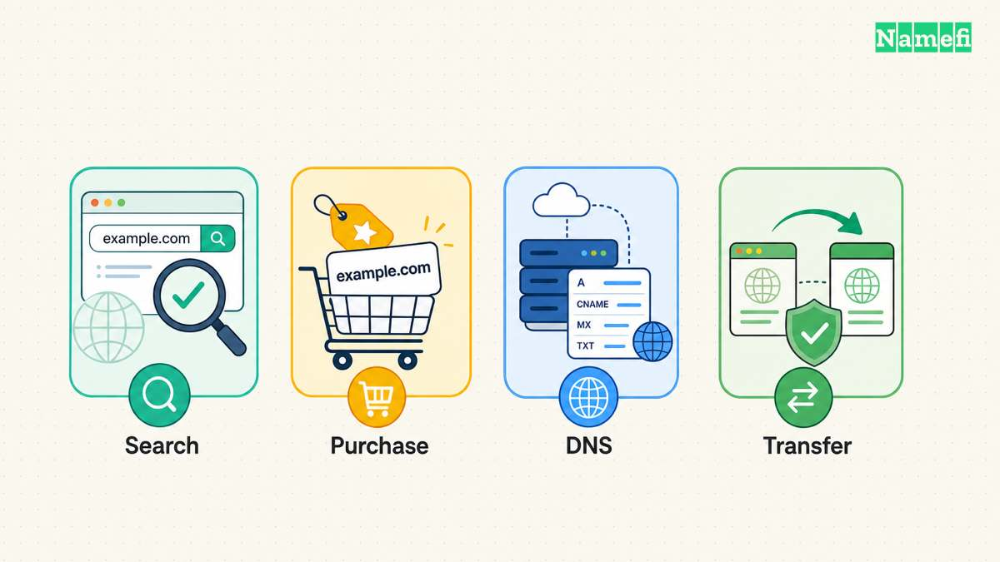
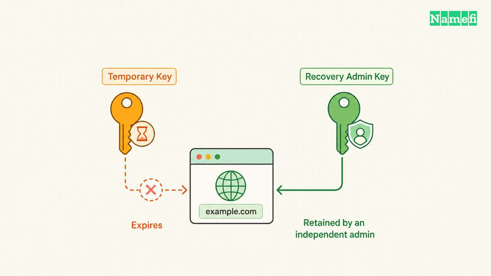

Delegate domain-agent permissions by separating discovery, purchasing, DNS administration, and transfers. Give the agent only the operations and domains needed for the current task. Confirm the restrictions in the enforcing system before relying on the restrictions.

An instruction such as “spend no more than the approved budget” describes intent. The instruction does not establish a technical spending limit. An OAuth scope, an MCP connection, and a registrar API key each require separate inspection.

The following design helps a small team document that separation. Provider capabilities vary, so the procedure treats unsupported restrictions as gaps to solve. The procedure does not assume that every registrar offers scoped tokens or per-domain roles.

## A permission inventory starts with actions and domain boundaries

Write the task before choosing the credential. Searching available names needs different authority from placing an order. Updating a TXT record needs different authority from changing account recovery details.

[OWASP recommends defining users, resources, and operations before granting privileges](https://cheatsheetseries.owasp.org/cheatsheets/Authorization_Cheat_Sheet.html#enforce-least-privileges). For domain work, list the customer account, permitted domains, allowed operations, and prohibited operations. Include the person who can approve an exception.

Consider a hypothetical agency that manages example.com for a client. The agency needs to publish one verification TXT record. The task does not require registration purchases, domain transfers, nameserver replacement, or changes to the client's billing profile.

Define the permitted record name and value before delegation. If the provider only supports access to the entire zone, record that limitation. A narrow task and a broad credential remain different facts, even when the agent promises to use only one function.

| Task | Needed capability | Separate authority to review |
| --- | --- | --- |
| Find candidates | Availability and price lookup | Purchases and payment |
| Register an approved name | Specific registration operation | Other names and add-ons |
| Publish verification | Specified DNS record change | Nameservers and unrelated records |
| Inspect renewal status | Registration inventory read | Renewal purchases and cancellation |
| Prepare a transfer | Readiness checks | Unlocking and transfer authorization |

Use an allowlist for known resources when the integration can enforce an allowlist. Include exact account identifiers as well as domain names. A domain may appear in more than one system, such as a registrar account and a DNS hosting account.

Keep registration ownership separate from operational access. A consultant should not become the intended [registrant](/en/glossary/registrant/) merely because the consultant configures the agent. Record the client's intended role in the purchase and account setup process.

Document the duration as well. A one-time verification task can end after the record check. A monitoring service can need continuing read access. Neither task automatically justifies indefinite write access to every domain.

When an operation cannot be limited adequately, keep that operation outside the delegated workflow. A human can perform the operation through the provider's documented interface. The agent can still prepare the proposed values and review the resulting state.

## Authentication and authorization establish different controls

Authentication establishes an identity. Authorization determines whether a particular identity may perform a particular action. [OWASP explicitly distinguishes those functions](https://cheatsheetseries.owasp.org/cheatsheets/Authorization_Cheat_Sheet.html#introduction). A successful login therefore does not establish appropriate permissions.

Inspect the provider credential directly. Check whether the credential belongs to a person, service account, customer account, or shared integration. Read the provider's current permission documentation and compare the documented capabilities with the task inventory.

For OAuth integrations, review the requested scopes and resource audience. [RFC 9700 recommends restricting tokens to the necessary privileges, resources, and actions](https://www.rfc-editor.org/rfc/rfc9700.html#section-2.3). The resource server must check the relevant restrictions. Scope names alone do not prove that a provider enforces a particular domain boundary.

A scope called domain management might cover a wide collection of operations. Another provider might offer separate registration and DNS scopes. Treat those examples as possible designs, not portable scope names. Use the actual provider documentation and consent screen.

MCP introduces another boundary. [The MCP authorization specification describes transport-level authorization for HTTP-based transports](https://modelcontextprotocol.io/specification/2025-11-25/basic/authorization#purpose-and-scope). The specification does not make every MCP server an OAuth service. The specification treats standard-input/output transport differently.

For an HTTP MCP integration, identify the MCP server and the downstream registrar service. Ask which token authorizes each connection. A client that may call the MCP server does not necessarily hold the same permissions directly at the registrar.

For a local integration, inspect how the process receives credentials. Keep credentials in the approved secret-management path. Avoid copying credentials into repository instructions, chat messages, screenshots, or image prompts. A documented key name can identify the credential without exposing the value.

A spending rule needs enforcement beyond a generic login grant. Review whether the provider or a trusted purchase service checks the total, currency, registration length, and approved domain. If the workflow only relies on natural-language instructions, record the spending limit as advisory.

Do not describe a limited payment balance as complete purchase authorization. A balance can limit one kind of loss while leaving DNS changes or account actions available. Evaluate financial limits and domain-administration permissions separately.

## The enforcing service must check each requested operation

The agent's planning layer should prepare the action, while a trusted control checks the action before execution. That design gives the team a place to enforce domain boundaries, approval requirements, and budget rules independently of generated prose.

[OWASP advises denying access by default and checking permissions on every request](https://cheatsheetseries.owasp.org/cheatsheets/Authorization_Cheat_Sheet.html#validate-the-permissions-on-every-request). Apply those principles to registration, renewal, DNS edits, and transfer operations. A successful earlier request should not authorize every later request.

For the agency example, the enforcing service should compare the requested account, zone, record name, type, and value with the approved change. The service should reject an attempt to change an unrelated mail record. The service should also reject a request targeting another client's account.

Use a preview that shows the actual proposed action. For a purchase, show the exact domain, term, total, currency, and receiving account. For a DNS edit, show the previous value and proposed value. An approval button without those details gives the reviewer little evidence.

Make approval specific to the operation. If a quote changes, the workflow should evaluate the changed quote against the existing authorization. A policy can permit a bounded variation, but the policy must state the variation. Avoid silently extending an approval to a different domain.

Protect the decision from untrusted page content. A domain listing, documentation page, or marketplace message can supply data. Such content should not rewrite the customer's authorization policy. Keep that separation clear when an agent reads external material during the task.

Review the tool catalog too. Removing a dangerous tool from the displayed interface can reduce accidental use. Actual provider-side restrictions remain necessary when another call path can reach the same operation. Ask the integration owner which layer enforces each rule.

Test denial cases with a sandbox or a mock service before enabling real changes. Try an unapproved domain, an expired approval, a higher quote, and an unrelated account. A useful test proves rejection without making an unauthorized live purchase.

Record both allowed and denied operations. Preserve the approval reference, target resource, request identifier, and outcome. The [purchase audit guide](/en/blog/audit-agent-domain-purchases/) provides a corresponding evidence checklist for completed transactions.

## Expiration and revocation complete the delegation process

Create a removal plan when granting access. Record the credential owner, task owner, permitted resources, expiration mechanism, and revocation path. A team should know how to stop the workflow before the team needs emergency containment.

For the TXT verification task, remove temporary write access after confirming the record. If the business needs continuing monitoring, replace the temporary write credential with read access when the provider supports read access. Document the remaining permission if the provider cannot provide that separation.

For OAuth deployments, review refresh tokens as well as access tokens. [RFC 9700 explains that refresh tokens can obtain new access tokens and need protection](https://www.rfc-editor.org/rfc/rfc9700.html#section-4.14). A short-lived access token does not by itself establish a short-lived grant.

Use the provider's documented revocation method. Then test the expected denial through an authorized, harmless read request where practical. Disconnecting a user interface and revoking a provider credential can be separate actions. Verify the actual result instead of assuming equivalence.

Keep a separate recovery administrator available. The recovery administrator should retain the ability to disable the integration without depending on the agent runtime. Document the provider support route and the evidence needed for account recovery.

Review delegation when a contractor leaves, an integration changes, or a task expands. Compare the current permission inventory with the original task. Remove obsolete credentials and update the task record before granting new authority.

A final handoff should answer five questions: which account, which domains, which operations, which limits, and which end condition? When an answer depends only on a prompt, label that dependency. When a provider enforces an answer, preserve evidence of the configured restriction.

Effective delegation gives an agent enough authority to complete a useful task. Verified enforcement, attributable requests, and a working removal process make that authority understandable to the business owner.

## These sources support the article

- [OWASP: Authorization Cheat Sheet](https://cheatsheetseries.owasp.org/cheatsheets/Authorization_Cheat_Sheet.html). Least privilege, default denial, and request checks. Fetched 2026-10-21.
- [IETF: RFC 9700](https://www.rfc-editor.org/rfc/rfc9700.html). Sections 2.3 and 4.14 address privilege restrictions and refresh tokens. Fetched 2026-10-21.
- [Model Context Protocol: Authorization](https://modelcontextprotocol.io/specification/2025-11-25/basic/authorization). Version 2025-11-25, scope and transport requirements. Fetched 2026-10-21.
