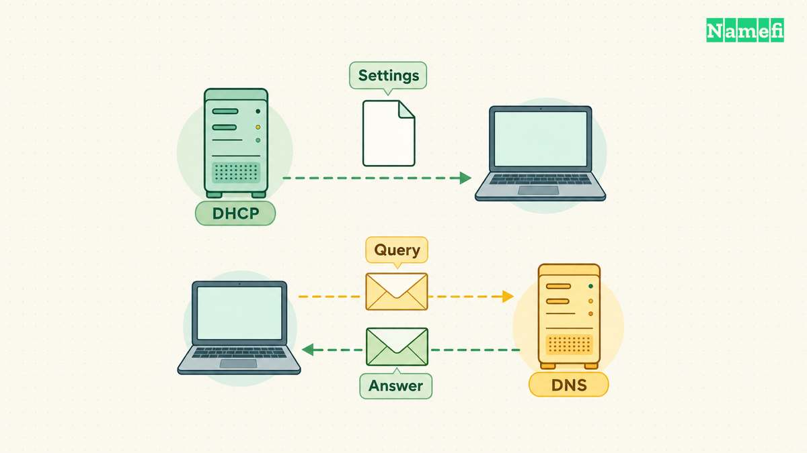
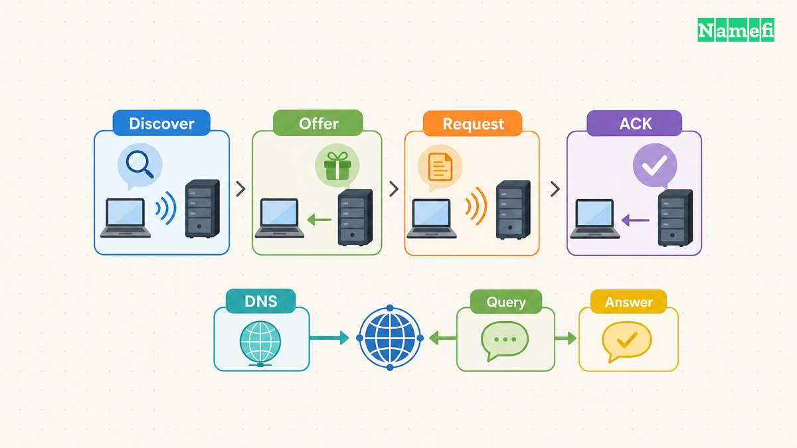
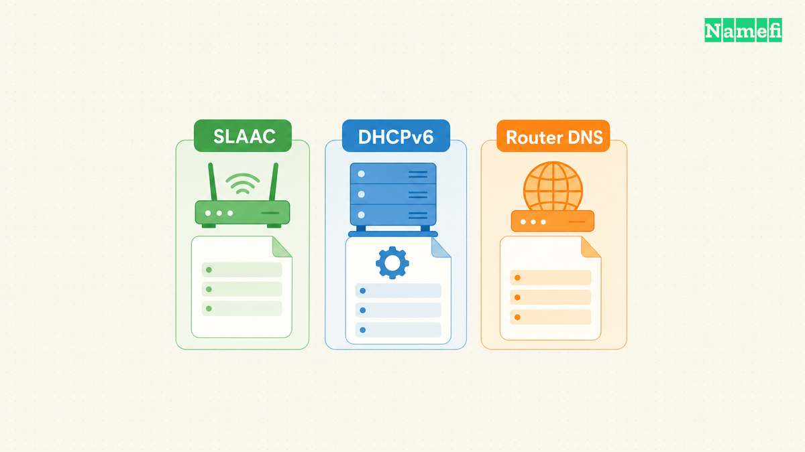

**DHCP supplies network configuration to a device. DNS answers questions about names.** A laptop can receive a DNS server address through DHCP, then send DNS queries to that server. Those exchanges perform different jobs.

The difference matters when a device connects to Wi-Fi but cannot open a website. An address problem, an unreachable resolver, and an incorrect website record require different repairs. Changing a domain record cannot repair a missing client address. Renewing a laptop lease cannot correct an authoritative website record.

This guide separates the client configuration path from the name lookup path. The examples describe hypothetical networks, not settings to copy into a router.

## DHCP supplies client settings and DNS supplies answers

DHCP stands for Dynamic Host Configuration Protocol. A DHCP server can allocate an address and provide configuration parameters to a client. [RFC 2131 describes the configuration framework](https://www.rfc-editor.org/rfc/rfc2131.html#section-1).

[DNS](/en/glossary/dns/) stands for Domain Name System. DNS organizes information under names and lets clients request particular record types. [RFC 1034 describes queries and responses](https://www.rfc-editor.org/rfc/rfc1034.html#section-4.3.1).

A device address and a website address can therefore appear in different conversations. The DHCP server helps configure the laptop's network interface. A DNS answer can identify the address associated with a website name. The website does not receive an address from the visitor's DHCP server.

| Question | DHCP | DNS |
| --- | --- | --- |
| What does the client need? | Network configuration | Information about a name |
| What can a response contain? | Address and configuration options | Requested resource records |
| What does an administrator inspect? | Client settings and leases | Queries, records, and responses |
| Does the protocol allocate client addresses? | DHCP can allocate addresses | DNS queries do not allocate addresses |

A [DNS resolver](/en/glossary/dns-resolver/) handles name lookup work for clients. An authoritative [nameserver](/en/glossary/nameserver/) serves information for a DNS zone. The services can run on different machines and belong to different administrators. [RFC 1034 separates resolvers, name servers, and zone authority](https://www.rfc-editor.org/rfc/rfc1034.html#section-2.4).

That distinction explains two settings that share the label “DNS server.” A laptop setting identifies a resolver for the laptop. A domain's nameserver configuration identifies authoritative infrastructure for the domain. Editing one setting does not automatically edit the other.

For a hypothetical office, document four separate responsibilities: client address allocation, client resolver configuration, internal zone management, and public zone management. One administrator might handle every responsibility. Separate records still help identify which configuration needs attention.

DNS also carries more than address information. The [DNS record types](/en/glossary/dns-record-types/) determine what a query asks for. A records contain IPv4 addresses, while MX records identify mail exchanges. [RFC 1035 defines those record formats](https://www.rfc-editor.org/rfc/rfc1035.html#section-3.4.1). A working website lookup does not establish that a domain's mail records are correct.

## DHCP can supply a resolver without performing a lookup

For a typical initial DHCPv4 allocation, the client sends Discover, the server sends Offer, the client sends Request, and the server sends Acknowledgment. Administrators often call the sequence **DORA**. A returning client can use a shorter exchange. [RFC 2131 documents the initial allocation and reuse paths](https://www.rfc-editor.org/rfc/rfc2131.html#section-3.1).

The resulting configuration can include more than the client address. DHCPv4 options describe settings such as the subnet mask, router addresses, and DNS server addresses. Option 6 carries DNS server addresses. Option 3 carries router addresses. [RFC 2132 specifies the options separately](https://www.rfc-editor.org/rfc/rfc2132.html#section-3.8).

Consider a hypothetical laptop that receives an address, a default gateway, and a resolver address. The laptop now knows where to send a DNS query. The DHCP reply has not answered the laptop's future question about `www.example.com`.

The client can later ask the resolver for that name's A record. A resolver might answer from cached information or perform further resolution. DHCP does not participate in every lookup. [RFC 1034 describes resolver operation and caching](https://www.rfc-editor.org/rfc/rfc1034.html#section-5.3).

A DHCP lease and a DNS cache lifetime also track different state. The lease governs the client's allocated address. A record's [TTL](/en/glossary/ttl/) limits how long a cache can retain that record before refreshing the information. [RFC 1035 defines the TTL field](https://www.rfc-editor.org/rfc/rfc1035.html#section-3.2.1).

Do not apply one timer to the other. A DNS record can expire from a cache while the client retains a valid address. A renewed client lease does not require every cached website record to expire.

Static configuration preserves the same separation. An administrator can configure a client address and resolver settings manually. DNS does not require DHCP to allocate that address first. RFC 2131 also allows DHCP to deliver parameters when an external mechanism already configured the address. [Section 3.4 describes that DHCPINFORM case](https://www.rfc-editor.org/rfc/rfc2131.html#section-3.4).

When reviewing a configuration, record the address source and resolver source independently. Avoid treating “automatic address” as evidence that every resolver setting also came from DHCP. A deliberate resolver override deserves separate documentation, including the reason for the override and the expected internal names.

A useful change record names the affected interface, the previous setting, and the intended result. For example, an administrator might correct the advertised resolver while preserving address allocation. After the correction, verify the client settings again. Then run a fresh lookup for the name that originally failed.

## IPv6 separates address configuration from DNS discovery

DORA describes the familiar DHCPv4 allocation sequence. DHCPv6 uses different messages and supports different operating modes. Do not apply the DHCPv4 message names to an IPv6 packet trace. [RFC 9915 describes DHCPv6 address, prefix, and configuration exchanges](https://www.rfc-editor.org/rfc/rfc9915.html#section-6).

IPv6 hosts can also form addresses through Stateless Address Autoconfiguration, or SLAAC. Router Advertisements provide prefix information that hosts can use during address creation. [RFC 4862 describes Router Advertisement processing](https://www.rfc-editor.org/rfc/rfc4862.html#section-5.5.3).

An automatically configured IPv6 address therefore does not prove that a DHCPv6 server assigned the address. Identify the configuration mechanism before searching for a missing lease. A lease inventory alone cannot describe every address on a network that uses SLAAC.

DNS server discovery forms another part of IPv6 configuration. DHCPv6 can provide recursive DNS server addresses and a domain search list through dedicated options. [RFC 3646 defines both options](https://www.rfc-editor.org/rfc/rfc3646.html#section-3).

Router Advertisements can also carry recursive DNS server addresses and a DNS search list. [RFC 8106 defines the RDNSS and DNSSL options](https://www.rfc-editor.org/rfc/rfc8106.html#section-5). A network can therefore provide DNS configuration without making DHCPv6 the source of that configuration.

DHCPv6 can supply configuration information without assigning a lease. The Information-request exchange requests parameters rather than address allocation. [RFC 9915 documents the server behavior](https://www.rfc-editor.org/rfc/rfc9915.html#section-18.3.6).

For troubleshooting, keep three questions separate. How did the interface obtain an address? How did the host learn its router? How did the host learn its resolver? A single “automatic configuration” label does not answer all three questions.

Suppose an office enables SLAAC and advertises a resolver through Router Advertisements. An empty DHCPv6 lease table would not, by itself, identify a fault. The relevant checks include the host's address, received advertisements, and effective resolver configuration. Treat the example as a diagnostic plan, not a prediction about every operating system.

Mixed IPv4 and IPv6 networks need the same care. Record which protocol family each observation concerns. An IPv4 DHCP lease says nothing about whether the host learned the expected IPv6 DNS configuration. Keep separate observations before deciding that “DHCP works” or “DNS fails.”

For a support ticket, include the failing name and the interface in use. Add the observed address family and the configuration source when available. Those details give the network administrator a specific configuration path to inspect. A screenshot that only says “connected” provides much less evidence.

## Distinct checks isolate configuration faults and DNS update faults

Begin with observation before renewal or record changes. The following commands target Windows 10 and Windows 11, which Microsoft's command references explicitly list. Other platforms have different configuration tools. [Microsoft documents the supported Windows versions and syntax](https://learn.microsoft.com/en-us/windows-server/administration/windows-commands/ipconfig).

Run `ipconfig /all` to inspect the full configuration. Identify the adapter that carries the affected connection. Record the address, gateway, resolver addresses, and available DHCP information. A computer can have several adapters, so avoid interpreting an unrelated adapter's settings as the failing connection.

Next, run `nslookup www.example.com`. Windows uses the default DNS server for the lookup unless the command specifies another server. For a controlled comparison, run `nslookup www.example.com APPROVED_DNS_IP`. Replace the placeholder with a resolver address approved for the network. [Microsoft documents the optional second argument](https://learn.microsoft.com/en-us/windows-server/administration/windows-commands/nslookup#syntax).

The commands demonstrate syntax, not a promised answer for `example.com`. Use the actual failing name during an investigation. Compare the same name and record type through each resolver, and save the complete responses.

Consider a hypothetical support case involving `portal.example.com`. The affected laptop shows the expected address configuration, but its default resolver query times out. A query through an approved comparison resolver returns an answer. Preserve both outputs before changing any setting.

The comparison gives the administrator a narrower investigation. Check whether the default resolver address matches the intended configuration. Then check whether the affected client can reach the intended resolver. Avoid replacing the public portal record merely because one client cannot obtain an answer.

Now consider a different result. Both resolvers return the same obsolete destination, and the authoritative zone also contains that destination. The administrator should inspect the authorized zone change process. Repeated client lease renewals would not change the published destination. After an authorized correction, compare the authoritative answer with subsequent resolver answers.

These examples deliberately stop short of claiming a complete diagnosis. A useful troubleshooting record identifies the observation, the next test, and the expected result. That record makes each repair easier to verify.

Interpret the evidence narrowly:

- An unexpected client configuration directs attention toward address allocation, manual settings, or the active adapter.
- A lookup timeout warrants checking the resolver address and the path to that resolver.
- Different resolver answers warrant checking the intended DNS view and the authoritative data.
- A successful lookup moves the investigation toward the application connection and service behavior.

Those observations guide the next check. A single timeout does not prove that DHCP failed. Different answers do not automatically establish that one resolver is wrong. An internal name requires an appropriate internal resolver, so an arbitrary public resolver can make the comparison misleading.

A separate failure occurs when a client receives an address but the client's own hostname still points elsewhere. DHCP and DNS can cooperate through [dynamic DNS updates](/en/blog/dynamic-dns-setup/), but the cooperation requires configuration. [RFC 4702 describes how clients and servers coordinate update responsibility](https://www.rfc-editor.org/rfc/rfc4702.html#section-4.1).

DNS UPDATE is a separate protocol operation that changes zone data. [RFC 2136 defines the update operation](https://www.rfc-editor.org/rfc/rfc2136.html#section-1). A DHCP acknowledgment does not prove that an update succeeded. Check the intended hostname, update responsibility, server logs, and resulting authoritative record separately.

Restrict updates to authorized actors and authenticate the update exchange. TSIG supplies shared-secret message authentication for DNS transactions. [RFC 8945 describes TSIG's purpose and limits](https://www.rfc-editor.org/rfc/rfc8945.html#section-1). A client-supplied hostname does not grant permission to replace an arbitrary domain's records.

Keep recovery specific. Correct a client configuration fault at the configuration source. Correct a stale authorized record through the responsible DNS administration path. Then verify the client settings and the name answer independently. Neither a DHCP lease nor a DNS response establishes ownership of the public domain name.

## Sources and further reading

- [RFC 2131](https://www.rfc-editor.org/rfc/rfc2131.html), sections 1, 3.1, 3.2, and 3.4: DHCP allocation, reuse, and external address configuration. Fetched 2026-10-21.
- [RFC 2132](https://www.rfc-editor.org/rfc/rfc2132.html), sections 3.3, 3.5, and 3.8: subnet mask, router, and DNS server options. Fetched 2026-10-21.
- [RFC 1034](https://www.rfc-editor.org/rfc/rfc1034.html), sections 2.4, 4.3.1, and 5.3: DNS components, queries, and resolver behavior. Fetched 2026-10-21.
- [RFC 1035](https://www.rfc-editor.org/rfc/rfc1035.html), sections 3.2.1, 3.3.9, and 3.4.1: TTL, MX, and A records. Fetched 2026-10-21.
- [RFC 9915](https://www.rfc-editor.org/rfc/rfc9915.html), sections 6 and 18.3.6: DHCPv6 configuration and Information-request handling. Fetched 2026-10-21.
- [RFC 4862](https://www.rfc-editor.org/rfc/rfc4862.html#section-5.5.3), section 5.5.3: SLAAC and Router Advertisements. Fetched 2026-10-21.
- [RFC 3646](https://www.rfc-editor.org/rfc/rfc3646.html#section-3), sections 3–4: DHCPv6 DNS configuration options. Fetched 2026-10-21.
- [RFC 8106](https://www.rfc-editor.org/rfc/rfc8106.html#section-5), section 5: Router Advertisement DNS options. Fetched 2026-10-21.
- [Microsoft ipconfig reference](https://learn.microsoft.com/en-us/windows-server/administration/windows-commands/ipconfig), Syntax, Parameters, and Examples. Fetched 2026-10-21.
- [Microsoft nslookup reference](https://learn.microsoft.com/en-us/windows-server/administration/windows-commands/nslookup), Syntax and Parameters. Fetched 2026-10-21.
- [RFC 4702](https://www.rfc-editor.org/rfc/rfc4702.html#section-4.1), sections 4.1, 5, and 8: update responsibility, lifetimes, and security. Fetched 2026-10-21.
- [RFC 2136](https://www.rfc-editor.org/rfc/rfc2136.html#section-1), section 1: dynamic DNS update operations. Fetched 2026-10-21.
- [RFC 8945](https://www.rfc-editor.org/rfc/rfc8945.html#section-1), section 1: transaction authentication through TSIG. Fetched 2026-10-21.
