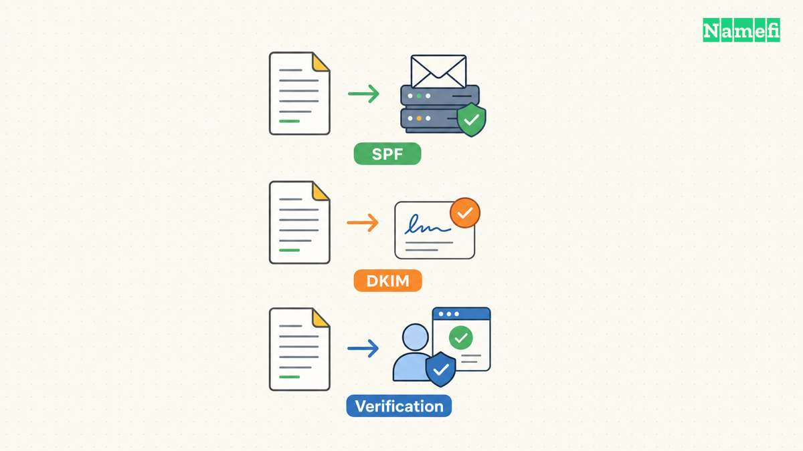

A DMARC checker can inspect a domain's published policy, but a policy lookup cannot prove that legitimate messages pass DMARC. Check the DNS record and then inspect real message authentication results. [The current DMARC standard defines policy discovery and message evaluation separately](#rfc-9989-defines-policy-discovery-and-message-results).

Start with [Google Admin Toolbox Dig](https://toolbox.googleapps.com/apps/dig/) for a public DNS lookup. Query TXT at `_dmarc` before the actual From domain. This guide explains the diagnosis and does not claim to have queried your domain.

The examples are hypothetical. [IANA maintains example domains for documentation](#iana-maintains-example-domains-for-documentation).

## The actual From domain determines the first lookup

Read the visible From address in a message from the sending service. For the hypothetical address `billing@example.com`, begin with `_dmarc.example.com`. A subdomain sender, such as `billing@receipts.example.com`, starts with `_dmarc.receipts.example.com`.

[The standard begins discovery at the message's author domain](#rfc-9989-defines-policy-discovery-and-message-results). A query only at the parent domain can miss a policy published for the exact sending subdomain.

Use the full name and TXT record type in the lookup tool. [Google provides a public DNS query interface](#google-provides-an-official-dns-query-tool). A local command such as `dig TXT _dmarc.example.com` provides another way to inspect the answer.

Keep the complete response, query time in UTC, and resolver information. If an online checker returns only a score, look for the underlying record and explanation before acting on the result.

## The returned TXT data needs a policy interpretation

A basic example is `v=DMARC1; p=none; rua=mailto:dmarc-reports@example.com`. The version identifies DMARC. The policy and reporting destination serve different purposes.

Check whether the version tag appears first and uses the expected value. [RFC 9989 defines the version requirement](#rfc-9989-defines-policy-discovery-and-message-results). Check the complete answer for duplicate DMARC policy records, rather than assuming a checker selected the intended record.

Current discovery rules discard multiple DMARC policy records returned for one target. [The standard documents that behavior](#rfc-9989-defines-policy-discovery-and-message-results). Do not try to add policy records together mentally.

Also distinguish a record with no explicit handling preference from an enforcement policy. RFC 9989 treats an otherwise valid record without `p` as `p=none`. [That current default matters when interpreting older checker warnings](#rfc-9989-defines-policy-discovery-and-message-results).

Do not change the record to satisfy a generic badge. Identify the exact issue, confirm the applicable standard or provider requirement, and preserve the previous value before making an authorized change.

## The effective policy can differ from a simple parent lookup

When the initial lookup does not provide an applicable record, DMARC discovery can involve the domain hierarchy. Current RFC 9989 uses DNS tree-walk rules. [The standard explains the discovery process](#rfc-9989-defines-policy-discovery-and-message-results).

Ask a specialist checker which discovery method it implements and which policy it actually applied. For a subdomain, record the author domain, policy domain, and relevant policy tags. A bare statement that the parent has DMARC does not show the complete evaluation.

If records disagree across resolvers, compare the active authoritative nameservers with the checker result. The [DNS propagation checker guide](/en/blog/dns-propagation-checker-guide/) describes that comparison.

Avoid replacing an existing policy while the active DNS provider remains uncertain. Editing an inactive zone can create an apparent repair without changing the public answer.

## A real message establishes authentication and alignment

Send a controlled message through each legitimate sending service. Use the recipient's original-message view to inspect the receiving system's authentication results.

Record the visible From domain, SPF domain and result, DKIM signing domain and result, and DMARC result. [Google explains the alignment requirement for direct email](#google-separates-alignment-from-a-policy-record). A successful SPF or DKIM result for an unrelated provider domain does not establish the required alignment.

When a message fails, identify whether the problem concerns authentication or alignment. A missing DKIM signature calls for a different repair from a passing signature on the wrong domain. A failed SPF check can also require sender authorization changes rather than a DMARC policy change.

Use the [SPF checker guide](/en/blog/spf-record-check/) for that narrower investigation. Keep private message content out of unfamiliar analysis tools. Share only the diagnostic fields needed by the responsible provider.

## Monitoring and enforcement answer different questions

A monitoring policy can provide useful reporting without requesting quarantine or rejection for failures. A domain with `p=none` therefore should not receive a claim of complete spoofing protection merely because the DNS record exists.

A stronger policy also does not guarantee every receiver's behavior or stop every form of phishing. DMARC validates domain use through aligned authentication. The protocol does not evaluate all message content or display-name deception.

Do not assume that `p=reject` represents the correct repair for every domain. RFC 9989 warns that rejection can break forwarding and mailing-list flows. The standard recommends against rejection for general-purpose mail domains. [The interoperability guidance governs that decision](#rfc-9989-defines-policy-discovery-and-message-results).

Check the current testing tag, `t`, as well as the policy value. RFC 9989 defaults `t` to `n`. With `t=y`, failing-message handling uses one policy level below the specified setting: reject becomes quarantine, and quarantine becomes none. Testing does not change report generation. [The current tag definition explains the effect](#rfc-9989-defines-dmarc-policy-testing). A checker that reports only `p=reject` can miss that qualification.

Older checkers may discuss percentage rollout through `pct`. RFC 9989 removes that tag. [Read current behavior before copying an older recommendation](#rfc-9989-defines-policy-discovery-and-message-results).

## A useful check ends with evidence and an owner

Document the exact TXT answer, applicable policy, report destination, real-message results, and unresolved sending services. Assign each repair to the DNS administrator or sending provider responsible for the failed component.

Verify that someone receives and reviews aggregate reports when the policy requests reports. A published address that nobody monitors does not supply an operational review process.

For deployment planning, use the [DMARC setup guide](/en/blog/dmarc-record-setup/). For an existing problem, preserve the current policy while investigating the actual failure.

The next action is to pair one DNS lookup with one real message from the affected sender. That pair separates a published intention from the authentication result that receivers actually observe.

## Sources and further reading

### RFC 9989 defines policy discovery and message results

[RFC 9989 defines policy discovery and message results](https://www.rfc-editor.org/rfc/rfc9989.html#section-4.10.1) — checked 2026-10-30. Checked passages: Sections 4.4, 4.7, 4.10, 5.1, 5.3, and 7.4; Appendix A.6 and Appendix C.5.2.

### Google separates alignment from a policy record

[Google separates alignment from a policy record](https://support.google.com/a/answer/81126?hl=en#:~:text=Email%20authentication%20requirements) — checked 2026-10-30.

### Google provides an official DNS query tool

[Google provides an official DNS query tool](https://toolbox.googleapps.com/apps/dig/) — checked 2026-10-30.

### IANA maintains example domains for documentation

[IANA maintains example domains for documentation](https://www.iana.org/help/example-domains#:~:text=for%20documentation%20purposes) — checked 2026-10-30.

### RFC 9989 defines DMARC policy testing

[RFC 9989, section 4.7, t tag](https://www.rfc-editor.org/rfc/rfc9989.html#section-4.7) — checked 2026-10-30.
