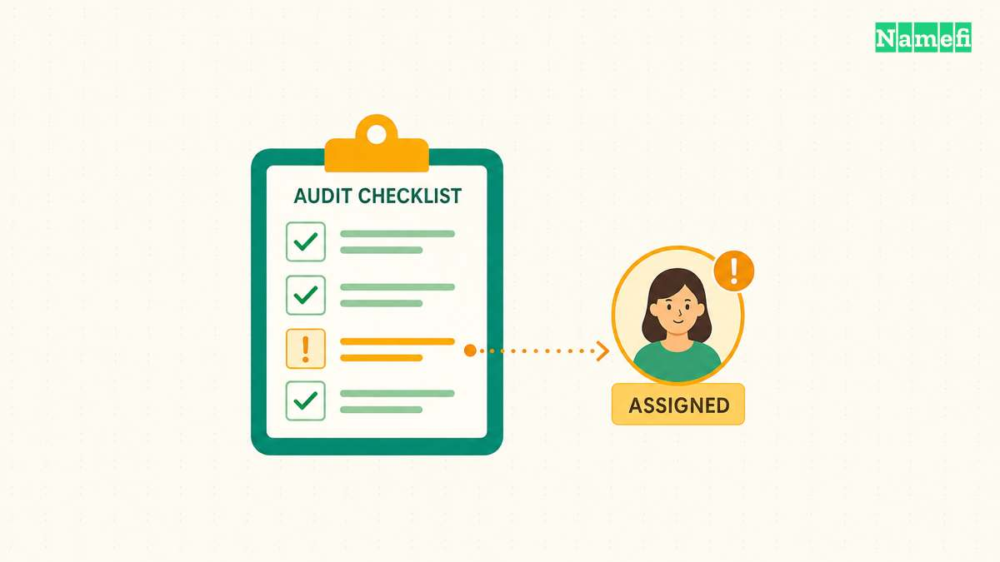
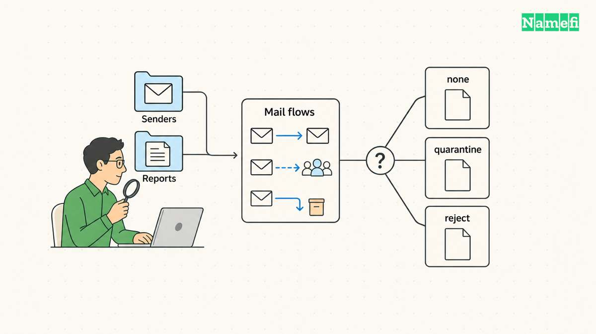

DMARC lets a domain owner publish email authentication policy and request reports about mail that uses the domain. DMARC checks whether a passing SPF or DKIM identity aligns with the visible From domain. [RFC 9989 defines the current protocol](#rfc-9989-defines-current-dmarc-behavior). DMARC can help receivers identify unauthorized use of a domain, but a DMARC pass does not establish that a message is safe.

Use DMARC after identifying the services that send email for the domain. Publishing a record is one step. The useful outcome requires legitimate senders to authenticate with the expected domain.

The examples are hypothetical. [IANA maintains example domains for documentation](#iana-maintains-example-domains-for-documentation).

## DMARC connects the visible sender to an authenticated domain

SPF and DKIM check different parts of a message's sending identity. SPF evaluates an SMTP identity and sending IP address. DKIM uses a signature with a signing domain. The [TXT record guide](/en/blog/txt-records-spf-dkim-verification/) explains the separate records.

DMARC connects those authentication results to the domain in the visible From field. A message needs a passing, aligned mechanism. [The current standard defines identifier alignment](#rfc-9989-defines-current-dmarc-behavior).

Consider a hypothetical newsletter with `From: updates@example.com`. The newsletter service can authenticate its own unrelated domain successfully. That success alone does not establish alignment with `example.com`. Configure the service's supported custom sending identity or DKIM signing domain instead of assuming that any SPF pass satisfies DMARC.

Relaxed and strict alignment apply different domain matching rules. Do not enable stricter settings merely because a checker presents strictness as a higher score. Compare the settings with the actual domains used by legitimate senders.

## The domain owner publishes policy in a TXT record

A DMARC lookup begins with `_dmarc` before the message's author domain. [RFC 9989 describes policy discovery](#rfc-9989-defines-current-dmarc-behavior). For the hypothetical author domain `example.com`, the initial lookup name is `_dmarc.example.com`.

A minimal monitoring example is `v=DMARC1; p=none; rua=mailto:dmarc-reports@example.com`. The example uses a reserved domain. Create a real reporting destination before publishing a corresponding record for your own domain.

The version tag identifies the protocol. The `p` tag states a handling preference. The `rua` tag requests aggregate reports to a reporting destination. [The standard defines the tag format and reporting URIs](#rfc-9989-defines-current-dmarc-behavior).

DNS interfaces differ in how they accept record names. Some interfaces append the zone name automatically. Check the saved fully qualified name to avoid accidentally publishing `_dmarc.example.com.example.com`.

Do not overwrite an existing enforcement policy with the monitoring example. An existing record needs investigation before revision. Use the [DMARC check guide](/en/blog/dmarc-record-check/) to inspect the current record and actual message results.

Inspect the published author domain in [Namefi's email-authentication configuration checker](https://namefi.io/domain-tools/email-auth). Review the discovered DMARC record and any policy or compatibility findings before revising an existing policy. The checker does not establish message alignment, report delivery, or successful protection from a record's presence alone.

## A sender inventory comes before policy enforcement

Write down every legitimate sending stream. Include employee mail, newsletters, billing, support systems, transactional messages, and website forms. Identify the responsible person and current provider for each stream.

For each sender, record the visible From domain, the SPF domain, and the DKIM signing domain. Send a controlled test through the actual service. Inspect the receiving system's authentication results.

Google separately documents SPF, DKIM, and DMARC requirements for mail sent to personal Gmail accounts. [Its guidance also distinguishes authentication from alignment](#google-explains-authentication-and-alignment). A provider requirement and the protocol's pass conditions answer related, but different, questions.

Use the inventory to repair missing authorization or signing configuration. Do not add an unfamiliar sending IP merely because a report shows traffic. Confirm that the traffic belongs to a legitimate service first.

## Reports help identify missing senders and broken authentication

A monitoring policy requests information without asking for quarantine or rejection on DMARC failure. Report review can reveal authorized services that still lack alignment. [RFC 9989 describes collecting reports and remediating mail streams](#rfc-9989-defines-current-dmarc-behavior).

Assign report review to someone who can connect the findings with the sender inventory. A mailbox that collects reports without review does not complete deployment. Choose a reporting workflow that the organization can maintain.

Reports contain operational information. Restrict access to the people who need the reports. If a third-party reporting service supplies the destination, follow its documented setup and authorization requirements.

Treat unfamiliar sources as investigation leads. Ask whether the organization recognizes the source, whether the message passed an aligned mechanism, and whether the reported behavior matches an expected service. Avoid using a single aggregate report as proof of a particular person's intent.

## Quarantine and rejection require a delivery decision

The policies `none`, `quarantine`, and `reject` express different handling preferences for messages that fail DMARC. Receivers still make handling decisions. A DNS record cannot guarantee universal rejection of abusive mail.

Current guidance needs care. RFC 9989 discusses forwarding and mailing-list problems. The standard says general-purpose mail domains should not deploy `p=reject`. [Its interoperability section explains the reasons](#rfc-9989-defines-current-dmarc-behavior). Do not assume every domain should follow an automatic progression to rejection.

Evaluate the domain's mail flows, users, forwarding arrangements, and delivery needs. A narrowly controlled transactional domain can present a different decision from a domain used for routine person-to-person mail. Document the reason for the chosen policy.

Older examples can also contain obsolete tags. RFC 9989 removes the `pct` tag. [The current standard explains that change](#rfc-9989-defines-current-dmarc-behavior). Avoid copying an old percentage rollout example without checking current provider behavior.

## A successful deployment needs ongoing sender checks

After publishing a new record, query the actual DNS name and send new test messages. Confirm the expected authentication and alignment for each legitimate service. Repeat relevant checks when adding or replacing a sending provider.

Keep the sender inventory, policy decision, DNS change record, and reporting owner together. Maintain an authorized correction process when a legitimate message fails.

The next action is to inventory the current senders and inspect one real message from each service. That evidence gives the domain owner a useful basis for publishing, reviewing, or revising DMARC.

## Sources and further reading

### RFC 9989 defines current DMARC behavior

[RFC 9989 defines current DMARC behavior](https://www.rfc-editor.org/rfc/rfc9989.html#section-4) — checked 2026-10-30. Checked passages: Sections 4.4, 4.7, 4.10, 5.1, 5.3, and 7.4; Appendix A.6 and Appendix C.5.2.

### Google explains authentication and alignment

[Google explains authentication and alignment](https://support.google.com/a/answer/81126?hl=en#:~:text=Email%20authentication%20requirements) — checked 2026-10-30.

### IANA maintains example domains for documentation

[IANA maintains example domains for documentation](https://www.iana.org/help/example-domains#:~:text=for%20documentation%20purposes) — checked 2026-10-30.
