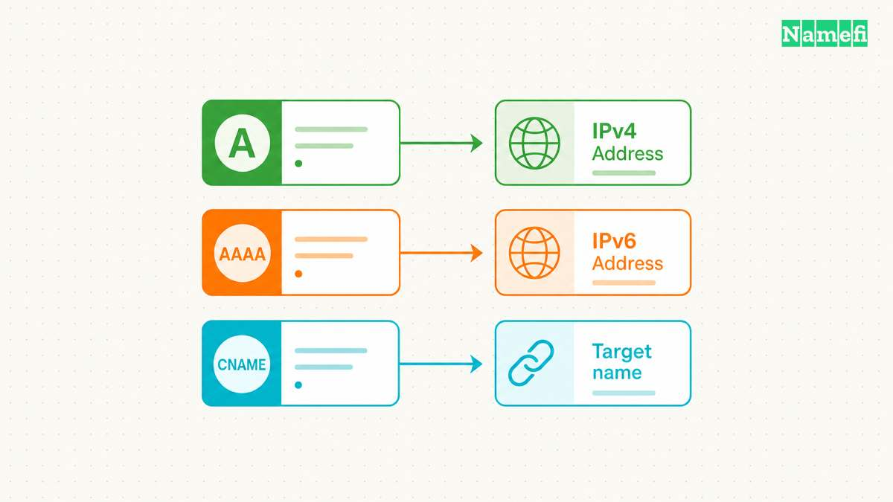
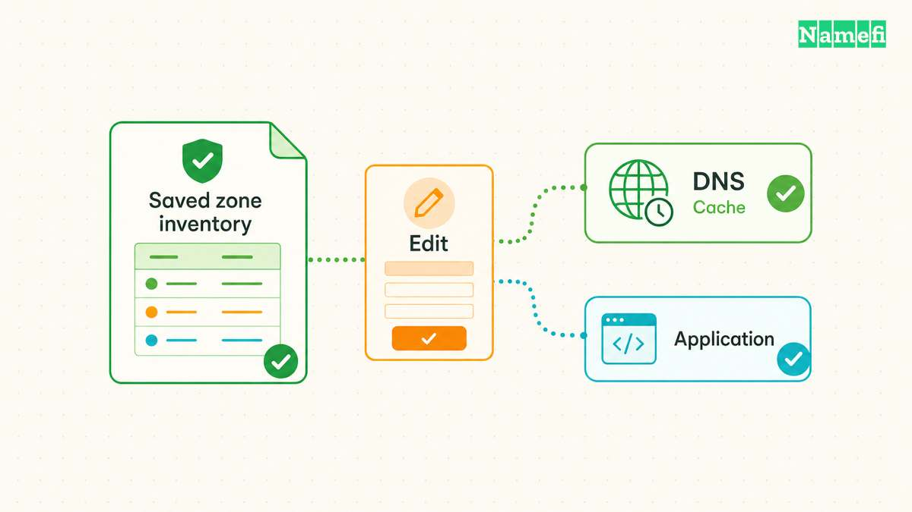
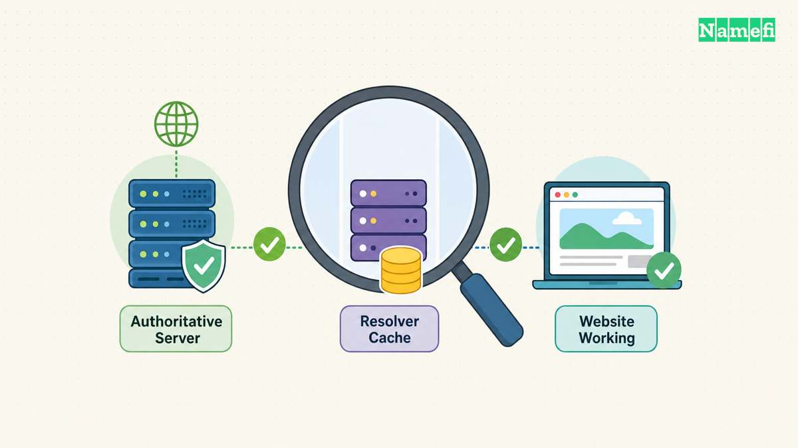

A DNS A record maps a name to an IPv4 address. Publish the address your hosting provider assigns for the service, then verify the exact hostname. [RFC 1035 defines the address data and multiple-address records](#rfc-1035-defines-a-records-and-ttl-units). An A record does not contain a website URL, path, or port.

For example, a hypothetical A record can map `www.example.com` to `192.0.2.20`. The example demonstrates the record's shape. Do not copy the documentation address into a production deployment.

The examples are hypothetical. [IANA maintains example domains for documentation](#iana-maintains-example-domains-for-documentation). [RFC 5737 reserves the illustrated IPv4 address range](#rfc-5737-reserves-documentation-ipv4-addresses).

## The name and address fields have different jobs

The record name identifies the hostname that a client queries. The address value identifies the IPv4 destination. A DNS dashboard may label the fields Host and Value, or Name and Content.

For a root-domain record, providers often offer a special representation for the zone apex. Follow the provider's own instructions for that field. Check the saved complete name instead of assuming every dashboard interprets the same input identically.

For a `www` record under `example.com`, confirm that the saved name is `www.example.com`. A duplicated zone suffix can create a different name that visitors never request.

The address field accepts an IPv4 address. A value such as `https://www.example.com/shop` belongs to a web address, rather than an A record. Use the [domain and hosting guide](/en/blog/domain-vs-hosting/) when the distinction between an address and hosted content remains unclear.

## The host must supply the destination before you edit DNS

Ask the hosting provider which record type and value the project needs. Some services supply a fixed address. Other services supply a hostname or a specialized connection workflow.

Cloudflare's record-management instructions tell users to update the relevant record's Content when an origin address changes. [The same instructions direct uncertain users to the hosting provider](#cloudflare-documents-record-creation-and-address-changes). Do not infer an origin address from an unrelated public lookup.

Before editing, save the previous record value, TTL, and relevant provider settings. Identify the existing service that uses the hostname. A website migration can affect a shared name that other applications still reference.

Check the current authoritative DNS provider. The registrar account and hosting account can differ from the DNS account. Edit the active DNS zone, rather than a dashboard that no longer serves the domain.

## A record creation should preserve unrelated services

Open the active provider's DNS record screen. Choose A, enter the intended name, enter the verified IPv4 address, and select the appropriate TTL. Save the change and inspect the complete stored record.

Cloudflare documents record creation through its DNS Records screen and describes provider-specific fields. [Its workflow includes choosing the record type and completing the relevant fields](#cloudflare-documents-record-creation-and-address-changes). Other providers can present different controls.

Avoid deleting mail, verification, or unrelated subdomain records to make room for the website change. The [DNS record guide](/en/blog/dns-record-types-guide/) explains the distinct purposes of those entries.

If an existing alias conflicts with the planned change, review the host's instructions before removing the alias. Do not stack record types without understanding the provider's rules and the intended service.

Keep the change narrow. A single hostname update does not automatically require replacing nameservers or rebuilding the whole zone.

## A records differ from aliases and web redirects

An A record supplies an IPv4 address. A CNAME record supplies another domain name. [Cloudflare explains that a CNAME target must be a domain rather than an IP address](#cloudflare-distinguishes-an-alias-from-an-address-record).

Use the record type the host requests. If the host supplies a hostname, do not look up the hostname once and assume its current address becomes a supported permanent A value.

DNS also does not select a page path or change the URL displayed in a browser. Two hostnames can reach the same server while the server handles those hostnames differently. [Cloudflare describes that separation between DNS and website handling](#cloudflare-distinguishes-an-alias-from-an-address-record).

Configure an HTTP redirect at the appropriate hosting or redirection service when visitors must move from one URL to another. A record editing alone does not implement that application behavior.

## TTL describes cache reuse in seconds

The TTL tells a resolver how long it may cache a record. [RFC 1035 specifies seconds as the TTL unit](#rfc-1035-defines-a-records-and-ttl-units). A DNS dashboard may display a named duration while the underlying value uses seconds.

Choose the TTL through the provider's supported controls and the migration plan. Record the old TTL before a change. Lowering a TTL after an old answer entered a cache does not rewrite that cached answer.

For a planned migration, follow the [TTL and propagation guide](/en/blog/ttl-and-dns-propagation/). Avoid promising a universal completion time from one dashboard setting.

A hostname can also have more than one A record. [RFC 1035 allows multiple addresses through multiple A records](#rfc-1035-defines-a-records-and-ttl-units). Publish only destinations that the service can actually use. Multiple records alone do not establish application health checks or automatic failover.

## A direct lookup verifies DNS before an application test

Run `dig A www.example.com` with the real hostname. Inspect the complete answer, response status, and responding resolver. [BIND documents record queries and explicit server selection](#bind-documents-a-record-queries-and-server-selection).

Compare the recursive result with an authoritative query when a recent change remains inconsistent. Use the [propagation checker guide](/en/blog/dns-propagation-checker-guide/) to keep the name, type, and resolver comparison aligned.

If the provider intentionally proxies the hostname, compare the public answer with the provider's expected proxy behavior. Do not assume a public address must reveal the origin server.

After DNS returns the intended result, open the exact hostname and route. Verify the host's domain configuration, HTTPS certificate, and application response. The [HTTPS guide](/en/blog/what-is-https/) separates those checks.

The next action is to obtain the host's supported IPv4 value and save one focused record change. Confirm DNS first, then confirm that the website or service works through the intended name.

In [Namefi's DNS lookup](https://namefi.io/domain-tools/dns), choose the A type and enter the exact owner name you edited. Compare the selected public resolver's address answer with the host's current instructions. Keep a separate authoritative query and application test when those questions remain unresolved.

## Sources and further reading

### RFC 1035 defines A records and TTL units

[RFC 1035 defines A records and TTL units](https://www.rfc-editor.org/rfc/rfc1035.html#section-3.4.1) — checked 2026-10-30. Checked passages: Sections 3.3.12, 3.4.1, 3.5, 4.1.1, and 4.1.3.

### Cloudflare documents record creation and address changes

[Cloudflare documents record creation and address changes](https://developers.cloudflare.com/dns/manage-dns-records/how-to/create-dns-records/#create-dns-records) — checked 2026-10-30.

### Cloudflare distinguishes an alias from an address record

[Cloudflare distinguishes an alias from an address record](https://www.cloudflare.com/learning/dns/dns-records/dns-cname-record/#:~:text=All%20CNAME%20records) — checked 2026-10-30.

### BIND documents A record queries and server selection

[BIND documents A record queries and server selection](https://bind9.readthedocs.io/en/latest/manpages.html#dig-dns-lookup-utility) — checked 2026-10-30. Checked passages: The dig manual: Simple Usage, the -x option, and the +recurse/+norecurse query option.

### IANA maintains example domains for documentation

[IANA maintains example domains for documentation](https://www.iana.org/help/example-domains#:~:text=for%20documentation%20purposes) — checked 2026-10-30.

### RFC 5737 reserves documentation IPv4 addresses

[RFC 5737 reserves documentation IPv4 addresses](https://www.rfc-editor.org/rfc/rfc5737.html#section-3) — checked 2026-10-30.
