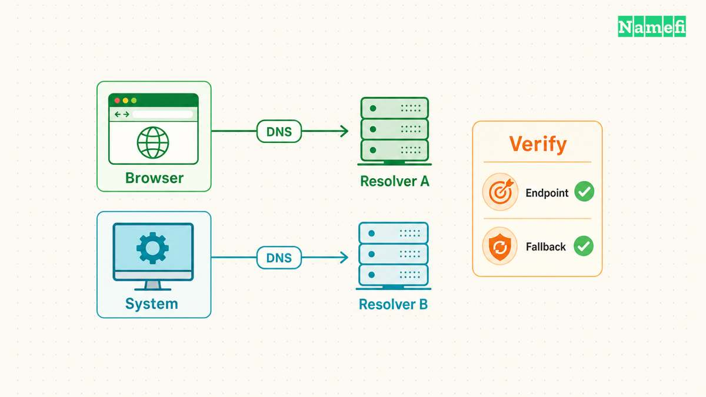

A DNS leak test helps identify the DNS servers used for the test's browser lookups. Start with [BrowserLeaks' DNS test](https://browserleaks.com/dns), record a baseline, connect the VPN, and repeat the test. Compare the observed resolver operators with your intended VPN and browser configuration. [BrowserLeaks explains its test method](#browserleaks-explains-the-browser-test).

An unfamiliar resolver name deserves investigation. The name alone does not prove a leak. A browser can use a separately selected DNS-over-HTTPS provider, and a VPN's expected resolver arrangement depends on the provider and configuration. Mozilla documents browser-level provider selection. [The Firefox DNS guidance explains that setting](#mozilla-explains-browser-dns-selection).

This guide describes a controlled comparison. The guide does not run a live test, certify a VPN, or establish anonymity.

## The baseline defines the question the VPN should answer

Before connecting the VPN, record the device, browser, network, VPN state, and DNS settings relevant to the test. Run the DNS test and save the displayed resolver results. Keep the UTC test time with the result.

BrowserLeaks states that its test attempts to resolve randomly generated names, including names for IPv4 and IPv6. The test observes the DNS path used for those browser requests. [The test description defines that scope](#browserleaks-explains-the-browser-test).

Treat the baseline as evidence about the current connection. A baseline does not automatically identify who configured the device or why a resolver appears. Your network can include several layers, including a router, managed device policy, or browser-level DNS setting.

As practical advice, write the expected change before connecting the VPN. For example, the VPN documentation might promise a particular DNS arrangement. Retain the exact product and platform instructions that establish that expectation. Avoid evaluating the result against an assumption about every VPN.

## A connected test needs the same browser and conditions

Connect the VPN through its supported application. Confirm that the application reports the intended connection. Repeat the DNS test in the same browser. Keep the browser's DNS settings unchanged for the first comparison.

Save the connected resolver result separately from the baseline. Compare resolver operators and addresses, together with the VPN state and time. An operator match can be more informative than a location label when infrastructure serves requests through several locations.

If the connected result still shows the baseline operator, investigate the actual VPN promise and device configuration. The result is a lead, not a complete packet-path analysis. Do not claim that the VPN tunnel failed solely from one displayed company name.

If the test returns no useful result, repeat the test before concluding that DNS is secure or broken. A failed web test does not demonstrate the absence of DNS traffic. Keep the test failure as an unresolved observation.

## Browser DNS can differ from the operating system setting

Mozilla allows Firefox users to select a DNS-over-HTTPS provider through Privacy & Security settings. That choice can explain why a browser-based test shows a provider different from an operating-system DNS setting. [Mozilla documents the provider control](#mozilla-explains-browser-dns-selection).

Compare the browser setting with the VPN's documented behavior. Do not change both settings at once. First establish which component should select the resolver under the intended configuration.

A command-line lookup also asks a different question from a browser test. Nslookup can target a selected DNS server directly. The browser test observes the path used for its own lookups. [Microsoft defines explicit-server nslookup queries](#microsoft-defines-an-explicit-server-query).

Therefore, agreement between one command and one browser test does not certify every application's DNS behavior. Disagreement can be useful evidence of separate settings. Use the [encrypted DNS guide](/en/blog/dns-over-https-vs-dns-over-tls/) to understand the transport question.

## Encrypted DNS and VPN routing address different properties

DNS-over-HTTPS and DNS-over-TLS protect the DNS transport to the selected resolver. A resolver address by itself does not demonstrate that either encrypted transport is active. Cloudflare lists plain resolver addresses separately from its encryption guidance. [Cloudflare distinguishes service addresses from encryption](#cloudflare-distinguishes-addresses-and-encryption).

Likewise, a DNS result does not establish where every application connection travels. A browser DNS test cannot certify protection for unrelated applications, every network transition, or every possible route. Keep conclusions limited to the observed requests and conditions.

As practical privacy advice, define what the VPN should protect before interpreting a test. An organization may require DNS through an internal resolver. A personal configuration may deliberately use an independent encrypted resolver. The same result can meet one policy and fail another.

Do not replace the required corporate DNS arrangement with a public resolver merely to make a test display a different name. Ask the administrator to confirm the permitted configuration for internal services.

## A repair should follow the product’s supported configuration

When the observed result conflicts with the documented expectation, collect the VPN version, platform, browser DNS setting, network type, and both test results. Ask the VPN provider or network administrator which setting should control DNS for that configuration.

Apply one supported correction at a time. Retest the same browser and test route afterward. If the configuration relies on particular behavior during disconnects or network changes, test those transitions under controlled conditions. Avoid carrying out interruption tests during sensitive work.

As operational advice, preserve the original settings and a rollback path. A privacy setting that breaks required work services needs a documented decision, not an unexplained permanent workaround.

End the investigation with a narrow statement. For example: “The connected browser test showed the resolver expected by the documented configuration.” That statement records a useful result without claiming that one web page certified the entire VPN.

## Sources and further reading

### BrowserLeaks explains the browser test

[BrowserLeaks: DNS Leak Test](https://browserleaks.com/dns#:~:text=The%20DNS%20Leak%20Test%20is%20a%20tool). Checked 2026-10-30.

### Mozilla explains browser DNS selection

[Mozilla: DNS-over-HTTPS FAQ](https://support.mozilla.org/en-US/kb/dns-over-https-doh-faqs#:~:text=Yes%2C%20they%20can%20disable%20DoH%2C%20select%20their%20own%20DoH%20provider). Checked 2026-10-30.

### Microsoft defines an explicit server query

[Microsoft Learn: nslookup](https://learn.microsoft.com/en-us/windows-server/administration/windows-commands/nslookup#remarks). Checked 2026-10-30.

### Cloudflare distinguishes addresses and encryption

[Cloudflare: Public resolver addresses](https://developers.cloudflare.com/1.1.1.1/ip-addresses/#1111). Checked 2026-10-30.
