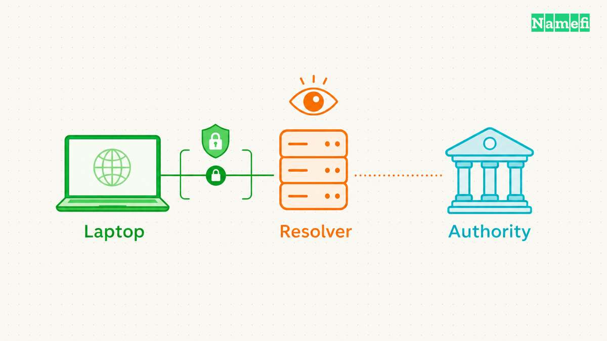
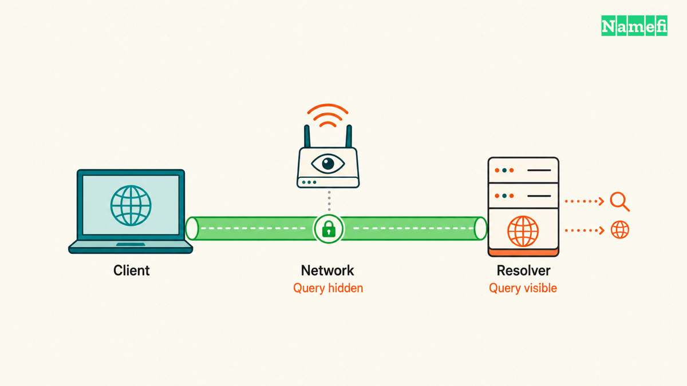
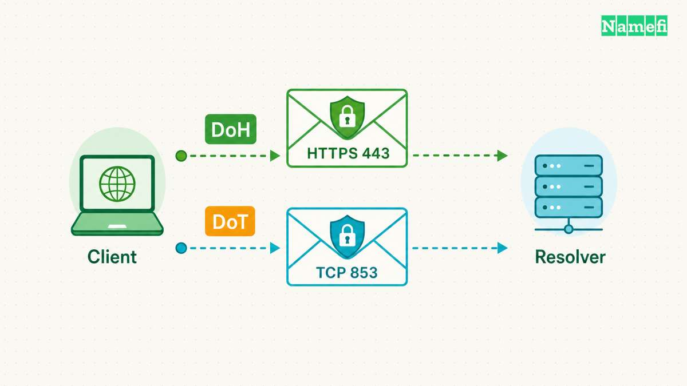
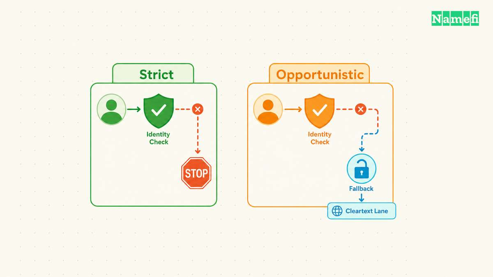

DNS over HTTPS and DNS over TLS both encrypt the connection between a DNS client and a resolver. DoH carries DNS messages through HTTPS. DoT carries DNS messages directly through TLS, without an HTTP layer.

The useful choice depends on application coverage, server authentication, and failure behavior. A setting that permits cleartext fallback offers a different protection level from a setting that stops resolution when encryption fails.

Neither protocol hides DNS queries from the selected resolver. Neither protocol automatically encrypts every later DNS exchange or replaces a VPN. This guide compares the client-to-resolver connection and explains how to check the result.

## Both protocols protect one connection in the DNS path

A [DNS](/en/glossary/dns/) lookup can cross several connections. An application asks for a name, a client contacts a [DNS resolver](/en/glossary/dns-resolver/), and the resolver obtains an answer. A cached answer can avoid additional upstream queries. An uncached lookup can require exchanges with authoritative servers.

Imagine a hypothetical laptop requesting the address of `www.example.com`. The laptop sends an encrypted request to a configured recursive resolver. The resolver decrypts the request because the resolver must read the question to answer. The encrypted connection ends at that resolver.

DoH and DoT therefore protect DNS message contents against ordinary passive observation along the protected connection. The [IETF privacy analysis](https://www.rfc-editor.org/rfc/rfc9076.html#section-6.1.4) explicitly distinguishes transport protection from resolver visibility. The resolver still receives the queried name and associated connection information. Resolver selection remains a trust decision.

Ask which organization operates the resolver before considering the transport choice complete. Review the selected service's current privacy policy and configuration documentation. Encryption alone says nothing about retention periods, filtering rules, or the operator's other uses of query data.

The next connection requires separate consideration. A recursive resolver may contact an authoritative [nameserver](/en/glossary/nameserver/) after a cache miss. Enabling DoH in a browser does not configure that upstream connection. The original [DoT specification](https://www.rfc-editor.org/rfc/rfc7858.html#section-1) focuses on stub clients and recursive servers rather than prescribing authoritative transport.

Encrypted DNS also leaves other network activity visible. Network observers can still see connection destinations and traffic patterns. Encryption of DNS messages does not establish anonymity, and a destination address can provide clues about the service. The [IETF identifies traffic analysis](https://www.rfc-editor.org/rfc/rfc9076.html#section-5.2) as a remaining concern.

[DNSSEC](/en/glossary/dnssec/) solves another problem. DNSSEC supplies data origin authentication and integrity protection for signed DNS data. DNSSEC does not encrypt queries, as [RFC 4033 explains](https://www.rfc-editor.org/rfc/rfc4033.html#section-1). An authenticated resolver connection and DNSSEC validation can complement each other.

A VPN also addresses a different scope. DoH and DoT carry DNS traffic, rather than tunneling arbitrary application traffic. If a goal requires a VPN, enabling encrypted DNS alone cannot meet that goal. Conversely, checking a VPN connection does not establish which DNS client settings an application uses.

The practical question is precise: which client sends which queries to which resolver through which protected connection? Answering that question prevents a browser setting from becoming an unsupported claim about the whole device.

### Each observer retains a different view of the connection

| Observer | What authenticated DoH or DoT protects | What remains visible |
| --- | --- | --- |
| Local Wi-Fi or ISP observer | DNS question and answer contents on the protected connection | Resolver destination, connection timing, and traffic sizes |
| Selected resolver operator | No concealment from the service answering the query | DNS question and connection information |
| Authoritative server | No automatic encryption of the resolver's separate upstream exchange | Questions that the resolver sends to that server |

The table describes the [privacy boundaries in RFC 9076](https://www.rfc-editor.org/rfc/rfc9076.html#section-6.1.4). The table does not claim that every observer can identify every visited website. Caching, shared addresses, and other connection protections affect that inference.

## DoH and DoT use different transport and configuration details

DoT normally establishes a TCP connection to port 853 and starts a TLS handshake. [RFC 7858 section 3.1](https://www.rfc-editor.org/rfc/rfc7858.html#section-3.1) permits another mutually configured port, but excludes port 53 for that alternative. A DoT port must not carry cleartext DNS after a failed handshake.

DoH uses HTTPS, whose default port is 443. The client needs a configured endpoint URL or URI template. [RFC 8484 sections 3 and 4](https://www.rfc-editor.org/rfc/rfc8484.html#section-3) specify server selection and DNS requests through HTTP GET or POST. An IP address alone does not describe the complete DoH endpoint.

| Detail | DoH | DoT |
| --- | --- | --- |
| Message carrier | HTTPS | TLS directly |
| Default port | 443 | TCP 853 |
| Configuration | HTTPS endpoint | Server and authentication details |
| Port visibility | Shares HTTPS port | Dedicated DNS transport port |
| Failure policy | Client setting | Client profile and setting |

Google provides a concrete example of the configuration difference. Google's [secure transport documentation](https://developers.google.com/speed/public-dns/docs/secure-transports#endpoints) lists `dns.google` for DoT on port 853. The documentation lists `https://dns.google/dns-query{?dns}` for standard DoH on port 443. Other services can publish different endpoint names and paths.

Copy endpoint values from the chosen operator's documentation. A hostname field and a URL field expect different inputs. Do not paste an HTTPS URL into a field that requests only a DoT authentication hostname. Do not assume every provider uses `/dns-query` merely because one documented endpoint uses that path.

The dedicated DoT port makes port-based network rules straightforward. DoH shares a port with other HTTPS services, which complicates identification by port alone. That difference does not make DoH unblockable. A network can restrict destinations, and managed devices can apply application policies.

Neither port number establishes confidentiality by itself. Traffic to port 443 could belong to an unrelated website. Traffic to port 853 shows a destination and port, rather than proving successful server authentication. Verification must connect traffic evidence with the client configuration and connection status.

DoH also inherits HTTP implementation choices. Cookies and identifying headers can create additional correlation opportunities, according to [RFC 8484 section 8.2](https://www.rfc-editor.org/rfc/rfc8484.html#section-8.2). Those possibilities do not mean every DoH client sends cookies. Review the client implementation before making that claim.

Avoid selecting a transport through a universal speed claim. A useful local comparison controls the resolver, network, cache state, and application. Record lookup success and failure alongside timing. A fast cached result and a new connection measure different conditions, so a single timing result cannot establish a general winner.

## Authentication and fallback determine the actual protection

Encryption protects a channel, but the client must also establish the intended server's identity. Otherwise, a client could encrypt a query to an unintended recipient. A secure configuration therefore needs both transport protection and a reliable authentication decision.

DoH uses HTTPS server identity verification for the configured endpoint, as [RFC 8484 section 3](https://www.rfc-editor.org/rfc/rfc8484.html#section-3) specifies. A certificate error requires investigation. Disabling certificate verification to make an endpoint work defeats the identity check that the configuration needs.

DoT has an important profile distinction. The [Strict Privacy profile](https://www.rfc-editor.org/rfc/rfc8310.html#section-5) requires an encrypted, authenticated connection. If the client cannot establish the required connection, resolution fails. The profile prioritizes the specified protection over continued name resolution.

The Opportunistic Privacy profile permits weaker outcomes when stronger protection is unavailable. Depending on configuration and capabilities, the client can use authenticated encryption, encryption without authentication, or cleartext. Therefore, the label “DoT supported” does not prove that every successful lookup used authenticated encryption.

For a hypothetical configuration review, record four facts: resolver address, authentication name, permitted backup resolvers, and cleartext fallback policy. Keep the record beside the device configuration. A future troubleshooting session needs the intended behavior as well as the current setting.

DoH clients also need an explicit failure review. Browser interface labels describe product behavior, rather than changing the DoH protocol. One browser can offer several modes with different availability choices.

For example, Mozilla documents that Firefox [Default Protection can fall back](https://support.mozilla.org/en-US/kb/dns-over-https#protection-levels-explained) to default resolvers when issues occur. Mozilla documents a warning under Max Protection when the secure resolver cannot supply the required result. The warning offers a system-DNS exception. An accepted exception changes the protection for that lookup.

Those Firefox details do not establish another browser's behavior. Check the documentation for the installed client and selected mode. Managed policies, application exceptions, and later software changes can affect the effective configuration.

Resolver startup introduces another boundary. A client configured with a resolver hostname may first need an address for that hostname. [RFC 8310 section 5](https://www.rfc-editor.org/rfc/rfc8310.html#section-5) allows an initial address meta-query before the subsequent strict connection. Strict operation does not necessarily mean that every startup packet already uses the final protected channel.

Choose the intended failure outcome before an outage. If confidential DNS transport is mandatory, test whether failed authentication stops lookups. If continued connectivity matters more, document the allowed fallback and understand the reduced protection. Neither outcome should surprise the person who operates the device.

## Android Private DNS requires a hostname and a scope check

Android exposes **Off**, **Automatic**, and **Private DNS provider hostname** under its Private DNS setting. Google's [Android instructions](https://support.google.com/android/answer/9654714) place the setting under **Network & internet → Private DNS**. Device manufacturers can change the menu location.

For Google's documented service, enter `dns.google` in the provider-hostname field, then save. Enter a hostname, rather than `8.8.8.8` or an HTTPS URL. Google's [Android configuration instructions](https://developers.google.com/speed/public-dns/docs/using#android) provide that example. Provider selection still requires the policy and fallback checks above.

Do not infer the active transport solely from the Private DNS label. Android 9 introduced DoT support. Google later [announced DoH over HTTP/3 upgrades](https://security.googleblog.com/2022/07/dns-over-http3-in-android.html) for supported, well-known resolvers on eligible Android 11 and later devices. The announcement describes an update-dependent transport change, rather than universal support for arbitrary DoH endpoint URLs in the hostname field.

Check the installed Android version, system updates, resolver documentation, and actual connection. A browser with a separate secure-DNS setting also needs a separate check. Private DNS protects DNS questions and answers, rather than all device traffic. An internal-name failure can require the managed resolver or VPN configuration instead of a different public hostname.

## A controlled test reveals which DNS connection the client uses

Start with a small, reversible check on a device under your control. Save the current DNS settings before changing a client. Choose one application and one documented resolver endpoint. Keep other applications closed where practical, so unrelated traffic creates fewer ambiguous observations.

Record whether the configuration applies to the browser, operating system, or a forwarding resolver. Browser-level success does not verify another application's DNS path. A command-line DNS utility can use a different path from the browser, so a successful utility query cannot establish browser behavior.

Use the following sequence as a diagnostic plan. The sequence describes checks to perform, rather than reporting measurements from a particular device.

1. Record the selected resolver, endpoint, authentication settings, and fallback mode.
2. Open the client's documented connection status or diagnostic view.
3. Request `example.com` from the selected application.
4. Confirm the diagnostic view reports the intended encrypted resolver.
5. Inspect permitted network diagnostics for the expected destination and connection.
6. Repeat the check after reconnecting to the network.

Treat cached results carefully. Loading a previously visited page might require no new DNS exchange. Follow the client's documented cache-reset procedure, or use a fresh test name under a domain you control. Do not invent random names under someone else's domain to generate diagnostic traffic.

A packet capture can supplement the application status on a device you administer. Look for the expected resolver connection and unexpected cleartext DNS traffic. Port 53 activity requires attribution before a conclusion: another process or a resolver startup query might explain the packet. Absence of visible port 53 traffic also does not prove that every application used the intended resolver.

Next, test failure behavior through a temporary rule limited to the selected resolver on the test device. Keep a recovery path available. Observe whether the selected application warns, stops resolution, or continues through another path. Restore the temporary rule immediately after the observation.

Compare the observed failure with the documented mode. A browser that continues loading a cached page has not demonstrated fallback. A new successful lookup through a different resolver provides stronger evidence. Capture the application status and destination change together before interpreting the result.

If the encrypted connection fails, check the endpoint spelling, required port, authentication hostname, device clock, and certificate error details. Check network restrictions before changing providers repeatedly. Do not bypass certificate verification or change authoritative DNS records to repair a local resolver transport failure.

Separate transport errors from DNS answers. A working encrypted connection can still return a negative answer for a nonexistent name. A resolver can also reject an answer because DNSSEC validation fails. Encryption cannot repair an incorrect zone or turn a missing record into a valid record.

If only internal services fail, stop treating the incident as a general DoH-versus-DoT comparison. Resolver selection and private DNS policy need separate investigation. The [enterprise split-horizon guide](/en/blog/dns-over-https-vs-enterprise-split-horizon-dns/) covers that deployment problem.

Keep the final record short: intended resolver, protected client scope, authentication result, and observed failure outcome. Repeat the relevant checks after changing browser settings, VPN configuration, or network management policy. A verified configuration gives a clearer answer than a protocol label alone.

## Sources and further reading

- IETF — [RFC 8484](https://www.rfc-editor.org/rfc/rfc8484.html), sections 3–4, 6, and 8: endpoints, HTTPS messages, and privacy. Fetched 2026-10-21.
- IETF — [RFC 7858](https://www.rfc-editor.org/rfc/rfc7858.html), introduction and section 3: DoT scope, TCP 853, and session handling. Fetched 2026-10-21.
- IETF — [RFC 8310](https://www.rfc-editor.org/rfc/rfc8310.html#section-5), sections 4–6: authentication, strict operation, opportunistic fallback, and startup queries. Fetched 2026-10-21.
- IETF — [RFC 9076](https://www.rfc-editor.org/rfc/rfc9076.html), sections 5.2, 6.1.4, and 6.2: remaining DNS privacy risks. Fetched 2026-10-21.
- IETF — [RFC 4033](https://www.rfc-editor.org/rfc/rfc4033.html#section-1), introduction: DNSSEC integrity and confidentiality distinction. Fetched 2026-10-21.
- Mozilla — [Configure DNS over HTTPS protection levels in Firefox](https://support.mozilla.org/en-US/kb/dns-over-https), “Protection levels explained” and status FAQ. Fetched 2026-10-21.
- Google — [Secure transports for DNS](https://developers.google.com/speed/public-dns/docs/secure-transports#endpoints), “Endpoints.” Fetched 2026-10-21.

- Google — [Android Private DNS settings](https://support.google.com/android/answer/9654714), [Google Public DNS Android setup](https://developers.google.com/speed/public-dns/docs/using#android), and [DNS-over-HTTP/3 in Android](https://security.googleblog.com/2022/07/dns-over-http3-in-android.html): hostname fields, scope, and version-dependent transports. Fetched 2026-10-21.
