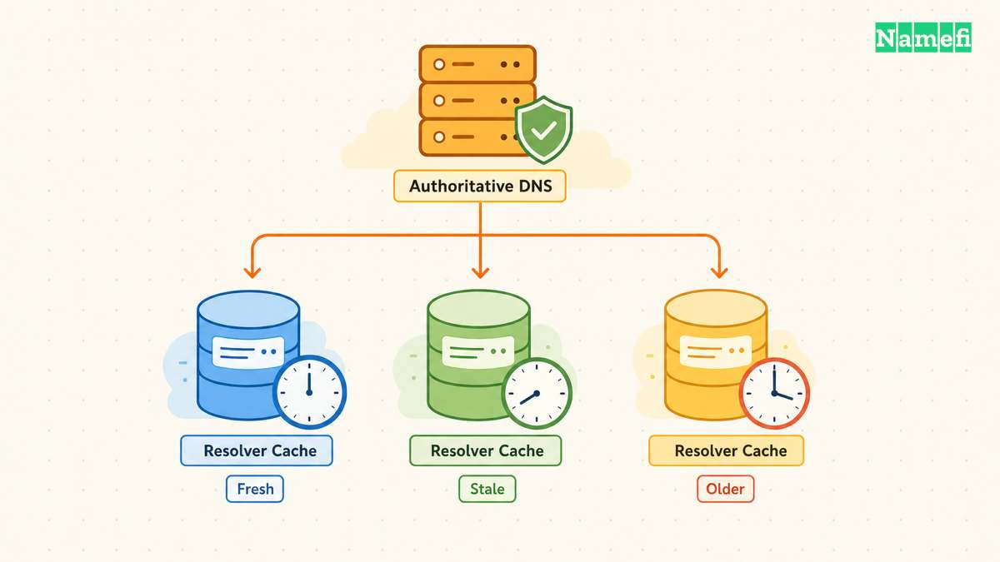
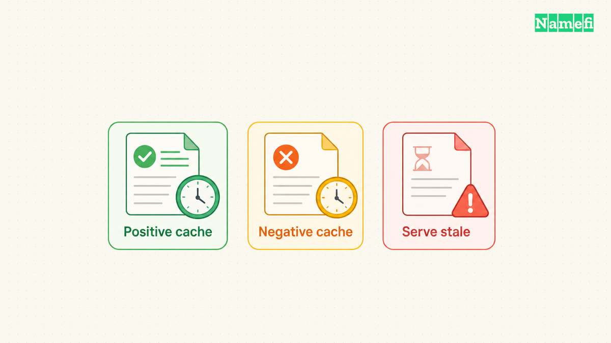

A DNS propagation checker compares DNS answers from selected resolvers or locations. Use the checker to identify differences, then query the authoritative nameservers to establish the intended record. A set of green markers does not prove that every resolver or application has refreshed its cache. [DNS cache lifetimes apply to individual records](#rfc-1035-defines-dns-answers-and-cache-lifetimes).

For a concrete starting tool, open [Google Admin Toolbox Dig](https://toolbox.googleapps.com/apps/dig/) and query the exact name and record type. For resolver comparisons, use the direct query method below. This article explains the checks rather than presenting invented live results.

The examples are hypothetical. [IANA maintains example domains for documentation](#iana-maintains-example-domains-for-documentation). [RFC 5737 reserves the illustrated IPv4 address range](#rfc-5737-reserves-documentation-ipv4-addresses).

## The exact name and record type define the test

Write down the intended change before opening a checker. For example, a hypothetical migration might change the A record for `www.example.com` to `192.0.2.20`. The name and address are reserved documentation examples.

Checking `example.com` instead can inspect a different record. Checking AAAA can inspect an IPv6 address that the migration did not change. Checking NS can inspect authority rather than the website address.

Use the [DNS record guide](/en/blog/dns-record-types-guide/) when the required record type is unclear. The checker must answer the same question as the change request.

Record the expected name, type, value, previous value, and change time in UTC. Keep those fields with the DNS provider's saved configuration. The note prevents later troubleshooting from becoming a comparison of different questions.

## Authoritative answers establish whether the change reached DNS

A recursive resolver can return cached data. An authoritative nameserver answers for the zone. [RFC 1035 distinguishes authoritative answers and cache behavior](#rfc-1035-defines-dns-answers-and-cache-lifetimes).

Find the active nameservers for the domain. Confirm that the nameservers belong to the provider where the change occurred. Editing an inactive DNS dashboard cannot change the answer from the active provider.

With `dig`, query an authoritative server directly. The command shape is `dig @nameserver.example.com www.example.com A +norecurse`. Replace the example server with the domain's actual authoritative server. [BIND documents server selection and recursion controls](#bind-documents-direct-and-recursive-dns-queries).

Repeat the query for the other authoritative nameservers. Compare the answers and record the server names. A mismatch among authoritative servers deserves provider investigation. Waiting for a local recursive cache does not explain away an authoritative mismatch.

If every authoritative server still returns the old value, recheck the saved record, active zone, delegation, and provider status. Avoid repeatedly changing the value while the actual authority remains uncertain.

## Recursive comparisons reveal which answers users can still receive

After confirming authority, compare a few resolvers relevant to the audience. A local query such as `dig www.example.com A` tests the configured resolver. An explicit query such as `dig @8.8.8.8 www.example.com A` asks a selected resolver. [Google documents the `8.8.8.8` resolver address](#google-lists-its-public-resolver-addresses).

Keep the complete answer while diagnosing differences. The answer value, TTL, response status, and responding server all help explain the result. [BIND documents the query options](#bind-documents-direct-and-recursive-dns-queries).

A global checker samples a set of observations. Read the checker's description to learn which resolvers or locations it actually uses. Do not interpret one location label as a test of every customer in that region.

If the authoritative value is correct while a recursive resolver returns the previous value, inspect the cache lifetime. The [TTL and propagation guide](/en/blog/ttl-and-dns-propagation/) explains the underlying behavior. Lowering the TTL after a resolver cached the old answer does not retroactively rewrite that cached answer.

For a bounded comparison, choose Compare resolvers in [Namefi's DNS lookup](https://namefi.io/domain-tools/dns). Enter the exact name, record type, and expected value when useful. The result covers Google and Cloudflare only. It does not demonstrate worldwide propagation or replace a direct authoritative check.

## Missing records and proxy addresses need separate explanations

A newly created record can encounter a cached negative answer. [RFC 2308 defines caching for nonexistent names and absent record types](#rfc-2308-defines-negative-caching). A checker that previously saw no record may therefore need a different explanation from a checker holding an old address.

Read the response status. `NXDOMAIN`, an empty answer, `SERVFAIL`, and a timeout do not describe the same condition. Do not label every unsuccessful lookup as slow propagation.

Also check whether a proxy intentionally changes the visible answer. Cloudflare documents special handling for proxied records. [Its TTL guidance distinguishes proxied records from DNS-only records](#cloudflare-explains-record-ttl-and-proxy-behavior). Compare the response with the provider's intended public behavior, rather than assuming the public answer must expose an origin server.

Changing nameservers introduces another layer. The nameserver delegation and an ordinary A record have separate cache behavior. [Cloudflare distinguishes nameserver TTL from record TTL](#cloudflare-explains-record-ttl-and-proxy-behavior). Test the delegation when the DNS provider itself changed.

## A DNS match does not establish that the website works

When the expected answer appears, test the application through the exact hostname. Confirm HTTPS, the certificate, the requested route, and any dependent services. The [HTTPS guide](/en/blog/what-is-https/) explains why DNS success and secure HTTP success require separate evidence.

A browser can also use a different resolver configuration from a command-line tool. Record the environment when two tests disagree. Investigate browser secure DNS, VPN settings, or managed network policy before assuming one checker is wrong.

Keep the previous service available for the migration plan's required period. Avoid removing the old service solely because one checker turned green. The appropriate overlap depends on the actual cache and application requirements.

## A short comparison record makes the result actionable

A useful result states the query name, type, authoritative answers, recursive answers, TTLs, and UTC test time. Add the expected proxy or hosting behavior when applicable.

Use that record to choose the next action. Correct the authoritative configuration when authority is wrong. Investigate cache differences when authority is right. Investigate the application when DNS matches but the service fails.

The next step is to run one authoritative query and one relevant recursive query for the exact changed record. Those observations provide a stronger diagnosis than a blanket estimate of how long propagation usually takes.

## Sources and further reading

### RFC 1035 defines DNS answers and cache lifetimes

[RFC 1035 defines DNS answers and cache lifetimes](https://www.rfc-editor.org/rfc/rfc1035.html#section-4.1.3) — checked 2026-10-30. Checked passages: Sections 3.3.12, 3.4.1, 3.5, 4.1.1, and 4.1.3.

### RFC 2308 defines negative caching

[RFC 2308 defines negative caching](https://www.rfc-editor.org/rfc/rfc2308.html#section-5) — checked 2026-10-30. Checked passages: Sections 3 and 5.

### BIND documents direct and recursive DNS queries

[BIND documents direct and recursive DNS queries](https://bind9.readthedocs.io/en/latest/manpages.html#dig-dns-lookup-utility) — checked 2026-10-30. Checked passages: The dig manual: Simple Usage, the -x option, and the +recurse/+norecurse query option.

### Cloudflare explains record TTL and proxy behavior

[Cloudflare explains record TTL and proxy behavior](https://developers.cloudflare.com/dns/manage-dns-records/reference/ttl/#proxied-records) — checked 2026-10-30.

### IANA maintains example domains for documentation

[IANA maintains example domains for documentation](https://www.iana.org/help/example-domains#:~:text=for%20documentation%20purposes) — checked 2026-10-30.

### RFC 5737 reserves documentation IPv4 addresses

[RFC 5737 reserves documentation IPv4 addresses](https://www.rfc-editor.org/rfc/rfc5737.html#section-3) — checked 2026-10-30.

### Google lists its public resolver addresses

[Google lists its public resolver addresses](https://developers.google.com/speed/public-dns/docs/using#:~:text=The%20Google%20Public%20DNS%20IP%20addresses) — checked 2026-10-30.
