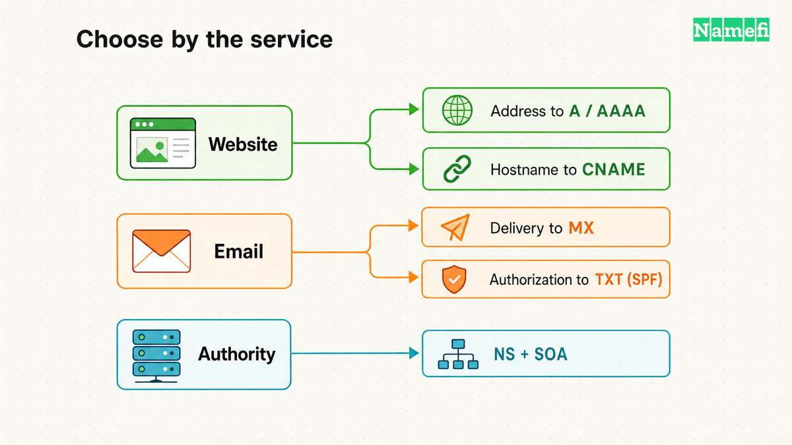

A website migration can succeed while email stops arriving. A domain can resolve correctly while a certificate request fails. Different DNS records control different dependencies.

[DNS record types](/en/glossary/dns-record-types/) tell software how to interpret a record's data. Choosing a type starts with the service that needs the answer. A website needs addresses, mail needs delivery instructions, and certificate issuance can depend on authorization policy.

This guide follows a hypothetical `example.com` zone through those decisions. Every name, address, and policy example illustrates a relationship. Use the values supplied for the actual service before making changes.

The useful question is more specific than “Which records does a domain need?” Ask which application reads each record, where the record belongs, and what other records complete the job.

## Record types answer different service questions

Use this table to choose the part of the zone to investigate. The table summarizes the record roles explained and sourced below.

| Type | Data or purpose | Use the record when |
| --- | --- | --- |
| A | IPv4 address | The service supplies an IPv4 destination |
| AAAA | IPv6 address | The service supplies a working IPv6 destination |
| CNAME | Alias target name | The provider requests an alias at a compatible name |
| MX | Preference and exchanger name | The domain receives email through a mail service |
| TXT | Application-defined text | A service requests verification or an SPF/DKIM publication |
| NS | Authoritative server name | A zone delegates authority or declares its servers |
| SOA | Zone management fields | The authoritative service manages zone metadata |
| CAA | Certificate issuance policy | The domain restricts certificate authorization |
| SRV | Priority, weight, port, target | An application supports DNS service discovery |
| PTR | Name in a reverse zone | An address administrator configures reverse DNS |
| DNSKEY, DS, RRSIG, NSEC | DNSSEC validation data | The operator deploys a coordinated signed zone |
| SVCB, HTTPS | Service binding data | The endpoint and client support the relevant binding |

The [IANA resource record registry](https://www.iana.org/assignments/dns-parameters/dns-parameters.xhtml#dns-parameters-4) lists additional, specialized types. A domain does not need every registered type. This guide covers the common operational choices rather than every historical assignment.

If instructions say “AAA record,” confirm whether the provider means AAAA. If instructions say “C record,” confirm whether the provider means CNAME. IANA registers AAAA and CNAME, without types named AAA or C. Do not invent a type from an abbreviated search term.

## Website records connect names to reachable services

Start a website change by separating the public name from the destination. A host can supply an address, an alias target, or instructions for a provider-specific feature. Those instructions represent different configurations.

An A record contains an IPv4 address. A hypothetical `www.example.com` A record could contain `192.0.2.20`. The record does not contain `https://`, a port, or a page path. [RFC 1035, section 3.4.1](https://www.rfc-editor.org/rfc/rfc1035.html#section-3.4.1) defines the address format.

An AAAA record contains an IPv6 address. The hypothetical equivalent could contain `2001:db8::20`. Publishing AAAA does not configure the destination server or its network. Confirm IPv6 connectivity before announcing the address. [RFC 3596, section 2](https://www.rfc-editor.org/rfc/rfc3596.html#section-2) defines AAAA independently of A.

A CNAME identifies another DNS name. For example, `www.example.com` could alias `site.example.net`. The resolver follows the target's data when answering the relevant query. The target therefore becomes a dependency that the domain administrator may not control. [RFC 1034, section 3.6.2](https://www.rfc-editor.org/rfc/rfc1034.html#section-3.6.2) explains alias resolution.

| Need | Record | Check |
| --- | --- | --- |
| Use IPv4 | A | Destination address |
| Use IPv6 | AAAA | IPv6 connectivity |
| Follow a hostname | CNAME | Target resolution |
| Publish HTTP parameters | HTTPS | Client support |

A CNAME cannot share its owner name with ordinary records such as A, MX, or TXT. DNSSEC supplies specific metadata exceptions. The zone apex requires SOA and NS data, so an ordinary apex CNAME conflicts with those requirements. [RFC 2181, section 10.1](https://www.rfc-editor.org/rfc/rfc2181.html#section-10.1) and [RFC 4034, section 3](https://www.rfc-editor.org/rfc/rfc4034.html#section-3) establish the distinction.

Provider interfaces sometimes accept an apex alias through flattening or another provider feature. Cloudflare's documented flattening process resolves the target and returns the final IP address instead of a CNAME. A dashboard label does not establish the public answer format. [Cloudflare's explanation](https://developers.cloudflare.com/dns/cname-flattening/#how-it-works) describes this provider behavior.

Inspect the returned records when evaluating an apex configuration. Ask whether the provider returns addresses, maintains the target dependency, and supports the required record combinations. Recheck those details before moving the zone to another provider.

HTTPS and SVCB records add service endpoints and connection parameters for supporting clients. HTTPS specializes SVCB for HTTP. These types support service-specific aliasing, including apex use, without applying CNAME's whole-name alias rule. They require compatible client behavior. [RFC 9460, sections 2–3](https://www.rfc-editor.org/rfc/rfc9460.html#section-2) defines the mechanism.

Do not add HTTPS or SVCB from an unrelated tutorial. Follow the service's configuration requirements and preserve the address records needed by clients without support. A plausible-looking parameter can describe a capability that the endpoint does not offer.

After changing a website record, check the hostname's DNS answer and the website itself. Confirm the intended page and certificate for each public hostname. A correct address alone cannot establish that the web server accepts the requested hostname.

### Example records show the owner name and value separately

Each row below represents a hypothetical zone-file line, not a live answer or a complete zone. The format follows [RFC 1035, section 5](https://www.rfc-editor.org/rfc/rfc1035.html#section-5).

| Owner name | TTL | Class | Type | Value |
| --- | --- | --- | --- | --- |
| `example.com.` | `300` | `IN` | `A` | `192.0.2.20` |
| `example.com.` | `300` | `IN` | `AAAA` | `2001:db8::20` |
| `www.example.com.` | `300` | `IN` | `CNAME` | `site.example.net.` |
| `example.com.` | `3600` | `IN` | `MX` | `10 mail.example.net.` |
| `_verify.example.com.` | `300` | `IN` | `TXT` | `"illustrative-verification-token"` |

The TTL uses seconds. `IN` denotes the Internet class. A terminal dot identifies an absolute domain name in a zone file. Dashboards can use different input conventions, so check the saved full name.

The examples use reserved [example domains](https://www.rfc-editor.org/rfc/rfc2606.html#section-3), [IPv4 documentation addresses](https://www.rfc-editor.org/rfc/rfc5737.html#section-3), and the [IPv6 documentation prefix](https://www.rfc-editor.org/rfc/rfc3849.html#section-2). Do not copy these destinations into production. The MX example still needs address records for its exchanger in the exchanger's zone. The TXT example verifies no actual account.

The [AAAA guide](/en/blog/aaaa-record-explained/) covers IPv6 readiness. The [A and CNAME comparison](/en/blog/cname-vs-a-record/) covers alias constraints in detail.

## Email records divide delivery from sender authentication

Email configuration usually involves several record types at several names. Keep incoming delivery, sending authorization, and signature verification as separate checks. A working website provides little evidence about any email function.

MX identifies a mail exchanger by hostname and includes a preference number. Lower preference numbers take precedence. A hypothetical `example.com` MX value might name `mail.example.net` with preference `10`. The MX value contains a hostname rather than an IP address. [RFC 1035, section 3.3.9](https://www.rfc-editor.org/rfc/rfc1035.html#section-3.3.9) specifies both fields.

Trace the exchanger's address records before declaring incoming mail ready. The exchanger hostname must resolve to addresses and must not itself be a CNAME. [RFC 2181, section 10.3](https://www.rfc-editor.org/rfc/rfc2181.html#section-10.3) states the target restriction.

This dependency matters during a website migration. Suppose the existing MX points to `mail.example.com`, and that hostname has its own A record. Preserve the mail hostname's address when replacing the website address. If the MX instead points to the apex, an apex address change also changes the mail destination.

TXT carries text that another protocol interprets. The record type does not identify the text's purpose by itself. A provider verification token and a sending policy can occupy separate TXT records at the same name. The consuming service selects the relevant data. [RFC 1035, section 3.3.14](https://www.rfc-editor.org/rfc/rfc1035.html#section-3.3.14) defines the text container.

SPF publishes sending authorization through TXT. The standard requires TXT, even when a DNS console still offers the legacy SPF record type. Adding a second SPF policy can make the authorization check fail because the standard prohibits selecting multiple SPF records. Combine authorized senders through the existing policy and review the resulting policy with the mail administrator. [RFC 7208, sections 3.1–3.2](https://www.rfc-editor.org/rfc/rfc7208.html#section-3.1) defines publication rules.

DKIM uses a selector and signing domain to find a public key. The DNS query uses a name such as `selector1._domainkey.example.com`. A provider might request TXT directly or supply an alias arrangement. Preserve the provider's exact owner name and required type. [RFC 6376, section 3.6.2](https://www.rfc-editor.org/rfc/rfc6376.html#section-3.6.2) describes key retrieval.

| Task | Record | Dependency |
| --- | --- | --- |
| Receive mail | MX | Exchanger addresses |
| Authorize senders | TXT for SPF | Valid policy |
| Verify signatures | DKIM key lookup | Correct selector |
| Verify service control | Requested TXT/CNAME | Exact challenge |

A verification record only satisfies the service's stated verification procedure. Keep records while a service requires continued verification. Before removing an old token, identify the service and account that requested the token.

For recovery, compare the current zone with the saved configuration. Check incoming mail routing before changing sender policy. Then test sending separately and inspect the receiving system's authentication results. The [custom-domain email guide](/en/blog/set-up-email-with-your-own-domain/) covers the broader setup process.

## Authority and policy records control separate decisions

[DNS](/en/glossary/dns/) records only help users when resolvers reach the correct authoritative service. NS records identify authoritative [nameservers](/en/glossary/nameserver/). The parent zone publishes delegation data, while the child zone publishes its own apex NS records. Coordinate both sides during an authority change. [RFC 1034, section 4.2.1](https://www.rfc-editor.org/rfc/rfc1034.html#section-4.2.1) describes zone boundaries.

Editing NS records inside an existing zone does not automatically replace the parent delegation. For a registered domain, use the registrar's nameserver process to update that delegation. A delegated subdomain instead requires coordination with the parent zone administrator.

Glue supplies nameserver addresses when resolving an in-zone nameserver would otherwise require that nameserver first. A hypothetical delegation to `ns1.example.com` illustrates the circular dependency. Coordinate nameserver address changes with the parent administrator rather than treating glue as another website record. [RFC 1034, section 4.2.1](https://www.rfc-editor.org/rfc/rfc1034.html#section-4.2.1) explains the role of glue.

SOA contains zone management information, including a serial and timing fields. Cloudflare creates SOA automatically when a zone uses its authoritative nameservers. [Cloudflare’s SOA documentation](https://developers.cloudflare.com/dns/manage-dns-records/reference/dns-record-types/#soa) describes that provider policy. Record the provider's management model before editing SOA manually. A serial comparison can help investigate replication, but the serial alone cannot prove that every desired record exists. [RFC 1035, section 3.3.13](https://www.rfc-editor.org/rfc/rfc1035.html#section-3.3.13) defines SOA.

[DNSSEC](/en/glossary/dnssec/) uses DNSKEY for public keys, RRSIG for signatures, and DS to connect a delegation to a child key. NSEC supplies authenticated denial data. These records support validation rather than web hosting or email routing. [RFC 4034, sections 2–5](https://www.rfc-editor.org/rfc/rfc4034.html#section-2) defines the record roles.

Treat DNSSEC as a coordinated configuration during provider changes. Confirm the new provider's signing instructions and the parent DS state. Copying address records while overlooking the trust relationship leaves a separate dependency unresolved.

CAA lets a domain holder specify certificate issuance authorization. A compliant certificate authority checks the relevant CAA record set before issuance. CAA policy can involve ancestor names and alias resolution. Review the effective policy rather than checking only the requested hostname. [RFC 8659, section 3](https://www.rfc-editor.org/rfc/rfc8659.html#section-3) defines the lookup rules.

CAA does not install a certificate or select the website destination. If issuance fails after a hosting migration, compare the issuing authority with the effective CAA policy. Keep the certificate workflow and the address change as separate investigations.

SRV supplies service discovery data, including priority, weight, port, and target hostname. Only applications that implement the relevant discovery procedure use SRV. A target must have address records and must not be an alias. [RFC 2782, “The format of the SRV RR”](https://www.rfc-editor.org/rfc/rfc2782.html) specifies those dependencies.

PTR points from a reverse DNS name to another name. Reverse zones follow address allocation boundaries. Arrange the change with the address-space administrator or hosting provider. Adding a PTR-looking row to the ordinary forward zone does not configure the address's reverse delegation. [RFC 1035, section 3.5](https://www.rfc-editor.org/rfc/rfc1035.html#section-3.5) describes IPv4 reverse mapping.

## A controlled change preserves records and tests dependencies

Before editing, export the zone or save an accurate record inventory. Include owner names, types, values, and TTLs. Add a service owner and purpose to the inventory so an unfamiliar token does not become an accidental deletion.

Map the proposed change to one outcome. A website move may require A, AAAA, or alias changes. An email move may require MX and authentication updates. A DNS provider move requires reproducing the zone and coordinating authority and validation.

Review the exact owner name in the provider interface. Some interfaces expect a relative label, while others accept complete names. Inspect the resulting full name before saving. Pay particular attention to underscores in verification and service-discovery names.

The [TTL](/en/glossary/ttl/) controls how long a resolver can cache record data under the protocol's caching rules. Lowering a TTL does not retroactively shorten an answer already cached with the previous value. Plan changes before the old cache period matters. [RFC 2181, section 8](https://www.rfc-editor.org/rfc/rfc2181.html#section-8) explains TTL limits.

Negative answers can also remain cached. A resolver that recently learned a name or type was absent may continue returning that result after publication. [RFC 2308, section 5](https://www.rfc-editor.org/rfc/rfc2308.html#section-5) defines negative caching. Avoid a universal “propagation takes this long” promise.

Keep a change log with the previous value, replacement value, and intended service. Record the time of the change and the result of each check. A colleague can then distinguish an unfinished migration from an unexpected later edit.

After saving, query each authoritative server for the exact name and type. Then compare recursive resolver answers. An old recursive answer with correct authoritative data suggests a different investigation from an authoritative server that still publishes the wrong value.

Finish with application checks. Load both website hostnames, test intended address families, send and receive email, and inspect certificate issuance where relevant. DNS inspection identifies published instructions. Application checks establish whether services can follow those instructions.

If the change fails, restore the specific saved records that caused the failure. Preserve unrelated working records. Keep the previous service available when feasible until verification succeeds. A careful record inventory makes recovery a defined operation rather than another round of guesses.

## These sources support the record selection guide

- IETF — [RFC 1034](https://www.rfc-editor.org/rfc/rfc1034.html), sections 3.6.2 and 4.2.1: aliases, zones, delegation, and glue. Fetched 2026-10-21.
- IETF — [RFC 1035](https://www.rfc-editor.org/rfc/rfc1035.html), sections 3.3.9–3.3.14, 3.4.1, and 3.5: MX, NS, SOA, TXT, A, and reverse mapping. Fetched 2026-10-21.
- IETF — [RFC 2181](https://www.rfc-editor.org/rfc/rfc2181.html), sections 8 and 10: TTLs, CNAME restrictions, and exchanger targets. Fetched 2026-10-21.
- IETF — [RFC 3596](https://www.rfc-editor.org/rfc/rfc3596.html#section-2), section 2: AAAA records. Fetched 2026-10-21.
- Cloudflare — [CNAME flattening](https://developers.cloudflare.com/dns/cname-flattening/#how-it-works), “How it works” and “Aspects to keep in mind.” Fetched 2026-10-21.
- Cloudflare — [DNS record types](https://developers.cloudflare.com/dns/manage-dns-records/reference/dns-record-types/#soa), “SOA”: automatic SOA creation and management. Fetched 2026-10-21.
- IETF — [RFC 9460](https://www.rfc-editor.org/rfc/rfc9460.html#section-2), sections 2–3: SVCB, HTTPS, and alias modes. Fetched 2026-10-21.
- IETF — [RFC 7208](https://www.rfc-editor.org/rfc/rfc7208.html#section-3), sections 3.1–3.3: SPF publication and multiple records. Fetched 2026-10-21.
- IETF — [RFC 6376](https://www.rfc-editor.org/rfc/rfc6376.html#section-3.6.2), section 3.6.2: DKIM key retrieval. Fetched 2026-10-21.
- IETF — [RFC 4034](https://www.rfc-editor.org/rfc/rfc4034.html), sections 2–5: DNSSEC records and CNAME metadata exceptions. Fetched 2026-10-21.
- IETF — [RFC 8659](https://www.rfc-editor.org/rfc/rfc8659.html#section-3), section 3: CAA processing. Fetched 2026-10-21.
- IETF — [RFC 2782](https://www.rfc-editor.org/rfc/rfc2782.html), “The format of the SRV RR”: fields and target restrictions. Fetched 2026-10-21.
- IETF — [RFC 2308](https://www.rfc-editor.org/rfc/rfc2308.html#section-5), section 5: negative-answer caching. Fetched 2026-10-21.

- IANA — [DNS resource record types](https://www.iana.org/assignments/dns-parameters/dns-parameters.xhtml#dns-parameters-4): registered type names and specialized assignments. Fetched 2026-10-21.
- IETF — [RFC 2606](https://www.rfc-editor.org/rfc/rfc2606.html#section-3), section 3: reserved example domains. Fetched 2026-10-21.
- IETF — [RFC 5737](https://www.rfc-editor.org/rfc/rfc5737.html#section-3), section 3: IPv4 documentation ranges. Fetched 2026-10-21.
- IETF — [RFC 3849](https://www.rfc-editor.org/rfc/rfc3849.html#section-2), section 2: IPv6 documentation prefix. Fetched 2026-10-21.
