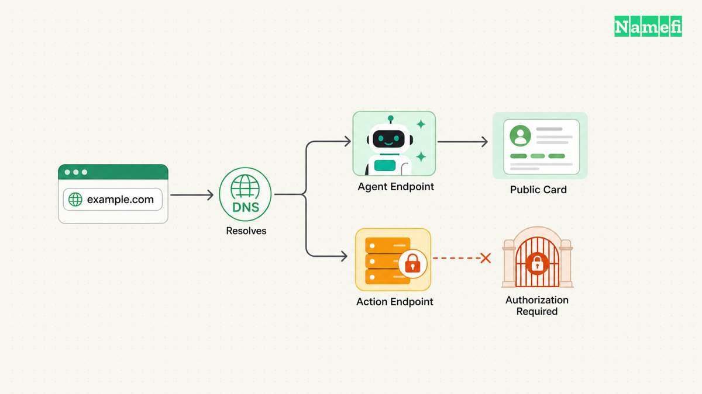
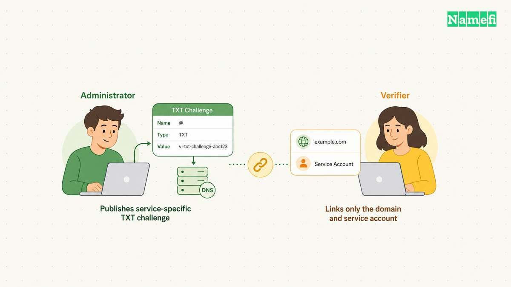
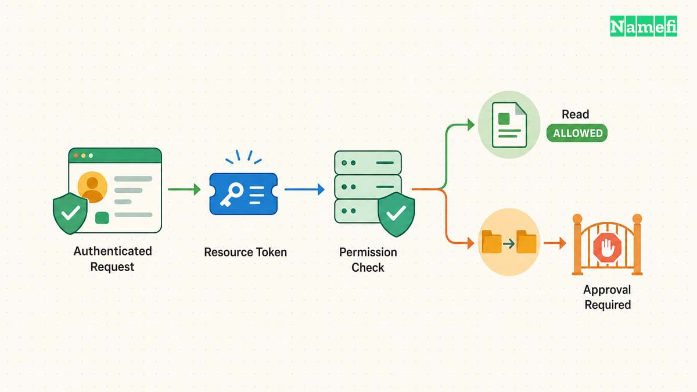
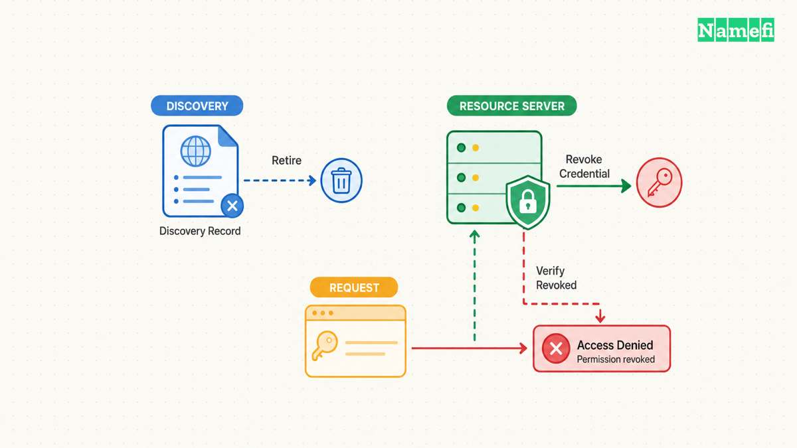

A domain can help software find an AI agent and recognize the organization that publishes the agent's endpoint. A domain cannot grant every permission merely by carrying a TXT record. Discovery, proof of domain control, and action authorization require separate checks.

That separation prevents a dangerous design shortcut. An application should not read a public string, accept a claimed identity, and immediately allow a payment or a DNS edit. The application needs a documented trust policy and an enforcement point.

This guide explains how domain records fit into that design. The proposed checklist is architectural guidance. The guide does not introduce a universal AI-agent TXT record or claim that every agent protocol uses DNS for authorization.

## Discovery locates an endpoint without granting an action

[DNS](/en/glossary/dns/) helps a client find network destinations. A hostname such as `agent.example.com` can identify a service endpoint. An address record can direct a connection toward infrastructure, while the application protocol defines the requests that the endpoint accepts.

TXT can hold application-interpreted text. [RFC 1035, section 3.3.14](https://www.rfc-editor.org/rfc/rfc1035.html#section-3.3.14) defines that container without supplying a universal agent policy. Publishing text that says an agent is “authorized” does not make unrelated software understand or trust the statement.

A discovery design needs an exact consumer. Name the client, supported protocol version, expected location, document schema, and validation behavior. If the application reads a custom DNS record, document the custom record as a product convention. Do not present the convention as an Internet-wide standard.

Some protocols discover structured metadata over HTTPS. [A2A's discovery guide](https://a2a-protocol.org/latest/topics/agent-discovery/) describes Agent Cards and discovery approaches. The public well-known approach uses `https://{agent-server-domain}/.well-known/agent-card.json`. [RFC 8615](https://www.rfc-editor.org/rfc/rfc8615.html#section-3) defines the broader well-known URI mechanism. Neither document turns every arbitrary `/.well-known/` path into a universally recognized agent service.

| Question | Evidence to request |
| --- | --- |
| Where is the agent? | Documented endpoint discovery |
| Who publishes the endpoint? | Verified control relationship |
| Who is making the request? | Accepted client authentication |
| What may the client do? | Enforced authorization policy |

A client that discovers an endpoint has learned where to make a request. The client has not necessarily learned who may perform a sensitive action. Keep the discovery response useful for inspection without placing private credentials in public metadata.

For example, a company could publish a public card describing a support agent's skills. The card could help a compatible client find the service. Access to customer records would still require the service's separate identity and permission checks. The example illustrates a design boundary rather than a claim about a deployed product.

Version the discovery configuration. Preserve a record of the published endpoint, metadata schema, and supported client versions. A future protocol update can change the discovery procedure. An old integration should not silently interpret a new document under an obsolete policy.

## Domain control supports a claim with a defined scope

A DNS challenge can show that an actor published a required value at a required name. The relying service decides what that challenge means for the service account. A challenge does not establish every possible relationship among the domain owner, employee, agent, and downstream application.

Write the verification claim precisely. A statement such as “the administrator connected this domain to this service account” has a narrower meaning than “the organization approves all actions from this agent.” The interface should communicate the verified relationship and the remaining limits.

Record who initiated verification and which account receives the verified domain. A token copied from another account can create an unintended association. Require a review of the target domain, account identifier, and service before an administrator publishes a challenge.

Domain control also needs maintenance. A registrar account, DNS operator account, or delegated subdomain can change independently of the application operator. The service should define how verification expires, how administrators remove a relationship, and what happens after a domain transfer.

Avoid placing long-lived bearer credentials in DNS. Public discovery data should not act as a reusable secret. A credential that grants access belongs in the authorization flow and secure storage appropriate to the application. A public key, identifier, and secret token represent different kinds of material.

If the design uses signatures, document the trusted key source and rotation procedure. A signature proves a relationship to a key under the chosen verification rules. The application still needs a reason to trust that key for the named domain and the requested action.

DNSSEC can authenticate DNS data when the relevant chain and validating behavior work correctly. DNSSEC does not supply the business meaning of a custom agent record. The [DNSSEC owner guide](/en/blog/dnssec-for-domain-owners/) explains the operational responsibilities that accompany signed data.

A useful verification record states the domain, service account, verification method, date, and revocation procedure. Keep the record independent of an attractive badge or agent name. Administrators need enough detail to retire a relationship after a staff departure or a service migration.

The product should also define subdomain boundaries. Approval for `agent.example.com` need not imply approval for every service below `example.com`. Specify the exact scope rather than inheriting broad organizational authority from the visual similarity of hostnames.

## Authorization checks bind identity to a permitted operation

Authentication asks which identity the service accepts for a request. Authorization asks whether that identity may perform the requested operation on the requested resource. A public endpoint and a verified domain do not eliminate either question.

The [MCP authorization specification](https://modelcontextprotocol.io/specification/2025-11-25/basic/authorization) defines an authorization flow for HTTP-based transports. The specification describes OAuth roles, resource metadata, and access-token requirements. MCP also distinguishes transport types, so do not describe one HTTP flow as mandatory for every MCP deployment.

For a protected tool, define permissions around operations and resources. An agent that reads a DNS inventory might not need permission to replace nameservers. An agent that prepares a payment might not need permission to execute the payment. The service should enforce the boundary at the actual operation.

Use the resource server's documented credential checks. MCP requires protected servers to validate access tokens for the intended audience. A token accepted by another service does not automatically authorize this service. The specification also prohibits passing an incoming token through unchanged to an upstream service.

A2A makes a similar distinction between advertised capabilities and enforced access. [The A2A specification's authorization section](https://a2a-protocol.org/latest/specification/#75-server-authorization-responsibilities) assigns request authorization to the server's policy. A listed skill describes a capability rather than a blanket permission for every caller.

For a hypothetical domain-management agent, create separate roles for reading records, changing individual records, and changing delegation. Add explicit resource scope, such as one domain or one delegated zone. Keep the roles understandable enough for an administrator to review before granting access.

| Agent task | Candidate permission boundary |
| --- | --- |
| Inspect configuration | Read specified domain records |
| Propose an edit | Prepare a change without applying it |
| Apply a record edit | Write approved record types and names |
| Change delegation | Separate high-impact authorization |
| Transfer an asset | Separate asset-control procedure |

The table proposes an operating policy, not a protocol requirement. The actual service must implement and test the chosen restrictions. A user interface label such as “limited agent” supplies no protection unless the backend rejects operations outside the granted scope.

Keep human approval requirements concrete. Identify which action requires approval, what information the reviewer sees, and how the service binds approval to the exact action. A vague instruction to “ask before anything risky” gives the enforcement system no reliable boundary.

## Rotation and revocation must reach the enforcement system

Plan revocation before launching a domain-linked agent. Identify each control that can outlive a public discovery update: access tokens, refresh credentials, API keys, delegated roles, cached cards, and queued jobs. The exact list depends on the service architecture.

Removing a DNS record changes discovery data. The removal does not necessarily revoke credentials that the resource server already accepts. The incident procedure should disable the relevant authorization at the resource server or identity provider according to the actual credential mechanism.

Likewise, changing a website hostname does not prove that old clients stopped reaching an old endpoint. Review redirects, old service deployments, and credential acceptance separately. Keep a record of the systems that administrators must update during an agent retirement.

Test both a successful request and a denied request before production use. Confirm that the intended client can perform the approved operation. Then confirm that a credential outside the approved scope cannot perform the operation. A successful demonstration alone does not test the permission boundary.

Repeat the denied-request test after revocation. Preserve the request identifier, affected resource, expected result, and observed result. Avoid storing sensitive payloads or credentials in ordinary logs. The evidence should establish enforcement without exposing access material.

Define how clients handle stale discovery documents. A client may need to refresh metadata, reject unsupported versions, or require a new administrator review after a significant endpoint change. The protocol and application policy should specify the response rather than leaving the response to a language model's interpretation.

For domain transfers, review the complete relationship again. The new domain owner may not operate the old agent, and the old agent may retain application credentials. Retire or reauthorize the association explicitly. Do not infer continuity from the unchanged spelling of the domain.

The release checklist should end with four verified outcomes: clients find the intended endpoint, the service accepts the intended identity, permitted actions succeed, and revoked actions fail. Domain records can support that process. The authorization system must still decide and enforce what an agent may do.

## These sources support the article

- IETF — [RFC 1035](https://www.rfc-editor.org/rfc/rfc1035.html#section-3.3.14), section 3.3.14: TXT format. Fetched 2026-10-21.
- A2A — [Agent discovery](https://a2a-protocol.org/latest/topics/agent-discovery/), Agent Cards and discovery approaches. Fetched 2026-10-21.
- IETF — [RFC 8615](https://www.rfc-editor.org/rfc/rfc8615.html#section-3), well-known URI locations. Fetched 2026-10-21.
- MCP — [Authorization](https://modelcontextprotocol.io/specification/2025-11-25/basic/authorization), HTTP authorization, resource discovery, audience validation, and token handling. Fetched 2026-10-21.
- A2A — [Protocol specification](https://a2a-protocol.org/latest/specification/#75-server-authorization-responsibilities), section 7.5: server authorization responsibilities. Fetched 2026-10-21.
