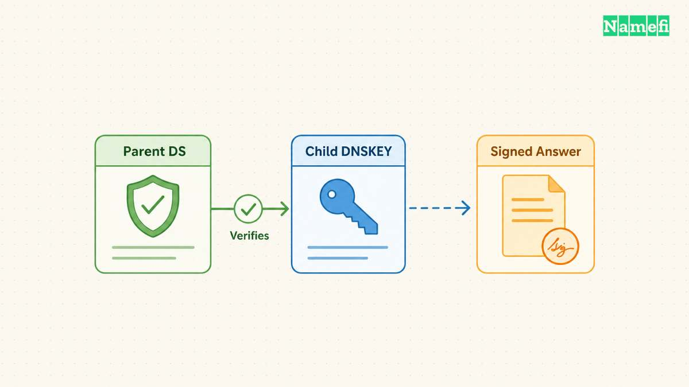
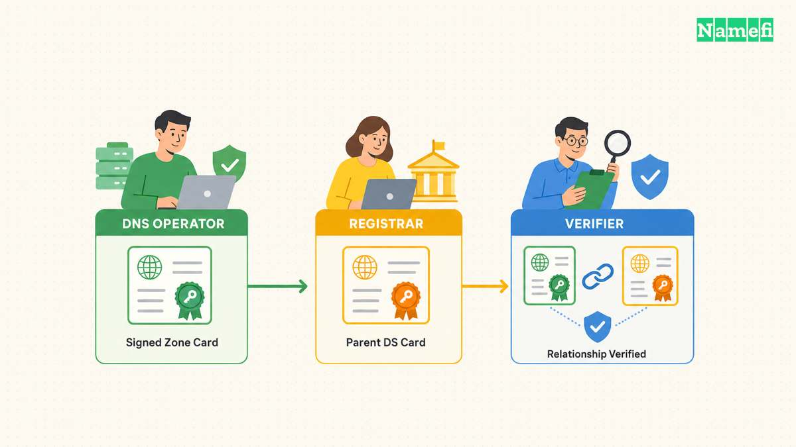
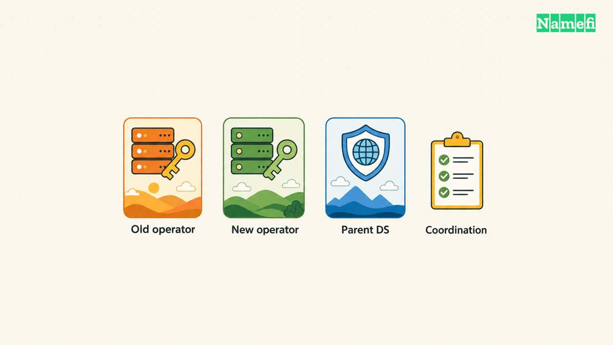
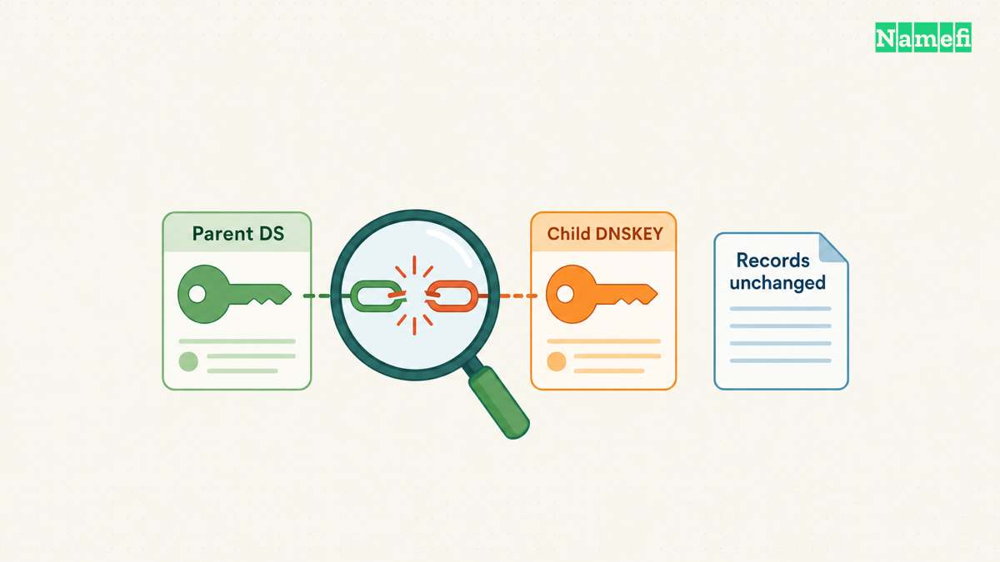

**DNSSEC lets validating resolvers check the origin and integrity of DNS data.** To enable DNSSEC safely, coordinate the DNS provider's signing keys with the parent zone's DS record. DNSSEC does not encrypt DNS traffic. [RFC 4033 describes the protection and trust relationship.](#rfc-4033-explains-dnssec-authentication)

For a domain owner, the main task is operational: make the signing service and delegation agree, verify the result, and preserve that agreement during changes. A dashboard switch alone does not demonstrate a complete deployment.

This guide covers domain-owner decisions. The [DNSSEC glossary](/en/glossary/dnssec/) introduces the term, and the [nameserver guide](/en/blog/change-domain-nameservers/) covers a separate DNS migration task.

## DNSSEC authenticates answers through a chain of trust

A signed DNS zone publishes signatures and public keys. A parent DS record connects the delegation to a child signing key. A validating resolver follows the authentication chain toward a trust anchor. [RFC 4033 defines the chain using DNSKEY and DS records.](#rfc-4033-explains-dnssec-authentication)

The relationship matters more than memorizing record abbreviations:

| Component | Owner's question |
| --- | --- |
| Zone signing | Which DNS provider maintains the signatures and keys? |
| DNSKEY | Which published key should the parent authenticate? |
| Parent DS | Which registrar workflow publishes the matching delegation information? |
| Validation | Can a validating resolver authenticate the resulting answers? |

DNSSEC addresses authenticity and integrity. Use separate controls for account access, website encryption, and private data. A signed DNS answer does not establish that a website's content deserves trust. That conclusion follows from the limited protection DNSSEC provides. [Read the protocol's stated scope.](#rfc-4033-explains-dnssec-authentication)

As a practical preparation step, identify the active authoritative DNS provider. The company that sold the registration may provide a different service from the company that serves the DNS zone.

## Enable signing before publishing the matching delegation

Before changing DNSSEC, save the existing nameservers, DS records, and zone configuration. Identify the authorized person who can change each account. Schedule the change when that person can investigate a failure.

For a concrete provider workflow, Cloudflare signs the zone, publishes public signing keys, and generates DS information when DNSSEC is enabled. Cloudflare then instructs customers to add the DS record at the registrar. [Follow Cloudflare's activation procedure.](#cloudflare-documents-dnssec-activation)

Use the matching procedure for your actual providers:

1. Confirm that the DNS provider and registrar support the required DNSSEC configuration.
2. Enable managed signing at the active DNS provider.
3. Copy the current DS values from that provider.
4. Publish those values through the registrar's DNSSEC controls.
5. Verify the parent DS and the signed authoritative answers.
6. Run a validation check and save the result.

Copy values exactly. Do not reuse a digest from an old account or another domain. Do not place the parent DS value into an ordinary child-zone record editor unless the provider's documented process requires that operation.

Some providers automate part of the relationship. Confirm what the automation actually publishes before assuming no registrar action remains. Cloudflare documents automatic DS publication for specific supported arrangements. [Its setup page identifies those exceptions.](#cloudflare-documents-dnssec-activation)

## Verify validation instead of counting visible records

Cloudflare recommends DNSViz for visualizing DNSSEC configuration and investigating failures. Open [DNSViz's domain analysis tool](https://dnsviz.net/) and enter the domain you administer. Request a fresh analysis rather than relying on an old result. [Cloudflare documents the analysis workflow.](#cloudflare-documents-dnssec-validation-checks)

Review the chain from the parent to the authoritative zone. Compare any reported mismatch with the exact provider values. Save the analysis time and the failing relationship so support can reproduce the problem.

For a command-line check, request DNSSEC data with `dig YOUR_DOMAIN A +dnssec`, replacing `YOUR_DOMAIN` with your domain. Inspect the response status and flags. Cloudflare documents the `ad` flag as an indication that the responding resolver authenticated the answer. [See the Dig checks.](#cloudflare-documents-dnssec-validation-checks)

Treat a signature in the response as one observation. A copied signature does not independently show that the entire delegation validates. Use a trusted validating resolver or a suitable validation tool for the end-to-end check.

Retest the services that depend on the domain. Include the website and mail delivery rather than checking only the registrar dashboard. Record a known working state before closing the change.

## Coordinate DNSSEC before changing DNS providers

A provider change can leave the parent authenticating an old key while the new provider serves different keys. Cloudflare documents connectivity failures when nameservers change without the corresponding DNSSEC preparation. [Read the migration warning.](#cloudflare-documents-dnssec-activation)

Choose the transition method before changing nameservers. Cloudflare describes a standard onboarding path that disables DNSSEC at the registrar first. Cloudflare also points to a migration method that keeps DNSSEC enabled when the previous provider supports the required key arrangement. [Its documentation distinguishes the methods.](#cloudflare-documents-dnssec-activation)

Do not combine fragments of both procedures. Follow a complete migration plan that both providers support. Ask the providers which records must remain available during cached delegation and key lifetimes.

The change record should identify the old configuration, new configuration, verification points, and rollback owner. Avoid retiring old signing material until the selected procedure permits retirement.

## Investigate a validation failure at the broken relationship

If a domain starts returning `SERVFAIL` after a DNS change, check the delegation and DNSSEC chain. Cloudflare documents a diagnostic comparison using a normal query and a query with `+cd`, which disables validation for that query. [See its troubleshooting example.](#cloudflare-documents-dnssec-validation-checks)

Use the comparison as a diagnostic signal. Do not distribute a validation bypass as the permanent repair. Collect the DS, DNSKEY, nameservers, resolver response, and analysis time for the responsible providers.

Ask which exact record or signature relationship failed. Restore the correct relationship through the authorized DNS and registrar accounts. Then repeat validation and application tests.

The useful next step is to document who maintains signing and who publishes the parent DS. That ownership record makes initial activation, key changes, and future migration easier to verify.

## Sources and further reading

### RFC 4033 explains DNSSEC authentication

[dns-standard official source](https://www.rfc-editor.org/rfc/rfc4033.html#section-2) — fetched 2026-10-30 UTC.

### Cloudflare documents DNSSEC activation

[dns-enable official source](https://developers.cloudflare.com/dns/dnssec/#enable-dnssec) — fetched 2026-10-30 UTC.

### Cloudflare documents DNSSEC validation checks

[dns-test official source](https://developers.cloudflare.com/dns/dnssec/troubleshooting/#troubleshoot-dnssec-validation-using-dnsviz) — fetched 2026-10-30 UTC.
