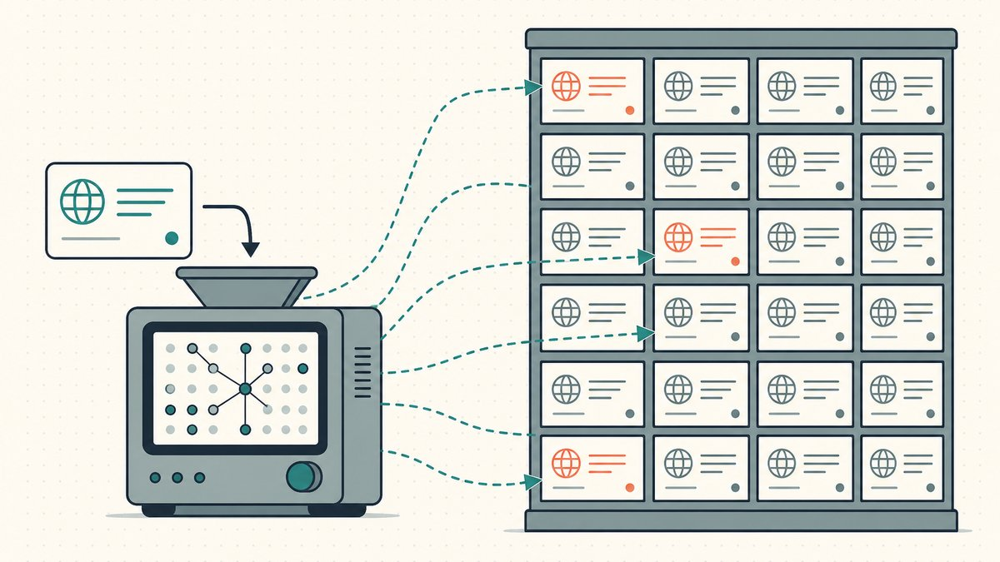
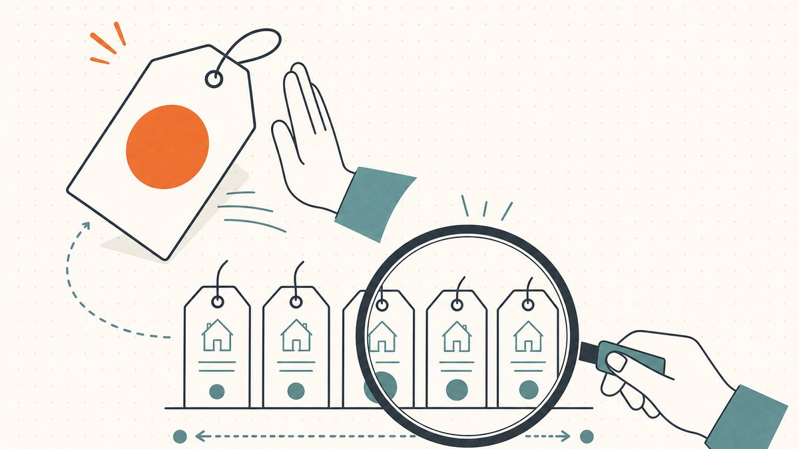

Use [GoDaddy Domain Appraisal](https://www.godaddy.com/domain-value-appraisal) to get an automated estimate and inspect the accompanying comparable sales. GoDaddy describes a model that uses [machine learning and market sales data](#godaddy-explains-its-appraisal-method). Treat the estimate as research input when setting a buying budget or asking price.

An appraisal does not give you a buyer, a completed transaction, or a binding offer. The practical question is whether the evidence helps your particular decision. A seller choosing a patient asking price faces a different decision from a buyer deciding when to stop bidding.

This guide focuses on using GoDaddy's result. For a broader pricing process, read [how to value a domain name](/en/blog/how-to-value-a-domain-name/).

## Start with the exact domain and keep the result dated

Open the official tool and enter the complete domain, including the extension. Review the spelling before submitting the search. Do not substitute the website address, a page path, or an email address for the domain name.

Record the estimate, currency, lookup date, and comparable domains that the result actually displays. Preserve an unavailable result as unavailable. Do not replace a missing estimate with a number from an unrelated name or a search snippet.

A useful worksheet has separate fields for the model estimate, your proposed asking price, and a buyer's actual offer. Keeping those fields separate prevents a hypothetical value from becoming an assumed sale.

For example, imagine evaluating `example.com` for a hypothetical sale. Your worksheet should identify the exact domain and the date of the appraisal. The example supplies no live valuation or availability result.

If the tool fails to return a result, check the entered name and try the official interface again. Do not buy an unrelated service merely because a third-party page promises access to an appraisal.

## Read the comparable sales before accepting the estimate

GoDaddy says its model examines similar domain names, including the extension and the part before the dot. The tool also considers length and uniqueness. GoDaddy presents [comparable domain sales with the estimate](#godaddy-explains-its-appraisal-method).

Use those comparables to ask specific questions. Does the comparable use the same extension? Does the comparable contain the same number of words? Does the comparable describe a similar product, audience, or commercial use?

A short technical acronym and a long descriptive phrase can serve different buyers. A shared keyword alone does not establish a useful comparison. Write down the reason for keeping each comparable.

Read [how to interpret comparable domain sales](/en/blog/how-to-read-comparable-domain-sales/) when the displayed examples differ substantially from your domain.

As editorial advice, favor explanations that another person can inspect. “The appraiser says so” provides less useful reasoning than a short comparison of spelling, extension, language, and likely use.

Also distinguish a reported sale from an asking price. A listing describes what a seller requests. Your own proposed price belongs in the asking-price field, even when the listing appears beside sales research.

## Compare a second model without averaging away disagreement

A second tool can help you identify assumptions worth investigating. EstiBot describes a statistical model that compares domain attributes with previously sold names. EstiBot lists attributes such as [length, extension, word count, pronunciation, and external demand signals](#estibot-explains-its-comparison-model).

Different outputs do not automatically identify a correct model. A disagreement should prompt a closer look at the names, data, and intended transaction. Do not average estimates solely to make the disagreement disappear.

Use a small comparison table in your notes:

| Research item | What to record | What the item does not settle |
| --- | --- | --- |
| GoDaddy result | Estimate, currency, date, displayed comparables | A particular buyer's budget |
| Second appraisal | Estimate and documented method | Which model will predict your transaction |
| Comparable sales | Name, extension, date, and source | Whether your domain has equal demand |
| Actual offer | Buyer, terms, amount, and expiry | Whether waiting will produce a better offer |

The table is an editorial research method. Neither provider promises that combining estimates produces a reliable sale forecast.

## A seller should separate a listing strategy from an appraisal

Before setting an asking price, decide what a satisfactory sale would accomplish. Consider your holding costs, the work required to negotiate, and how urgently you need a result. These are your operating constraints, rather than inputs you should assume the tool knows.

Write a reserve decision separately from your public asking price. A patient listing can allow negotiation. A time-limited auction calls for a decision about the lowest acceptable outcome before bidding starts.

Avoid adding a revenue multiple unless the transaction actually includes a business with verified revenue. A domain-only appraisal cannot replace an assessment of accounts, contracts, content, or other business assets.

Also avoid presenting an appraisal screenshot as a purchase commitment from GoDaddy. Explain the result as an automated estimate. A prospective buyer should understand the difference before negotiations begin.

Our [end-user and reseller pricing guide](/en/blog/end-user-vs-reseller-domain-pricing/) explains why the intended buyer matters when choosing a sales strategy.

## A buyer should set a budget before reading the seller's appraisal

Start with the domain's purpose in your own project. List acceptable alternatives and the cost of changing the proposed brand. Decide how much you can commit without relying on a later resale.

Then inspect the seller's appraisal and underlying comparables. Check whether the screenshot shows the exact domain, a visible date, and the full context. A cropped estimate gives less information than the actual tool result.

As practical advice, keep a maximum purchase budget outside the negotiation interface. Include any quoted transaction charges and registration costs in that budget. Ask the seller or marketplace to clarify an uncertain charge before committing.

If a seller's price exceeds your budget, a high appraisal does not remove the budget constraint. Choose a different name, negotiate within the budget, or decline the purchase.

## Keep the appraisal only when the evidence improves the decision

A useful appraisal note should finish with an action: investigate comparable sales, revise the asking price, retain the domain, or walk away. Add the reason for the action beside the result.

Revisit the note when an actual offer arrives. Compare the offer's terms with your objective, rather than checking whether the offer matches a model's output. Payment terms, delivery requirements, and transaction certainty belong in that assessment.

Start with the official GoDaddy tool, save the dated result, and inspect the comparables. Use the result to organize research. Use an explicit budget and sales objective to make the final decision.

## Sources and further reading

### GoDaddy explains its appraisal method

[GoDaddy explains its appraisal method](https://www.godaddy.com/resources/skills/godaddy-domain-name-value-appraisal-tool#:~:text=algorithm%20uses%20proprietary%20machine%20learning). Checked 2026-10-30.

### EstiBot explains its comparison model

[EstiBot explains its comparison model](https://www.estibot.com/methodology#:~:text=EstiBot%20relies%20on%20a%20statistically%20derived%20model). Checked 2026-10-30.
