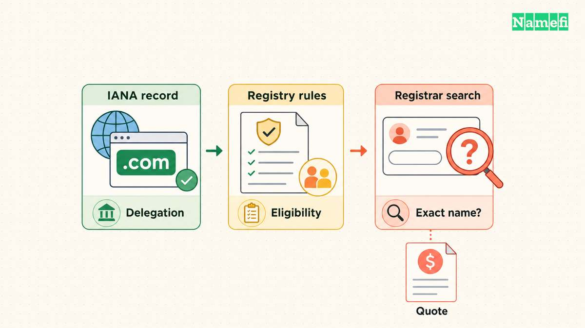

Use [IANA’s Root Zone Database](https://www.iana.org/domains/root/db) for the official list of public DNS top-level domains. Use a registrar’s search for the availability and price of a specific name. Those are different tasks. [IANA describes the database as a registry of TLD delegation details](#iana-publishes-the-official-extension-list).

The grouped lists below help you create a shortlist beyond `.com`. The examples come from the checked IANA database. The lists do not claim that every extension accepts every applicant or that your desired name is available.

## Familiar generic endings provide a starting shortlist

The following endings appear as generic TLDs in [IANA’s database](#iana-publishes-the-official-extension-list). The possible uses are editorial suggestions based on the wording, rather than eligibility promises.

| Extension | Possible naming fit | Comparison to make |
| --- | --- | --- |
| `.com` | Broad business or personal identity | Complete-name availability and renewal |
| `.net` | A broad alternative to another unavailable name | Confusion with the corresponding `.com` |
| `.org` | A community or organizational identity | Audience expectations and registry policy |
| `.info` | An information-oriented identity | Readability and the complete address |
| `.biz` | A business-oriented identity | Whether visitors understand the ending |
| `.online` | A general online project | Length of the complete domain |

Do not choose an ending only because the preferred name is unavailable elsewhere. Test whether the alternative creates a confusing address. A different complete name can be clearer than an ending that the intended audience repeatedly mistypes.

Our [TLD explainer](/en/blog/what-is-a-tld/) covers the naming hierarchy. This page serves as a browsing and checking list rather than repeating that definition.

## Descriptive generic endings can match a project’s subject

These examples also appear as generic TLDs in [IANA’s official list](#iana-publishes-the-official-extension-list). The label can suggest a subject, but the label does not certify what the site provides.

| Extension | Editorial naming idea | Before registration |
| --- | --- | --- |
| `.app` | Application or product | Read registry and hosting requirements |
| `.dev` | Development project | Check the intended browser and hosting setup |
| `.tech` | Technology organization | Compare the complete name with alternatives |
| `.shop` | Store-related identity | Confirm the name and storefront platform |
| `.store` | Store-related identity | Compare spelling and renewal terms |
| `.blog` | Publishing identity | Check long-term publishing plans |

Keep the subject and the business model separate. A `.shop` registration does not create a storefront. A `.blog` registration does not provide publishing software. [ICANN distinguishes the domain from web hosting and email services](#icann-separates-the-domain-from-the-website).

Read the chosen registry’s current conditions. A short directory description cannot summarize every technical, contractual, or eligibility requirement. Avoid assuming that a category called “generic” means unrestricted use.

## Country-code endings identify separate registration systems

IANA classifies these examples as country-code TLDs. [The official list identifies each delegation and manager](#iana-publishes-the-official-extension-list).

| Extension | Associated country or territory |
| --- | --- |
| [`.ch`](#iana-records-the-ch-country-code-delegation) | Switzerland |
| [`.uk`](#iana-records-the-uk-country-code-delegation) | United Kingdom |
| [`.de`](#iana-records-the-de-country-code-delegation) | Germany |
| [`.fr`](#iana-records-the-fr-country-code-delegation) | France |
| [`.ca`](#iana-records-the-ca-country-code-delegation) | Canada |
| [`.us`](#iana-records-the-us-country-code-delegation) | United States |
| [`.au`](#iana-records-the-au-country-code-delegation) | Australia |
| [`.jp`](#iana-records-the-jp-country-code-delegation) | Japan |
| [`.ai`](#iana-records-the-ai-country-code-delegation) | Anguilla |
| [`.io`](#iana-records-the-io-country-code-delegation) | British Indian Ocean Territory |
| [`.co`](#iana-records-the-co-country-code-delegation) | Colombia |

Do not infer registration eligibility from the country association. Some registries impose local requirements, while other registries allow applicants from elsewhere. Check the registry policy for the exact registration structure.

For example, the [.ch buying guide](/en/tld/ch/) examines Swiss registration rules. The [.io buying guide](/en/tld/io/) distinguishes second-level applications from third-level applications. Those distinctions matter more than a broad “country domain” category.

Search-engine treatment can differ from registry classification. Google lists `.ai`, `.io`, and `.co` among country-code endings that Google treats as generic. [Google publishes the exceptions](#google-documents-generic-treatment-for-selected-country-codes). Do not treat every country-code ending as identical for geographic targeting.

## Internationalized endings use scripts beyond Latin letters

IANA’s database also lists internationalized endings, including `.中国` in Han characters and `.भारत` in Devanagari. The database shows the readable label and the corresponding DNS representation. [Use the writing-system filter when browsing](#iana-publishes-the-official-extension-list).

An internationalized spelling describes the script. The spelling does not replace the underlying TLD classification or registry rules. Both listed examples appear as country-code entries in the checked database.

For a multilingual project, test the actual address in the applications your audience needs. Include browsers, email tools, forms, and printed materials. Treat compatibility testing as a project requirement rather than assuming every input field accepts the chosen spelling.

A readable name in one script may still require explanation to readers who use another script. Choose according to the people who must type and share the address.

## The complete official list includes entries you cannot simply buy

Open the [Root Zone Database](https://www.iana.org/domains/root/db) and search the extension. Review the status and type before opening the delegation record. The checked database distinguishes active, retired, reserved, and other statuses.

The presence of a string in the database does not establish open retail registration. Brand-associated entries, special-use entries, and active commercial registry entries answer different questions.

Use this sequence when a directory suggests an unfamiliar ending:

1. Find the exact ending in IANA’s database.
2. Open the delegation record and identify the manager.
3. Read the manager’s registration policy.
4. Find a registrar that supports the ending.
5. Search the exact proposed name.
6. Review the final term and renewal conditions.

A registrar may support only some extensions. A failed search at one registrar therefore does not prove that an extension does not exist.

## Your shortlist should survive a practical buying review

Compare the full address, registration conditions, ongoing renewal, and required services. Keep the currency and term visible in your notes. Save the actual quote rather than relying on a promotional headline.

Read the complete name aloud and ask another person to type the name. Check whether the name creates ambiguity across the dot or invites an unintended spelling.

Select the extension only after the complete address meets the project’s requirements. Then follow the [domain and website launch guide](/en/blog/build-website-with-domain/) to connect the registration with a working site.

## Sources and further reading

### IANA publishes the official extension list

[IANA publishes the official extension list](https://www.iana.org/domains/root/db#:~:text=The%20Top-Level%20Domain%20Registry%20represents%20the%20delegation%20details%20of%20top-level%20domains%20in%20the%20Domain%20Name%20System%20%28DNS%29.), checked 2026-10-30.

### Google documents generic treatment for selected country codes

[Google documents generic treatment for selected country codes](https://developers.google.com/search/docs/specialty/international/managing-multi-regional-sites#:~:text=Country-code%20top-level%20domain%20names%20%28ccTLDs%29.%20These%20are%20tied%20to%20a%20specific%20country), checked 2026-10-30.

### ICANN separates the domain from the website

[ICANN separates the domain from the website](https://www.icann.org/resources/pages/about-domain-names-2018-08-30-en#:~:text=Your%20domain%20name%20is%20not%20the%20same%20thing%20as%20a%20website%20or%20a%20Uniform%20Resource%20Locator%20%28URL%29.), checked 2026-10-30.

### IANA records the ch country code delegation

[IANA records the ch country code delegation](https://www.iana.org/domains/root/db/ch.html#:~:text=Category%20Classification%20based%20on%20purpose%20and%20governing%20global%20allocation%20policy%20Country-code%20top-level%20domain%20Script%20The%20writing%20system%20%28script%29), checked 2026-10-30.

### IANA records the uk country code delegation

[IANA records the uk country code delegation](https://www.iana.org/domains/root/db/uk.html#:~:text=Category%20Classification%20based%20on%20purpose%20and%20governing%20global%20allocation%20policy%20Country-code%20top-level%20domain%20Script%20The%20writing%20system%20%28script%29), checked 2026-10-30.

### IANA records the de country code delegation

[IANA records the de country code delegation](https://www.iana.org/domains/root/db/de.html#:~:text=Category%20Classification%20based%20on%20purpose%20and%20governing%20global%20allocation%20policy%20Country-code%20top-level%20domain%20Script%20The%20writing%20system%20%28script%29), checked 2026-10-30.

### IANA records the fr country code delegation

[IANA records the fr country code delegation](https://www.iana.org/domains/root/db/fr.html#:~:text=Category%20Classification%20based%20on%20purpose%20and%20governing%20global%20allocation%20policy%20Country-code%20top-level%20domain%20Script%20The%20writing%20system%20%28script%29), checked 2026-10-30.

### IANA records the ca country code delegation

[IANA records the ca country code delegation](https://www.iana.org/domains/root/db/ca.html#:~:text=Category%20Classification%20based%20on%20purpose%20and%20governing%20global%20allocation%20policy%20Country-code%20top-level%20domain%20Script%20The%20writing%20system%20%28script%29), checked 2026-10-30.

### IANA records the us country code delegation

[IANA records the us country code delegation](https://www.iana.org/domains/root/db/us.html#:~:text=Category%20Classification%20based%20on%20purpose%20and%20governing%20global%20allocation%20policy%20Country-code%20top-level%20domain%20Script%20The%20writing%20system%20%28script%29), checked 2026-10-30.

### IANA records the au country code delegation

[IANA records the au country code delegation](https://www.iana.org/domains/root/db/au.html#:~:text=Category%20Classification%20based%20on%20purpose%20and%20governing%20global%20allocation%20policy%20Country-code%20top-level%20domain%20Script%20The%20writing%20system%20%28script%29), checked 2026-10-30.

### IANA records the jp country code delegation

[IANA records the jp country code delegation](https://www.iana.org/domains/root/db/jp.html#:~:text=Category%20Classification%20based%20on%20purpose%20and%20governing%20global%20allocation%20policy%20Country-code%20top-level%20domain%20Script%20The%20writing%20system%20%28script%29), checked 2026-10-30.

### IANA records the ai country code delegation

[IANA records the ai country code delegation](https://www.iana.org/domains/root/db/ai.html#:~:text=Category%20Classification%20based%20on%20purpose%20and%20governing%20global%20allocation%20policy%20Country-code%20top-level%20domain%20Script%20The%20writing%20system%20%28script%29), checked 2026-10-30.

### IANA records the io country code delegation

[IANA records the io country code delegation](https://www.iana.org/domains/root/db/io.html#:~:text=Category%20Classification%20based%20on%20purpose%20and%20governing%20global%20allocation%20policy%20Country-code%20top-level%20domain%20Script%20The%20writing%20system%20%28script%29), checked 2026-10-30.

### IANA records the co country code delegation

[IANA records the co country code delegation](https://www.iana.org/domains/root/db/co.html#:~:text=Category%20Classification%20based%20on%20purpose%20and%20governing%20global%20allocation%20policy%20Country-code%20top-level%20domain%20Script%20The%20writing%20system%20%28script%29), checked 2026-10-30.
