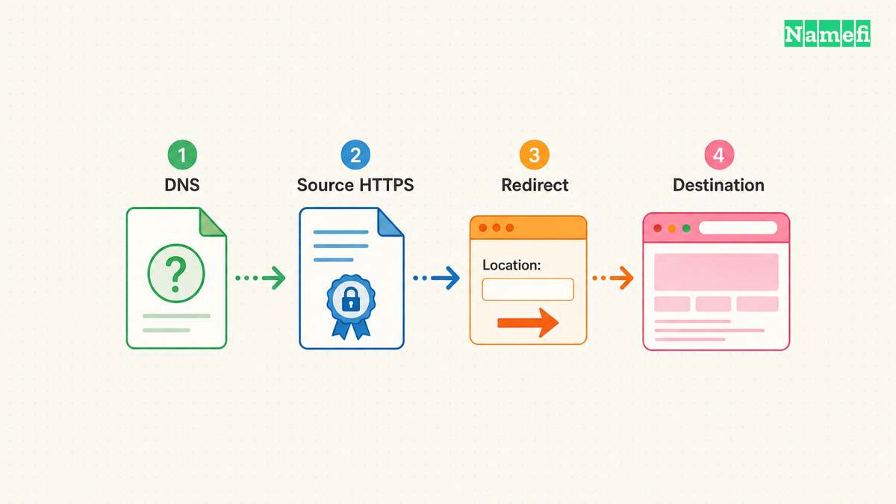
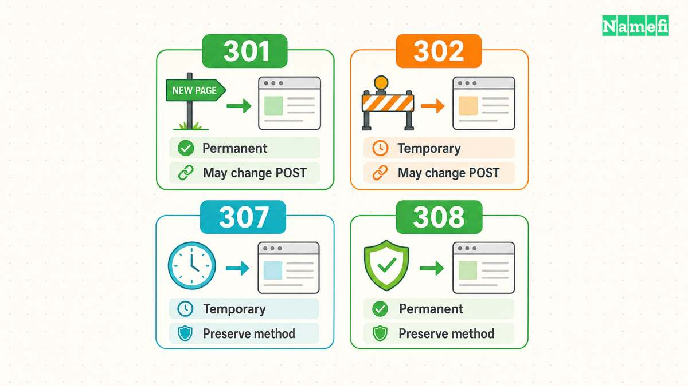
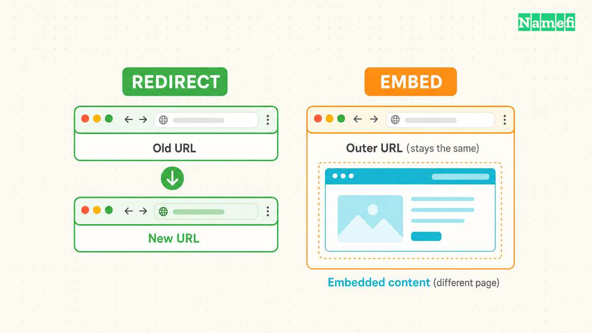
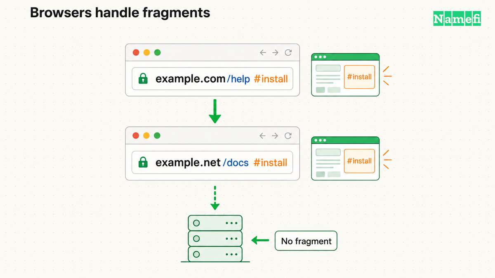

**Domain forwarding sends a visitor from one web address to another through an HTTP redirect.** DNS first helps the browser reach a server. The server then supplies the new URL. A DNS alias alone does not make the browser change addresses. [MDN describes the redirect exchange.](https://developer.mozilla.org/en-US/docs/Web/HTTP/Guides/Redirections#principle)

The practical choice involves more than selecting “permanent” in a dashboard. The old hostname needs working HTTPS when visitors request HTTPS. The forwarding rule needs a deliberate policy for paths and query parameters. A website migration also needs relevant destinations for old pages.

This guide explains those decisions for a spare domain, a changed brand address, or an existing website move. All example addresses and migration plans below are hypothetical. Provider controls vary, so treat the examples as acceptance criteria rather than settings to copy blindly.

## DNS connects the browser to the redirect service

[DNS](/en/glossary/dns/) and forwarding perform different jobs. A browser looks up the website address before requesting a page from the server. [MDN describes that sequence](https://developer.mozilla.org/en-US/docs/Learn_web_development/Getting_started/Web_standards/How_the_web_works#so_what_happens_exactly). A forwarding service must receive the web request to return a redirect.

Suppose the desired result is `https://example.com` opening `https://example.net/welcome`. The DNS configuration for `example.com` must lead to the selected forwarding infrastructure. The HTTP rule supplies `https://example.net/welcome` as the destination. The destination website then handles the second request.

A CNAME record supplies a canonical DNS name for an alias. The record does not contain a website path. [RFC 1034 defines that DNS alias relationship in section 3.6.2](https://www.rfc-editor.org/rfc/rfc1034.html#section-3.6.2). Entering `https://example.net/welcome` into a CNAME target confuses a URL with a DNS name. Use the [DNS record types](/en/glossary/dns-record-types/) reference when reviewing the existing zone.

First identify which service will answer the old web address. A [registrar](/en/glossary/registrar/) dashboard may offer forwarding, or the web host may provide redirect rules. A CDN can also provide rules. Choose the service whose current instructions cover the old hostname and required URL mapping. A forwarding button at one provider does not establish which provider currently receives the web traffic.

Write down the exact scope before editing DNS. Include the apex, such as `example.com`, and each required [subdomain](/en/glossary/subdomain/), such as `www.example.com`. Do not assume that configuring the apex also configures `www`. Ask the service to document each supported source hostname.

HTTPS creates a separate prerequisite. The old HTTPS address must establish a secured connection before the server can return an HTTP redirect. A valid destination certificate cannot repair the old address's certificate failure. [RFC 9110 sections 4.3.3 and 7.4 describe the secured origin connection](https://www.rfc-editor.org/rfc/rfc9110.html#section-4.3.3).

For the hypothetical move, verify certificates for both `example.com` and any old `www` address visitors use. Then verify the destination independently. If the forwarding provider cannot serve HTTPS for the source, choose another arrangement before announcing the move. Do not ask visitors to bypass certificate warnings.

Save the existing DNS configuration before changing anything. Change only the records required by the forwarding provider. Keep mail and verification requirements on the checklist. Domain forwarding describes web navigation, so test mailbox service separately if the domain also handles email.

## Redirect codes describe permanence and request handling

Four common status codes answer two questions: does the move last, and must an automatic redirect preserve the request method? A GET request retrieves a page. A POST request commonly submits data. Those requests need different testing even when the address bar looks identical.

| Code | Move | Method behavior |
| --- | --- | --- |
| 301 | Permanent | POST may become GET |
| 302 | Temporary | POST may become GET |
| 307 | Temporary | Method stays unchanged |
| 308 | Permanent | Method stays unchanged |

[RFC 9110 defines these distinctions in sections 15.4.2, 15.4.3, 15.4.8, and 15.4.9](https://www.rfc-editor.org/rfc/rfc9110.html#section-15.4.2). The distinction concerns protocol behavior, rather than a provider's marketing label.

For a permanent move of ordinary content pages, 301 can express the intended move. For temporary routing during a short campaign, consider 302. Choose 307 or 308 when the corresponding temporary or permanent redirect must retain the method. Confirm that the actual clients support the intended flow.

Consider a hypothetical contact form that submits to `https://example.com/contact`. A successful home-page redirect tells little about that form. If the destination receives GET instead of POST, the destination may never receive the intended submission. Preserving POST also requires a destination that accepts the submitted request. A status code cannot make two applications compatible.

A preserved method also does not promise preserved authentication. A cross-domain destination changes the request context. RFC 9110 tells clients to reconsider fields such as `Authorization` and `Cookie` during redirection. [Its redirect procedure explains those checks](https://www.rfc-editor.org/rfc/rfc9110.html#section-15.4). Test signed-in flows separately from public GET requests. Confirm which credentials the destination actually receives, without logging secret values.

Before redirecting a form or API, have the application owner define the expected request and response. Use harmless test data in a controlled environment. Check which endpoint receives the request, which method arrives, and whether the application completes the intended action. Avoid testing payment or account-changing actions with real submissions.

Permanence also affects recovery planning. RFC 9110 identifies 301 and 308 as heuristically cacheable. A corrected server rule does not establish that every client immediately forgets a previous response. [The status definitions describe this caching behavior](https://www.rfc-editor.org/rfc/rfc9110.html#section-15.4.9). Verify the mapping before enabling a permanent rule, and inspect cache controls during troubleshooting.

Search engines apply their own interpretation. Google treats 301 and 308 as permanent signals for the destination's canonical URL. Google treats 302 and 307 as temporary redirects. [Google documents that grouping](https://developers.google.com/search/docs/crawling-indexing/301-redirects#overview-of-redirect-types). Choose the code that describes the move, then verify the implementation. A code does not guarantee indexing, traffic, or rankings.

Record the chosen code alongside the reason. “Temporary campaign, preserve POST” is a more useful maintenance note than “forwarding enabled.” Future maintainers can compare the original requirement with the current application before changing the rule.

## URL mappings preserve useful destinations while masking embeds pages

A forwarding rule needs an explicit destination policy. Decide whether every source address should reach one landing page, or whether paths should map to corresponding pages. Then decide which query parameters the destination needs. These decisions belong in the migration plan before any bulk rule.

For a hypothetical unchanged site structure, `https://example.com/help/setup?lang=en` might need to reach `https://example.net/help/setup?lang=en`. A fixed destination of `https://example.net/` would discard the useful page selection. A rule that retains the path but drops the query would produce a different result again.

Provider settings determine the constructed target. Cloudflare Single Redirects distinguishes static URLs from expression-based dynamic targets. Cloudflare also provides a separate query-preservation setting, disabled by default. [Its settings documentation states those behaviors](https://developers.cloudflare.com/rules/url-forwarding/single-redirects/settings/#static-url-redirect). Other providers can expose different controls. Read the selected product's instructions instead of assuming that “forward domain” preserves everything.

Create a small mapping sheet with source URL, expected target, and observed result. Include the home page, a nested path, and a query-bearing URL. Add trailing-slash and encoded-character examples when the actual site uses those forms. Record an exception for each page whose new path differs.

For example, an old `/support/install` page might move to `/docs/getting-started`. A general rule that copies paths would miss that change. Add a specific mapping and check rule priority against the provider's documentation. Test the exception after enabling the general rule, rather than testing each rule only in isolation.

Choose query handling deliberately. A language selector might remain necessary, while an obsolete campaign parameter might serve no purpose. Write the expected behavior for each parameter the application uses. Then test multiple parameters together. Do not equate a preserved query string with a working destination application.

Domain masking requires a different assessment. In an iframe-based arrangement, the source page contains the destination page inside an embedded browsing context. The HTML standard defines an iframe and its source URL. [See the iframe element specification](https://html.spec.whatwg.org/multipage/iframe-embed-object.html#the-iframe-element). The outer address can remain visible while the embedded page navigates elsewhere.

That arrangement does not perform the same top-level navigation as an HTTP redirect. Copying the outer address may fail to identify the embedded page a visitor currently sees. Test deep linking, back navigation, and mobile layout before depending on an embedded arrangement. If the requirement is a branded address for the application itself, investigate the application's custom-domain support.

An embedded page can also refuse framing. CSP `frame-ancestors` specifies which parent pages may embed content, and `'none'` disallows parents. [MDN explains that directive](https://developer.mozilla.org/en-US/docs/Web/HTTP/Reference/Headers/Content-Security-Policy/frame-ancestors). If masking produces an empty frame, inspect the browser console and destination headers. Changing DNS cannot override the destination's framing policy.

## Browsers handle fragments separately from paths and queries

The fragment after `#` belongs to browser-side processing. The HTTP target URI excludes the fragment. A forwarding server therefore cannot select a rule from the original `#install` alone. [RFC 9110 distinguishes the fragment from the request target](https://www.rfc-editor.org/rfc/rfc9110.html#section-7.1).

For example, a visitor might open `https://example.com/help#install`. Suppose the response contains `Location: https://example.net/docs` without a fragment. The browser must inherit the original fragment when following that redirect. The resulting address becomes `https://example.net/docs#install`. [RFC 9110 specifies fragment inheritance](https://www.rfc-editor.org/rfc/rfc9110.html#section-10.2.2).

That inherited fragment helps only when the destination understands `#install`. If the new page uses a different section identifier, test the resulting section explicitly. A working page response does not prove that the browser selected the intended section. A destination fragment in `Location` changes the inheritance case, so record fragments separately from query parameters.

A canonical annotation serves another purpose. A `rel="canonical"` annotation expresses a preferred URL for search processing. The annotation does not itself navigate a visitor. Google describes canonicalization methods as signals and can choose a different canonical URL. [Google explains canonical selection](https://developers.google.com/search/docs/crawling-indexing/consolidate-duplicate-urls). Use an HTTP redirect when visitors need to move, and keep the destination's canonical annotation consistent with the intended URL.

## Testing confirms the redirect before a website move

Start with the destination. Open each intended landing page directly and confirm that the correct content loads over HTTPS. Then test the source addresses. Keeping those checks separate helps distinguish a broken destination from a broken forwarding rule.

For each source hostname, test HTTP and HTTPS explicitly. Include `www` where the migration requires `www`. Test at least one old deep link and one relevant query. A successful root-page test covers only that request, not every rule the dashboard contains.

Use browser developer tools to inspect the network exchange with request preservation enabled. Check the first response, its status, and its `Location` value. Then inspect the destination response. An unexpected home page often indicates a mapping error rather than failed DNS resolution.

For a command-line inspection, adapt the following hypothetical request to a domain under your control:

    curl --silent --show-error --dump-header - --output /dev/null 'https://example.com/help/setup?lang=en'

The command prints response headers and discards the response body. The command does not automatically follow redirects. [The curl manual documents `--dump-header`](https://curl.se/docs/manpage.html#-D). Compare the returned `Location` with the mapping sheet, then request that target separately. Keep certificate verification enabled during HTTPS checks.

The following acceptance sheet illustrates a hypothetical documentation move. Each expected result requires an actual test against the chosen configuration.

| Example source | Expected destination or check |
| --- | --- |
| `http://example.com/` | The final HTTPS landing page |
| `https://www.example.com/help/setup` | The matching page at `https://example.net/help/setup` |
| `https://example.com/help/setup?lang=en` | The matching page with the required `lang=en` query |
| `https://example.com/support/install` | The explicit exception at `https://example.net/docs/getting-started` |
| `https://example.com/help#install` | The mapped page and the intended browser section |
| A controlled form submission | The expected method, body handling, authentication, and application result |

Inspect the full chain as well as the first response. A rule can reach an intermediate hostname that sends the visitor back. Google recommends redirecting directly to the final destination because chains add latency. [Its migration guide explains redirect chains](https://developers.google.com/search/docs/crawling-indexing/site-move-with-url-changes#prepare-url-mapping). Combine hostname, scheme, and path decisions where the provider supports the intended direct mapping.

For harmless GET checks, the following example follows redirects and limits the chain to five redirects:

    curl --silent --show-error --location --max-redirs 5 --dump-header - --output /dev/null 'https://example.com/help/setup?lang=en'

The headers show each response. Five redirects form a diagnostic limit for this example, not a protocol requirement or SEO guarantee. [The curl manual defines redirect following](https://curl.se/docs/manpage.html#-L) and [the redirect limit](https://curl.se/docs/manpage.html#--max-redirs). The command does not test a form submission or browser fragment behavior.

Classify failures before changing settings. A certificate error requires source HTTPS investigation. A wrong `Location` requires rule investigation. A correct target that returns a missing page requires destination investigation. Repeated redirects require inspection of every step for a loop. MDN describes redirect loops and their failure behavior. [See its loop guidance](https://developer.mozilla.org/en-US/docs/Web/HTTP/Guides/Redirections#redirection_loops).

For a website migration, Google recommends direct redirects to corresponding destinations. Google warns against sending many unrelated old URLs to one irrelevant home page. Google also recommends retaining redirects for at least one year, generally longer when practical. [Its site-move instructions explain these requirements](https://developers.google.com/search/docs/crawling-indexing/site-move-with-url-changes#start-the-site-move). The guidance does not promise unchanged rankings.

Keep a maintenance record after launch. Assign responsibility for the old registration, source certificates, redirect service, and mapping changes. Review failures against real old links rather than testing only newly published links. Investigate reports with the exact source URL and observed target.

Make the acceptance checks concrete. For a hypothetical documentation move, write “the old installation URL reaches the new installation page.” Also write “the English language query remains present.” Those statements let a reviewer identify failure without knowing the dashboard configuration. A requirement such as “forwarding works” leaves too much room for a wrong but reachable page.

After correcting a failure, repeat the affected request and one neighboring case. A fix for a single path could accidentally alter the rule for other paths. Keep the observed status and target beside each result. When several people manage the migration, record which configuration each check tested. A dated result without the matching configuration cannot explain a later discrepancy.

Close the move only after the mapping sheet matches observed results. Keep the previous configuration for recovery and document any deliberate exceptions. A reliable forwarding setup has a reachable source, valid HTTPS, suitable status codes, and tested destinations. Each component needs its own check.

## Sources and further reading

- MDN — [Redirections in HTTP](https://developer.mozilla.org/en-US/docs/Web/HTTP/Guides/Redirections#principle), “Principle” and “Redirection loops.” Fetched 2026-10-21.
- MDN — [How the web works](https://developer.mozilla.org/en-US/docs/Learn_web_development/Getting_started/Web_standards/How_the_web_works#so_what_happens_exactly), browser DNS lookup and HTTP request sequence. Fetched 2026-10-21.
- RFC Editor — [RFC 1034, section 3.6.2](https://www.rfc-editor.org/rfc/rfc1034.html#section-3.6.2), aliases and canonical names. Fetched 2026-10-21.
- Google Search Central — [Canonical URL methods](https://developers.google.com/search/docs/crawling-indexing/consolidate-duplicate-urls), canonical signals and consistent annotations. Fetched 2026-10-21.
- RFC Editor — [RFC 9110](https://www.rfc-editor.org/rfc/rfc9110.html#section-15.4.2), sections 4.3.3, 7.4, 15.4.2–15.4.3, and 15.4.8–15.4.9. Fetched 2026-10-21.
- Google Search Central — [Redirects and Google Search](https://developers.google.com/search/docs/crawling-indexing/301-redirects#overview-of-redirect-types), permanent and temporary signals. Fetched 2026-10-21.
- Cloudflare — [Single Redirects settings](https://developers.cloudflare.com/rules/url-forwarding/single-redirects/settings/#static-url-redirect), static and dynamic targets, query preservation. Fetched 2026-10-21.
- WHATWG — [HTML iframe element](https://html.spec.whatwg.org/multipage/iframe-embed-object.html#the-iframe-element), embedded navigable and source URL. Fetched 2026-10-21.
- MDN — [CSP frame-ancestors](https://developer.mozilla.org/en-US/docs/Web/HTTP/Reference/Headers/Content-Security-Policy/frame-ancestors), permitted embedding parents. Fetched 2026-10-21.
- curl — [Command-line manual](https://curl.se/docs/manpage.html#-D), `--dump-header` and `--output`. Fetched 2026-10-21.
- Google Search Central — [How to move a site](https://developers.google.com/search/docs/crawling-indexing/site-move-with-url-changes#start-the-site-move), redirect mapping, irrelevant targets, and retention. Fetched 2026-10-21.
