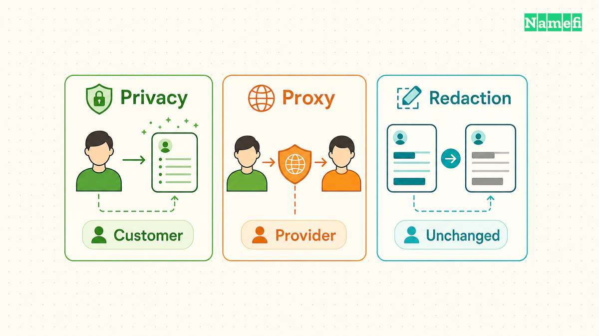
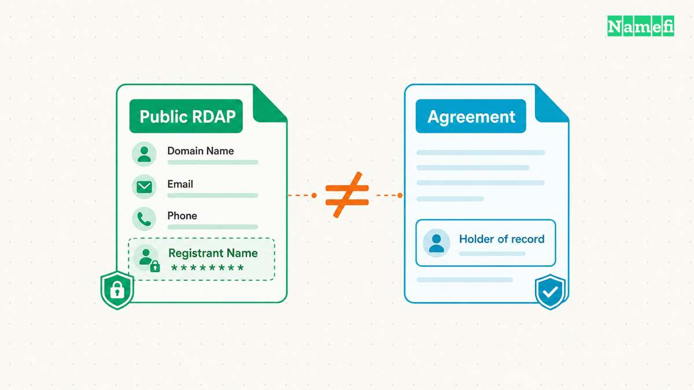
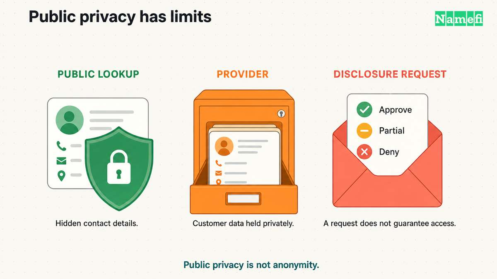
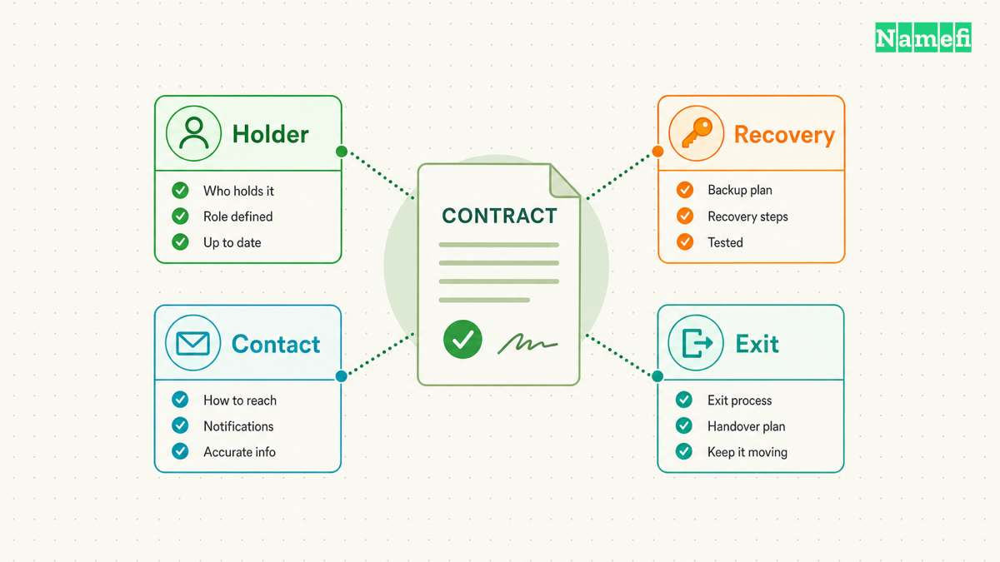

Domain privacy and proxy registration can produce similar public lookup results, but the services establish different registration relationships. The crucial question concerns the registered name holder.

A privacy service leaves the customer as the [registrant](/en/glossary/registrant/) and supplies alternative contact details. A proxy service becomes the registered name holder of record. [ICANN distinguishes the services on that basis](https://www.icann.org/resources/pages/privacy-proxy-registration-2013-03-22-en#:~:text=Privacy%20Services).

A third arrangement, registration-data redaction, can hide personal fields without either service. A blank name in a lookup therefore cannot identify the underlying contract.

Before paying for protection, check three things: who holds the registration, who can see the underlying data, and how important messages reach the customer. Those checks matter more than a checkout label such as “private domain.”

## Privacy and proxy services assign different registration roles

Start with the distinction between a public contact and a contracting party. A public contact answers how strangers can reach someone. The registered name holder answers who holds the registration under the relevant agreements.

With a privacy service, the customer keeps that registered role. The service supplies reliable alternative contact information for public directory display. With a proxy service, the provider holds the registration and licenses use to the customer. The [current Registrar Accreditation Agreement specification defines both arrangements](https://itp.cdn.icann.org/en/files/accredited-registrars/registrar-accreditation-agreement-21jan24-en.htm#:~:text=SPECIFICATION%20ON%20PRIVACY%20AND%20PROXY%20REGISTRATIONS).

The distinction does not establish every legal right between the parties. The service agreement, registration agreement, and applicable law still matter. Avoid treating either a lookup screenshot or a product name as a complete statement of ownership.

| Arrangement | Holder of record | Public treatment |
| --- | --- | --- |
| Privacy service | Customer | Alternative contact details |
| Proxy service | Proxy provider | Provider identity and contacts |
| Data redaction | No change from redaction alone | Selected values withheld |

Consider a hypothetical consultant who registers example.com. Under a privacy arrangement, the consultant remains the registered name holder while the service substitutes contact details. Under a proxy arrangement, the consultant uses the domain through the provider relationship.

The consultant might manage the domain through a familiar dashboard in either case. Dashboard access does not settle the distinction. The current RAA separately recognizes an account holder who pays for or manages a registration without being the registered name holder. [Section 1.1 supplies that definition](https://itp.cdn.icann.org/en/files/accredited-registrars/registrar-accreditation-agreement-21jan24-en.htm#:~:text=Account%20Holder).

For a business, write down the intended registered entity before buying a service. The intended entity might differ from the employee who opens the account. Ask the provider to explain how the agreement records that relationship.

Keep the provider name separate from the [registrar](/en/glossary/registrar/) name in the same record. A customer needs to know which organization handles billing, registration support, privacy questions, and proxy cancellation. Do not assume one support inbox handles every function.

This comparison also concerns registration services, not an HTTP proxy or a network privacy tool. A domain proxy agreement describes a registration relationship. The agreement does not, by itself, describe how website traffic travels.

## Domains By Proxy illustrates why the service agreement matters

Domains By Proxy is a named service, rather than another name for every privacy arrangement. GoDaddy identifies Domains By Proxy as [its Domain Privacy partner](https://www.godaddy.com/help/what-is-domain-privacy-41145). A lookup that names Domains By Proxy does not identify the person who operates the website.

GoDaddy's [Domain Name Proxy Agreement, sections 1 and 2](https://www.godaddy.com/legal/agreements/domain-name-proxy-agreement), describes the proxy registrant and the customer's retained rights. Those rights include controlling use, renewing the registration, and selling or transferring the registration, subject to the agreement. Section 2 requires cancellation of the associated DBP service for a sale, transfer, or assignment.

A proxy registration therefore does not mean that the customer has no contractual rights. Equally, a familiar account dashboard does not replace the agreement. Before selling or transferring a protected domain, ask support which agreement applies and which cancellation sequence preserves protection during the handoff.

Section 4 also permits disclosure or service cancellation under specified conditions. The listed conditions include legal requirements, legal process, and compliance with ICANN rules. The agreement does not promise secrecy until a court orders disclosure. Check the current terms for the specific registration before relying on a narrower promise.

The agreement still uses the term “Whois.” Read that wording alongside current publication policy and the actual RDAP response. Do not infer that every legacy field listed in the agreement appears in every current lookup.

## RDAP redaction changes what a public lookup reveals

Older guides often describe a choice between publishing every personal detail in [WHOIS](/en/glossary/whois/) and buying a privacy service. That framing misses the current gTLD registration-data system.

On January 28, 2025, [RDAP](/en/blog/whois-and-rdap-public-data/) became the definitive source for gTLD registration information in place of WHOIS. [ICANN announced that transition and directs users to its RDAP-based Lookup service](https://www.icann.org/en/announcements/details/icann-update-launching-rdap-sunsetting-whois-27-01-2025-en). Some services still use “WHOIS privacy” as a familiar label.

Separately, ICANN's Registration Data Policy took effect on August 21, 2025. [The policy replaced the Interim Registration Data Policy for contracted parties](https://www.icann.org/en/announcements/details/icann-registration-data-policy-now-in-effect-for-contracted-parties-21-08-2025-en). A protocol change and a data-publication policy change answer different questions.

RDAP supplies the lookup mechanism. Redaction rules determine which field values the response withholds. A privacy or proxy service adds a contractual arrangement beyond that mechanism.

The policy requires redaction when applicable law requires protection of personal data. The policy also permits redaction in specified additional circumstances. [Section 9.2 describes those publication requirements](https://www.icann.org/en/contracted-parties/consensus-policies/registration-data-policy#:~:text=Redaction%20Requirements%20for%20Publication).

Consequently, inspect actual fields before deciding what an additional service would change. A redacted personal name does not imply a hidden domain name, hidden registrar, or hidden registration dates. Record each field separately rather than labeling the entire response “anonymous.”

Use [ICANN Lookup](https://lookup.icann.org/en) for the initial inspection. Read the returned record and follow any registrar referral. Compare the result with the provider's explanation of the service.

For a hypothetical example.com registration, record whether the response shows a service identity, redacted values, or personal contact details. Also record the contact mechanism and the time of the check. Avoid publishing the screenshot if the screenshot contains personal information.

A result showing a provider name suggests a service relationship worth checking. A result showing redacted values establishes only what the response withholds. Neither result replaces the customer agreement.

Ask about the particular extension as well. ICANN's cited policy applies to ICANN-accredited registrars and gTLD registry operators under ICANN agreements. Country-code registration services can have different rules. A conclusion about example.com should not become an assumption about every extension in a portfolio.

Compare the service against the outcome actually needed. A customer seeking fewer public contact details should ask which additional fields the service changes. A customer seeking reliable contact forwarding should examine that feature separately.

## Public protection leaves provider access and disclosure questions

Public redaction does not mean that nobody holds the underlying information. ICANN's policy covers collection, transfers, publication, and disclosure as separate operations. [The policy FAQ explains those separate functions](https://www.icann.org/en/system/files/files/registration-data-policy-faqs-21aug25-en.pdf#page=4).

Ask which organization collects the customer details and which organizations receive them. Review the provider's privacy notice for payment, support, and account information too. Registration-directory protection alone cannot answer those questions.

Accurate private information also supports continuity. Do not replace required contact details with invented identities or unusable mailboxes. The RAA requires reliable registration contact information and provides consequences for specified accuracy failures. [Sections 3.7.7.1–3.7.7.2 explain those duties](https://itp.cdn.icann.org/en/files/accredited-registrars/registrar-accreditation-agreement-21jan24-en.htm#:~:text=3.7.7.1).

A useful contract review distinguishes four events. A provider can forward a message, disclose information privately, publish information publicly, or end a service. Those events have different consequences for the customer.

Forwarding a complaint does not necessarily expose the customer to the sender. Conversely, a promise to forward mail does not promise that the provider will reject every disclosure request. Read the exact provisions instead of extending one feature into a broader guarantee.

ICANN's privacy/proxy guidance directs providers to publish their service terms, abuse contacts, and relevant procedures. [The guidance specifically includes communication handling, termination, and publication conditions](https://www.icann.org/resources/pages/privacy-proxy-registration-2013-03-22-en#:~:text=2013%20RAA). Use those topics as questions when a checkout page offers only a short description.

Ask whether the provider gives notice before disclosure, when permitted. Ask whether the provider distinguishes a request from a court order. Ask how the provider handles a disputed request and which jurisdiction the agreement specifies.

The Registration Data Policy requires a disclosure-request process and consideration of properly formed requests. A response can provide data or explain a denial. [Section 10 defines that process](https://www.icann.org/en/contracted-parties/consensus-policies/registration-data-policy#:~:text=Disclosure%20Requests). A request therefore does not guarantee access, and a redacted record does not guarantee permanent secrecy.

For sensitive uses, describe the actual exposure concern to a qualified adviser. A home address, an unpublished project, and a business dispute create different questions. Avoid relying on the word “privacy” as an answer to all three.

Also review information published outside the registration directory. A customer who puts a personal address on a website has created another public disclosure. A directory service cannot determine what the customer publishes elsewhere.

## Contract checks and recovery checks make the choice practical

Choose an arrangement by testing the needed outcome against the contract. The following checks help compare offers without assuming that higher prices buy broader protection.

First, identify the registered name holder. Save the agreement version and the provider's written explanation. For a proxy service, identify the provision that gives the customer use of the domain and explains how that relationship ends.

Second, inspect the public record. Compare the current result with the promised treatment for the exact extension. Ask support about an unexpected field before changing registration details or disabling a service.

Third, check the contact path. When the registrar applies the relevant redaction provisions, the policy requires an email address or web form that facilitates contact without identifying the contact. [Section 9.2.3 states that requirement](https://www.icann.org/en/contracted-parties/consensus-policies/registration-data-policy#:~:text=9.2.3).

Send a harmless test message through the advertised route when the provider permits testing. Use a separate inbox and avoid sensitive content. Check spam folders and any provider message center before concluding that forwarding failed.

If the message does not arrive, save the submission time and any confirmation. Ask support which delivery stage failed. Keep a separate, working account contact while support investigates.

Fourth, rehearse recovery through the provider's documented process. Confirm who can request account recovery and what evidence the provider asks for. Keep registration receipts and agreements somewhere accessible without the domain's own email service.

Consider a hypothetical company whose only administrator leaves. The company needs more than a redacted public record. The company needs an authorized person who can recover access, receive notices, and renew the registration.

Record those responsibilities before the departure happens. Keep recovery details current when staff, addresses, or service providers change. Treat privacy settings and account authorization as separate review items.

Fifth, review exit conditions before a transfer or sale. Ask whether ending the service changes the registered name holder, alters public fields, or requires additional verification. Coordinate the sequence with the registrar rather than disabling protection as an experiment.

The [registrar transfer guide](/en/blog/transfer-domain-to-another-registrar/) covers the broader transfer process. The [buyer handoff guide](/en/blog/how-to-transfer-a-domain-to-a-buyer/) covers delivery after a sale. Both situations deserve a separate check of the privacy or proxy agreement.

Compare the total service terms over the expected registration period. Ask about renewal pricing, cancellation charges, and any fee for handling forwarded communications. Record the actual answers rather than assuming that an included service and a paid service perform identical work.

A hypothetical freelancer might need a working contact relay while keeping a home address out of public directory results. A company might prioritize a documented registration relationship and an exit process that authorized staff can complete. Neither customer can evaluate the offer from the price alone.

Keep one short comparison sheet for each candidate provider. Include the holder of record, changed fields, renewal price, disclosure provisions, and support route. Mark an unanswered question as unknown. A missing answer should prompt a support request before the customer relies on the feature.

Finally, check failure procedures. Ask how customers receive notices if the provider stops operating and how the registrar records the underlying customer. ICANN's FAQ confirms continuing escrow obligations for privacy/proxy customer information. [Question 14 discusses those obligations](https://www.icann.org/en/system/files/files/registration-data-policy-faqs-21aug25-en.pdf#page=9).

Do not treat escrow as a personal recovery guarantee. Ask support how the applicable arrangements affect the specific registration. Keep the answer with the agreement and revisit the answer when terms change.

The useful comparison ends with four recorded answers: holder of record, public fields, contact delivery, and recovery procedure. A service fits the need when those answers match the customer's requirements and the contract supports those answers.

## These sources support the comparison

- [ICANN: About Privacy/Proxy Registration Service](https://www.icann.org/resources/pages/privacy-proxy-registration-2013-03-22-en). Definitions and “2013 RAA” procedures. Fetched 2026-10-21.
- [ICANN: Registrar Accreditation Agreement, January 21, 2024 version](https://itp.cdn.icann.org/en/files/accredited-registrars/registrar-accreditation-agreement-21jan24-en.htm). Section 1.1, sections 3.7.7.1–3.7.7.2, and Specification on Privacy and Proxy Registrations. Fetched 2026-10-21.
- [ICANN: Launching RDAP; Sunsetting WHOIS](https://www.icann.org/en/announcements/details/icann-update-launching-rdap-sunsetting-whois-27-01-2025-en). January 2025 transition announcement. Fetched 2026-10-21.
- [ICANN: Registration Data Policy now in effect](https://www.icann.org/en/announcements/details/icann-registration-data-policy-now-in-effect-for-contracted-parties-21-08-2025-en). Effective-date announcement. Fetched 2026-10-21.
- [ICANN: Registration Data Policy](https://www.icann.org/en/contracted-parties/consensus-policies/registration-data-policy). Scope, sections 9.2 and 10. Current page includes a May 2026 revision. Fetched 2026-10-21.
- [ICANN: Registration Data Policy FAQ](https://www.icann.org/en/system/files/files/registration-data-policy-faqs-21aug25-en.pdf). Questions 1, 5, and 14. Fetched 2026-10-21.
- [GoDaddy: What is Domain Privacy?](https://www.godaddy.com/help/what-is-domain-privacy-41145). Domains By Proxy partner identification. Fetched 2026-10-21.
- [GoDaddy: Domain Name Proxy Agreement](https://www.godaddy.com/legal/agreements/domain-name-proxy-agreement). Sections 1, 2, and 4 establish proxy display, retained rights, cancellation, and disclosure conditions. Page states last revision April 1, 2024. Fetched 2026-10-21.
