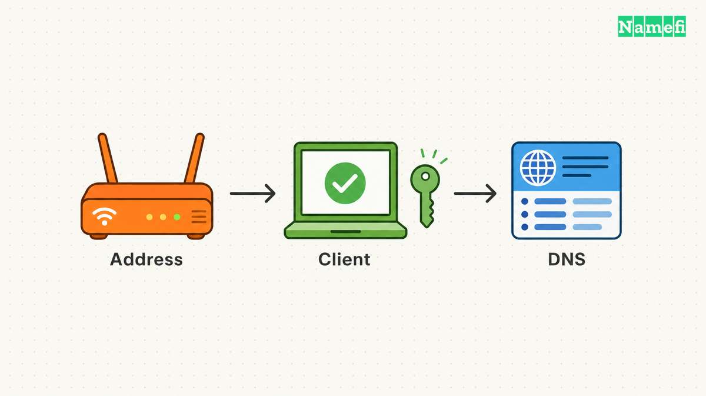
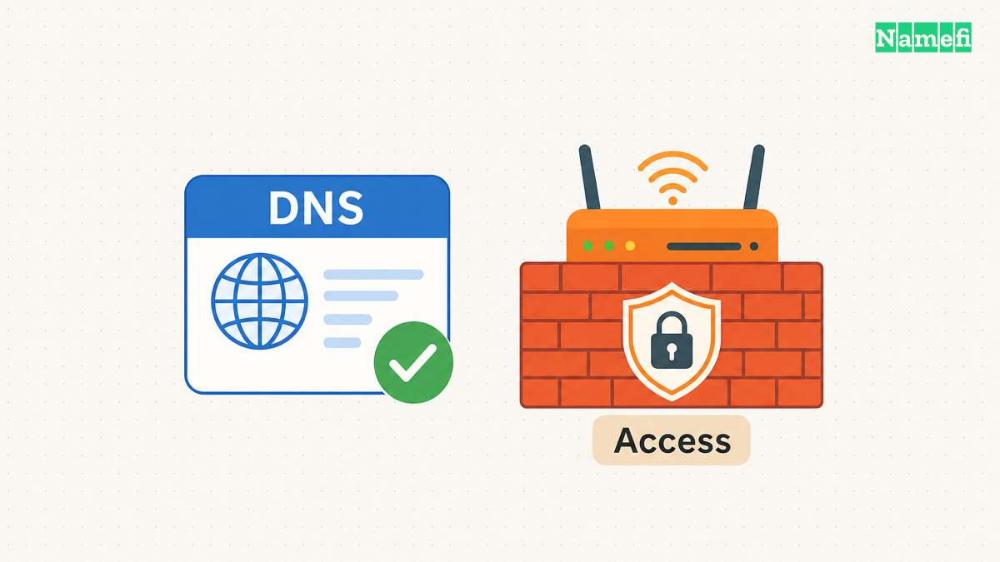

DDNS, or dynamic DNS, updates a hostname's address record when the server's public IP address changes. An update client detects the change and sends an authorized update to the DNS provider. [No-IP describes that update cycle](#no-ip-explains-update-clients-and-network-access-limits). DDNS keeps the name useful without requiring someone to edit DNS after every address change.

DDNS does not automatically create a path through a router or make a server safe to expose. Plan the hostname update and the remote-access method as separate tasks.

The examples are hypothetical. [IANA maintains example domains for documentation](#iana-maintains-example-domains-for-documentation).

## An updater changes the record that a resolver reads

A resolver answers questions about DNS records. A DDNS updater changes a record through a provider's supported interface. Running a resolver does not itself create an automatic update service.

Consider a hypothetical home server at `home.example.com`. If the connection's public IPv4 address changes, the previous A record can point at the old address. An updater detects the new address and asks the DNS provider to revise that record.

No-IP documents update clients on routers, servers, and other devices. [The client monitors the public address and reports changes](#no-ip-explains-update-clients-and-network-access-limits). Cloudflare documents both an API-based script and the existing `ddclient` utility. [The available integration depends on the provider](#cloudflare-documents-dynamic-address-update-options).

Start with a supported client rather than building a new updater without need. Confirm that the client supports the actual DNS provider and the address family you intend to update.

## A stable hostname still needs an access plan

Before setting up DDNS, decide who should reach the service. A private administration interface and a public website need different access arrangements. Choose the server's authentication and network exposure accordingly.

Confirm which address belongs to the connection and which address the application uses internally. Ask the network provider about incoming-connection restrictions when the arrangement is unclear.

Carrier-grade NAT can prevent ordinary incoming access to a subscriber's network. [No-IP explains the shared public-address limitation](#no-ip-explains-update-clients-and-network-access-limits). DDNS can update a name without removing that network limitation.

A supported authenticated tunnel or private remote-access service can fit some deployments. Evaluate the service's own access controls and instructions. Do not disable a firewall or expose an administrative port merely to make the DDNS test pass.

## The provider choice determines your configuration route

A hosted DDNS name can place the address under the provider's domain. A custom-domain arrangement lets the project use a name under its own registration. Choose the route based on continuity and account-control requirements.

Check the provider's actual supported updater, account requirements, hostname rules, and update credentials. Read the current service conditions instead of assuming all free plans behave alike.

If the project already uses Cloudflare DNS, review [Cloudflare's dynamic update instructions](https://developers.cloudflare.com/dns/manage-dns-records/how-to/managing-dynamic-ip-addresses/#ddclient). Cloudflare explicitly identifies `ddclient` as a third-party option. [Its documentation also describes an API-based route](#cloudflare-documents-dynamic-address-update-options).

For FreeDNS, use the separate [FreeDNS setup guide](/en/blog/freedns-setup/). A provider-specific setup belongs in that provider's documented workflow rather than in a generic command copied across services.

## One supported updater should own the hostname

Choose a router integration or an update client on a device that remains available. No-IP notes that a separate client can serve networks whose router lacks built-in support. [The provider describes those configuration choices](#no-ip-explains-update-clients-and-network-access-limits).

Set the exact hostname and relevant address family. Confirm that the client detects the intended public address rather than publishing an internal-only value. Follow the provider's instructions for any address-detection setting.

Avoid running unrelated updaters against the same record. Two clients with different address-detection behavior can overwrite each other's values. Assign one active owner and document the fallback procedure.

After setup, inspect the updater's status and the provider's saved DNS value. A program that starts successfully has not necessarily authenticated or changed the intended record.

Do not force an address change that interrupts other users merely to test the system. Use an approved maintenance event or the provider's supported test process. Observe the updater during the next legitimate address change.

## Update credentials deserve narrow permissions and private handling

An updater needs permission to change DNS. Choose the narrowest supported authorization for the intended zone or hostname. Keep the credential accessible only to the process or administrator that needs the credential.

Use the provider's supported secret configuration method. Avoid placing a token in a public repository, copied support message, browser screenshot, or shared command history. Treat a token-bearing update URL as a credential.

Keep diagnostics useful without printing secrets. Record the hostname, detected address, update outcome, and time. Redact authorization headers and token-bearing paths before sharing logs.

If a credential leaks, revoke or replace the credential through the provider. Then verify that the legitimate updater uses the replacement and that the DNS record remains correct. These are practical operational recommendations for maintaining update authority.

## DNS verification and application verification complete different checks

Query the exact hostname and record type after an update. Compare the answer with the intended public address. When a recent update returns an older value, compare authoritative DNS with the resolver's cache.

The [DNS propagation checker guide](/en/blog/dns-propagation-checker-guide/) explains that distinction. A successful provider update and a cached old answer can describe different stages of the change.

Next, test the service through the hostname from an appropriate external network. Confirm the intended authentication, route, and HTTPS behavior. The [HTTPS guide](/en/blog/what-is-https/) covers checks beyond name resolution.

If the address matches but the service fails, investigate the server, router, access policy, or provider restrictions. Changing the DDNS hostname repeatedly will not repair an unrelated application failure.

Keep the hostname owner, updater location, credential owner, and recovery instructions with the project records. The next action is to choose one supported updater and verify the complete update-to-connection path during an authorized test.

After an updater reports success, query the exact hostname and A or AAAA type in [Namefi's DNS lookup](https://namefi.io/domain-tools/dns). Compare the selected resolver's response with the intended public address. This observation does not run the updater or prove that the application behind the address accepts connections.

## Sources and further reading

### Cloudflare documents dynamic address update options

[Cloudflare documents dynamic address update options](https://developers.cloudflare.com/dns/manage-dns-records/how-to/managing-dynamic-ip-addresses/#overview) — checked 2026-10-30.

### No-IP explains update clients and network access limits

[No-IP explains update clients and network access limits](https://www.noip.com/faqs#:~:text=How%20does%20Dynamic%20DNS%20work) — checked 2026-10-30. Checked passages: How does Dynamic DNS work?, router configuration, and the CGNAT and remote-access questions.

### IANA maintains example domains for documentation

[IANA maintains example domains for documentation](https://www.iana.org/help/example-domains#:~:text=for%20documentation%20purposes) — checked 2026-10-30.
