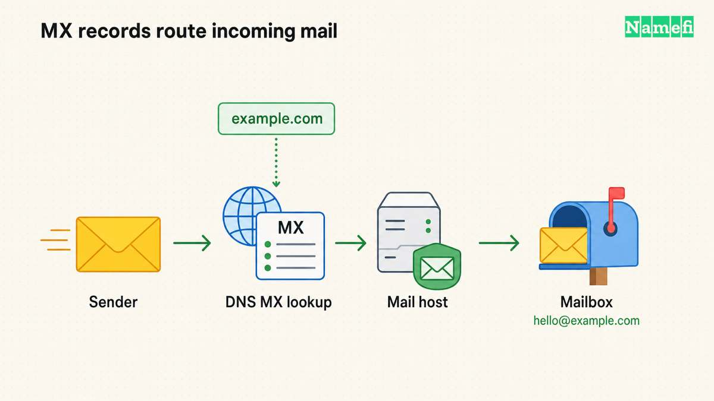
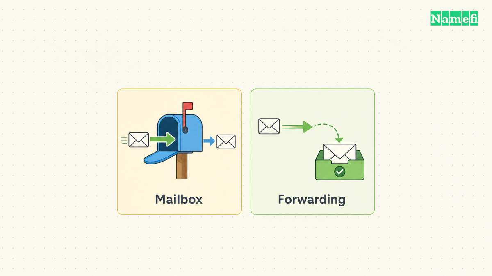
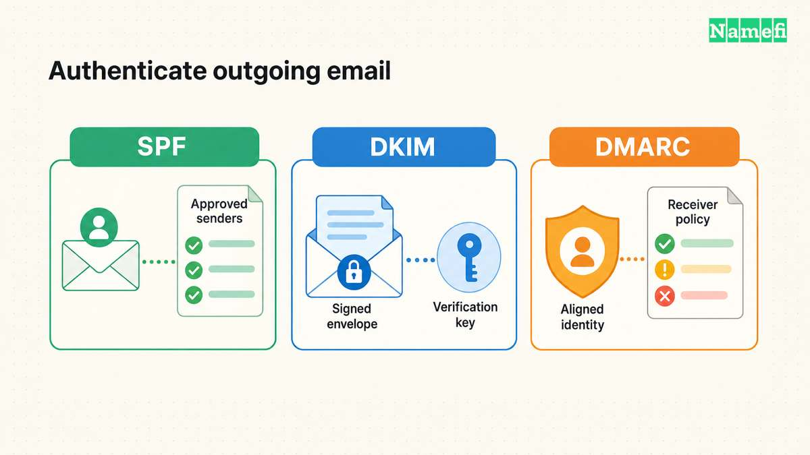

An email domain is the domain after the `@` in an email address. In the hypothetical address `hello@example.com`, the domain is `example.com`. A usable business address also needs an email service and the correct domain configuration. Buying a domain alone does not create a working mailbox.

For a concrete hosted-mail route, start with [Google Workspace's MX setup instructions](https://support.google.com/a/answer/16004259?hl=en). The instructions connect an existing domain to Google's receiving service. Other providers require their own settings. [Google explains the receiving-mail configuration](#google-defines-the-receiving-mail-setup).

The first decision concerns what the address must do: receive mail in a separate inbox, forward incoming mail, send authenticated replies, or support a team. Decide those requirements before choosing a service or changing DNS.

## A domain name and a mailbox serve different jobs

A domain gives the address a name your organization can administer. A mailbox service stores messages and supplies the supported interfaces for reading and sending. A DNS configuration tells other mail systems where to deliver incoming messages.

Google's setup guide requires an MX record and Gmail activation in the administrative console. These are distinct parts of its setup process. Adding an MX record does not replace the provider's account configuration. [The receiving-mail instructions show both steps](#google-defines-the-receiving-mail-setup).

If your organization already uses the domain for a website, inventory the existing DNS records first. As operational advice, preserve the website records while adding the email records your chosen provider requires. Avoid replacing the entire zone merely because a setup wizard asks for DNS access.

The [domain and hosting guide](/en/blog/domain-vs-hosting/) explains the website boundary. A company can choose different services for registration, authoritative DNS, website hosting, and email. Confirm each account separately before assigning work.

## The address plan should describe people and responsibilities

Write a small address plan before buying mail licenses. Identify who needs a personal inbox, which public functions need a shared address, and who should receive mail after a colleague leaves. The plan is editorial administrative advice, rather than a claim about one provider's licensing model.

For a hypothetical small company, the plan might distinguish a named employee from a public support function. `alex@example.com` identifies one person's work address. `support@example.com` identifies an organizational responsibility. The organization should decide who may read, send, and administer each address.

Ask the provider how the required functions work. A shared inbox, group, alias, and forwarding rule can have different access and reply behavior. Verify the exact product feature and plan before treating the terms as interchangeable.

Also decide who controls recovery. Keep a documented domain account owner and a separate email-service administrator where the organization requires separation. Avoid a recovery arrangement that depends entirely on the service currently failing.

## Forwarding and sending require separate decisions

Forwarding can route incoming messages to another inbox. A business that needs replies from the custom address should verify outbound support explicitly. Do not assume that an incoming forwarding rule supplies authenticated sending from the same domain.

Ask four practical questions: Where will messages live? Which interface will staff use? Which address will recipients see in replies? Which service authenticates outgoing messages? Obtain answers from the provider's current product documentation.

A full hosted-mail service can be appropriate when the organization needs separate inboxes and an established sending workflow. Forwarding can fit a narrower receiving task. Those are editorial starting points. The correct choice depends on the provider's actual features and the organization's requirements.

If the domain already receives important messages, plan migration before changing MX records. Inventory existing mailboxes and aliases, decide how to preserve stored mail, and test the new service. The [custom-domain email setup guide](/en/blog/set-up-email-with-your-own-domain/) covers the operational sequence in more detail.

## DNS separates incoming delivery from outgoing authentication

MX records identify the receiving service. Use the values supplied for your actual provider and setup. Google currently documents `smtp.google.com` for its single-record setup and states that supported legacy Google values can remain when mail works. [Google documents those alternatives](#google-defines-the-receiving-mail-setup).

SPF identifies authorized sending infrastructure through a DNS TXT record. Google advises administrators to identify all organizational email senders before building the record. Include legitimate business systems such as invoicing or customer-support services when the provider's instructions require them. [Google's SPF guide explains the sender inventory](#google-explains-the-sender-inventory).

DKIM uses a private signing key and a public key published in DNS. The receiving service uses the public key to verify a message signature. Keep private keys in the authorized mail service, never in a public DNS record. [Google explains the DKIM key roles](#google-explains-dkim-key-roles).

DMARC connects domain authentication with the visible author domain and published policy. Treat DMARC deployment as a separate configuration task after identifying legitimate senders. The current standard warns about forwarding and mailing-list interoperability under restrictive policy. [RFC 9989 explains the deployment boundary](#rfc-9989-explains-dmarc-interoperability).

As practical advice, begin with observation and review real message flows. Avoid copying an old percentage-based enforcement recipe. RFC 9989 removed the `pct` tag from the current specification. A general business address can participate in indirect mail flows that need careful assessment.

## A business address needs a complete acceptance test

Test the address from an external mailbox. Confirm that the intended person or shared inbox receives the message. Reply through the intended business workflow and confirm that the external recipient sees the correct sender address.

Inspect the received message's authentication results through the mailbox provider's supported interface. Confirm that the legitimate sending service signs and authenticates messages as intended. A published DNS record alone does not demonstrate that the sending workflow uses the record correctly.

Repeat the test for the important functions in the address plan. Include shared addresses, website forms, invoices, and any forwarding path your business relies on. Preserve a simple checklist without storing message contents in a public document.

Before announcing the address, confirm domain renewal, administrator access, and the migration plan for old mail. A professional address depends on reliable administration as well as a suitable domain name. Your next action is to write the address plan, select the matching service, and follow that provider's official setup route.

Example names use [reserved documentation domains](#rfc-2606-reserves-example-domain-names).

## Sources and further reading

### Google defines the receiving mail setup

[Google Workspace Help: MX records](https://support.google.com/a/answer/16004259?hl=en#:~:text=Step%201%3A%20Add%20Google%27s%20MX%20record%20to%20your%20domain). Checked 2026-10-30.

### Google explains the sender inventory

[Google Workspace Help: SPF](https://support.google.com/a/answer/33786?hl=en#:~:text=Step%201%3A%20Identify%20all%20your%20email%20senders). Checked 2026-10-30.

### Google explains DKIM key roles

[Google Workspace Help: DKIM](https://support.google.com/a/answer/174124?hl=en#:~:text=How%20does%20DKIM%20work%3F). Checked 2026-10-30.

### RFC 9989 explains DMARC interoperability

[RFC 9989: DMARC](https://www.rfc-editor.org/rfc/rfc9989.html#section-7.4). Checked 2026-10-30.

### RFC 2606 reserves example domain names

[RFC 2606: Reserved Example Domains](https://www.rfc-editor.org/rfc/rfc2606.html#section-3). Checked 2026-10-30.
