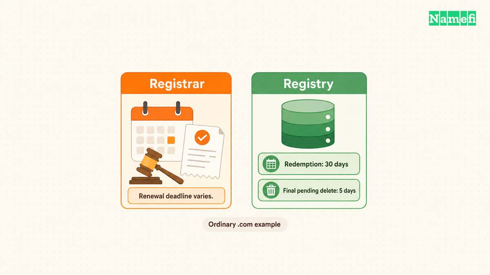

Contact the current registrar immediately when a domain expires. The domain may still qualify for renewal or restoration, but the available process depends on the registration status and registrar terms. ICANN states that renewal options and fees vary by registrar. [ICANN explains expired-domain recovery](#icann-explains-renewal-and-restoration).

Do not wait for a public release date before trying to recover your own domain. Check the registrar account, confirm the exact domain, and ask which recovery action remains available today.

## The registrar account supplies the first actionable answer

Sign in through the registrar’s known website rather than an unsolicited payment link. Check the domain’s status, renewal controls, payment history, and account notices. Save any relevant receipt or failed-payment notice.

If the registrar is unknown, use [ICANN Lookup](https://lookup.icann.org/en/lookup). Google’s official instructions identify the registrar information field and explain how a reseller can appear in the registration response. [Google documents that process](#google-explains-how-to-find-the-registrar).

As practical guidance, ask support these questions together:

1. Can the account renew this domain now?
2. Does recovery require restoration instead of ordinary renewal?
3. What total charge applies in the displayed currency?
4. What exact deadline and timezone apply?
5. Has a sale or deletion changed the account’s recovery options?

Keep the support response. A general article cannot establish the account-specific deadline. A date without a timezone can also create an avoidable misunderstanding.

If the account shows a successful renewal but the site remains unavailable, preserve the receipt and ask the registrar to confirm the registry action. ICANN provides a complaint route for certain renewal problems. [ICANN discusses renewal complaints](#icann-explains-renewal-and-restoration).

## Renewal and restoration describe different stages

Ordinary renewal extends an existing registration through the registrar’s renewal process. Restoration concerns a deleted registration that remains eligible for recovery. ICANN’s guidance says that a domain in the Redemption Grace Period must return through the current registrar before a transfer. [ICANN explains the restoration boundary](#icann-explains-redemption-before-transfer).

That distinction matters when a cheaper registrar advertises a transfer. A transfer checkout does not replace the current registrar’s restoration process. Resolve the current status before planning a provider change.

| Current situation | Useful next action |
| --- | --- |
| Account offers renewal | Confirm the domain and complete the registrar’s renewal process |
| Registrar requires restoration | Request the restoration terms and total charge |
| Account and public data disagree | Ask support to reconcile the exact status |
| Another party controls the registration | Confirm the change and consider the available acquisition or dispute route |
| Registration appears available | Verify availability through an actual registration checkout |

The table provides a decision aid. The registrar and applicable registry rules determine the real recovery path.

## The expiration date does not create a universal release countdown

ICANN describes a 30-day Redemption Grace Period for the recovery situation covered by its guidance. [The FAQ explains redemption eligibility](#icann-explains-redemption-eligibility). That period does not establish a universal number of days between customer expiration and public release.

The registrar’s customer process and the registry’s registration status describe different parts of the lifecycle. Country-code extensions can also have their own rules. Ask about the exact extension instead of applying a generic timeline from another domain.

A changed public expiration date does not replace account evidence of a paid renewal. If the site matters to the business, request confirmation in the registrar account and preserve the renewal receipt.

Avoid adding several published grace periods together to predict the day somebody else can register the name. The [backorder and drop-catching guide](/en/blog/domain-backorders-and-drop-catching/) addresses acquisition attempts separately from owner recovery.

## Domain recovery does not automatically restore every service

As operating advice, verify the registration first and then inspect the site and email configuration. Restoring the registration is one step. The application, DNS zone, and mail service may need separate checks.

Preserve the previous DNS records if available. Compare nameservers and important records with the known working configuration. Do not replace the full zone with a default template simply because the homepage fails.

Test the website through the intended hostnames. Check incoming email and the outgoing provider’s configuration. Review any service that uses domain ownership verification. Record each test outcome rather than assuming that one working page proves complete recovery.

The [DNS record guide](/en/blog/dns-record-types-guide/) can help separate website routing from email dependencies. The [free HTTPS guide](/en/blog/free-ssl-certificate/) explains the certificate workflow if HTTPS also needs repair.

## Prevention needs a reachable contact and a working payment method

ICANN recommends keeping contact and payment information current and tracking expiration dates. The guidance also discusses auto-renewal and renewal reminders. [ICANN describes those precautions](#icann-explains-renewal-and-restoration).

As practical advice, assign a responsible owner for each important domain. Maintain an independent expiration reminder and document the registrar account. Check that the account recovery address remains accessible if the domain’s email stops working.

Review auto-renewal status after a card change, transfer, or account handoff. A checkbox alone does not confirm that a later payment succeeded. Verify the renewal after the registrar processes the charge.

If the domain cannot return through ordinary recovery, separate the next decision from the urgent troubleshooting work. An acquisition offer, backup domain, or dispute process needs its own evidence and budget. The immediate goal is an accurate registrar answer about the current registration.

## Sources and further reading

### ICANN explains renewal and restoration

[ICANN explains renewal and restoration](https://www.icann.org/resources/pages/domain-name-renewal-expiration-faqs-2018-12-07-en#:~:text=Options%20and%20fees%20for%20renewing%20domain%20names%2C%20including%20expired%20ones%2C%20vary%20by%20registrar). Supporting passage: “Options and fees for renewing domain names, including expired ones, vary by registrar” Checked 2026-10-30.

### Google explains how to find the registrar

[Google explains how to find the registrar](https://docs.cloud.google.com/identity/docs/how-to/identify-host#:~:text=Use%20the%20ICANN%20Lookup%20tool%20to%20find%20your%20domain%20registrar.). Supporting passage: “Use the ICANN Lookup tool to find your domain registrar.” Checked 2026-10-30.

### ICANN explains redemption before transfer

[ICANN explains redemption before transfer](https://www.icann.org/resources/pages/domain-name-renewal-expiration-faqs-2018-12-07-en#:~:text=the%20name%20must%20be%20restored%20by%20your%20current%20registrar%20before%20it%20can%20be%20transferred). Supporting passage: “the name must be restored by your current registrar before it can be transferred” Checked 2026-10-30.

### ICANN explains redemption eligibility

[ICANN explains redemption eligibility](https://www.icann.org/resources/pages/domain-name-renewal-expiration-faqs-2018-12-07-en#:~:text=Domain%20names%20that%20are%20in%20the%2030-day%20Redemption%20Grace%20Period%20can%20be%20redeemed). Supporting passage: “Domain names that are in the 30-day Redemption Grace Period can be redeemed” Checked 2026-10-30.
