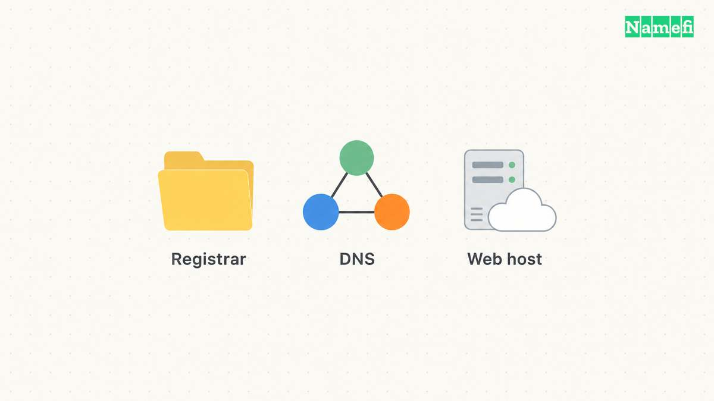

To find your domain registrar, start with [ICANN Lookup](https://lookup.icann.org/en). To find your DNS host, inspect the domain's authoritative nameservers. Those checks answer different questions. A registrar manages a registration, while an authoritative DNS service answers queries about the domain. [ICANN describes registration lookup](#icann-explains-its-registration-lookup), and [Cloudflare describes authoritative nameservers](#cloudflare-explains-authoritative-nameservers).

If your immediate task involves an MX, TXT, or website address record, locate the active DNS account before editing. A familiar registrar dashboard can contain an inactive DNS zone. Changing that inactive zone will not change answers from another provider's authoritative service.

This guide helps a domain administrator identify the correct provider and account. The examples use reserved example domains and documentation addresses. The commands illustrate a workflow and do not report a live lookup.

## The registration record identifies the registrar

Open ICANN Lookup and enter the registered domain. Remove the protocol, page path, query, and email prefix. For the hypothetical URL `https://shop.example.com/orders`, begin with `example.com`. Keep `shop.example.com` in your notes for the later website investigation.

Find the registrar entry in the result. Record the registrar name, any identifier the result displays, and the lookup time. ICANN's browser client retrieves registration data through RDAP. The tool provides a public route to registration information, rather than access to your private registrar account. [ICANN documents the client](#icann-explains-its-registration-lookup).

Use the registrar entry to identify where registration administration belongs. Then compare the result with purchase receipts, renewal notices, and your organization's account inventory. A reseller relationship can require additional account investigation. Treat your own billing records as account evidence, and treat the public lookup as registration evidence.

Do not enter account credentials into an unfamiliar website found through a search advertisement. As practical account advice, use the provider's verified website and your existing account records. Ask the organization that purchased the domain to confirm who holds administrative access.

## Authoritative nameservers identify the active DNS service

Query the domain's NS records. On a machine with nslookup, use `nslookup -type=NS example.com.`. The final dot makes the DNS name explicit. Microsoft documents the query tool and its record-type options. [The command reference explains the syntax](#microsoft-defines-the-query-tool).

Nameserver hostnames often suggest a provider. Treat the suggestion as a lead. Cloudflare supports standard and custom nameservers, so a branded hostname alone cannot establish the organization behind every service. [Cloudflare describes its nameserver options](#cloudflare-explains-authoritative-nameservers).

Confirm the provider through an account that lists the domain and its assigned nameservers. Compare those assigned names with the public answer. If the account shows different names, investigate whether the account contains an inactive zone, an incomplete migration, or the wrong domain.

Also consider subdomain delegation. A team can delegate a subdomain to separate authoritative servers. The authority for `example.com` does not automatically identify the account managing every delegated name beneath `example.com`. DNS divides authority through zones and referrals. [RFC 1034 explains delegation](#rfc-1034-explains-zone-delegation).

For a delegated application, check the name relevant to that application. Ask the DNS administrator whether a child zone exists before adding records to the parent zone. This practical check prevents a parent-zone edit from becoming an unexplained no-op.

Use [Namefi's DNS lookup](https://namefi.io/domain-tools/dns) with the domain and the NS record type to record a public resolver's nameserver answer. Compare the names with the provider and account records. This check does not identify the registrar account or independently confirm the website's origin host.

## The website address does not establish the registration provider

A website address lookup serves another purpose. An A or AAAA result identifies an address returned for the queried name. The result does not identify the registrar account.

A reverse proxy also changes the meaning of the returned address. Cloudflare states that a proxied record returns Cloudflare addresses rather than the origin address. DNS-only records expose the configured origin address instead. [Cloudflare explains proxy status](#cloudflare-separates-proxy-addresses-from-origin-addresses).

Therefore, avoid concluding that the operator of a returned network address also holds your registration or stores your website files. Record the observation precisely: “This lookup returned an address associated with a proxy.” That statement leaves the origin-hosting question open.

The [domain and hosting guide](/en/blog/domain-vs-hosting/) explains the service boundaries. The [public registration data guide](/en/blog/whois-and-rdap-public-data/) explains additional limits of provider inference.

## The intended change determines which account matters

Use the following routing table as practical administrative guidance. Confirm each provider's requirements before making a production change.

| Intended change | Account to identify first | Evidence to retain |
| --- | --- | --- |
| Renew the registration | Registrar or purchasing reseller account | Registration record and renewal receipt |
| Change the authoritative service | Registrar account and destination DNS account | Assigned nameservers and a complete zone inventory |
| Add an email verification TXT record | Active authoritative DNS account | Required owner name and exact TXT value |
| Point a website to a host | Active authoritative DNS account and hosting account | Required records and host configuration |
| Change application files | Hosting or application deployment account | Deployment project and hostname mapping |

Before changing nameservers, inventory the current zone. Include mail routing, verification records, and delegated subdomains. As editorial operational advice, arrange a rollback plan and a responsible administrator. A website-only checklist can miss email dependencies.

Use the [DNS record guide](/en/blog/dns-record-types-guide/) to classify existing records. Save a copy of the old configuration through your provider's supported export or documentation process. Keep private verification tokens in the authorized system rather than a public support ticket.

## A provider handoff needs a small evidence packet

When access remains unclear, send the internal administrator the exact domain, registrar entry, nameserver answer, lookup time, and intended change. Include the account name if your organization already knows the account. Exclude passwords, recovery codes, and payment details.

Ask the administrator to confirm control of the relevant account. Public data can identify a service boundary, but public data cannot demonstrate that a particular colleague can edit the zone. Keep that distinction explicit in the handoff.

Your next action should match the question. Use ICANN Lookup for registration, an NS query for DNS authority, and the hosting dashboard for application deployment. Once the correct account is confirmed, make the smallest authorized change and verify the exact record afterward.

Example names use [reserved documentation domains](#rfc-2606-reserves-example-domain-names).

## Sources and further reading

### ICANN explains its registration lookup

[ICANN: Information for RDAP Users](https://www.icann.org/en/contracted-parties/registry-operators/registration-data-access-protocol/information-for-rdap-users-31-08-2018-en#:~:text=ICANN%20org%20maintains%20a%20publicly%20available%20RDAP%20client). Checked 2026-10-30.

### Cloudflare explains authoritative nameservers

[Cloudflare: Nameservers](https://developers.cloudflare.com/dns/nameservers/#:~:text=Nameservers%20are%20DNS%20servers). Checked 2026-10-30.

### Microsoft defines the query tool

[Microsoft Learn: nslookup](https://learn.microsoft.com/en-us/windows-server/administration/windows-commands/nslookup#remarks). Checked 2026-10-30.

### RFC 1034 explains zone delegation

[RFC 1034: Domain Names — Concepts and Facilities](https://www.rfc-editor.org/rfc/rfc1034.html#section-4.2). Checked 2026-10-30.

### Cloudflare separates proxy addresses from origin addresses

[Cloudflare: Proxy status](https://developers.cloudflare.com/dns/proxy-status/#example). Checked 2026-10-30.

### RFC 2606 reserves example domain names

[RFC 2606: Reserved Example Domains](https://www.rfc-editor.org/rfc/rfc2606.html#section-3). Checked 2026-10-30.
