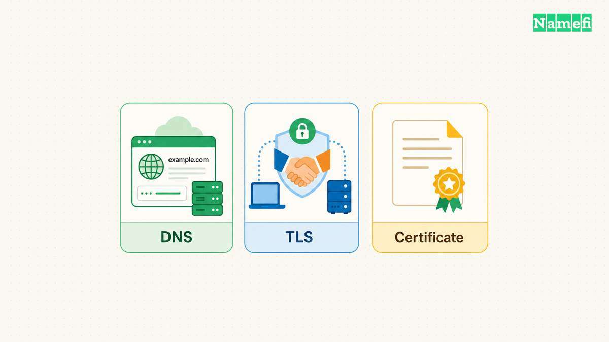
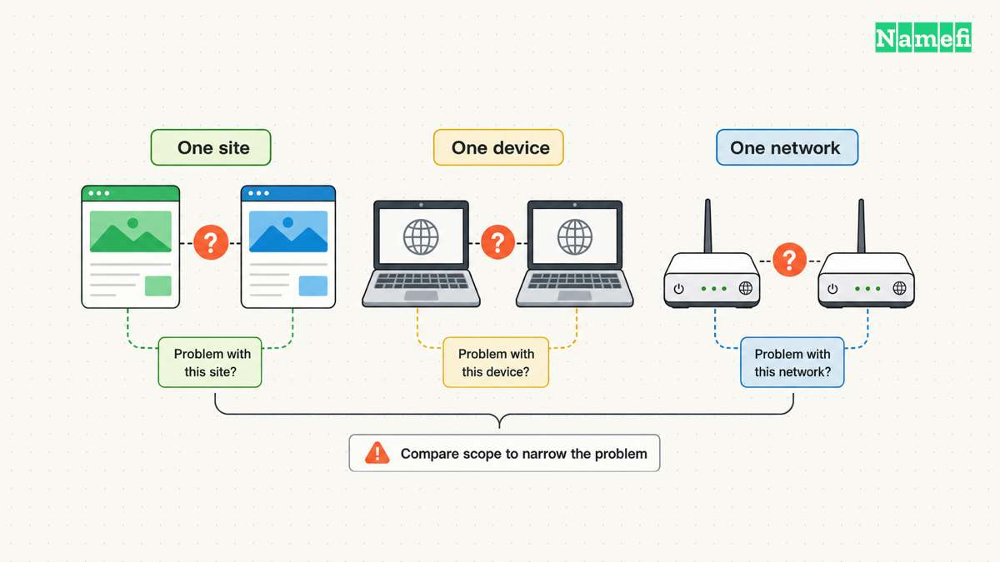
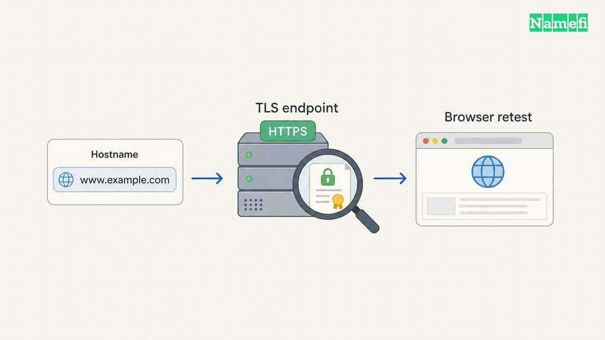

Chrome can show “This site can't provide a secure connection” when a secure connection fails. The accompanying code matters. Google separates [secure-connection errors from certificate and DNS resolution errors](#google-distinguishes-the-error-categories).

Start by recording the complete URL and the exact code. Then determine whether the failure follows one website, one device, or one network. Those observations help choose who can make the relevant correction: the visitor, a network administrator, or the website operator.

This guide provides that diagnostic sequence. The existing [certificate installation guide](/en/blog/how-to-install-an-ssl-certificate/) covers deploying HTTPS after the operator identifies a server configuration requirement.

## The exact Chrome code determines the first check



A short heading does not identify one underlying failure. Chromium defines `ERR_SSL_PROTOCOL_ERROR` as a protocol error. Chromium separately defines `ERR_SSL_VERSION_OR_CIPHER_MISMATCH` for incompatible protocol versions or cipher suites. The [network error definitions](#chromium-defines-distinct-network-errors) preserve that distinction.

Use the displayed code to choose an initial investigation:

| Displayed code or message | Initial check |
| --- | --- |
| `ERR_SSL_PROTOCOL_ERROR` | Identify the affected hostname and the endpoint serving HTTPS |
| `ERR_SSL_VERSION_OR_CIPHER_MISMATCH` | Ask the operator to check supported TLS settings |
| `NET::ERR_CERT_DATE_INVALID` | Check the device clock and the certificate validity period |
| `NET::ERR_CERT_AUTHORITY_INVALID` | Investigate the certificate trust path and any managed HTTPS inspection |
| `ERR_NAME_NOT_RESOLVED` | Investigate the hostname and DNS resolution |

Google documents [clock, trust, network, and secure connection cases separately](#google-distinguishes-the-error-categories). Treat the table as a way to select checks. The table does not establish the root cause of an individual incident.

Record whether the address includes `www`, another subdomain, or an explicit port. Two names can reach different configurations. An [HTTPS](/en/blog/what-is-https/) investigation needs the actual failing address throughout the comparison.

Preserve the error before changing settings. Note the observation time in UTC and any recent hosting, DNS, proxy, or certificate change. The sequence gives the next administrator a reproducible starting point.

## Visitors can compare failures before changing system settings



First, confirm the address and reload the page. Check whether other websites open. Google recommends [comparing the scope of the failure and checking the connection](#google-provides-a-bounded-browser-checklist).

Update and restart Chrome through its normal controls. Then try an Incognito window. If the page works there, investigate extensions and the relevant browsing data. Google places these steps in its [connection troubleshooting checklist](#google-provides-a-bounded-browser-checklist).

Change one relevant setting at a time and retry the original address. A changed result should remain attributable to a particular comparison. Clearing unrelated data repeatedly removes useful context without identifying the failing endpoint.

If permitted, compare the same address on another device or another network. Record the results rather than treating either comparison as proof. A website can behave differently across network paths, while a device can have its own browser settings.

On a managed work network, give the administrator the exact certificate or connection error. Google identifies missing proxy certificates as one cause of `NET::ERR_CERT_AUTHORITY_INVALID` and advises [contacting the administrator](#google-distinguishes-the-error-categories). Use the organization's certificate process.

If the error reports an incorrect date, check the device clock. If the problem concerns a website certificate, the operator may need to inspect or [renew the certificate](/en/blog/renew-ssl-certificate/). Buying another certificate before identifying the failing hostname leaves that diagnosis unfinished.

Keep certificate checks enabled. Avoid deleting the entire Hosts file or lowering security settings as a general repair procedure. When an entry or policy appears relevant, give the responsible administrator the specific evidence and preserve unrelated configuration.

Report a persistent error that persists for one site to the website owner, as [Google advises](#google-distinguishes-the-error-categories).

## Operators should verify the named HTTPS endpoint



Confirm which service terminates TLS for the failing hostname. Check the hosting platform, load balancer, or reverse proxy that actually receives the connection. The [DNS record guide](/en/blog/dns-record-types-guide/) explains why an address record and the application behind that address require separate verification.

For a server that you administer, inspect the configured TLS listener and certificate chain. Nginx's documentation shows the [HTTPS listener, certificate files, and chain requirements](#nginx-documents-the-endpoint-configuration). A domain registration alone does not configure those components.

A terminal comparison can preserve additional evidence. Replace the example hostname with the authorized endpoint:

```text
curl -Iv https://www.example.com/
```

The `-I` option requests HTTP headers with HEAD. The `-v` option provides diagnostic output. Read the TLS result and application response separately. The command requests headers, so retest the actual page in Chrome after the correction. The [curl option reference](#curl-documents-the-diagnostic-options) explains these controls.

curl verifies certificates by default. Preserve that behavior during the comparison. curl's documentation [advises against skipping verification in production](#curl-explains-certificate-verification). curl builds can use different certificate stores, so record the tool version alongside the result.

For an OpenSSL installation that supports the following options, an operator can also test the named TLS endpoint:

```text
openssl s_client -connect www.example.com:443 -servername www.example.com -verify_hostname www.example.com -verify_return_error </dev/null
```

The `-servername` option sends the SNI name. Hostname verification checks the certificate name. `-verify_return_error` stops on certificate verification errors. OpenSSL documents the [connection and verification options](#openssl-documents-the-named-endpoint-check).

Use the actual hostname rather than substituting only an IP address. Nginx explains how [SNI affects certificate selection](#nginx-documents-the-endpoint-configuration). Keep the browser address and the hostname in the command consistent.

Compare the observations with the relevant server or platform logs. Correct the identified listener, certificate chain, hostname, or supported TLS configuration. Retest the original browser URL after the change, including every affected hostname.

Close the incident with the failing code, UTC observation times, relevant configuration change, and successful browser retest. Remove credentials and private hostnames before sharing diagnostic output outside the approved support channel.

## These sources support the diagnostic sequence

The retrieval dates below use America/Los_Angeles.

### Google distinguishes the error categories

Google Chrome Help — [Get help with common error messages](https://support.google.com/chrome/answer/95669?hl=en#:~:text=Secure%20connection%20errors), fetched 2026-10-29. The page separates certificate, clock, secure connection, and weak security errors. Its secure connection section contains the message quoted in the introduction.

### Chromium defines distinct network errors

Chromium — [Network error definitions](https://chromium.googlesource.com/chromium/src/+/main/net/base/net_error_list.h#:~:text=NET_ERROR%28SSL_PROTOCOL_ERROR), fetched 2026-10-29. The definitions distinguish protocol errors, protocol or cipher mismatch, and DNS resolution errors.

### Google provides a bounded browser checklist

Google Chrome Help — [Fix connection and loading errors](https://support.google.com/chrome/answer/6098869?hl=en#:~:text=Step%203%3A%20Update%20and%20restart%20Chrome), fetched 2026-10-29. The checklist covers the address, connection, browser update, restart, Incognito mode, extensions, and browsing data.

### curl documents the diagnostic options

curl — [HEAD](https://curl.se/docs/manpage.html#-I) and [verbose output](https://curl.se/docs/manpage.html#-v), fetched 2026-10-29. These sections define the two options used in the example.

### curl explains certificate verification

curl — [TLS certificate verification](https://curl.se/docs/sslcerts.html#verification), fetched 2026-10-29. The page describes default verification, certificate stores, and the risks of skipping verification.

### OpenSSL documents the named endpoint check

OpenSSL 3.5 — [s_client options](https://docs.openssl.org/3.5/man1/openssl-s_client/#options) and [verification options](https://docs.openssl.org/3.5/man1/openssl-verification-options/#verification-options), fetched 2026-10-29. The relevant options are `-connect`, `-servername`, `-verify_hostname`, and `-verify_return_error`.

### Nginx documents the endpoint configuration

Nginx — [HTTPS configuration](https://nginx.org/en/docs/http/configuring_https_servers.html), [certificate chains](https://nginx.org/en/docs/http/configuring_https_servers.html#chains), and [SNI](https://nginx.org/en/docs/http/configuring_https_servers.html#sni), fetched 2026-10-29. The certificate-chain and SNI sections explain chain delivery and certificate selection for named servers.
