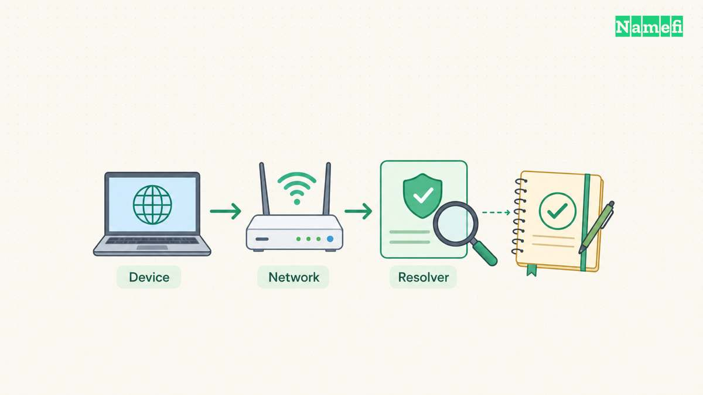
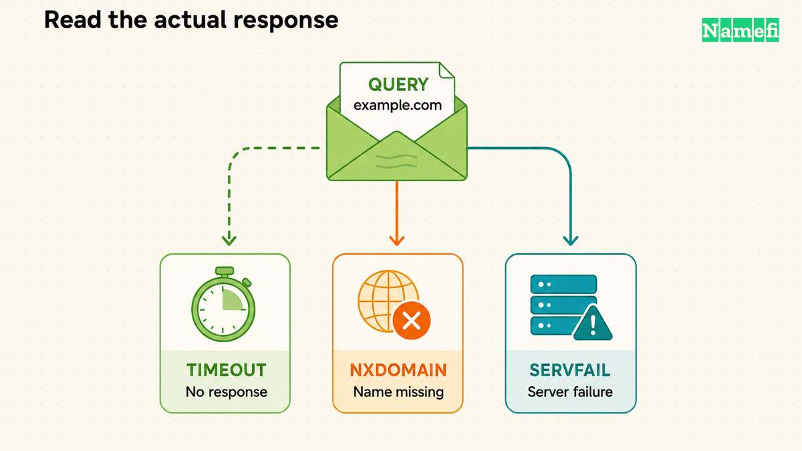
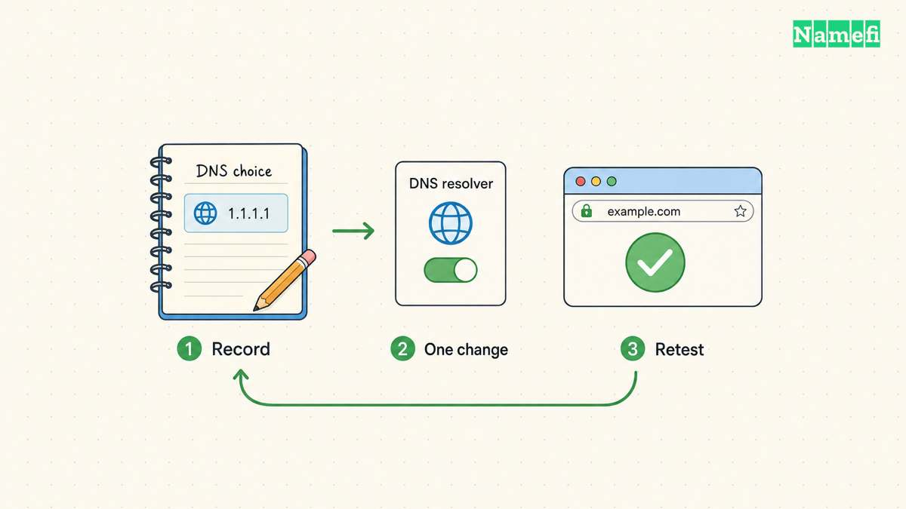

A “DNS server not responding” message means the device did not complete a useful DNS exchange. The message alone cannot identify the failed component. Start by checking the configured resolver and comparing the same query across controlled conditions. Microsoft separates client configuration, server configuration, and intermediate network problems. [The Windows troubleshooting guide describes those boundaries](#microsoft-separates-client-server-and-network-failures).

This guide addresses Windows DNS diagnosis. A timeout differs from a reply that says a name does not exist. Keep the exact error and command output before changing settings. The examples below illustrate syntax. Replace documentation addresses with the approved server addresses for your network.

## The first comparison establishes the scope

Record the affected hostname, application, and UTC time. Then compare another public website on the same device. Check another device on the same network when practical. Finally, compare the affected device on another authorized connection.

Treat every comparison as a way to narrow the investigation. If one website fails while other websites work, avoid replacing the entire network configuration immediately. If several devices fail on one network, collect evidence for the network administrator before changing every device.

On a work device, retain the corporate VPN state in your notes. Internal names can require organization-specific DNS. Microsoft documents a case where an unreachable primary server causes nslookup to fail while the Windows DNS client can still use other configured servers. [The client guide explains this important tool difference](#microsoft-separates-client-server-and-network-failures).

As practical guidance, change only one condition per comparison. A different network, disconnected VPN, and changed resolver produce too many variables when combined in one test.

## The active adapter reveals the configured DNS servers

Open a Windows terminal and run `ipconfig /all`. Find the adapter that carries the affected connection. Record the DNS servers, connection-specific suffix, and default gateway. Microsoft states that `/all` shows full adapter configuration. [The ipconfig reference defines the output](#microsoft-defines-adapter-and-cache-inspection).

Do not assume that every listed adapter participates in the failed request. A disconnected adapter and an active VPN adapter can appear together. Use the connection context to select the relevant configuration.

Next, query the exact public name through the default server with `nslookup -type=A example.com.`. Use the real affected hostname for your investigation. Keep the fully qualified spelling and record type identical across comparisons.

The `Server` and `Address` lines identify the server selected by nslookup. Those lines describe the tool's query target. They do not certify that the DNS service works or that a browser uses the same resolution path. [Microsoft explains nslookup's default-server behavior](#microsoft-distinguishes-nslookup-results).

## Response categories lead to different investigations

A successful answer, an empty result, a missing name, and a timeout require different next steps. Microsoft documents separate nslookup messages for these conditions. [The command reference lists the result categories](#microsoft-distinguishes-nslookup-results).

| Observation | Meaning for this test | Useful next check |
| --- | --- | --- |
| Address records appear | The selected server answered this name and type | Retest the application |
| No records | The server lacks the requested type for a valid name | Check the required type and owner name |
| Nonexistent domain | The server reported that the queried name does not exist | Check spelling and authoritative data |
| Timed out | The tool received no timely response | Compare reachability and another approved resolver |
| Refused | The server declined the request | Check query permission and intended server role |

A timeout does not prove that a registration expired. An absent AAAA record does not prove that the A record is missing. Keep the result tied to the exact name, type, server, and test time.

For a missing-name reply, continue with the [NXDOMAIN guide](/en/blog/fix-dns-probe-finished-nxdomain/). For record interpretation, use the [DNS record guide](/en/blog/dns-record-types-guide/).

## An explicit server separates configuration from server reachability

Run the same query against the configured server explicitly: `nslookup -type=A example.com. 192.0.2.53`. The address is hypothetical. Microsoft places the DNS server in the second argument. [The command reference defines that order](#microsoft-distinguishes-nslookup-results).

If network policy allows a second resolver, repeat the query against that approved address. Compare the complete output. A second server's success helps narrow the issue, but the result does not establish why the original server failed.

For private corporate names, ask the administrator which internal resolver should answer. A public resolver cannot serve as a meaningful replacement test for an internal-only name. Preserve the private hostname within authorized support channels.

Microsoft documents outbound firewall rules as one possible cause of DNS timeouts. The documented scenario establishes a diagnostic possibility, not a reason to disable protection. [The client troubleshooting guide shows the blocked-query scenario](#microsoft-separates-client-server-and-network-failures).

Ask the administrator to inspect the applicable rule or packet evidence. Avoid broad inbound rules, unrestricted outbound changes, or disabling a firewall. A narrowly identified rule change belongs to the administrator who owns the network policy.

Prepare a controlled local test with [Namefi's DNS command generator](https://namefi.io/domain-tools/dns-commands). Keep the hostname and record type fixed, choose the system resolver or a listed public resolver, and run the generated command on the affected device. The generator itself makes no DNS request.

## A cache change needs evidence and a retest

Use `ipconfig /displaydns` when the local cache matters. Microsoft states that the output includes cached records and entries preloaded from the Hosts file. The `/flushdns` option resets the DNS client cache. [The ipconfig documentation defines both operations](#microsoft-defines-adapter-and-cache-inspection).

As practical troubleshooting advice, save relevant cache observations before clearing the cache. Clear the cache only when stale local information fits the evidence. A cache reset cannot substitute for a reply from an unreachable DNS server.

After an authorized correction, repeat the exact DNS query and the original application action. Check the internal services required for ordinary work. Record the old setting, changed setting, time, and result. Revert a trial resolver change if the trial does not resolve the observed problem.

If the problem persists, provide support with the exact hostname, adapter DNS addresses, VPN state, command output, and comparison results. A focused evidence packet gives the administrator a reproducible question instead of a generic request to “fix DNS.”

Example names use [reserved documentation domains](#rfc-2606-reserves-example-domain-names). [Example IPv4 addresses use the documentation range](#rfc-5737-reserves-example-ipv4-addresses).

## Sources and further reading

### Microsoft separates client server and network failures

[Microsoft Learn: DNS client resolution issues](https://learn.microsoft.com/en-us/troubleshoot/windows-client/networking/troubleshoot-dns-client-resolution-issues#troubleshoot-dns-client-name-resolution-issues). Checked 2026-10-30.

### Microsoft defines adapter and cache inspection

[Microsoft Learn: ipconfig](https://learn.microsoft.com/en-us/windows-server/administration/windows-commands/ipconfig#parameters). Checked 2026-10-30.

### Microsoft distinguishes nslookup results

[Microsoft Learn: nslookup](https://learn.microsoft.com/en-us/windows-server/administration/windows-commands/nslookup#remarks). Checked 2026-10-30.

### RFC 2606 reserves example domain names

[RFC 2606: Reserved Example Domains](https://www.rfc-editor.org/rfc/rfc2606.html#section-3). Checked 2026-10-30.

### RFC 5737 reserves example IPv4 addresses

[RFC 5737: Documentation IPv4 Addresses](https://www.rfc-editor.org/rfc/rfc5737.html#section-3). Checked 2026-10-30.
