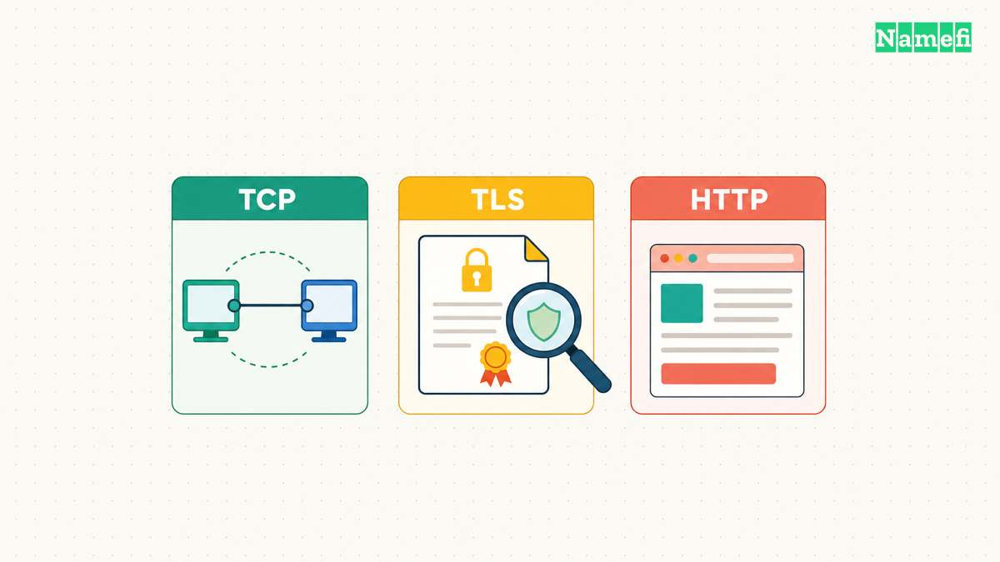
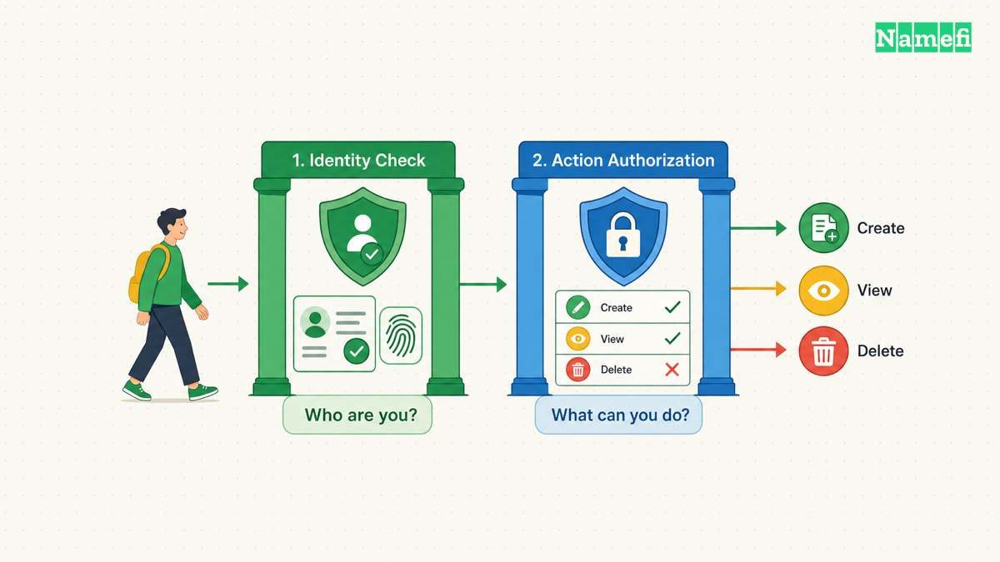
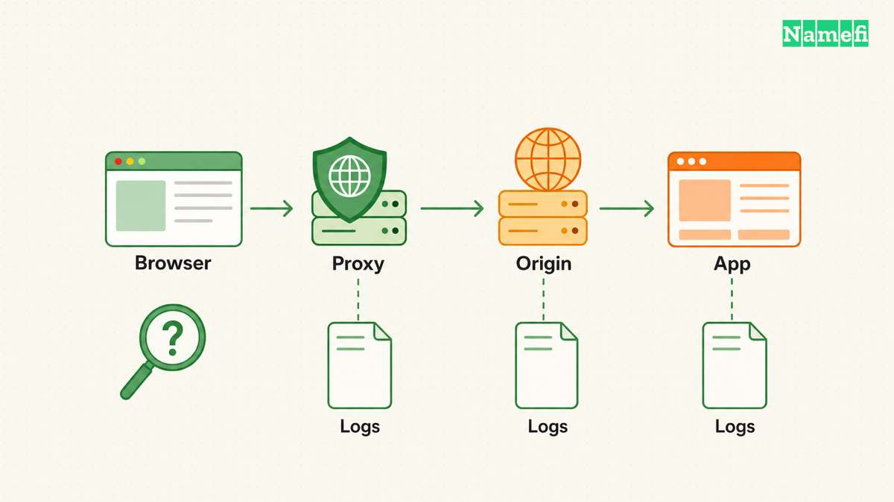
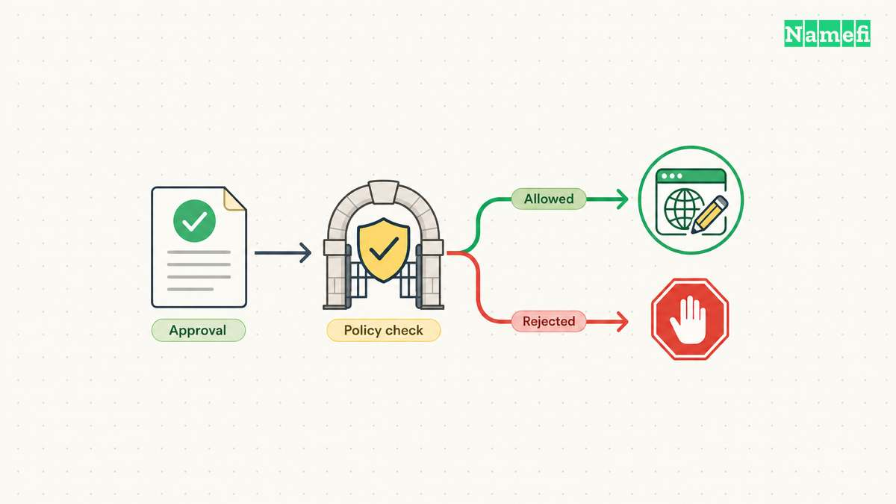

**A 403 Forbidden response means the server understood the request but refuses to fulfill the request.** The refusal can concern permissions or another restriction. A 403 over HTTPS is an HTTP response, rather than the browser's certificate-verification error. [RFC 9110 defines 403 and its limits](#the-http-standard-defines-a-forbidden-response).

First identify your role. A visitor should confirm the address, intended account, and permission to access the resource. A site operator should identify which application or security layer returned the response before changing configuration.

## HTTPS and application permission answer different questions

HTTPS requires protected communication and verification of the expected service identity. HTTP then carries requests and responses through the connection. [The HTTPS specification describes that protection](#the-https-standard-defines-connection-protection).

A successfully verified HTTPS connection can therefore carry a refusal. Installing another certificate does not grant an account permission to use a private application. Changing a DNS resolver does not directly change an application's authorization policy.

Keep related status codes distinct:

| Result | Meaning to investigate |
| --- | --- |
| 401 Unauthorized | The request lacks valid authentication credentials for the target resource |
| 403 Forbidden | The server refuses to fulfill the understood request |
| 404 Not Found | The server did not find a current representation or will not disclose one |
| Certificate warning | The client could not complete the expected connection verification |

RFC 9110 defines the three HTTP statuses. The standard also permits a server to use 404 to hide a forbidden resource's existence. [The status definitions explain these boundaries](#the-http-standard-distinguishes-authentication-and-resource-errors). Do not infer every account or resource detail from one status code.



## Visitors should check the intended access path first

Use the official route to the service. Check the complete hostname and page path, especially if the error came from an old bookmark or a copied link. Then confirm the account that should have access.

Follow this practical sequence:

1. Open the service through its known sign-in page.
2. Confirm that the selected account belongs to the intended organization.
3. Check whether another resource in the same application works.
4. Record the exact URL, error text, and UTC time.
5. Contact the operator if the resource should be available to that account.

A repeated request with the same credentials may not change the result. RFC 9110 specifically says a client should not automatically repeat a 403 request with the same credentials. The standard also notes that a refusal can have reasons unrelated to credentials. [The 403 definition states both points](#the-http-standard-defines-a-forbidden-response).

Do not treat deleting every cookie or resetting the entire network as a universal fix. Such changes can remove useful context without establishing why the service refused access. Use the operator's documented sign-in or session procedure when evidence points to a session problem.

If the resource is private and the account lacks access, request access through the authorized channel. A deliberate access policy needs an authorization decision, rather than a connection workaround.



## Operators need to locate the layer that returned the refusal

Cloudflare's support documentation lists several possible sources of 403 responses. Origin-side permission rules, ModSecurity rules, and IP deny rules can return a refusal. Cloudflare's own WAF and other security features can also return 403. [Cloudflare documents those different sources](#cloudflare-describes-origin-and-security-layer-refusals).

Branding can supply a clue, but branding does not establish the full cause. Cloudflare also documents some unstyled 403 responses generated early in its own infrastructure. One example concerns a mismatch between the requested host and TLS SNI. [The support page explains the unstyled case](#cloudflare-describes-origin-and-security-layer-refusals).

Compare the response with the deployment's logs and security events. As investigation advice, preserve any request identifier that the response supplies. Match the identifier or timestamp to the intended hostname, method, path, and account context.

| Evidence | Focused next check |
| --- | --- |
| Application authorization log records a denial | Expected account role and resource policy |
| Origin access rule rejects the request | The precise file, directory, route, or source restriction |
| Security event identifies a matching rule | The rule's intended condition and the matched request |
| Refusal begins after a proxy or host change | Hostname routing and the provider's documented configuration |

The table provides an investigation order, rather than proof of a cause. Verify the matching event before editing a rule. Keep the intended access boundary explicit: public page, signed-in user, organization member, or administrator.



## A command-line request needs the same context as the browser

With curl available, inspect an illustrative response:

```bash
curl -i https://www.example.com/private
```

The hostname uses a [reserved documentation domain](#the-ietf-reserves-example-domains). Replace the hostname and path with the intended resource. curl's `-i` option includes response headers alongside response data. [The curl manual defines the option](#curl-documents-response-header-output).

This command does not automatically reproduce the browser's signed-in session. An anonymous command-line request and an authenticated browser request can legitimately produce different results. Record the authentication context when comparing the observations.

Use the real hostname in the URL. Cloudflare documents a host/SNI mismatch as one possible 403 case. [The support explanation describes that mismatch](#cloudflare-describes-origin-and-security-layer-refusals). An IP-only test can therefore investigate a different request path from the failing browser request.

Keep certificate verification enabled. curl verifies certificates and the requested server name by default. [The verification guide explains the default](#curl-documents-certificate-verification). A test that bypasses verification does not reproduce the intended authenticated connection.

## A correction should preserve the intended access boundary

For a confirmed configuration error, make the smallest documented change that restores the intended access. Reproduce the failing request after the change. Also check that an account without permission still cannot reach the private resource.

Do not disable an entire WAF, broaden every filesystem permission, or expose a private origin merely to make the error disappear. A successful correction restores the intended user journey while keeping the intended restrictions.

A useful escalation includes the hostname, path, method, UTC time, response status, request identifier when present, and expected account permission. Remove credentials and session tokens before sharing the report. If the browser instead shows a certificate error, use the [HTTPS guide](/en/blog/what-is-https/) to investigate the connection layer.



## Sources and further reading

### The HTTP standard defines a forbidden response

[IETF RFC 9110, section 15.5.4](https://www.rfc-editor.org/rfc/rfc9110.html#section-15.5.4). Fetched 2026-10-30.

### The HTTPS standard defines connection protection

[IETF RFC 9110, sections 4.2.2 and 4.3.4](https://www.rfc-editor.org/rfc/rfc9110.html#section-4.2.2). Fetched 2026-10-30.

### The HTTP standard distinguishes authentication and resource errors

[IETF RFC 9110, sections 15.5.2, 15.5.4, and 15.5.5](https://www.rfc-editor.org/rfc/rfc9110.html#section-15.5.2). Fetched 2026-10-30.

### Cloudflare describes origin and security layer refusals

[Cloudflare Support, Error 403, common and Cloudflare-specific cases](https://developers.cloudflare.com/support/troubleshooting/http-status-codes/4xx-client-error/error-403/#common-use-cases). Fetched 2026-10-30.

### The IETF reserves example domains

[IETF RFC 2606, section 3](https://www.rfc-editor.org/rfc/rfc2606.html#section-3). Fetched 2026-10-30.

### curl documents response header output

[curl manual, -i / --show-headers](https://curl.se/docs/manpage.html#:~:text=Show%20response%20headers%20in%20the%20output). Fetched 2026-10-30.

### curl documents certificate verification

[curl, SSL certificate verification](https://curl.se/docs/sslcerts.html#:~:text=curl%20does%20certificate%20verification%20by%20default). Fetched 2026-10-30.
