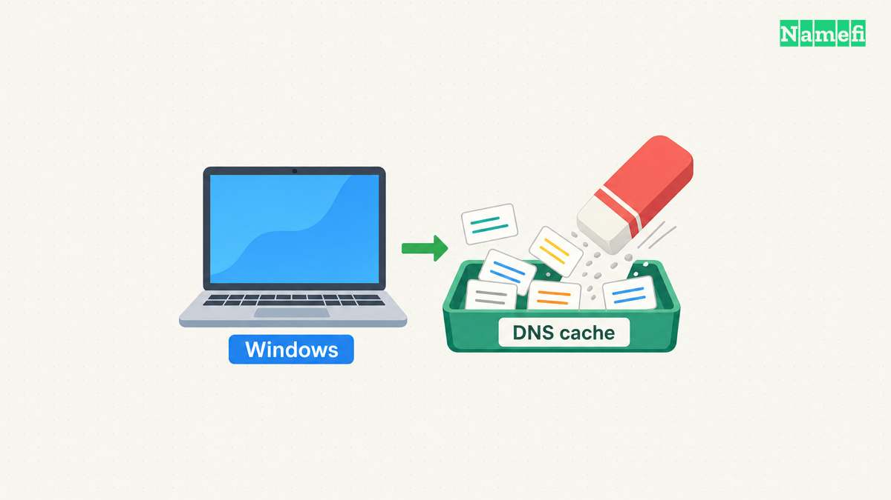

**Run `ipconfig /flushdns` in an administrator Command Prompt to clear the Windows DNS client resolver cache.** Microsoft documents the command for Windows 10 and Windows 11. The command removes dynamically added cache entries, including cached negative answers. [Microsoft defines the cache operation](#microsoft-defines-the-windows-cache-commands).

Use the command when a Windows device might retain an outdated DNS answer. A successful flush confirms a local cache operation. The result does not confirm that a website works or that an upstream resolver has new information.

## Windows provides a short procedure for a local flush

On a computer that you manage, follow these steps:

1. Open Start and search for **Command Prompt**.
2. Select **Run as administrator**.
3. Approve the Windows permission prompt if your account permits the action.
4. Run the following command.

```text
ipconfig /flushdns
```

Windows normally reports that the DNS resolver cache was successfully flushed. UCSF's current Windows support procedure documents the administrator prompt and confirmation. [The support procedure covers Windows 10 and Windows 11](#ucsf-documents-the-administrator-procedure).

If Windows refuses the operation, read the exact message. A permission error needs an approved administrator account or help from the device administrator. Do not change service permissions to force a routine troubleshooting command through a managed computer.

Retry the original hostname in the application that failed. Compare the same page or service with the earlier attempt. Record whether the error disappeared, changed, or remained the same.

Stop after a successful result. Repeating a flush without new evidence makes the troubleshooting history harder to interpret. The useful outcome is a working service or a clearer diagnosis, rather than a long list of reset commands.

To prepare the command for your shell, open [Namefi's DNS command generator](https://namefi.io/domain-tools/dns-commands), choose Windows and the cache-flush task, then copy the command. The page generates text only. Run the command locally with the required administrator access and repeat the original test.



## The client cache contains successful and negative answers

DNS lets an application request records associated with a name. Windows keeps recently resolved records in its client cache, which helps the computer reuse answers. Microsoft's cache display also includes information preloaded from the local Hosts file. [Microsoft describes the cache contents](#microsoft-defines-the-windows-cache-commands).

A negative answer can matter after a new record appears. For example, imagine that an administrator creates `portal.example.com` after an earlier lookup found no such name. A local cached negative answer can outlast that publication change. DNS standards explicitly define negative-answer caching. [RFC 2308 explains its lifetime](#the-dns-standard-defines-negative-cache-lifetimes).

The example is hypothetical. A flush can remove the Windows client's dynamic cache entry, but a resolver outside the computer can still return a cached negative answer. That is why a flush sometimes completes successfully without fixing the original symptom.

To inspect the client cache before a flush, use:

```text
ipconfig /displaydns
```

Microsoft documents `/displaydns` separately from `/flushdns`. The display can help an administrator compare names and cached answers. [The command reference explains both parameters](#microsoft-defines-the-windows-cache-commands).

Treat saved cache output as potentially sensitive. As practical advice, remove internal hostnames and unrelated browsing entries before sharing output in a public support forum.

## A local flush does not publish or repair a domain record

The domain operator publishes DNS data through authoritative servers. A resolver retrieves or reuses answers for clients. These roles exist separately from the Windows cache. [RFC 1034 defines name servers, resolvers, and cached records](#the-dns-standard-separates-authority-from-resolution).

If the published address is wrong, the domain operator must correct the published record. If an upstream resolver retains an old answer, clearing the Windows cache does not directly clear that resolver. The [TTL and propagation guide](/en/blog/ttl-and-dns-propagation/) explains how cache lifetimes affect observations.

A flush also does not remove an incorrect Hosts file entry. Microsoft distinguishes entries preloaded from Hosts from dynamically added cache entries. [The client-cache documentation describes that distinction](#microsoft-defines-the-windows-cache-commands). Ask the administrator to inspect Hosts when evidence points to a local override.

Do not use a DNS flush to explain an HTTP permission error. If a browser reaches the site and displays a [403 response](/en/blog/fix-http-403/), investigate the site's access rules. The [HTTPS guide](/en/blog/what-is-https/) explains why a working connection and application permission are separate results.


## A lookup comparison identifies the next investigation

After the flush, query the intended hostname:

```text
nslookup www.example.com.
```

The hostname uses a [reserved example domain](#the-ietf-reserves-example-domains-for-documentation). Replace the example hostname before running the command. Without a second argument, `nslookup` uses its default DNS server. A second argument selects a server by name or address. [Microsoft documents the argument order](#microsoft-documents-nslookup-server-selection).

For an explicit-server comparison, use the following pattern:

```text
nslookup www.example.com. 192.0.2.53
```

The address `192.0.2.53` is a [documentation placeholder](#the-ietf-reserves-documentation-address-ranges). Replace the address with a verified resolver that the network administrator permits. Do not send private organization names to an arbitrary public resolver.

Interpret the comparison carefully:

| Observation | Useful next action |
| --- | --- |
| The application works after one flush | Record the result and end the cache investigation |
| The default resolver returns an unexpected address | Compare the intended authoritative record and resolver path |
| A permitted comparison resolver returns another answer | Investigate the difference before choosing which answer is correct |
| An internal name fails outside the VPN | Restore the approved internal resolution path |
| Only one browser fails | Inspect that browser's resolver configuration |

A different answer proves that the observations differ. The difference alone does not prove that either resolver is wrong. Keep the exact hostname, record type, and UTC test time in the support report.

Chrome can use a custom Secure DNS provider. The browser's configured provider can therefore differ from the resolver tested at the operating-system level. [Google documents provider selection for desktop Chrome](#google-documents-desktop-secure-dns-selection). Check the setting before assuming every application follows the same lookup path.


## Other ipconfig parameters perform different jobs

Do not append unrelated commands to a DNS-only procedure. Microsoft documents `/release` as releasing DHCP configuration, `/renew` as renewing DHCP configuration, and `/registerdns` as initiating dynamic DNS registration. [The parameter descriptions separate these operations](#microsoft-defines-the-windows-cache-commands).

A DHCP reset can interrupt a connection. A dynamic registration request concerns the computer's registered names. Neither operation means “clear the DNS client cache.” Choose another operation only when the observed problem calls for that operation.

The Windows command does not apply to every operating system. For a Mac, follow the separate [Mac DNS cache guide](/en/blog/flush-dns-mac/). For unresolved Windows failures, provide the administrator with the exact error and the post-flush comparison. A focused report gives the next investigation a clear starting point.

## Sources and further reading

### The IETF reserves documentation address ranges

[IETF RFC 5737, section 3, Documentation address blocks](https://www.rfc-editor.org/rfc/rfc5737.html#section-3). Fetched 2026-10-30.

### The IETF reserves example domains for documentation

[IETF RFC 2606, section 3, Reserved example second-level domain names](https://www.rfc-editor.org/rfc/rfc2606.html#section-3). Fetched 2026-10-30.

### Microsoft defines the Windows cache commands

[Microsoft, ipconfig parameter reference](https://learn.microsoft.com/en-us/windows-server/administration/windows-commands/ipconfig#parameters). Fetched 2026-10-30.

### UCSF documents the administrator procedure

[UCSF IT, Windows 8, 10, and 11 procedure](https://it.ucsf.edu/how-to/how-flush-dns-cache#:~:text=Windows%208%2C%2010%2C%20and%2011). Fetched 2026-10-30.

### The DNS standard defines negative cache lifetimes

[IETF RFC 2308, section 5, Caching negative answers](https://www.rfc-editor.org/rfc/rfc2308.html#section-5). Fetched 2026-10-30.

### The DNS standard separates authority from resolution

[IETF RFC 1034, sections 2.4 and 3.6](https://www.rfc-editor.org/rfc/rfc1034.html#section-2.4). Fetched 2026-10-30.

### Microsoft documents nslookup server selection

[Microsoft, nslookup remarks and noninteractive examples](https://learn.microsoft.com/en-us/windows-server/administration/windows-commands/nslookup#remarks). Fetched 2026-10-30.

### Google documents desktop Secure DNS selection

[Google Chrome Help, Use a secure connection to look up sites](https://support.google.com/chrome/answer/10468685?hl=en&co=GENIE.Platform%3DDesktop#:~:text=Select%20your%20current%20service%20provider). Fetched 2026-10-30.
