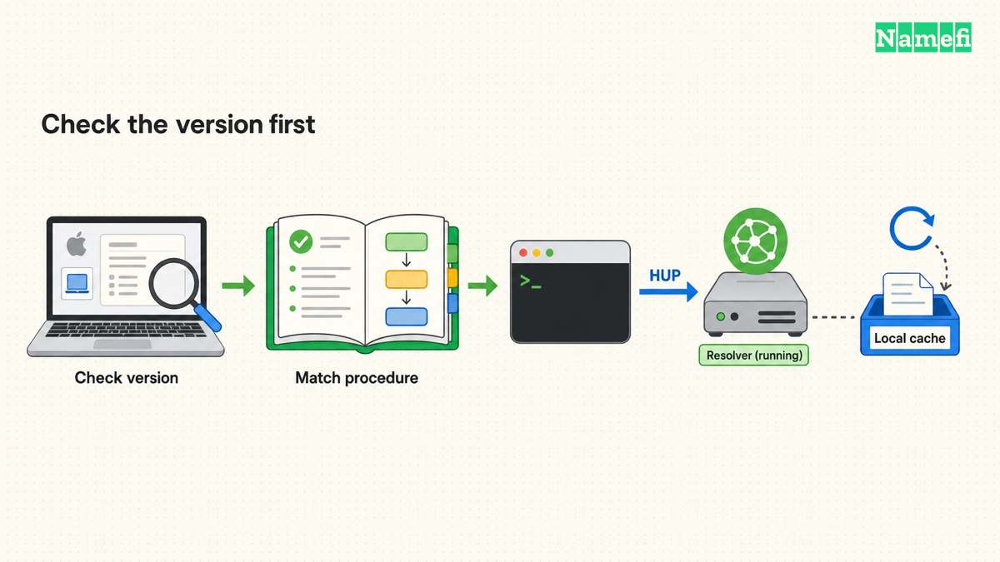
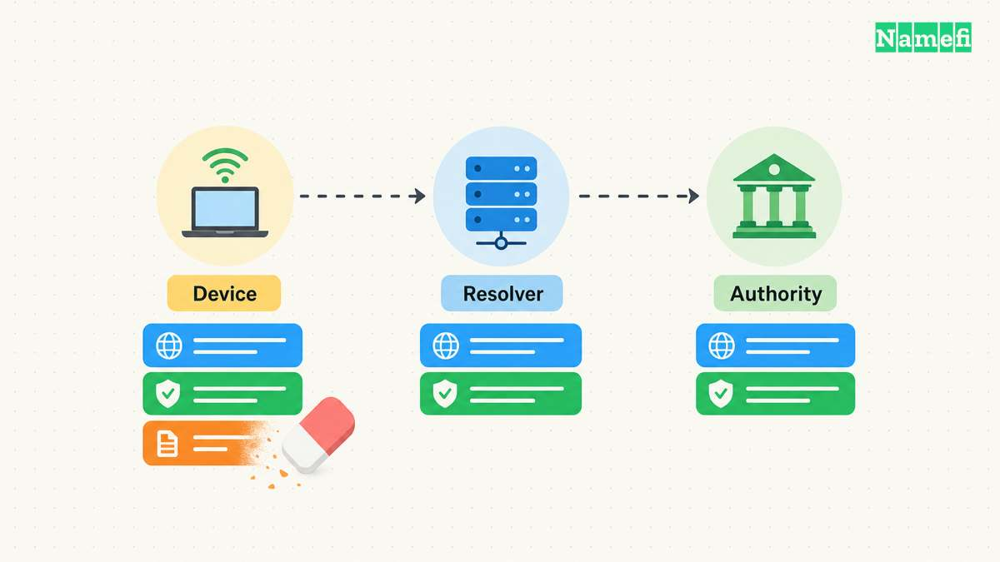

**For macOS Sonoma 14 and newer, UCSF's current IT procedure uses `sudo killall -HUP mDNSResponder`.** Check the installed version before running the command. Apple also publishes an archived command table, but Apple explicitly says that historical article no longer receives updates. [UCSF documents the modern procedure](#ucsf-documents-its-current-macos-cache-procedure). [Apple labels its version table as archived](#apple-documents-the-historical-command-boundaries).

A DNS flush refreshes local cached answers. A flush does not change a domain's published records or clear every upstream resolver. Use one documented operation, retry the original service, and investigate the remaining failure rather than repeating resets.

## The installed version determines which instructions apply

Open the Apple menu and choose **About This Mac**. Apple explains that this window shows the macOS name and version number. Record the full version, including any minor update, before choosing historical instructions. [Apple documents the version check](#apple-explains-how-to-identify-the-installed-version).

The minor version matters for Yosemite. Apple's archived table distinguishes OS X 10.10 through 10.10.3 from 10.10.4 and later. A table that says only “Yosemite” can hide that difference. [The archived Apple procedure records both ranges](#apple-documents-the-historical-command-boundaries).

Use the following source-specific reading aid:

| Installed system | Documented command | Scope of the evidence |
| --- | --- | --- |
| macOS Sonoma 14 and newer | `sudo killall -HUP mDNSResponder` | UCSF's current operational procedure |
| OS X 10.10.4 and later | `sudo killall -HUP mDNSResponder` | Apple's archived historical range |
| OS X 10.10 through 10.10.3 | `sudo discoveryutil mdnsflushcache` | Apple's archived historical range |
| OS X 10.9.5 and earlier in the Mavericks, Mountain Lion, and Lion section | `sudo killall -HUP mDNSResponder` | Apple's archived historical range |
| OS X 10.6 through 10.6.8 | `sudo dscacheutil -flushcache` | Apple's archived Snow Leopard range |

The table combines two explicitly identified documents. UCSF's current procedure is institutional guidance, rather than a universal Apple compatibility guarantee. Apple's phrase “and later” belongs to an archived document. Do not silently extend that historical wording to every future macOS release.

For a managed Mac, use the administrator's procedure for the installed release. If a release falls outside a verified procedure, ask for release-specific guidance before copying a privileged command from an unrelated version.



## Terminal runs the documented operation once

For a Mac covered by the current UCSF procedure:

1. Save the hostname and exact application error.
2. Open **Applications > Utilities > Terminal**.
3. Run the following command.

```bash
sudo killall -HUP mDNSResponder
```

4. Enter the administrator password when Terminal requests the password.
5. Retry the original hostname in the original application.

UCSF documents Terminal, the command, and the administrator-password prompt. [The procedure supplies those steps](#ucsf-documents-its-current-macos-cache-procedure). Do not add unrelated service resets to the command.

If Terminal reports a permission problem or cannot find the expected process, preserve the message. Check the installed release and the applicable procedure. Repeatedly trying commands for other releases does not establish which resolver path failed.

A spoken message or an added `echo` command only confirms that a shell reached that line. Do not treat an appended success message as independent proof that DNS resolution now works. The useful verification is the original application result.

Apple's archived article also describes restarting a Mac to update cached information. [Apple explains that alternative](#apple-documents-the-historical-command-boundaries). Save work before a restart, and coordinate any restart of a shared or managed computer.

After confirming that the documented procedure fits your macOS release, use [Namefi's DNS command generator](https://namefi.io/domain-tools/dns-commands) to copy the macOS cache-flush command. The page does not run the command or confirm a successful flush. Keep the version checks above as the prerequisite.

## Local cache clearing leaves upstream answers intact

DNS uses separate name servers and resolvers. A resolver can reuse a cached record until its lifetime expires. Negative answers also have defined cache lifetimes. [RFC 1034 defines these DNS roles](#the-dns-standard-separates-resolution-and-authority). [RFC 2308 explains negative caching](#the-dns-standard-gives-negative-answers-a-lifetime).

Imagine an administrator adds `portal.example.com` after an earlier lookup found no record. The hostname is a hypothetical example using a [reserved documentation domain](#the-ietf-reserves-example-domains). A local flush can remove a local negative answer while an upstream resolver still returns its cached response.

The same boundary applies to an old address. If the authoritative record remains wrong, the domain operator must correct that record. If an upstream resolver holds an older answer, a local flush does not directly replace that resolver's cache.

The [DNS propagation guide](/en/blog/ttl-and-dns-propagation/) explains how those observations differ. A browser that works after one flush needs no further reset. A browser that still fails needs a comparison with the intended records and resolver path.



## DNS settings provide a separate configuration check

Apple places current DNS settings under **System Settings > Network > network service > Details > DNS**. The page lists DNS servers and search domains. [Apple documents that settings path](#apple-documents-the-current-dns-settings-screen).

Inspect those settings when evidence suggests the Mac uses an unexpected resolver. Record the existing configuration before any approved change. A cache operation and a resolver-setting change perform different jobs.

An internal company name may depend on the approved VPN or organization resolver. As practical advice, preserve that approved path instead of substituting a public resolver during an unrelated troubleshooting step.

If only Chrome fails, check whether Chrome uses a custom Secure DNS provider. Google documents provider selection separately from operating-system DNS settings. [Chrome's desktop guidance explains the setting](#google-documents-browser-dns-provider-selection).

A useful support report names the macOS version, hostname, UTC test time, original error, command result, and post-flush behavior. Keep private organization names in an approved support channel. For Windows, use the separate [ipconfig flush procedure](/en/blog/flush-dns-cache/).

## Sources and further reading

### UCSF documents its current macOS cache procedure

[UCSF IT, macOS instructions](https://it.ucsf.edu/how-to/how-flush-dns-cache#:~:text=For%20macOS%20Sonoma). Fetched 2026-10-30.

### Apple documents the historical command boundaries

[Apple Support, archived Reset the DNS cache in OS X](https://support.apple.com/en-us/101481#:~:text=This%20article%20has%20been%20archived). Fetched 2026-10-30.

### Apple explains how to identify the installed version

[Apple Support, Find out which macOS your Mac is using](https://support.apple.com/en-us/109033#:~:text=About%20This%20Mac). Fetched 2026-10-30.

### The DNS standard separates resolution and authority

[IETF RFC 1034, sections 2.4 and 3.6](https://www.rfc-editor.org/rfc/rfc1034.html#section-2.4). Fetched 2026-10-30.

### The DNS standard gives negative answers a lifetime

[IETF RFC 2308, section 5](https://www.rfc-editor.org/rfc/rfc2308.html#section-5). Fetched 2026-10-30.

### The IETF reserves example domains

[IETF RFC 2606, section 3](https://www.rfc-editor.org/rfc/rfc2606.html#section-3). Fetched 2026-10-30.

### Apple documents the current DNS settings screen

[Apple Mac User Guide, Change DNS settings on Mac](https://support.apple.com/guide/mac-help/change-dns-settings-on-mac-mh14127/mac#:~:text=To%20change%20these%20settings). Fetched 2026-10-30.

### Google documents browser DNS provider selection

[Google Chrome Help, desktop Secure DNS](https://support.google.com/chrome/answer/10468685?hl=en&co=GENIE.Platform%3DDesktop#:~:text=Select%20your%20current%20service%20provider). Fetched 2026-10-30.
