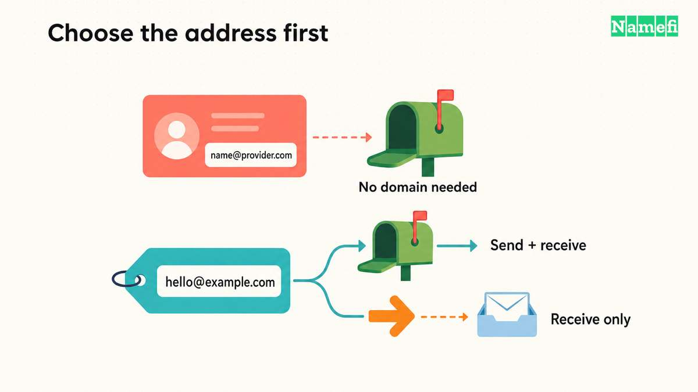
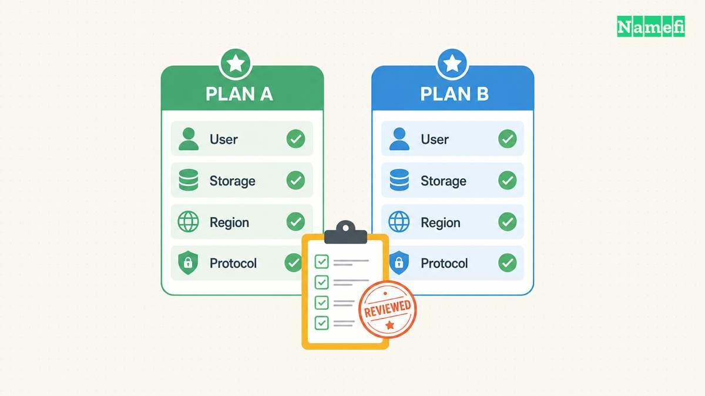
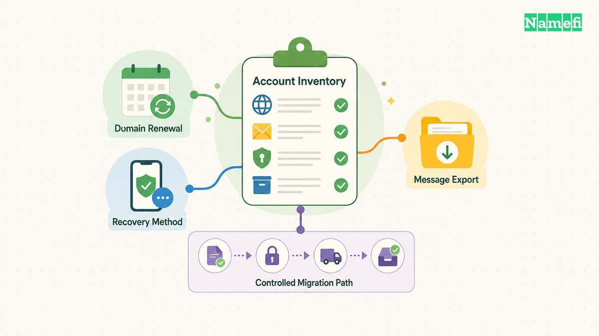

Yes, a free service can provide email under a domain you control, but the service and eligibility matter. Zoho lists a limited free custom-domain mailbox plan. Cloudflare documents free-plan incoming routing. [A mailbox](#zoho-lists-its-free-mailbox-limits) and [forwarding](#cloudflare-distinguishes-sending-from-routing) solve different tasks.

Free email service does not remove the domain's purchase and renewal commitment. It also does not establish that every sending, client-access, or team feature you need is included. Decide which email tasks must work before choosing an offer.

This guide focuses on custom-domain options. The [custom-domain email setup guide](/en/blog/set-up-email-with-your-own-domain/) covers configuration after you select a service.

## Decide whether you need a mailbox or an incoming address

Write down the actual workflow. A public contact address that forwards to an existing inbox needs a receiving route. A team member who must read, send, organize, and export business correspondence needs a broader service.

As practical buying advice, separate addresses from accounts. A business can use several public addresses while one person receives the messages. A team can also need separate access for each employee, even when the business publishes one shared contact address.

Use this comparison to identify the next question:

| Required workflow | Service to investigate | Important limitation to check |
| --- | --- | --- |
| Read and send from a custom-domain address | Hosted mailbox | User limits, client support, and sending terms |
| Receive at a domain and read elsewhere | Forwarding | Destination verification and reply identity |
| Give employees separate access | Managed user accounts | Included user count and administrator controls |
| Send application notifications | Transactional sending service | Recipient rules, authentication, and usage charges |
| Try a paid service temporarily | Trial | End date, downgrade terms, and export path |

The table describes requirements, rather than promising that one free product covers every row. Keep your must-have tasks visible while reviewing the signup page.

## Zoho offers a free plan with specific eligibility and client limits

Zoho's pricing page lists email hosting for one domain, up to five users, and 5 GB of mail storage per user. The free plan excludes IMAP, POP, and ActiveSync. Zoho says the offer is [available only in selected data centers](#zoho-lists-its-free-mailbox-limits).

Those conditions make the signup flow part of the evaluation. Confirm that the free option is actually available for the account and region you will use. Do not assume that another person's screenshot establishes your eligibility.

If your workflow depends on a desktop client, compare the client's connection requirements with the excluded protocols. Ask Zoho to clarify any uncertain access method before moving live mail.

As practical advice, test one account with noncritical messages first. Check reading, sending, attachments, account recovery, and any mobile workflow you need. Keep the result of each test in the service-selection notes.

Start with the [official Zoho Mail pricing page](https://www.zoho.com/mail/zohomail-pricing.html#:~:text=Forever%20Free%20Plan), then inspect the actual signup offer. Avoid using a paid trial as evidence that a feature belongs to the continuing free plan.

## Cloudflare routes incoming mail without creating a conventional mailbox workflow

Cloudflare's current documentation describes Email Service with separate sending and routing functions. Email Routing can forward incoming messages to destination addresses or process messages with Workers. [Cloudflare lists routing on Free and Paid plans](#cloudflare-distinguishes-sending-from-routing).

For a simple contact address, the relevant task is forwarding incoming mail to an existing inbox. Cloudflare says the domain must use Cloudflare DNS. The setup procedure also requires a [verified destination address](#cloudflare-documents-routing-setup-and-verification).

Follow the official [routing setup guide](https://developers.cloudflare.com/email-service/get-started/route-emails/#add-a-destination-address). Review the proposed DNS records before enabling routing. Do not replace an existing email provider's MX records without planning the mail migration.

Also test replies. Forwarding a message into another inbox does not, by itself, establish how that inbox will send from the custom-domain address. Identify the outbound service and authentication requirements separately.

Avoid the outdated blanket claim that Cloudflare has no sending capability. Current documentation describes transactional sending, including authenticated SMTP and APIs. Cloudflare distinguishes arbitrary-recipient sending from routing and verified-destination use. [Check the current plan conditions for the exact sending task](#cloudflare-distinguishes-sending-from-routing).

## A free address should have a tested outgoing identity

Send a test message to the custom-domain address from an external mailbox you control. Confirm that the intended destination receives the message. Then reply through the workflow you plan to use.

Inspect the reply's visible From address. Check whether the recipient sees the domain identity you intended. If the reply uses a provider address instead, identify whether that outcome meets your requirement.

As operating advice, keep incoming and outgoing tests separate. A successful receiving test does not show that a newsletter service, support tool, or application can send correctly.

Follow the selected sending provider's authentication instructions. Our [SPF explanation](/en/blog/txt-records-spf-dkim-verification/) explains why outgoing authorization differs from incoming delivery. Review DKIM and DMARC through the provider's current setup flow as well.

Do not delete unrelated TXT records while adding email authentication. Keep a record of the previous configuration and each consumer's purpose. The [DNS record guide](/en/blog/dns-record-types-guide/) explains the different record roles.

## Compare the continuing cost before printing the address

List the domain renewal commitment beside the free email plan. Add any paid feature required for your actual workflow. Treat an unknown amount as unknown until the provider supplies a current quote.

Ask what happens when the team adds another user or reaches a storage limit. Check whether an upgrade affects every account or only the account that needs the feature. Save the answer with the plan terms.

As practical advice, test export before storing irreplaceable correspondence. Identify how you would move messages and DNS records to another provider. A low-cost start becomes less useful if nobody understands the exit process.

Keep administrative recovery outside an untested dependency. Record who owns the email organization, domain account, and destination inbox. Review those records when an employee or contractor leaves.

Choose a free mailbox when the documented limits fit your work. Choose forwarding when incoming delivery to another inbox meets the requirement. In either case, verify the real signup offer and test the complete receiving-and-replying workflow before announcing the address.

## Sources and further reading

### Zoho lists its free mailbox limits

[Zoho lists its free mailbox limits](https://www.zoho.com/mail/zohomail-pricing.html#:~:text=Forever%20Free%20Plan). Checked 2026-10-30.

### Cloudflare distinguishes sending from routing

[Cloudflare distinguishes sending from routing](https://developers.cloudflare.com/email-routing/#:~:text=Arbitrary-recipient%20sending%20requires). Checked 2026-10-30.

### Cloudflare documents routing setup and verification

[Cloudflare documents routing setup and verification](https://developers.cloudflare.com/email-routing/get-started/enable-email-routing/#:~:text=Before%20you%20can%20create%20a%20routing%20rule). Checked 2026-10-30.
